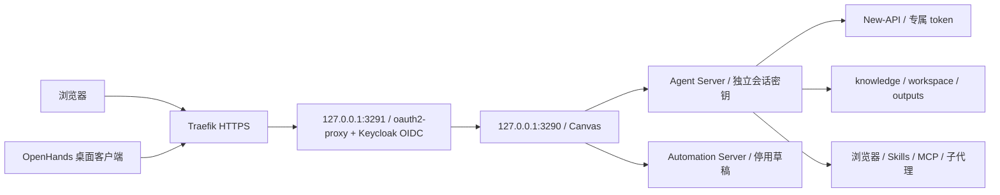

# NixOS 全栈 AI 基建与数字伴侣架构设计与运维实战指南

## 一、 宏观架构总览与 Life-OS 情感伴侣愿景

本系统基于 **NixOS Flakes** 现代化声明式基础设施与容器化编排，为自建数字生活基建（Life-OS）打造了一套完整的全栈 AI、知识工程与拟人化情感陪伴中枢。

系统贯彻**单一事实来源（Single Source of Truth）**、**100% 声明式开箱即用（Zero-Config Post-Deploy）**与**数据/状态严格持久化（Impermanence + 5GB Restic 严苛灾备）**三大工程原则：

1. **单一事实来源与零手动配置**：身份认证（Keycloak OIDC 与原生密码登录）、API 路由（New-API）、模型映射、工具注册（ContextForge + FastMCP）与反向代理（Traefik），在部署完成后无需任何人工点击网页 `/install`、复制粘贴 API Key 或修改配置，全部由声明式代码与幂等脚本全自动初始化。

   OpenHands 的公网访问是安全例外：模型配置和工具由初始化脚本播种，但浏览器或桌面客户端首次连接仍需输入独立的后端会话密钥，不能用 SOPS `password` 或模型 API Key 替代，详见第九节。

   Kilo Star 客户端插件和 New-API 的 Star 运维渠道则是持久化运行时配置例外，不由上述引导脚本生成，配置、验证与生效边界见 4.6 节。

2. **通用 Agent 与情感中枢正交解耦**：底层由模型网关接入模型矩阵；通用任务工作台由 OpenHands、可插拔 MCP 与用户管理的工作区/Skills 构成；Persona Engine 独立服务 QQ、微信与 Matrix 渠道。
3. **数字生活基建全链路感知（Life-OS Sync）**：AI 伴侣深度融合个人生活服务，不仅能闲聊，还能读取随手记（Memos）、考公刷题动态（Kaogong）、影音库更新（Jellyfin / MoviePilot）、智能家居传感器（Home Assistant）与全球分布式网络健康度（DN42 BGP / ATC CDN / VictoriaMetrics），成为真正生活在数字系统里的全知伴侣。
4. **遵循 Haumea/Rake 无 `default.nix` 递归收集规范**：整个 `services/ai/` 及其子目录（`gateway/`、`mcp/`、`openhands/`、`companion/`）严格**不使用 `default.nix`**。根据仓库 `lib/rake.nix` 的 Haumea 加载机制，目录中的模块通过 `.all` 递归展平属性。在主机配置中可导入 `nixosModules.services.ai.all`，再以模块选项显式启用所需服务。

---

### 1.1 模块目录规范与递归加载机制

```text
nixos/modules/services/ai/
├── gateway/
│   ├── new-api.nix             # New-API 聚合底座与模型矩阵 (nixosModules.services.ai.gateway.new-api)
│   └── cpa.nix                 # CPA 代理与逆向通道 (nixosModules.services.ai.gateway.cpa)
├── mcp/
│   ├── common.nix              # ContextForge 基础选项与持久化
│   ├── containers.nix          # ContextForge 容器拓扑与 Keycloak SSO 挂载
│   ├── db-init.nix             # 自动向 ContextForge 注册虚拟网关
│   ├── degoog-bridge.nix       # 隐私搜索与深度正文提取 FastMCP (5005 端口)
│   ├── lifeos-bridge.nix       # 个人生活基建 MCP 工具箱 (Memos, 考公, 影音, 智能家居, 监控) (5007 端口)
│   ├── traefik-proxy.nix       # ContextForge Traefik 反向代理
│   └── backup.nix              # MCP 备份配置
├── openhands/
│   ├── common.nix / containers.nix / bootstrap.nix / traefik-proxy.nix / backup.nix
│   ├── bootstrap.py             # 幂等对账模型档案、MCP、工作区与自动化草稿
│   └── skills/                  # 通用示例；用户可热插拔自己的 SKILL.md
└── companion/
    ├── common.nix              # 伴侣通用选项、端口、持久化与反向代理
    ├── persona-engine.nix      # 人设编译器、记忆中枢、出站清洗、主动关怀与告警 Webhook (5006 端口)
    ├── qq-astrbot.nix          # AstrBot + NapCat (OneBot v11) 与平滑自愈工具 heal-napcat-ws
    ├── wechat-ilink.nix        # 微信官方 iLink 长轮询与 24h 窗口智能保活
    ├── matrix-bot.nix          # Matrix 端到端加密 E2EE 伴侣通道
    └── backup.nix              # 5GB 极简灾备排除规则 (过滤群聊图片/音视频)
```

> **Haumea 导入语法示例**：
>
> ```nix
> # 在 fra0/default.nix 中整包导入：
> imports = nixosModules.services.ai.all;
>
> # 或在边缘节点/特定机器仅导入部分子系统：
> imports = nixosModules.services.ai.companion.all; # 仅伴侣系统
> imports = nixosModules.services.ai.gateway.all;   # 仅模型网关
> ```

---

### 1.2 系统架构全景拓扑图

```
                           [ 用户交互终端 (Client Interaction) ]
                                    |
          +-------------------------+-------------------------+
          |                         |                         |
          v (OneBot v11 WS)         v (HTTP Long-Poll)        v (Matrix E2EE)
    [ QQ 客户端 / 群聊 ]       [ 微信个人号 (免风控) ]      [ Matrix 加密房间 ]
          |                         |                         |
          v (TCP 6098)              v (HTTPS)                 v (TCP 3090)
+-------------------+     +-------------------+     +-------------------+
|     NapCatQQ      |     |  wechat-ilink     |     |   matrix-bot      |
|  (无头 NTQQ 协议)  |     | (24h窗口智能保活) |     |  (永不失联保底)   |
+-------------------+     +-------------------+     +-------------------+
          |                         |                         |
          v (WS 反向/正向 6098)      |                         |
+-------------------+               |                         |
|      AstrBot      |               |                         |
| (表情转译/多模态)  |               |                         |
|   (WebUI 6185)    |               |                         |
+-------------------+               |                         |
          |                         |                         |
          +-------------------------+-------------------------+
                                    |
                                    | 统一 HTTP/JSON 对话载荷 (POST /v1/companion/chat)
                                    v
+-------------------------------------------------------------------------------+
|                 AI 拟人情感编译器与记忆中枢 (Persona Engine :5006)             |
|                                                                               |
|  • 人设编译器：SillyTavern 卡 (PNG V2/V3 / JSON)、世界书、大肥鱼 Markdown、SOUL.md |
|  • 动态宏展开：{{char}}, {{user}}, {{time}}, {{date}}, {{weekday}}              |
|  • 世界书扫描：常驻词条 + 关键词动态正则触发注入 Prompt                         |
|  • 拟真出站管道：撕毁（（内心独白））草稿箱、拟人橡皮擦、多气泡延迟拆分发送   |
|  • 主动关怀调度：22.5h 微信保活续期、晨起唤醒、深夜催睡、服务器告警拟人化转述 |
|  • 会话记忆存储：/var/lib/ai-companion/memory/companion.db (SQLite/状态机)   |
+-------------------------------------------------------------------------------+
         |                                                       |
         | 调用模型生成 (POST /v1/chat/completions)               | 统一工具链挂载
         v                                                       v
+------------------------------------+   +--------------------------------------+
|       统一模型网关 (New-API :3280) |   |    IBM ContextForge MCP 总线 (:5002)  |
|                                    |   |                                      |
|  • companion-pro: step-5-preview,  |   |  • degoog-mcp (:5005): 隐私网页搜索  |
|    glm-5.3 (高智商细腻陪伴)        |   |  • lifeos-mcp (:5007): 生活基建工具:  |
|  • companion-flash: deepseek-v4.1  |   |    - memos_note: 随手记读写          |
|  • companion-audio: stepaudio-2.5  |   |    - kaogong_status: 考公刷题督学    |
|    (听写 ASR + 情绪语音条 TTS)     |   |    - movie_subscribe: 追剧点播       |
|  • companion-vision: qwen3-vl      |   |    - hass_sensor: 智能家居状态       |
|  • local-rp-model: arx8 算力协同   |   |    - infra_health: 集群与 BGP 监控   |
|  • 零配置固定令牌: internal-token   |   +--------------------------------------+
+------------------------------------+                      ^
         |                                                  |
         +--------------------------+-----------------------+
                                     |
                                     v
+-------------------------------------------------------------------------------+
| OpenHands Agent Workspace (127.0.0.1:3290) + Keycloak OIDC Ingress (:3291)    |
|                                                                             |
|  • 通用 workspace / knowledge / outputs / Skills 挂载与持久化                |
|  • New-API 专属 SOPS token，模型档案通过 API 幂等配置                         |
|  • Degoog MCP 与声明式外部 MCP；不承载任何垂直领域固定工作流                  |
|  • 入口仅由 Traefik 转发到 Keycloak OIDC 代理，保留独立后端会话密钥           |
+-------------------------------------------------------------------------------+
```

---

## 二、 全栈组件清单、端口与默认凭据总览

支持用户名和密码登录的入口统一使用**用户名：`i`**、**密码：SOPS `password`**。OpenHands 的后端会话密钥、模型提供商 API Key 与网页登录密码是不同凭据，不应混用：

| 组件名称           | 核心作用                                     | 宿主机/内部端口                | 对外公网域名                                     | 默认用户名 / 标识       | 默认密码 / 访问令牌             | 认证方式                                      |
| ------------------ | -------------------------------------------- | ------------------------------ | ------------------------------------------------ | ----------------------- | ------------------------------- | --------------------------------------------- |
| **AstrBot**        | QQ 机器人调度中枢、插件/多模态管理           | `6185`                         | `bot.dora.im`                                    | **`i`**                 | **SOPS `password`**             | PBKDF2-SHA256 哈希登录                        |
| **NapCatQQ**       | 无头 NTQQ 协议端 (OneBot v11)                | `6099` (WebUI)<br>`6098` (WS)  | `napcat.dora.im`                                 | -                       | **SOPS `password`**             | WebUI Token (SHA256 校验)                     |
| **New-API**        | 统一模型路由、配额与密钥网关                 | `3280`                         | `api.dora.im`                                    | **`i`**                 | **SOPS `password`**             | Bcrypt 哈希 / Keycloak SSO                    |
| **ContextForge**   | IBM 开源 MCP 聚合虚拟网关                    | `5002` (API)<br>`5003` (UI)    | `mcp.dora.im`                                    | **`i`** (`i@dora.im`)   | **SOPS `password`** + 复合规则  | Basic Auth / Keycloak SSO                     |
| **CPA**            | CLI-Proxy-API 逆向与商业 API 代理            | `8317`                         | `cpa.dora.im`                                    | -                       | **SOPS `password`**             | Management Secret Key                         |
| **OpenHands**      | 通用自主 Agent、浏览器、MCP 与 Skills 工作台 | `127.0.0.1:3290` → 容器 `8000` | `openhands.dora.im`；`chat.dora.im` 旧入口重定向 | Keycloak `users` Realm  | SOPS OIDC / 后端 / 模型独立密钥 | Traefik → oauth2-proxy OIDC + Session API Key |
| **Persona Engine** | 人设编译器、记忆中枢与出站清洗               | `5006`                         | 无 (纯内网回环，不暴露公网)                      | **`i`** (`defaultUser`) | 免密 / 内网受信调用             | RESTful API                                   |
| **Degoog MCP**     | 隐私搜索与网页正文提取桥接服务               | `5005`                         | 本地回环                                         | -                       | -                               | FastMCP SSE / OpenAPI                         |
| **Life-OS MCP**    | 个人生活基建 (Memos/考公/影音/监控)          | `5007`                         | 本地回环                                         | -                       | -                               | FastMCP SSE                                   |
| **Keycloak**       | 集中身份认证与 OIDC 单点登录                 | `3260`                         | `sso.dora.im`                                    | **`i`** (`i@dora.im`)   | **SOPS `password`**             | LDAP / PostgreSQL 统一凭据                    |
| **PostgreSQL**     | New-API、Keycloak 等基础数据库               | `5432`                         | 本地回环                                         | `postgres`              | 系统凭据 / Peer 认证            | 本地 Socket / Peer                            |
| **Redis**          | 各服务独立缓存与任务队列                     | `6379`                         | 本地回环                                         | -                       | -                               | 本地回环免密                                  |

---

### 2.1 本机 AI 服务的注册关闭策略

本节针对当前机器 **`fra0`**。注册关闭策略已写入仓库配置，**本次未部署、未重启服务，也未修改运行中的数据库**；需要后续单独部署才会生效。禁用的是用户自助注册和首次 OAuth/SSO 登录自动建号，不删除现有账号，也不禁用已有用户登录或声明式管理员播种。

| 服务                                                                        | 声明式策略                                                                                                                      | 登录与初始化边界                                                                                                                                                                                  |
| --------------------------------------------------------------------------- | ------------------------------------------------------------------------------------------------------------------------------- | ------------------------------------------------------------------------------------------------------------------------------------------------------------------------------------------------- |
| **New-API**                                                                 | `RegisterEnabled=false`、`PasswordRegisterEnabled=false`，由 `new-api-bootstrap` 幂等写入 `options` 表                          | 保留 `PasswordLoginEnabled=true` 和现有 OIDC 登录；只有密码注册开关不足以阻止 OAuth 自动建号。尚未绑定 OIDC 的现有用户应先用密码登录并绑定，不再通过首次 OIDC 登录创建另一个账号                  |
| **ContextForge**                                                            | `PUBLIC_REGISTRATION_ENABLED=false`、`SSO_AUTO_CREATE_USERS=false`                                                              | 保留 Keycloak SSO，仅允许符合既有 provider 绑定规则的已有用户登录；不额外开启跨 provider 自动关联。`SSO_PRESERVE_ADMIN_AUTH=true` 保留平台管理员原生认证，管理员 `i@dora.im` 由既有初始化机制提供 |
| **Keycloak `users` Realm**                                                  | 首次导入设置 `registrationAllowed=false`；启动前的 `keycloak-ldap-reconcile` 同时写入已有 Realm 的 `registration_allowed=false` | 不仅修改初始 Realm 文件，避免现存数据库配置被跳过；保留 LDAP 用户同步和管理员播种。此 Realm 被其他服务共用，其自助注册也一并关闭                                                                  |
| **OpenHands Agent Canvas**                                                  | Keycloak OIDC 代理保护 Web/API，独立会话密钥认证 Agent Server；无本地用户注册入口                                               | Keycloak `users` Realm 自助注册关闭；浏览器端还需独立后端会话密钥                                                                                                                                 |
| **AstrBot / NapCat / CPA**                                                  | 分别为预置管理员、WebUI Token、Management Secret Key，无开放用户注册系统                                                        | 保留现有认证，不通过关闭认证来实现所谓“禁注册”                                                                                                                                                    |
| **Persona Engine / Degoog / Degoog MCP Bridge / Life-OS MCP / Browserless** | 搜索、内部工具或执行器，无终端用户自助注册系统                                                                                  | 保留既有网络边界、内部令牌或服务认证；MCP 工具和模型渠道的“注册”属于服务配置，不在禁用范围                                                                                                        |
| **VS Code Web IDE**                                                         | 单用户 BasicAuth，无本地用户注册入口                                                                                            | 保留 `auth` middleware 和既有模型配置，不变更非 AI 业务注册策略                                                                                                                                   |

`fra0` 没有启用 LobeChat、Open WebUI / Ollama、LiteLLM、Perplexica 或 OpenClaw，不应为了关闭注册而启动它们，也不在本次修改中改变其他主机的服务配置。

New-API 的数据库选项由现有引导服务更新，运行进程按 `SYNC_FREQUENCY` 同步（默认约 60 秒）；后续部署时应等引导和同步完成再验收，不能仅看登录页是否隐藏注册按钮。管理员通过受控后台新增账号属于管理操作，不等于开放自助注册。以上策略不替代访问控制，也不会自动清理此前已注册的账号。

只求值、不部署的回归检查：

```bash
nix eval --offline --no-write-lock-file --raw .#checks.x86_64-linux.ai-authentication-test.result
```

检查覆盖 New-API、ContextForge、Keycloak Realm/既有 Realm 同步，以及 OpenHands Keycloak OIDC 客户端和独立 SOPS 密钥配置。静态求值不执行服务启动或线上登录；部署后仍需验证未认证请求被拒、Keycloak 登录成功以及既有用户访问正常。

---

## 三、 组件间协同交互与数据流向深度解析

整套系统通过清晰定义的协议在不同层级之间流转，主要涵盖以下五大核心数据流：

### 3.1 核心流程 1：QQ 用户消息全链路流转

```
[用户在 QQ 发送消息]
       │ (包含纯文字 / [Face:123] 表情 / 语音条 / 短视频)
       ▼
 [NapCatQQ (无头 NTQQ) :6098]
       │ 转化为 OneBot v11 JSON 事件流
       ▼ (WebSocket ws://127.0.0.1:6098)
 [AstrBot 核心调度中枢 :6185]
       │ 1. 入站翻译：将 [Face] 表情空消息补偿为 "[旺柴]" 文本占位
       │ 2. 身份打标：静默注入 [昵称(QQ号)] 与 [主人] 身份标签
       │ 3. 媒体抽取：语音转为 MP3，视频通过 ffmpeg 抽 16 帧拼图 + 60s 音频切片
       ▼ (HTTP POST http://127.0.0.1:5006/v1/companion/chat)
 [Persona Engine 情感中枢 :5006]
       │ 1. 会话记忆检索：从 /var/lib/ai-companion/memory/companion.db 读取该用户最近 10 轮历史
       │ 2. 宏变量替换：将 {{char}} 替换为角色名、{{user}} 替换为 "i"、展开当前日期时间与星期
       │ 3. 世界书扫描：按关键词与正则扫描，命中时注入背景设定 (Lore)
       │ 4. 组装 System Prompt 与完整上下文
       ▼ (HTTP POST http://127.0.0.1:3280/v1/chat/completions)
 [New-API 统一模型网关 :3280]
       │ 携带 Bearer sk-ai-internal-... 内部固定 Token
       │ 路由匹配：按 companion-pro 路由至 Step-5 / GLM-5.3，或按 local-rp-model 路由至 arx8
       ▼ (HTTP POST 上游商业 API 或 CPA :8317)
 [大语言模型完成推理]
       │ 返回原始回复文本 (可能包含内心独白与 AI 客服口癖)
       ▼
 [Persona Engine 拟真出站整形]
       │ 1. 草稿箱撕毁：正则剔除 （（内心独白草稿）） 与 <think> 思考链
       │ 2. 拟人橡皮擦：擦除 "作为一个AI助手" 等机械口吻
       │ 3. 拟人化多气泡拆分：切分为 2~4 个短句气泡，计算打字耗时 (len * 0.08s)
       │ 4. 写入 SQLite 持久化会话历史
       ▼ (HTTP JSON 回包: {"bubbles": [{"text": "...", "delay_seconds": 1.2}, ...]})
 [AstrBot 出站处理]
       │ 1. 表情还原：将 "[旺柴]" 还原为 QQ 原生 Face Segment
       │ 2. 语音合成：若处于语音模式，调用 stepaudio-2.5-tts（先行过滤表情符号）生成语音条
       ▼ (WebSocket 发送消息调用)
 [NapCatQQ 推送消息]
       │ 模拟真人打字延迟依次逐条发出
       ▼
[QQ 客户端收到拟人多气泡短消息]
```

---

### 3.2 核心流程 2：微信官方 iLink 长轮询与 24h 窗口智能保活

```
[用户在微信向机器人发消息]
       │
       ▼
 [腾讯官方 iLink 云端网关 (ilinkai.weixin.qq.com)]
       │ HTTP 长轮询抓取 (get_updates)
       ▼
 [wechat-ilink 守护进程]
       │ 1. 提取消息正文与 context_token
       │ 2. 刷新保活时间戳：(user_id, context_token, expires_at = now + 24h)
       │    记录在 /var/lib/ai-companion/wechat/ilink_auth.json
       ▼ (HTTP POST http://127.0.0.1:5006/v1/companion/chat)
 [Persona Engine 情感中枢]
       │ (同流程 1，完成记忆加载、宏替换、大模型推理与出站气泡拆分)
       ▼
 [wechat-ilink 发送回包]
       │ 携带上一步缓存的 context_token，调用 send_message 接口分气泡发送
       ▼
 [用户微信收到回复]

【主动关怀与 22.5h 续期定时器】
  wechat-ilink 后台调度器每 5 分钟轮询一次：
  ├─ [距上次互动达到 22 小时] ──> 触发自然日常话题（结合 Memos 动态）发送给微信，
  │                               吸引主人回复以刷新 24h 窗口；
  ├─ [23:30 深夜] ─────────────> 结合 Home Assistant 传感器，若发现书房灯亮着，
  │                               主动发送傲娇催睡消息；
  └─ [超时超过 24 小时] ─────────> context_token 失效，主动问候自动无缝降级路由至 QQ 发送。
```

---

### 3.3 核心流程 3：Life-OS 个人数字基建工具调用流

```
[OpenHands 或其他 MCP 客户端需要使用工具]
       │
       ▼
 [IBM ContextForge MCP 总线 :5002]
       │
       ├──> [degoog-mcp :5005] ─────────> 本地 Degoog 聚合搜索引擎 (执行联网搜索与网页正文提取)
       │
       └──> [lifeos-mcp :5007]
              │
              ├──> memos_create_note ────> Memos 数据库/API (随口保存灵感备忘)
              ├──> kaogong_daily_status ─> 考公数据库 (获取行测/申论每日刷题指标与错题)
              ├──> moviepilot_subscribe ─> MoviePilot 服务 (聊天直接点播电影/番剧)
              ├──> jellyfin_recent ──────> Jellyfin 媒体库 (查询最近入库的影视)
              ├──> hass_get_state ───────> Home Assistant (读取环境光照、人体存在传感器)
              └──> infra_cluster_health ─> VictoriaMetrics (读取 DN42 BGP 与服务器探活指标)
```

---

### 3.4 核心流程 4：统一单点登录 (SSO) 与鉴权流

```
[已有用户浏览器访问 OpenHands / New-API / ContextForge]
       │ 选择服务提供的 Keycloak 登录
       ▼
 [Traefik 反向代理 :443]
       │ 路由至 Keycloak OIDC 端点 (https://sso.dora.im)
       ▼
 [Keycloak :3260]
       │ 验证凭据：用户名 "i"，密码来自 SOPS password
       │ 对接 OpenLDAP 用户库 (uid=i,ou=people,dc=dora.im)
       ▼
 [签发 JWT ID Token 与 Access Token]
       │ 重定向回调至对应服务 (Redirect URI)
       ▼
[OIDC 代理校验身份；OpenHands 另校验独立 Session API Key]
```

OpenHands 入口经 oauth2-proxy 使用 Keycloak OIDC，不向公网裸露本地服务；Keycloak `users` Realm 关闭自助注册。Session API Key、OIDC 客户端密钥、OAuth Cookie 密钥与模型网关 token 相互独立，均由 SOPS 管理。

---

### 3.5 核心流程 5：基础设施告警拟人化转述流

```
[服务器发生异常：如某一节点 BGP 会话中断或磁盘高水位]
       │
       ▼
 [Prometheus / Alertmanager / VictoriaMetrics]
       │ 触发 Webhook
       ▼
 [Persona Engine :5006 (/api/v1/system-alert)]
       │ 1. 提取告警核心内容 (节点名、故障严重程度、错误日志)
       │ 2. 组装专属提示词："请用你的性格语气，第一时间将以下故障汇报给主人，不要变成无聊客服！"
       │ 3. 调用 New-API 生成生动关切的通知文本
       ▼
 [分发通道]
       ├──> 微信 (wechat-ilink)：若在 24h 窗口内，直接私聊推送
       └──> QQ (AstrBot/NapCat)：向主人 QQ 私聊推送或窗口戳一戳提醒
```

---

## 四、 部署过程中的真实故障排错与代码实现剖析

在实际部署与服务编排中，遇到了多项由上游协议断层、数据库 Schema 演进和网络时序引发的问题。以下为具体排错原因与针对性解决方案：

### 4.1 Dify 到 OpenHands 的服务端迁移边界

fra0 已将 Dify API、Web、Worker、Sandbox、Plugin Daemon、专属 Redis/Qdrant、初始化单元、Traefik 路由和 Dify 专用 Keycloak 客户端从声明式配置移除。通用工作台由 OpenHands 提供，模型经 New-API、工具经可插拔 MCP、资料与产物经通用持久化目录管理，不迁移领域专用工作流。

旧宿主机数据**不会**由 NixOS 激活或本次代码变更删除。下次部署后，管理员需先确认备份与保留要求，再人工审阅并清理 `/var/lib/dify`、Dify PostgreSQL 数据库/角色、`/var/lib/private/qdrant`、`/var/lib/redis-dify` 和相关容器存储；不得把这些路径直接放入无确认的删除脚本。SOPS `dify/secret_key` 已从代码引用移除，可由密钥维护者在确认无其他消费者后通过 SOPS 单独删除。

OpenHands 通用目录为 `/var/lib/openhands/{state,knowledge,workspace,skills,outputs}`。本目录只预装通用调研与任务管理 SKILL.md 示例；垂直能力由用户后续添加技能文件，不内置任何行业工作流。

此次不执行服务切换、数据库清理、DNS apply 或真实浏览器验收。切换前应确认 New-API 中已创建限额/模型受限的专属 token，并在 SOPS 增加后文列出的后端会话密钥、Keycloak OIDC、OAuth Cookie 和模型网关密钥。

---

### 4.3 AstrBot 监听端口冲突与 Traefik 代理 502

- **故障现象**：访问 `https://bot.dora.im` 出现 HTTP 502 Bad Gateway，且本地 `curl http://127.0.0.1:6180` 报错拒绝连接。
- **原因分析**：AstrBot 4.29+ 容器官方默认将 WebUI 仪表盘硬编码监听在 **6185** 端口，而我们在 `ports.nix` 中原登记为 6180。容器启动日志明确打印：
  ```text
  Starting WebUI at http://0.0.0.0:6185
  ```
- **代码实现修复（`nixos/modules/base/module/misc/ports.nix`）**：
  将 `config.ports.astrbot` 修正为 **6185**，Traefik 代理目标同步调整为 6185，网络流量正常打通。

---

### 4.4 看门狗导致 NapCat 二维码频繁被打断重刷

- **故障现象**：NapCat 容器每隔几分钟自动重启，控制台二维码刚出来就被打断重刷，无法完成手机扫码授权。
- **原因分析**：原看门狗定时器每 5 分钟检查本地端口 6098（OneBot WS）是否处于 Listening 状态。但在首次部署尚未扫码登录时，NTQQ 不会拉起 WebSocket 服务端，导致看门狗误判服务死锁并强制重启 NapCat，从而形成了“未扫码 -> 杀容器 -> 生成新二维码 -> 再次杀容器”的恶性死循环。
- **代码实现修复（`nixos/modules/services/ai/companion/qq-astrbot.nix`）**：
  删除激进的重启看门狗，改为编写 `heal-napcat-ws` CLI 管理脚本。该脚本通过调用 NapCat WebUI 原生 HTTP API（`/api/OB11Config/GetConfig` 与 `SetConfig`），对 WebSocket 连接进行平滑重新触发，**不重启容器、不退登 QQ、不破坏登录态**。

---

### 4.5 ContextForge 启动瞬间 Keycloak 502 探测失败

- **故障现象**：ContextForge 启动日志中报错：
  ```text
  Failed to discover Keycloak endpoints from https://sso.dora.im/realms/users/.well-known/openid-configuration: Server error '502 Bad Gateway'
  ```
- **原因分析**：在 systemd 服务拓扑中，`podman-contextforge.service` 缺乏对 `keycloak.service` 的显式依赖。在机器开机或配置重载瞬间，ContextForge 立即向 Traefik 发起 OIDC Well-Known 抓取，而此时 Keycloak 正在进行 Quarkus 引导，导致首次抓取命中 502。
- **代码实现修复（`nixos/modules/services/ai/mcp/containers.nix`）**：
  在 `systemd.services.podman-contextforge` 中显式添加 `after = [ "keycloak.service" ]` 与 `wants = [ "keycloak.service" ]`，确保 Keycloak 处于 Ready 状态后再拉起 ContextForge。

---

### 4.6 Kilo Star 供应商模拟 Codex 客户端

本节记录 **2026-11-18** 核对的 Kilo 后端 `7.8.27`、官方 Codex `0.167.1` 和 `fra0` 上 New-API `v1.0.0-rc.51` 的配置与验收。目标是让 Kilo 向 Star 发送与 Codex 标识一致的请求，并修正真实模型 ID，而不是实现另一套 Codex 代理或修改客户端源码。

这里的“模拟”限于请求协议、HTTP 标识和模型映射；Kilo 仍使用自己的提示词、工具与 SDK，**不复制 Codex 的完整请求行为或 TLS ClientHello 指纹**。成功覆盖请求头不等于所有模型均可用，也不保证能通过上游未来增加的校验。Star 是受编程客户端和使用规则约束的上游，不能把此配置理解为允许普通闲聊或绕过服务规则。

#### 4.6.1 配置位置与协议选择

客户端配置位于 `~/.config/kilo/kilo.jsonc`，插件位于 `~/.config/kilo/plugin/star-codex.js`。`home-manager/modules/tippy/config.nix` 持久化整个 `.config/kilo` 目录，但**没有在 Nix 模块中生成这一供应商配置**；此处是已持久化的客户端运行时设置，不应另建重复的系统服务。

以下只是需要合并到现有配置中的相关片段，不能用来覆盖其他供应商、模型、权限或 MCP 设置。API Key 继续由 Kilo 的既有认证机制管理，不写入此 JSON、文档或 Nix Store：

```json
{
  "$schema": "https://app.kilo.ai/config.json",
  "plugin": ["file:///home/tippy/.config/kilo/plugin/star-codex.js"],
  "provider": {
    "star": {
      "name": "Star",
      "npm": "@ai-sdk/openai",
      "options": {
        "baseURL": "https://api.131479.xyz/v1",
        "headers": {
          "User-Agent": "codex_cli_rs/0.167.1 (NixOS 26.11.0; x86_64) linux",
          "originator": "codex_cli_rs",
          "Accept": "text/event-stream"
        }
      },
      "models": {
        "deepseek-v4.1-flash": {
          "id": "deepseek-v4.1-flash-1017",
          "name": "deepseek-v4.1-flash",
          "reasoning": true
        },
        "glm-5.3": {
          "id": "z-ai/glm-5.3",
          "name": "glm-5.3",
          "reasoning": true
        }
      }
    }
  }
}
```

- 在本轮 Kilo 版本中，`@ai-sdk/openai` 使这一自定义供应商使用 `/v1/responses`；原来的 `@ai-sdk/openai-compatible` 使用 `/v1/chat/completions`。不要仅根据库名判断未来版本的行为，应核对实际请求 URL。
- `codex_cli_rs` 是这里模拟的 Codex CLI 标识；示例版本和系统字符串来自当时核对的客户端，不能盲目套用任意版本号。官方 `codex exec` 的默认标识可能与交互式 CLI 不同，对照测试应记录实际发送的标识。
- 模型键 `deepseek-v4.1-flash` 是 Kilo 菜单和命令使用的逻辑 ID；`id` 才是发送给上游的真实 ID。本轮 Star 的 `/v1/models` 发布了 `deepseek-v4.1-flash-1017` 和 `z-ai/glm-5.3`，却没有对应的两个裸名称，因此必须显式映射。
- `/v1/models` 仅说明当前发布的模型名称，不证明模型池健康。目录和客户端版本变化后，应重新核对，不能把历史快照当作永久可用清单。

#### 4.6.2 为什么必须覆盖最终请求头

仅在 `provider.star.options.headers` 中配置 `User-Agent` 不够：Kilo 构造每次请求时会写入自己的标识，SDK 还会追加 `ai-sdk/provider-utils/... runtime/bun/...`。本地捕获曾看到实际发送的是 `Kilo-Code/7.8.27 ...`，而不是供应商配置中的旧 Codex 标识；`HTTP-Referer` 和 `X-Title` 也会声明 Kilo。

因此使用 Kilo 支持的插件 `config` 钩子，为 **`star` 单一供应商** 设置最终 `options.fetch`。插件在 SDK 已完成请求构造后统一标识，保留原有认证、请求体、方法和取消信号，不增加代理进程、轮询或重试逻辑：

```javascript
export const StarCodex = async () => ({
  async config(config) {
    const options = config.provider?.star?.options;
    if (!options?.headers?.["User-Agent"] || !options.headers.originator)
      return;

    const send = options.fetch ?? globalThis.fetch;
    // Kilo overrides provider headers and the SDK appends its own User-Agent.
    options.fetch = (input, init) => {
      const headers = new Headers(
        init?.headers ?? (input instanceof Request ? input.headers : undefined),
      );
      headers.set("User-Agent", options.headers["User-Agent"]);
      headers.set("originator", options.headers.originator);
      headers.set("Accept", "text/event-stream");
      headers.delete("X-Title");
      headers.delete("HTTP-Referer");
      return send(input, { ...init, headers });
    };
  },
});
```

显式的 `plugin` 文件 URL 用于确保加载入口明确；迁移用户或目录时需同步更新路径。添加或修改插件后，**已有 Kilo 后台应重启，或重载 VS Code 窗口**，不能假定已缓存的插件实例会热加载。`--pure` 模式会跳过插件，不适合验收这一模拟方式。

本地检查请求头时应使用隔离配置或显式的测试 Key，只保留白名单头和测试正文，不能记录真实 `Authorization`。如果最终头已一致但仍有 `client_not_allowed`，需要继续对照官方客户端的实际请求，不能未经证据就认定是 TLS，也不能宣称仅靠此插件能解决所有指纹校验。

#### 4.6.3 New-API 网关侧的模拟与优先级

另一条调用路径是 Kilo 的 `api` 供应商经 `https://api.dora.im/v1`，由 `fra0` 的 New-API 转发到 Star。系统部署由 `nixos/modules/services/ai/gateway/new-api.nix` 管理，端口登记为 `3280`；本轮 Star 运维渠道为 **ID `5`、名称 `星茶会`**，其运行时配置保存在 New-API 数据库中。迁移或重建数据库后必须重新确认 ID，不能假定其他实例的渠道 `5` 仍是 Star。

Star 使用普通 OpenAI/API Key 渠道类型 `1`。**不能只为了模拟客户端就改成 Codex OAuth 类型 `57`**，后者要求另一种订阅账号认证数据，不适用于现有 Star API Key。

通过已有管理会话使用网页后台或原生 `PUT /api/channel/` 更新。以下是本轮目标字段的 API 示例；`header_override` 和 `param_override` 是编码了 JSON 对象的字符串。更新前应读取、备份并合并现有值，仅替换相关标识，保留其他自定义字段，且不提交 `key`：

```json
{
  "id": 5,
  "header_override": "{\"User-Agent\":\"codex_cli_rs/0.167.1 (NixOS 26.11.0; x86_64) linux\",\"originator\":\"codex_cli_rs\",\"Accept\":\"text/event-stream\"}",
  "param_override": "{\"store\":false}",
  "priority": 20
}
```

- 移除旧的 OpenCode/Kilo `X-Title`、`HTTP-Referer` 标识覆盖，不配置 `*` 通配请求头透传，避免重新带入相互矛盾的客户端元数据；正常上游认证仍由渠道自身提供。
- 本轮优先级由 `0` 提高到 `20`，没有更改分组、令牌、角色或其他渠道。原配置和路由字段分别备份为 `fra0:/var/lib/new-api/star-channel-5-before.*.json` 与 `star-channel-5-routing-before.*.json`，应保留为受控恢复资料。
- 不能仅用 SQL 修改 `channels.priority`：实际选择还依赖 `abilities.priority` 和进程缓存。原生更新接口会重建渠道能力、刷新缓存并同步渠道变更；本轮确认两条 DeepSeek 名称的能力记录均启用且优先级为 `20`。
- 网关模型清单同时保留 `deepseek-v4.1-flash` 和 `deepseek-v4.1-flash-1017`，并合并模型映射 `{"deepseek-v4.1-flash":"deepseek-v4.1-flash-1017"}`。渠道选择先匹配请求模型，再应用映射，因此只加 `model_mapping` 而不公布友好名称仍可能无法选择 Star。
- 保留 Kilo `api` 供应商原有的友好模型名，由网关完成上述映射；不把它永久改成仅 Star 使用的原始 ID，避免丢失其他渠道对友好名称的回退能力。

管理认证必须经现有受控会话、运行时秘密或安全注入完成，不把密码或 Key 放到命令行、日志、文档或 Nix Store，不关闭认证或 TLS 校验。需要远程管理时使用既有 SSH 入口，例如 `/run/current-system/sw/bin/ssh fra0`，也可按已有配置先连接 `sjc0` 再连接 `fra0`；连接失败不是修改全局路由或防火墙的理由。

#### 4.6.4 编程任务验收与验证记录

Star 上游禁止问候类探测，**不能用“你好”或普通闲聊作为连通测试**。固定标题可以避免额外的自动标题生成请求；使用短小的真实编程任务，要求不调用工具、不创建文件。下例使用本轮 VS Code 扩展自带的后端，扩展升级后需确认实际路径；如果当前 `kilo` 命令已指向同一后端，也可直接使用该命令：

```bash
KILO=/home/tippy/.vscode/extensions/kilocode.kilo-code-7.8.27-linux-x64/bin/kilo
PROMPT='Implement a Python 3 function is_even(n: int) -> bool. Return only Python code. Do not call tools or create files.'

KILO_DISABLE_PROJECT_CONFIG=1 "$KILO" run --dir /tmp \
  --title "Star direct coding acceptance" \
  --model star/deepseek-v4.1-flash --format json "$PROMPT"

KILO_DISABLE_PROJECT_CONFIG=1 "$KILO" run --dir /tmp \
  --title "Star gateway coding acceptance" \
  --model api/deepseek-v4.1-flash --format json "$PROMPT"
```

网关返回成功不自动证明使用了 Star。可在管理员授权下使用 New-API 的原生单渠道锁定机制禁止降级，或检查请求日志的 `channel_id`；测试认证只在受控进程内注入，不打印令牌。本轮先锁定渠道 `5` 测试，再验证普通别名调用，消费日志 `12367`、`12377` 均记录渠道 `5`。

| 核对项                        | 2026-11-18 的结果                                                                                   | 验证边界                                                |
| ----------------------------- | --------------------------------------------------------------------------------------------------- | ------------------------------------------------------- |
| Kilo 请求头及插件作用域       | 本地测试确认 Star 最终标识已覆盖，其他供应商不受影响                                                | 匿名本地端点仅验证发送方式，不证明上游接受              |
| DeepSeek 正确 ID 与持久化插件 | Star 直连、网关锁定和普通别名调用均生成 `is_even` 函数                                              | 使用真实编程请求，无问候或工具调用                      |
| 生成代码                      | 返回 `n % 2 == 0`，正数、负数、零共 7 个用例通过                                                    | 不等于验收所有模型或所有代理工具                        |
| GLM 普通版映射                | 根据同一 Star 凭据获取的 `/v1/models` 核对为 `z-ai/glm-5.3`                                         | 本轮没有单独做 GLM 生成验收                             |
| GPT Luna 模型                 | `gpt-6-luna` 当时返回无可用渠道；`gpt-5.6-luna` 返回 `503`，官方 Codex 使用相同凭据也返回同类 `503` | 不能把该时段的上游失败归咎于 Kilo，也不能承诺永久不可用 |
| Step 3.7                      | 历史出现 `auto` 组无可用渠道，后续 Responses、Chat Completions 和普通网关调用均成功生成代码         | 当前不能复现历史错误，没有为此切换生产协议或修改分组    |

#### 4.6.5 排错时区分客户端、网关与上游

| 现象                                           | 应先确认的事实                                                     | 不应采取的结论或操作                                                                     |
| ---------------------------------------------- | ------------------------------------------------------------------ | ---------------------------------------------------------------------------------------- |
| `403 client_not_allowed`，声明身份与指纹不一致 | 实际最终头、插件是否加载、请求协议及官方客户端对照结果             | 配置里写了 `User-Agent` 不代表它已发送；不能直接断言 TLS 是根因                          |
| Kilo 本地 `Model not found: star/...`          | 菜单逻辑 ID 与 `models.<key>.id` 的区别                            | 不把逻辑 ID 缺失当作远端故障；CLI 使用友好名称而不是盲目使用原始 ID                      |
| `free/auto` 组下模型无可用渠道                 | 请求 URL、响应头、真实模型 ID，以及直连 Star 是否返回同样错误      | Star 上游的分组信息可能被网关原样转发，不能据此修改 `api.dora.im` 的分组、令牌或访问范围 |
| 有效模型仍返回 `503`                           | 相同凭据、相同模型、真实编程提示词的官方客户端结果和当时模型池状态 | 不靠重启本地服务、更换分组或增加无限重试解决上游临时不可用                               |
| 网关生成成功                                   | 实际请求日志的渠道 ID、别名匹配和原生能力优先级                    | 不能把降级到其他渠道的成功算作 Star 验收通过                                             |

本轮直连 Star 响应包含 `x-new-api-version: v0.0.0`，本地 New-API 为 `v1.0.0-rc.51`；这些只是当时的定位线索，不是永久身份凭证。网关只管理自己的渠道与访问范围，不需要获知或指导 Star 的上游分组。发布目录里存在模型、一次请求成功或当前无法复现错误，都不能保证上游以后一直有可用节点。

版本对应的实现参考：[Kilo 请求构造](https://github.com/Kilo-Org/kilocode/blob/v7.8.27/packages/opencode/src/session/llm/request.ts)、[Kilo 插件加载](https://github.com/Kilo-Org/kilocode/blob/v7.8.27/packages/opencode/src/plugin/index.ts)、[Codex 默认客户端标识](https://github.com/openai/codex/blob/rust-v0.167.1/codex-rs/login/src/auth/default_client.rs)、[New-API 渠道字段与能力更新](https://github.com/QuantumNous/new-api/blob/v1.0.0-rc.51/model/channel.go)。

---

## 五、 5GB Restic 严苛备份与持久化防爆设计

针对云服务器 5GB 远程冷备存储配额，在 `nixos/modules/services/ai/companion/backup.nix` 中设计了精细的排除策略：

```nix
services.restic.backups.borgbase = {
  paths = lib.mkAfter [
    "${cfg.dataDir}/personas"
    "${cfg.dataDir}/memory"
    "${cfg.wechat.dataDir}"
    "${cfg.matrix.dataDir}"
    "${cfg.qq.dataDir}/napcat/config"
    "${cfg.qq.dataDir}/astrbot/data/cmd_config.json"
    "${cfg.qq.dataDir}/astrbot/data/data_v4.db"
  ];
  exclude = lib.mkAfter [
    "**/napcat/data/**/ChatMsg/**"
    "**/napcat/data/**/Audio/**"
    "**/napcat/data/**/Video/**"
    "**/napcat/data/**/Pic/**"
    "**/napcat/data/**/OriPic/**"
    "**/napcat/data/**/Group/**"
    "**/napcat/data/**/Crashpad/**"
    "**/napcat/logs/**"
    "${cfg.qq.dataDir}/astrbot/data/logs/**"
    "${cfg.qq.dataDir}/astrbot/data/temp/**"
    "${cfg.qq.dataDir}/astrbot/data/attachments/**"
    "${cfg.qq.dataDir}/astrbot/data/site-packages/**"
    "**/cache/**"
    "**/temp/**"
    "**/__pycache__/**"
  ];
};
```

- **防爆效果**：
  - NapCat 在大型活跃群聊中运行数周会积累数 GB 的高清图片与短视频（存放在 `ChatMsg`、`Audio`、`Video`、`Pic`），这些属于易失性展示数据，排除后**备份体积从 3GB+ 直接降低至 35MB 左右**。
  - 灾备恢复时，只需 `restic restore` 恢复核心凭据与 SQLite 数据库，NapCat 即可免扫码秒级上线。

---

## 六、 整套系统配置与操作维护手册（用户必读）

当你需要完整拉起或重新配置这套 AI 陪伴与基建系统时，请按以下顺序执行：

### 6.1 第一步：检查密钥与 SOPS 主密码

确认你的 `secrets/common.yaml` 已包含全局主密码 `password`（所有组件均会自动以该密码作为统一凭据）：

```bash
# 验证密钥可解密
sops -d secrets/common.yaml | grep -E '^password:'
```

---

### 6.2 第二步：推送 DNS 域名解析 (Terraform)

AI 相关域名分别在 `terraform/cdn.tf` 和 `terraform/cloudflare.tf` 中定义。OpenHands 使用 `cloudflare.tf` 的直连 CNAME，`openhands.dora.im` 指向 `fra0.dora.im`，`proxied = false`，不经过 ATC CDN 或 Cloudflare 代理：

```bash
cd terraform
terraform apply
```

_这会在 Cloudflare 上自动创建 `api`、`chat`、`mcp`、`persona`、`bot`、`napcat` 等三级域名 CNAME 解析，指向你的边缘网络并回源至 `fra0`。_

---

### 6.3 第三步：部署应用到主机 (NixOS)

在仓库根目录执行构建与切换：

```bash
# 针对 fra0 节点应用
sudo nixos-rebuild switch --flake .#fra0

# 检查所有服务单元是否全部正常
systemctl --failed
# 正常应输出: 0 loaded units listed.
```

---

### 6.4 第四步：登录 NapCat 接入 QQ 机器人（免输复杂 Token）

1. 浏览器打开 `https://napcat.dora.im/webui/`。
2. **输入 WebUI Token**：直接输入你的 **SOPS `password`** 即可进入控制台。
3. 界面显示 NTQQ 登录二维码，使用手机 QQ 扫描并确认授权。
4. 凭证将自动持久化保存在 `/var/lib/dafeiyu/napcat/data/` 中，后续重启系统或升级容器均可免扫码自动登录。

---

### 6.5 第五步：登录并配置 AstrBot 核心调度中枢

1. 浏览器打开 `https://bot.dora.im`。
2. **登录认证**：
   - 用户名：**`i`**
   - 密码：**SOPS `password`**
3. **配置大模型提供商（二选一）：**
   - **方案 A（深度拟人中枢：对接 Persona Engine，最推荐）**：
     - **Base URL**：`http://127.0.0.1:5006/v1`（指向 Persona Engine）
     - **API Key**：可随意填写任意字符串（例如 `internal-token`，Persona Engine 收到请求后会自动替换为本地有效内部令牌发给 New-API）
     - **模型名称**：填写你期望底层执行的模型，如 `companion-pro`、`gemini-3-flash` 或 `step-5-preview`
     - **注意**：在此模式下，**AstrBot 自身完全无需导入任何角色**，Prompt 保持默认即可！Persona Engine 会在每次请求时自动读取激活的角色卡与世界书动态注入。
   - **方案 B（极简直连：直通 New-API 网关）**：
     - **Base URL**：`http://127.0.0.1:3280/v1`（直通 New-API）
     - **API Key**：读取 `/var/lib/new-api/internal-token` 文件中的固定内部令牌
     - **模型名称**：填写 `companion-pro` 或 `gemini-3-flash`
     - **注意**：在此模式下，由 AstrBot 面板的「人设管理」负责维护提示词。
4. **配置协议平台连接（对接同机 NapCat）**：
   - 进入「配置」→「平台设置」：
     - 确保 OneBot v11 正向 WebSocket 地址填为 `ws://127.0.0.1:6098`，点击测试连接显示“已连接”。

---

### 6.6 第六步：人设导入与个性化角色切换指南

Persona Engine 提供了三种极其便捷的人设管理与切换方式：

- **方式 A：在 QQ 中直接聊天切换（最推荐，零门槛）**：
  - 我们已在 AstrBot 插件中内置了 `astrbot_plugin_persona` 插件，在 QQ 私聊或群聊中直接发指令：
    - **查看所有可用人设**：发送 `/persona` 或 `/persona list`，机器人会列出所有已导入的人设以及当前正在生效的人设（带 ⭐ 标记）；
    - **即刻切换人设**：发送 `/persona <人设名称>`（例如 `/persona 大肥鱼`），机器人会立刻回显确认，下一句回复就会无缝切换为该人格！
- **方式 B：本地 WebUI 图形控制台（可视化卡片与拖拽上传）**：
  - Persona Engine 内置了现代化的单页控制台，通过 SSH 端口转发访问：
    ```bash
    # 在本地终端执行端口转发
    ssh -L 5006:localhost:5006 root@fra0
    ```
  - 浏览器打开 `http://localhost:5006/` 即可看到：
    - **角色卡片网格**：直观展示每个人设的名称、简介与开场白，带“生效中”徽章；
    - **一键切换**：点击卡片底部的“切换为此人设”按钮，即刻热切换；
    - **拖拽上传区**：将从网上下载的酒馆 `.png` 角色卡或 `.json` 文件直接拖入页面，自动解析元数据并存盘激活！
- **方式 C：直接往服务器文件夹丢文件（底层热加载）**：
  - 将网上下好的 SillyTavern 角色卡 `.png` 原图、`.json` 或 Markdown 人格（如 `大肥鱼-人格.md`）直接放入：
    ```bash
    /var/lib/ai-companion/personas/
    ```
  - Persona Engine 会自动监控目录并热加载，下次对话时自动可用。

---

### 6.7 第七步：日常运维命令速查

- **NapCat QQ 连接平滑自愈（网络波动掉线时使用）**：
  ```bash
  heal-napcat-ws
  ```
  _通过 WebUI API 平滑重启 WebSocket 客户端链路，无需重启容器、不退登 QQ、无需扫码。_
- **查看各容器运行日志**：
  ```bash
  sudo podman logs -f napcat      # 查看 NTQQ 协议日志
  sudo podman logs -f astrbot     # 查看 AstrBot 调度与对话日志
  sudo podman logs -f new-api     # 查看模型路由与 Token 消耗日志
  ```
- **查看情感中枢与 MCP 日志**：
  ```bash
  journalctl -u ai-persona-engine.service -f
  journalctl -u degoog-mcp-bridge.service -f
  journalctl -u lifeos-mcp-bridge.service -f
  ```

---

## 七、 深度技术答疑与核心架构设计辨析

### 7.1 数据存储分布、统一数据库可行性与服务器极简迁移

#### 1. 各组件数据与配置到底存放在哪里？

- **已完全运行在统一 PostgreSQL 里的服务**：
  - **New-API**：数据库 `new_api`（存储渠道 Channels、访问令牌 Tokens、系统设置 Options、用户 Users）。
  - **Keycloak**：数据库 `keycloak`（存储 OIDC Clients、用户凭据、Realm 配置）。
  - **Memos**：数据库 `memos`（存储全部个人笔记与标签）。
- **基于本地文件存储的服务及其原因**：
  - **AstrBot**：配置文件 `/var/lib/dafeiyu/astrbot/data/cmd_config.json`，数据与对话历史存放在 SQLite `/var/lib/dafeiyu/astrbot/data/data_v4.db`。
    - _为什么不能存入 Postgres？_ 这是 AstrBot 上游开源项目的硬编码架构，内部采用 Python `peewee` ORM 强绑定了 SQLite 文件与 JSON，上游并未实现 PostgreSQL 适配器。
  - **NapCatQQ**：配置文件 `/var/lib/dafeiyu/napcat/config/`，登录凭证与 QQ 缓存存放在 `/var/lib/dafeiyu/napcat/data/`。
    - _为什么不能存入 Postgres？_ NapCat 底层运行的是真实的腾讯官方 Linux NTQQ 桌面客户端（基于 Electron / C++），腾讯客户端的设备秘钥（`device.json`）、Token 与本地消息缓存由 NTQQ 闭源核心硬编码存储在本地 LevelDB / SQLite 文件中，外部无法将其剥离至远程关系型数据库。
  - **CPA (CLI-Proxy-API)**：`/var/lib/cpa/config.yaml`（纯 YAML 配置文件）。

#### 2. “不存统一数据库，迁移服务器会不会每次都要手动配置很麻烦？”

**完全不会！因为 NixOS 声明式自动化已经替代了手动配置过程：**

- 传统运维之所以希望把配置全丢进数据库，是因为担心在新机器上重新部署时，需要进 WebUI 手动点几十个按钮（添加渠道、绑定 Token、新建用户、改密码、配反代）。
- 但在我们的架构中，**配置本身即代码（Configuration as Code）**：
  - New-API 的管理员 `i`、内部 Token、渠道模型矩阵由 `new-api-bootstrap.service` 自动写入；
  - CPA 配置文件由 `cpa-init-config.service` 自动从 SOPS 渲染；
  - NapCat 的 `webui.json` Token 与 AstrBot 的 `cmd_config.json` 账号密码由 `dafeiyu-setup-dirs` 自动生成；
- **终极极简迁移服务器指南（零手动配置）**：
  当你需要迁移到新服务器时，只需要两步：
  1. **迁数据库**：`pg_dumpall` 并在新机器 `psql` 导入所需服务数据库；
  2. **迁 QQ 登录态**：拷贝 `/var/lib/dafeiyu/napcat/data`（仅几百 KB 的设备秘钥，为了免去重新扫码）；
  3. 新机器拉取 Flakes 仓库，执行 `sudo nixos-rebuild switch` —— **整套系统的所有端口、配置、密钥、反代与后台账密全自动就绪，无需在网页上手动填任何一项参数！**

---

### 7.2 NapCat 是 QQ 官方的吗？会封号吗？避坑与防护建议

#### 1. NapCat 是官方的吗？

- **不是**。NapCatQQ 是一个由开源社区维护的开源项目。
- **但它运行的是官方二进制**：与老一代完全逆向 QQ 协议的机器人（如过去的 Go-CQHTTP、Mirai、ShamRock 等基于 Android/iPad 协议 Hook 的方案）不同，NapCat 容器内部运行的是**腾讯官方发布的真实 Linux NTQQ 客户端**，通过对 NTQQ 本地 IPC 进行轻量包装，将 QQ 消息转发为标准 OneBot v11 接口。
- **技术优势**：因为底层运行的是真正的 NTQQ，其握手协议包、加密算法（ECDH）、设备心跳特征与官方桌面 QQ **95% 以上一致**，是目前全网存活率最高、协议层最稳固的 QQ 个人号机器人方案。

#### 2. 会封号吗？

**任何非官方自动化行为都存在一定程度的风控与冻结风险。** 腾讯的风控主要由**行为特征**与**环境特征**触发，而非协议逆向特征。以下情况极易触发风控：

1. **异地登录（重点警惕）**：当前主机 `fra0` 位于德国法兰克福！如果使用一个平时在中国大陆手机登录的 QQ 小号，突然在境外 IP（德国）登录，极易触发异地登录保护或冻结。
2. **新号挂机**：刚注册不到一个月的新号权重极低，挂机器人很容易被要求人脸核验。
3. **高频刷屏与违规内容**：在大型公开群聊中高频发消息、发送外部可疑链接或敏感违规词汇。

#### 3. 生产环境避坑与防护建议

- **账号选择**：务必使用专用的“老号”（常用生活小号、实名过、有半年以上正常聊天记录），严禁使用生活/工作核心主号。
- **网络出口优化**：
  - 若可能，建议通过本仓库的 Tailscale / EasyTier / DN42 隧道，将 NapCat 容器的网络流量通过国内节点（如 `can0`、`xiy0`）或家宽路由出站，保持登录 IP 为国内常用地区；
  - 或将 QQ 机器人部署在亚太/国内节点，而核心大模型仍由 `fra0` 的 New-API 驱动。
- **频率限制**：在 AstrBot 中严格保持消息防抖与流控（默认配置 `time: 60, count: 30`），避免在群聊中连续高频触发。

---

### 7.3 Persona Engine 到底是干什么的？纯内网运行与安全辨析

#### 1. Persona Engine 的作用

它是整套系统的**“拟人认知中枢与出站修剪器”**：

- **全网主流人设卡解码**：专门负责解析 SillyTavern（酒馆）角色卡 V2/V3 中的 PNG 隐写 Base64 数据，提取性格、场景与对话示例；
- **世界书动态扫描（World Info）**：当对话中出现特定关键词时，动态触发长篇设定注入；
- **拟真去 AI 味**：物理撕毁模型生成的 `（（内心独白草稿箱））` 与 `<think>` 思考链标签，擦除“作为一个人工智能模型”等机械口癖；
- **多气泡延迟发送**：将原本一次性吐出的 500 字长文切分为 2~4 条短句，并计算拟真打字耗时依次返回；
- **跨端共享记忆**：统一为 QQ、微信（iLink）和 Matrix 提供同一套会话记忆。

#### 2. 为什么之前外网能访问？纯内网运行的安全性

- **外网暴露隐患**：此前由于在 Traefik 中配置了 `Host(persona.dora.im)` 反向代理，导致该端点暴露在公网，且其 API 为内网设计、**没有设置强密码认证**，存在未授权调用的安全隐患。
- **现已实施的整改**：
  - 彻底移除了 Traefik 反向代理规则，删除了 `cdn.tf` 与 `monitoring.nix` 中的解析；
  - **Persona Engine 现已严格绑定在宿主机本地回环 `127.0.0.1:5006`**；
  - 仅允许同机运行的 AstrBot、微信守护进程 `wechat-ilink` 和 `matrix-bot` 在本地内网调用，外网无法探测或直连，彻底杜绝未授权访问。

---

### 7.4 AstrBot vs Persona Engine：两者人设功能重合吗？

- **AstrBot 自带人设**：AstrBot 原生支持配置单段 System Prompt（系统提示词）或导入单块 Markdown 人格文件，适合简单的人格设定。
- **两者的关键差异**：
  - **SillyTavern 生态兼容**：AstrBot 原生不支持直接读取网上下到的 `.png` 角色卡隐写图片，也不支持酒馆标准的世界书动态关键词触发深度；而 Persona Engine 原生支持酒馆 V2/V3 PNG、JSON 及世界书。
  - **跨渠道共享**：AstrBot 仅服务于 QQ 平台；若后续接入微信官方 iLink 和 Matrix，只有通过 Persona Engine 才能让这几个平台共享完全相同的人设状态机与记忆池。
- **架构选择建议**：
  - **精简模式（直接直连）**：若你只使用 QQ 机器人，且人设只需在 AstrBot 后台填一段 Prompt 或放一个 Markdown 文件，可以在 AstrBot 后台直接将模型提供商填为 `http://127.0.0.1:3280/v1`（直通 New-API），完全跳过 Persona Engine，链路更短、延迟更低；
  - **高级模式（走 Persona Engine）**：若你需要使用网上下载的复杂 SillyTavern PNG 角色卡、世界书或同时使用微信，可将提供商指向 `http://127.0.0.1:5006/v1`。

---

### 7.5 AstrBot vs NapCat：为什么两个都要？功能重叠了吗？

两者没有任何功能重叠，是典型的**“外设硬件/协议端”**与**“大脑/智能体中枢”**的分工：

```
[NapCat] (硬件适配器 / 协议转换器)
  ├── 职责：运行真正官方 Linux NTQQ，保持网络长链接与心跳，收发 QQ 消息二进制包。
  ├── 产出：将 QQ 消息转换成通用的 OneBot v11 JSON 格式，通过 WebSocket 转发。
  └── 属性：它完全没有 AI 能力，不知道什么是大模型，只管通信收发。

[AstrBot] (智能体框架 / 大脑与调度中枢)
  ├── 职责：Python 编写的智能体中枢，负责多模态清洗、调用 LLM、调度插件、维护上下文。
  ├── 输入：从 NapCat 接收 OneBot v11 格式的 JSON 消息。
  └── 输出：调用大模型后，将生成的文字回复通过 WebSocket 指令通知 NapCat 发送出去。
```

**为什么不能只用 AstrBot？** 因为腾讯从未公开过 QQ 的免密通信协议，AstrBot 作为 Python 软件不包含 NTQQ 的底层协议栈，必须借助 NapCat 运行官方 NTQQ 核心来完成协议通信。

---

### 7.6 OpenHands OIDC 与注册边界

OpenHands Web/API 入口由独立 oauth2-proxy 作为 Keycloak OIDC 反向代理保护；Keycloak 客户端使用授权码流程，不启用 direct access grants。`users` Realm 禁止自助注册与首次 SSO 自动建号。OpenHands 仍保留独立 Session API Key；fra0 仅向 allowlist 中的 `i@dora.im` 浏览器会话自动提供该 key，以完成同源 Agent Server backend 登记。

该保护不是多租户隔离。Agent Canvas 官方 `AGENT_CANVAS_ALLOW_LAN_SESSION_KEY` 会将 backend Session API Key 注入已认证页面；任何获准登录的用户均具有 Agent Server 执行权限。因此必须保持 oauth2-proxy 邮箱 allowlist 只包含受信任用户，新增用户前应先评估授权边界。该 opt-in 使用上游支持配置，不是源码补丁。

---

### 7.7 Docker 镜像版本策略：动态 `:latest` 与 OpenHands 固定版本

现有 New-API、CPA、ContextForge、NapCat、AstrBot 采用 `:latest` 策略；OpenHands 是例外，固定镜像 digest：

| 组件服务         | 镜像声明                                  | 标签策略    | 为什么使用 `:latest`                                                                                   |
| ---------------- | ----------------------------------------- | ----------- | ------------------------------------------------------------------------------------------------------ |
| **NapCatQQ**     | `docker.io/mlikiowa/napcat-docker:latest` | `:latest`   | **腾讯 NTQQ 协议对抗刚需**：旧版本客户端极易被腾讯服务器强制风控或提示版本过低禁止登录，必须紧跟最新版 |
| **AstrBot**      | `docker.io/soulter/astrbot:latest`        | `:latest`   | 快速获取新模型适配、协议自愈与插件生态修复                                                             |
| **New-API**      | `docker.io/calciumion/new-api:latest`     | `:latest`   | 紧跟各大模型商（Claude 3.7 / Step-5 / Qwen2.5 / DeepSeek）的最新 API 协议与渠道兼容                    |
| **CPA**          | `docker.io/eceasy/cli-proxy-api:latest`   | `:latest`   | 紧跟逆向代理上游认证与凭据算法更新                                                                     |
| **ContextForge** | `ghcr.io/ibm/mcp-context-forge:latest`    | `:latest`   | 保持对 MCP 规范最新提案的兼容                                                                          |
| **OpenHands**    | `ghcr.io/openhands/agent-canvas@sha256:…` | 固定 digest | 公网编程代理涉及执行权限与持久凭据，升级前验证认证、API 兼容和客户端行为，完整版本见第九节             |

#### 深度辨析：为什么很多运维/配置模板倾向于“固定版本”？

1. **NixOS 声明式与可复现性（Reproducibility）哲学**：
   Nix 的核心设计理念是“无论何时构建，产物 100% 确定相同”。使用固定 Tag（如 `v4.18.37`）或哈希，可以保证相同的 Git Commit 在半年后重新 build 出完全一样的行为；而 `:latest` 是个动态指针，不同时间拉取到的内容会发生变化。
2. **防范上游“破坏性改动”（Breaking Changes）**：
   部分快速演进的开源软件在次版本升级中可能会调整数据库字段或弃用配置项。固定版本可以让系统“在已知验证过的安全集里平稳运行”，升级动作转由人工测试后主动推进。

#### 为什么在此 AI / QQ 机器人场景下，使用 `:latest` 更有优势？

1. **逆向与非官方协议对抗的时效性**：
   QQ 协议生态（NapCat）具有特殊的生命周期。腾讯会定期失效旧版本 NTQQ 的鉴权算法。如果固定在一个月前的旧版本，很可能某天早晨突然遭遇大规模登录失效。保持 `:latest` 意味着每次容器拉取都能拿到社区针对最新封控策略的修补代码。
2. **免去手动改 Nix 代码升级的繁琐**：
   无需每次发布新版都手动去编辑 Nix 文件修改版本号字符串。
3. **日常一键升级操作**：
   若想将所有 AI 容器升级到当天的最新构建，只需在终端执行：
   ```bash
   sudo podman pull docker.io/mlikiowa/napcat-docker:latest && sudo systemctl restart podman-napcat.service
   sudo podman pull docker.io/soulter/astrbot:latest && sudo systemctl restart podman-astrbot.service
   ```

---

## 八、 AstrBot `/var/lib/dafeiyu/astrbot/data/` 目录全景、持久化与灾备字典

为了确保在启用 Impermanence 内存根系统与 5GB Restic 严格限制时心中有数，以下为 AstrBot 数据目录下全部 18 项文件与子目录的完整功能解析与备份策略：

| 目录 / 文件名         | 类型 | 存储内容与功能说明                                                           | 是否建议 Persist (Impermanence) | 是否建议 Restic 远程备份 | 体积与排除考量                                         |
| --------------------- | ---- | ---------------------------------------------------------------------------- | ------------------------------- | ------------------------ | ------------------------------------------------------ |
| **`cmd_config.json`** | 文件 | **核心全局配置文件**（平台连接、LLM 提供商、Dashboard 账密、流控、安全设置） | **必须持久化**                  | **必须备份**             | ~8 KB，体积极小，整套机器人的核心配置资产              |
| **`data_v4.db`**      | 文件 | **SQLite 核心业务数据库**（用户会话上下文、插件状态、使用统计、全局偏好）    | **必须持久化**                  | **必须备份**             | ~300 KB，聊天记忆与状态核心，压缩后极小                |
| **`data_v4.db-shm`**  | 文件 | SQLite 共享内存临时文件                                                      | 运行时随 DB 挂载                | **排除**                 | 临时锁文件，进程停止后无价值                           |
| **`data_v4.db-wal`**  | 文件 | SQLite 预写日志文件 (Write-Ahead Logging)                                    | 运行时随 DB 挂载                | **排除**                 | 临时事务缓存，定期自动 checkpoint 回 DB                |
| **`plugins/`**        | 目录 | **本地安装的第三方插件代码目录**（如 `astrbot_plugin_face_convert`）         | **建议持久化**                  | **建议备份**             | 数十 KB 至数 MB，存放定制开发的 Python 插件            |
| **`personas/`**       | 目录 | **本地人设库**（存放自定义的 `.md` 角色人设提示词模板）                      | **建议持久化**                  | **建议备份**             | 数十 KB，纯文本提示词资产                              |
| **`knowledge/`**      | 目录 | 知识库原始文档存放目录（`.txt` / `.md` / `.pdf` 原文）                       | **建议持久化**                  | **建议备份**             | 视个人知识库而定，纯文本通常极小                       |
| **`knowledge_base/`** | 目录 | 知识库向量索引缓存（Chroma / FAISS 向量数据库）                              | **建议持久化**                  | **可选备份**             | ~几 MB，若知识库很大可排除（可由原文重新向量化）       |
| **`config/`**         | 目录 | 部分复杂插件独立生成的配置子文件                                             | **建议持久化**                  | **建议备份**             | 数 KB，插件个性化设置                                  |
| **`skills/`**         | 目录 | 智能体动态 Skill 声明与代码                                                  | **建议持久化**                  | **建议备份**             | 数十 KB                                                |
| **`skills.json`**     | 文件 | Skill 启用清单与元数据配置                                                   | **建议持久化**                  | **建议备份**             | ~1 KB                                                  |
| **`t2i_templates/`**  | 目录 | 文生图 / 画图插件的提示词渲染模板                                            | **建议持久化**                  | **可选备份**             | 数十 KB                                                |
| **`mcp_server.json`** | 文件 | AstrBot 连接外部 MCP 工具的端点配置文件                                      | **建议持久化**                  | **建议备份**             | < 1 KB                                                 |
| **`plugins.json`**    | 文件 | AstrBot 官方插件市场索引缓存列表                                             | 自动生成                        | **强制排除备份**         | **~2.8 MB**，每次打开插件市场自动拉取，浪费备份空间    |
| **`attachments/`**    | 目录 | 群聊或私聊中下载/生成的图片、语音条、多媒体附件                              | 运行时生成                      | **强制排除备份**         | **极易膨胀至数 GB**，纯展示缓存，撑爆 5GB 空间的主因！ |
| **`temp/`**           | 目录 | 视频抽帧、音频 FFmpeg 切片与语音识别临时临时文件                             | 运行时生成                      | **强制排除备份**         | 纯临时中间态文件，用完即弃                             |
| **`site-packages/`**  | 目录 | 容器内动态通过 pip 安装的插件依赖库（wheel 包解压内容）                      | 建议持久化                      | **强制排除备份**         | **数十至数百 MB**，代码包可随时通过 pip 重新拉取       |
| **`webchat/`**        | 目录 | 内置网页聊天界面的静态资源与临时会话文件                                     | 运行时生成                      | **强制排除备份**         | 静态缓存，无需备份                                     |

#### 5GB 灾备最小集总结：

若要在极限情况下进行冷备恢复，你**真正需要备份的 AstrBot 数据只有 3 样东西**：

1. `astrbot/data/cmd_config.json`（配置）
2. `astrbot/data/data_v4.db`（记忆与数据库）
3. `astrbot/data/personas/` 与 `plugins/`（自定义人设与自研插件）
   这三项的总大小加在一起**通常小于 1 MB**，即使远程存储空间只有 100MB 也能轻松做上百次历史版本快照！

---

## 九、 OpenHands 编程工作台、桌面客户端与公网安全

OpenHands 工作台配置了 New-API 模型网关、可插拔 MCP 和领域无关的持久化知识/工作区目录。领域能力通过 Skills 扩展。当前配置尚未接通默认 Degoog MCP、独立语义知识库 MCP 和远端 ACP，定时自动化仅配置了可选的停用草稿。

### 9.1 服务版本、模块与流量拓扑

| 项目                | 配置                                                                                                     |
| ------------------- | -------------------------------------------------------------------------------------------------------- |
| WebUI               | `https://openhands.dora.im`，根路径进入 `/canvas/`；`chat.dora.im` 重定向到主域                          |
| Canvas / 桌面客户端 | `1.34.0`                                                                                                 |
| Agent Server / SDK  | `1.58.1`                                                                                                 |
| Automation Server   | `1.26.0`                                                                                                 |
| 官方容器            | `ghcr.io/openhands/agent-canvas@sha256:f96a67b825fae3e8a0587516e48216a68913eb3aaf7f069ec2a68dfe643bbdce` |
| 容器引擎            | Podman，通过 NixOS `virtualisation.oci-containers` 管理官方 Docker 镜像                                  |
| 宿主监听            | Agent Canvas `127.0.0.1:3290`；Keycloak OIDC proxy `127.0.0.1:3291`                                      |
| 服务模块            | `nixos/modules/services/ai/openhands/`                                                                   |
| 首次初始化          | `nixos/modules/services/ai/openhands/bootstrap.nix` 与 `bootstrap.py`                                    |
| 桌面模块            | `home-manager/modules/desktop/openhands.nix`                                                             |
| 桌面包和启动层      | `pkgs/openhands-desktop/`                                                                                |



`fra0` 导入 `nixosModules.services.ai.all` 并显式设置 `services.ai.openhands.enable = true`。模块默认关闭，其他主机不会因导入 AI 模块而自动运行该容器。

`openhands.dora.im` 使用现有直连 CNAME。旧入口 `chat.dora.im` 已按现有 CDN 源站策略解析到 fra0，Traefik 仅将其重定向到 `openhands.dora.im`，无需改动 DNS。Keycloak 回调和会话 Cookie 仍只使用主域名。主入口支持长连接与 WebSocket，并转发到 loopback OIDC proxy，不单独公开内部服务端口。

### 9.2 身份验证与三类访问凭据

| 凭据                        | 用途                                    | SOPS 路径                       |
| --------------------------- | --------------------------------------- | ------------------------------- |
| Keycloak OIDC client secret | OAuth2 proxy 与 Keycloak 建立授权码流程 | `openhands/oidc-secret`         |
| OAuth Cookie secret         | 签名 OIDC 登录 Cookie                   | `openhands/oauth_cookie_secret` |
| Session API Key             | OpenHands Agent Server 会话/API 认证    | `openhands/backend_api_key`     |
| 模型网关 token              | OpenHands 复用现有 New-API 客户端密钥   | `openai_api_key`                |

Keycloak 用户 `i` 由现有目录服务管理；OpenHands 不建立本地账号或开放注册。桌面应用仍安装给 `tippy`。

容器显式读取同一 SOPS 会话密钥的两个环境变量：`LOCAL_BACKEND_API_KEY` 与 `OH_SESSION_API_KEYS_0`。固定版本的启动器和 SDK 使用不同变量名，只设置前者可能造成前端要求登录、后端却没有有效密钥校验。因此部署后必须验证无密钥的 `/api/settings` 请求返回 `401`，不能仅观察前端登录页面。

后端 Session API Key 由 SOPS template 注入，不把密钥写入 Nix Store。fra0 的 Agent Canvas 显式启用官方 `AGENT_CANVAS_ALLOW_LAN_SESSION_KEY`，仅在 Keycloak OIDC 鉴权后将当前 backend key 提供给同源 UI，自动生成默认 backend 登记；用户不必手动 Add Backend 或输入 Session API Key。该功能仅对被 OIDC allowlist 授权的可信用户安全。不要用 SOPS `password` 或模型 token 替代 backend key。

不要通过 `podman exec printenv` 或日志读取会话密钥。通过受控的 SOPS 文件分发方式授权客户端；SOPS `password` 和模型 API Key 都不能替代这个会话密钥。

另外，`OH_SECRET_KEY` 和 Automation KV secret 用于保护持久化凭据，由官方入口脚本在数据卷中稳定保存，不应当成登录密钥。恢复时必须同时恢复这些文件和对应数据库。

这是单用户可信管理员实例，不是多租户权限系统。持有会话密钥的客户端拥有较高后端权限，不应分享给不受信任用户。

### 9.3 已配置的模型、工具与安全边界

模型通过 `https://api.dora.im/v1` New-API OpenAI-compatible 接口调用。默认模型档案可由 `services.ai.openhands.profiles` 覆盖：

| 档案        | SDK 模型名           | 用途            |
| ----------- | -------------------- | --------------- |
| `default`   | `openai/gpt-6.1-sol` | 默认 Agent 工作 |
| `fast`      | `openai/gpt-5.6-sol` | 快速交互        |
| `reasoning` | `openai/gpt-6.2-sol` | 复杂推理        |

已开启以下能力：

- 终端、文件编辑、任务跟踪和模型切换。
- Chromium 浏览器工具、子代理任务委派、Glob/Grep 代码检索。
- 全局通用 Skills、用户技能、项目技能和持久记忆加载。当前仓库仅提供两个通用示例 Skills。
- `services.ai.openhands.mcpServers` 可挂载 SSE 和 Streamable HTTP 工具。Bearer Token 通过 `mcpServerSecrets` 对应的 SOPS 键注入。锁定版 Degoog 的 Web 实例不提供 `/mcp`，此前指向 `https://s.dora.im/mcp` 的默认配置已移除。Degoog 搜索验收需要接入独立的 MCP 服务。
- 通用知识、工作文件、技能和输出分别保存在 `/knowledge`、`/workspace`、OpenHands Microagents 目录与 `/outputs`。

执行确认配置为 `confirmation_mode = true`、`security_analyzer = null`，采用确认门禁而不额外调用安全分析模型；单次会话 `max_iterations = 100`。子代理、浏览器和 MCP 的使用仍可能增加主模型轮次与费用，100 轮不是全局预算上限。

OpenHands OCI 主容器绑定 loopback，启用 `no-new-privileges`、`cap-drop=ALL`、CPU/内存/PID 上限；配置没有挂载宿主 Docker/Podman socket、宿主仓库、SSH 密钥或宿主用户目录。fra0 现以 `openhands0` 独立 bridge 和 nftables 路由 ACL 限制容器出站：只允许 New-API 宿主网关、指定公网 interface 的 DNS 与 TCP 80/443，拒绝 link-local、RFC1918、CGNAT 等保留地址；该 bridge 不在 Podman/NixOS trusted interfaces 内。这个 ACL 只约束该容器的 IP 出站，**不**把 Agent 工具从 Canvas 分离，也无法阻止公开网站反向代理等应用层 SSRF；部署后仍须实测路由/防火墙计数器。

确认门禁不等于文件系统或网络隔离。放入 `/workspace` 的内容就是代理可操作的工作区；第三方 Skills/MCP 也属于执行信任边界，应先审阅再安装。记忆可能保存跨会话信息，不宜放入不相关项目的敏感材料。

### 9.4 自动化草稿：先审阅，不自动运行

定时自动化默认关闭。只有显式设置 `services.ai.openhands.automation.enable = true` 才播种一个通用、禁用状态的工作区维护草稿：

| 草稿                         | 预设时间（Asia/Shanghai） | 范围                                             |
| ---------------------------- | ------------------------- | ------------------------------------------------ |
| Workspace maintenance review | 周一 `09:00`              | 仅检查明确配置的工作区，不修改文件或联系外部服务 |

草稿为 `enabled = false`，没有物化为运行中的自动化，也没有试运行记录。需在 UI 审阅提示词、模型档案、工作区和费用后明确启用。

Automation 的 draft dispatch 和模型 profile validate 都不是纯 schema 检查：前者会创建运行，后者会发起真实模型请求。不要把它们当作零费用验收接口。

### 9.5 桌面入口与 Keycloak OIDC

Linux 客户端使用官方 `OpenHands.Agent.Canvas-1.34.0.AppImage`，由 `appimageTools` 包装为 Nix FHS 应用，固定官方 SHA-256：

```text
sha256-8VY5V2XHwZmNQcu1p0pk9g6wPDav+9CGemcg3Jyo9G4=
```

官方 Electron 入口与仓库启动器只支持 BasicAuth 密码挑战，并拒绝跳转到不同 origin。Keycloak OIDC 会跨域重定向，因此桌面菜单的 OpenHands 入口改为通过系统浏览器打开受保护的 `/canvas/`，由浏览器完成 SSO；独立 Electron 包仍可用于不依赖远端 SSO 的本地测试。

桌面入口不为 Electron 设置 BasicAuth 密码文件，也不把 Session API Key 放进启动参数。OIDC 完成后，若 Agent Server 要求会话密钥，用户通过 WebUI 的受控输入流程提供该独立密钥。

本地开发需要运行官方 Electron 客户端时，直接启动其本地应用入口：

```bash
openhands-desktop
```

本地 Electron 客户端会以当前用户权限运行本地后端，模型配置、会话和工作目录与远端实例分开；不要误认为它自动继承服务器的容器隔离。

Home Manager 模块位于 `home-manager/modules/desktop/openhands.nix`，由 `hmModules.desktop.all` 自动收集。桌面菜单与 `openhands` 命令均通过系统浏览器访问 OIDC-protected URL；Electron 应用只作为本地开发入口安装，不再尝试自动绕过 Keycloak。`fra0` 无桌面，不会安装该应用。

只构建客户端、不部署主机的检查命令：

```bash
nix build --no-link .#nixosConfigurations.arx8.pkgs.openhands-desktop
```

桌面配置须在对应主机后续部署时生效。不要在 `fra0` 上切换到 `arx8` 的整机配置。本次只编写代码和定向构建，没有执行桌面主机的 `switch`。

### 9.6 服务启动、持久化与备份

| 单元 / 路径                                | 作用                                                                       |
| ------------------------------------------ | -------------------------------------------------------------------------- |
| `podman-openhands.service`                 | Agent Canvas 容器，绑定 `127.0.0.1:3290`，启用 CPU/内存/PID 和容器权限限制 |
| `openhands-oauth2-proxy.service`           | loopback Keycloak OIDC 代理，监听 `127.0.0.1:3291`                         |
| `openhands-bootstrap.service`              | 对账模型档案、MCP、工作区与可选自动化草稿                                  |
| `/var/lib/openhands/{knowledge,workspace}` | 用户资料与项目工作区                                                       |
| `/var/lib/openhands/skills`                | 全局 Skills/Microagents 目录                                               |
| `/var/lib/openhands/outputs`               | 用户交付产物目录                                                           |
| `/var/lib/openhands/state`                 | OpenHands settings、会话、记忆、自动化数据库与内部加密状态                 |

`/var/lib/openhands` 由 Impermanence 与 Restic 持久化/备份。旧 `/var/lib/dify` 与 Qdrant 数据不会自动删除；清理前须独立确认备份、保留策略及数据库消费者。

Restic 覆盖 OpenHands state、knowledge、skills、outputs 与 workspace，并排除常见缓存。工作区、大型产物与容器镜像可能增长，应按现有 5GB 配额检查实际备份大小；不能假定启用备份就一定满足容量限制。

日常检查：

```bash
systemctl status podman-openhands.service openhands-oauth2-proxy.service openhands-bootstrap.service
sudo journalctl -u podman-openhands.service -f
sudo journalctl -u openhands-bootstrap.service -n 50 --no-pager
sudo podman ps --filter name=openhands
```

### 9.7 Git flake 新模块不可见的排错

普通 `--flake .#fra0` 使用 Git 源；新建目录/文件必须被 Git flake 输入纳入后才能由 Haumea 加载。若报 `services.ai.openhands` 不存在，先检查 flake 输入是否包含新模块，而不是临时改成 impurity 绕过。

```bash
nix eval --raw .#nixosConfigurations.fra0.config.services.ai.openhands.domain
```

完整 `nixos-rebuild switch` 会应用该主机所有相关工作区改动，应先审阅 diff；不要顺带应用无关配置变更。

### 9.8 验证记录与参考资料

本次代码重构尚未部署。部署后需执行本文末尾的认证、网络隔离、容器限额、备份恢复与跨工具冒烟清单；代码求值、容器存在或健康探针成功都不能代替真实 WebUI/Agent 验收。

- [官方 v1.34.0 发布及桌面资产](https://github.com/OpenHands/OpenHands/releases/tag/v1.34.0)
- [官方安装与桌面预览说明](https://docs.openhands.dev/openhands/usage/agent-canvas/setup.md)
- [官方 VM / Self-Hosted 部署](https://docs.openhands.dev/openhands/usage/agent-canvas/backend-setup/vm.md)
- [固定版本 Electron 入口](https://github.com/OpenHands/OpenHands/blob/v1.34.0/electron/main.mjs)
- [社区 VPS 部署、出站代理与备份](https://github.com/osamuelsublate/openhands-infra)
- [父子代理、人工门禁与浏览器 QA 示例](https://github.com/rajistics-demo/sdlc-automation-github-demo)

## 十、迁移部署与端到端验收

### 10.1 SOPS 密钥维护

本次不编辑加密 SOPS 文件。密钥维护者需先用仓库既有流程更新 `secrets/common.yaml`：

- 新增 `openhands/backend_api_key`：高熵随机值，用于 OpenHands 会话/API 认证，并仅分发给受信任客户端。
- 新增 `openhands/oidc-secret`：专属 OIDC confidential-client secret，须与 Keycloak `openhands` 客户端配置相同。
- 新增 `openhands/oauth_cookie_secret`：oauth2-proxy Cookie 签名密钥，使用 oauth2-proxy 支持的随机 Base64 格式。
- 从 `secrets/common.yaml` 删除旧 `dify/secret_key` 前，先由密钥维护者确认没有仓库外消费者；`password` 与 `openai_api_key` 是其他服务共用键，不能删除或替换。
- 只有配置 `services.ai.openhands.mcpServerSecrets` 时，才为每个声明的外部 MCP 另加独立 SOPS Bearer Token 键，并使用同名 SOPS key 映射。

示例随机值生成命令只在可信终端本地执行，命令输出不得进入 Git、日志或聊天：

```bash
openssl rand -hex 32
openssl rand -base64 32 | tr -d '\n'
```

OpenHands 复用现有顶层 `openai_api_key`，本脚本不会再生成重复的网关密钥。

Keycloak 启动时的 Realm 导入只用于新建 Realm。对于 `fra0` 上既有的 `users` Realm，在管理控制台添加 confidential client `openhands`，启用 Standard flow，关闭 Direct access grants，设置唯一回调 `https://openhands.dora.im/oauth2/callback`，并将其专属 client secret 写入对应 SOPS 键。入口仅允许 Keycloak 返回已验证的 `i@dora.im` 邮箱。确认旧客户端 `dify` 已停用后，可在该控制台将其移除。

升级前确认旧 Canvas 状态和工作区的 Restic 快照可恢复。上一代使用 `openhands-data` OCI 卷和 `/var/lib/openhands-agent-canvas/projects`。如需保留会话历史，在维护窗口停止写入，从完整快照恢复应用状态及其内部加密材料到新 `state`，项目文件恢复到新 `workspace`。验证新会话密钥和模型令牌后再恢复服务。先保留旧卷和目录作为回滚来源。

### 10.2 部署前检查

```bash
nix fmt --no-update-lock-file -- <本次修改的 Nix 文件>
nix eval --no-update-lock-file --raw .#nixosConfigurations.fra0.config.system.build.toplevel.drvPath
nix eval --no-update-lock-file --raw .#checks.x86_64-linux.ai-authentication-test.result
nix build --no-update-lock-file --no-link .#nixosConfigurations.fra0.config.system.build.toplevel -L
```

当前仓库存在本任务之外的已修改主机/Colmena/RustDesk 文件。部署前必须逐项审阅完整 `git diff`；不可用包含这些无关变更的工作树直接切换 fra0。系统切换、Keycloak Realm 更新、容器拉取均须在授权范围内并准备回滚到上一代系统配置。

### 10.3 鉴权与进程检查

```bash
curl -sS -o /dev/null -w '%{http_code} %{redirect_url}\n' https://openhands.dora.im/canvas/
sudo ss -lntp | rg ':(3290|3291)\b'
systemctl is-active podman-openhands.service openhands-oauth2-proxy.service openhands-bootstrap.service
curl -fsS http://127.0.0.1:3291/ping
sudo podman inspect openhands --format '{{json .HostConfig}}' | jq '{Privileged, CapAdd, CapDrop, PidsLimit, Memory, NanoCpus, SecurityOpt, Binds}'
```

公网未登录请求应重定向到 Keycloak 或返回拒绝，不能返回 OpenHands 工作区/API 内容；本机 3290/3291 应只绑定 `127.0.0.1`。容器检查应确认 `Privileged=false`、连接 `openhands` 而不是默认 `podman` 网络、未挂载 `/var/run/docker.sock`、`CapDrop` 包含 `ALL`、`no-new-privileges` 生效，并应用声明的内存/CPU/PID 上限。

### 10.4 沙箱与 SSRF 验收限制

fra0 声明了独立 OpenHands bridge 和 nftables egress ACL，但固定版 Agent Canvas 的工具与 Agent Server 仍在同一个受限容器执行，没有独立的沙箱容器引擎 proxy。含 ACL 的系统代尚未激活；部署后须在 Agent 实际 shell/浏览器运行环境中验证：

- 访问宿主 SSH、Metrics、数据库、容器 API/Socket Proxy 均失败。
- 访问 `169.254.169.254` 及其他 link-local 元数据目标失败。
- 访问未授权的 RFC1918 内网目标失败；允许的 MCP 与 New-API 端点仍可连通。
- 沙箱运行时没有 privileged、额外 capabilities 或宿主敏感目录挂载，且 CPU、内存、PID 与磁盘限制均在对应运行时实测生效。

DNS 查询直接发往声明的公共解析器；公网 HTTP(S) 可达。测试内网拒绝时还应检查 nftables packet counter/trace，不能把目标恰巧无服务监听当作隔离成功。任何一项失败都应保持服务仅限可信管理者访问并阻止公网开放。

### 10.5 通用闭环冒烟测试

先在 WebUI 上传一份无敏感信息的测试资料，并将其放入 `/knowledge`。通过 Keycloak 登录后提交一个通用任务，例如：

> 研究“如何设计可复现的本地软件基准测试”，先用 Degoog 搜索至少三份独立来源并读取正文，记录来源 URL/日期和证据；再通过一个已授权 MCP 查询非敏感测试记录；结合我上传的基准测试说明文件，在工作区创建 Python 汇总脚本并实际运行；将结论、限制、复现步骤、脚本及引用来源写入 `/outputs/benchmark-review.md`，不要覆盖原始资料。

验收应逐项确认：

- 未登录浏览器进入 Keycloak，不出现未鉴权的 OpenHands 内容；Realm 不提供自助注册。
- 登录后 Degoog MCP 搜索结果能被打开抓取为完整正文；单有摘要不算通过。PDF 正文提取另行选取真实 PDF 验证，当前基础 bridge 不保证所有 PDF 均可解析。
- 指定 MCP 工具能返回结果，且未配置的 MCP 不会被自动调用。
- Agent 能同时读取 `/knowledge` 用户文件和网页来源，不能将二者混为同一来源。
- Agent 沙箱执行脚本并生成可下载的 Markdown 交付物，工作区和输出在重启后仍存在且进入备份。
- 检查 systemd/Traefik/OAuth 日志、模型网关独立 token 用量及备份任务结果；日志中不应出现任何密钥。

### 10.6 本轮验证结果

- `fra0` NixOS 闭包与 AI authentication regression check 已构建并切换。Canvas、bootstrap、oauth2-proxy、Traefik、Keycloak 和 PostgreSQL 均运行；bootstrap 对账成功。
- 现有 `openhands` Keycloak 客户端原先只有过宽的 `https://chat.dora.im/*` callback。SOPS `openhands/oidc-secret` 已作为唯一 OIDC 客户端 secret 来源；reconcile 单元现在同步该 secret、标准授权流程、唯一 `https://openhands.dora.im/oauth2/callback` callback 与 Web Origin，并删除 OpenHands client 的其他 redirect URI。生产授权端点以 HTTP 200 返回 Keycloak 登录页，不再返回 `invalid redirect_uri`。
- 公开 `/canvas/` 请求返回 302 到 Keycloak；Canvas 未认证 `/api/settings` 返回 401；oauth2-proxy `/ping` 与 Canvas `/ready` 均返回 200。
- `chat.dora.im` 曾返回 404，原因是旧 Dify/LobeChat 路由已移除但域名仍指向 fra0。已加入仅重定向到 `openhands.dora.im` 的 Traefik 路由，避免为旧域名复制或放宽 OIDC callback。
- New-API `openai_api_key` 从 fra0 SOPS 运行时读取，真实 completion 请求成功。Canvas 容器原先把 `api.dora.im` 解析到自身回环；现在使用 Podman `host-gateway`，容器内解析至 `10.88.0.1` 并可校验证书访问模型网关。模型档案现为 `gpt-6.1-sol`、`gpt-5.6-sol`、`gpt-6.2-sol`，三个档案均报告 `api_key_set=true`。
- 使用 SOPS 运行时目录中的现有 `password` 在受限 HTTP 客户端中完成真实 Keycloak 授权码登录，验证 OIDC cookie 安全属性、canvas 返回 200 及 registration disabled；不输出密码、cookie 或授权码。
- 通过 OpenHands 默认 profile 完成真实 Agent 会话并收到预期 completion；另一次 Agent terminal-tool 会话只在 `/outputs` 写入临时标记文件，从容器挂载卷逐字节校验后删除文件和对话。
- Degoog bridge MCP initialize 握手成功，搜索返回三个来源；网页抓取返回 2.6KB Python.org 正文。**该 bridge 当前没有挂载到 OpenHands `mcpServers`**，因此这些结果只验证 bridge 本身，不代表 Agent 已能调用 MCP。
- 下一代 fra0 的专属 egress policy 与 nftables ruleset 语法已通过 `nix build` 和 `nft --check`，但尚未激活或做真实数据包隔离验收。
- 未做 PDF 正文提取、Agent 工具内 MCP 调用及备份恢复验收；容器仍与 Canvas 服务同一隔离边界。

### 10.7 Agent Canvas Backend 自动登记

Agent Canvas 是浏览器 frontend，Agent Server 是负责 conversation/tools/workspace 的 backend。即使同一个 Agent Canvas 容器也同时运行 Agent Server，Docker/self-hosted frontend 默认仍要求用户在 `Manage Backends` 注册 backend；这是上游跨多个 remote backend 的设计，不表示 fra0 缺少服务。

fra0 声明了上游支持的 `AGENT_CANVAS_ALLOW_LAN_SESSION_KEY=true`，同源 UI 可据 runtime 注入的 Session API Key 自动生成默认 backend 条目；但只有将含此环境变量的新系统代部署到 fra0 后才会生效。该上游选项会把 backend API key 发送给已认证的浏览器。`openhands-oauth2-proxy` 因此必须继续只 allowlist `i@dora.im`；不要让普通 Keycloak 用户访问或从互联网直连容器端口。该变更的整机 build 通过，但切换预演会一并重启工作树中已有新版本的 DN42 agent/controller 与 Traffic Ops 初始化服务，目前未切换以免夹带这些服务变更。
