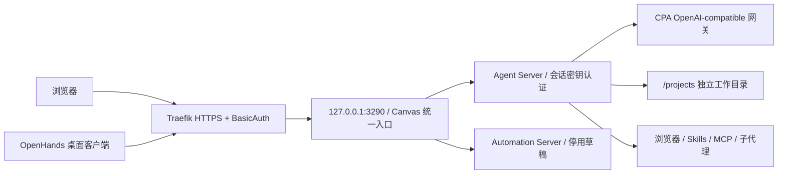

# NixOS 全栈 AI 基建与数字伴侣架构设计与运维实战指南

## 一、 宏观架构总览与 Life-OS 情感伴侣愿景

本系统基于 **NixOS Flakes** 现代化声明式基础设施与容器化编排，为自建数字生活基建（Life-OS）打造了一套完整的全栈 AI、知识工程与拟人化情感陪伴中枢。

系统贯彻**单一事实来源（Single Source of Truth）**、**100% 声明式开箱即用（Zero-Config Post-Deploy）**与**数据/状态严格持久化（Impermanence + 5GB Restic 严苛灾备）**三大工程原则：

1. **单一事实来源与零手动配置**：身份认证（Keycloak OIDC 与原生密码登录）、API 路由（New-API）、模型映射、工具注册（ContextForge + FastMCP）与反向代理（Traefik），在部署完成后无需任何人工点击网页 `/install`、复制粘贴 API Key 或修改配置，全部由声明式代码与幂等脚本全自动初始化。

   OpenHands 的公网访问是安全例外：模型配置和工具由初始化脚本播种，但浏览器或桌面客户端首次连接仍需输入独立的后端会话密钥，不能用 SOPS `password` 或模型 API Key 替代，详见第九节。

2. **多模态与拟人情感中枢正交解耦**：底层由模型网关接入高性价比模型矩阵；中间层由 FastMCP 工具箱和 Dify 负责知识检索与工作流；顶层由统一的人设编译器（Persona Engine）负责格式解析、世界书触发、草稿箱撕毁、多气泡拆分与跨平台状态机，再通过统一接口分发至 QQ（NapCat + AstrBot）、微信（官方 iLink）与 Matrix。
3. **数字生活基建全链路感知（Life-OS Sync）**：AI 伴侣深度融合个人生活服务，不仅能闲聊，还能读取随手记（Memos）、考公刷题动态（Kaogong）、影音库更新（Jellyfin / MoviePilot）、智能家居传感器（Home Assistant）与全球分布式网络健康度（DN42 BGP / ATC CDN / VictoriaMetrics），成为真正生活在数字系统里的全知伴侣。
4. **遵循 Haumea/Rake 无 `default.nix` 递归收集规范**：整个 `services/ai/` 及其子目录（`gateway/`、`mcp/`、`dify/`、`companion/`）严格**不使用 `default.nix`**。根据仓库 `lib/rake.nix` 基于 Haumea 的加载机制，无 `default.nix` 时 Haumea 会自动遍历目录下全部模块，并通过 transformer 动态挂载 `.all` 递归展平属性。在主机配置中只需写 `imports = nixosModules.services.ai.all;` 即可一键声明式装配全部 AI 模块。

---

### 1.1 模块目录规范与递归加载机制

```text
nixos/modules/services/ai/
├── gateway/
│   ├── new-api.nix             # New-API 聚合底座与模型矩阵 (nixosModules.services.ai.gateway.new-api)
│   └── cpa.nix                 # CPA 代理与逆向通道 (nixosModules.services.ai.gateway.cpa)
├── mcp/
│   ├── common.nix              # ContextForge 基础选项与持久化
│   ├── containers.nix          # ContextForge 容器拓扑与 Keycloak SSO 挂载
│   ├── db-init.nix             # 自动向 ContextForge 注册虚拟网关
│   ├── degoog-bridge.nix       # 隐私搜索与深度正文提取 FastMCP (5005 端口)
│   ├── lifeos-bridge.nix       # 个人生活基建 MCP 工具箱 (Memos, 考公, 影音, 智能家居, 监控) (5007 端口)
│   ├── traefik-proxy.nix       # ContextForge Traefik 反向代理
│   └── backup.nix              # MCP 备份配置
├── dify/
│   ├── common.nix / containers.nix / db-init.nix / traefik-proxy.nix / backup.nix
├── openhands-agent-canvas.nix  # OpenHands 容器、公网认证、初始化、持久化与备份
├── openhands-bootstrap.py      # 模型档案、工具、工作目录与停用自动化草稿播种
└── companion/
    ├── common.nix              # 伴侣通用选项、端口、持久化与反向代理
    ├── persona-engine.nix      # 人设编译器、记忆中枢、出站清洗、主动关怀与告警 Webhook (5006 端口)
    ├── qq-astrbot.nix          # AstrBot + NapCat (OneBot v11) 与平滑自愈工具 heal-napcat-ws
    ├── wechat-ilink.nix        # 微信官方 iLink 长轮询与 24h 窗口智能保活
    ├── matrix-bot.nix          # Matrix 端到端加密 E2EE 伴侣通道
    └── backup.nix              # 5GB 极简灾备排除规则 (过滤群聊图片/音视频)
```

> **Haumea 导入语法示例**：
>
> ```nix
> # 在 fra0/default.nix 中整包导入：
> imports = nixosModules.services.ai.all;
>
> # 或在边缘节点/特定机器仅导入部分子系统：
> imports = nixosModules.services.ai.companion.all; # 仅伴侣系统
> imports = nixosModules.services.ai.gateway.all;   # 仅模型网关
> ```

---

### 1.2 系统架构全景拓扑图

```
                           [ 用户交互终端 (Client Interaction) ]
                                    |
          +-------------------------+-------------------------+
          |                         |                         |
          v (OneBot v11 WS)         v (HTTP Long-Poll)        v (Matrix E2EE)
    [ QQ 客户端 / 群聊 ]       [ 微信个人号 (免风控) ]      [ Matrix 加密房间 ]
          |                         |                         |
          v (TCP 6098)              v (HTTPS)                 v (TCP 3090)
+-------------------+     +-------------------+     +-------------------+
|     NapCatQQ      |     |  wechat-ilink     |     |   matrix-bot      |
|  (无头 NTQQ 协议)  |     | (24h窗口智能保活) |     |  (永不失联保底)   |
+-------------------+     +-------------------+     +-------------------+
          |                         |                         |
          v (WS 反向/正向 6098)      |                         |
+-------------------+               |                         |
|      AstrBot      |               |                         |
| (表情转译/多模态)  |               |                         |
|   (WebUI 6185)    |               |                         |
+-------------------+               |                         |
          |                         |                         |
          +-------------------------+-------------------------+
                                    |
                                    | 统一 HTTP/JSON 对话载荷 (POST /v1/companion/chat)
                                    v
+-------------------------------------------------------------------------------+
|                 AI 拟人情感编译器与记忆中枢 (Persona Engine :5006)             |
|                                                                               |
|  • 人设编译器：SillyTavern 卡 (PNG V2/V3 / JSON)、世界书、大肥鱼 Markdown、SOUL.md |
|  • 动态宏展开：{{char}}, {{user}}, {{time}}, {{date}}, {{weekday}}              |
|  • 世界书扫描：常驻词条 + 关键词动态正则触发注入 Prompt                         |
|  • 拟真出站管道：撕毁（（内心独白））草稿箱、拟人橡皮擦、多气泡延迟拆分发送   |
|  • 主动关怀调度：22.5h 微信保活续期、晨起唤醒、深夜催睡、服务器告警拟人化转述 |
|  • 会话记忆存储：/var/lib/ai-companion/memory/companion.db (SQLite/状态机)   |
+-------------------------------------------------------------------------------+
         |                                                       |
         | 调用模型生成 (POST /v1/chat/completions)               | 统一工具链挂载
         v                                                       v
+------------------------------------+   +--------------------------------------+
|       统一模型网关 (New-API :3280) |   |    IBM ContextForge MCP 总线 (:5002)  |
|                                    |   |                                      |
|  • companion-pro: step-5-preview,  |   |  • degoog-mcp (:5005): 隐私网页搜索  |
|    glm-5.3 (高智商细腻陪伴)        |   |  • lifeos-mcp (:5007): 生活基建工具:  |
|  • companion-flash: deepseek-v4.1  |   |    - memos_note: 随手记读写          |
|  • companion-audio: stepaudio-2.5  |   |    - kaogong_status: 考公刷题督学    |
|    (听写 ASR + 情绪语音条 TTS)     |   |    - movie_subscribe: 追剧点播       |
|  • companion-vision: qwen3-vl      |   |    - hass_sensor: 智能家居状态       |
|  • local-rp-model: arx8 算力协同   |   |    - infra_health: 集群与 BGP 监控   |
|  • 零配置固定令牌: internal-token   |   +--------------------------------------+
+------------------------------------+                      ^
         |                                                  |
         +--------------------------+-----------------------+
                                    |
                                    v
+-------------------------------------------------------------------------------+
|                    Dify 知识库与复杂工作流引擎 (Dify CE :5001)                 |
|                                                                               |
|  • 社区版原生邮箱密码登录：i@dora.im；关闭 OAuth、注册与自建工作区             |
|  • 自动免配置向导：dify_setups 表自动标记完成，无需网页 /install 引导          |
|  • 自动注入 Degoog Search 联网搜索工具 (OpenAPI 3.0 Schema)                   |
|  • 向量存储：原生 Qdrant 实例 (:6333, /var/lib/private/qdrant)                |
+-------------------------------------------------------------------------------+
```

---

## 二、 全栈组件清单、端口与默认凭据总览

支持用户名和密码登录的入口统一使用**用户名：`i`**、**密码：SOPS `password`**。OpenHands 的后端会话密钥、模型提供商 API Key 与网页登录密码是不同凭据，不应混用：

| 组件名称           | 核心作用                                | 宿主机/内部端口                | 对外公网域名                | 默认用户名 / 标识       | 默认密码 / 访问令牌               | 认证方式                            |
| ------------------ | --------------------------------------- | ------------------------------ | --------------------------- | ----------------------- | --------------------------------- | ----------------------------------- |
| **AstrBot**        | QQ 机器人调度中枢、插件/多模态管理      | `6185`                         | `bot.dora.im`               | **`i`**                 | **SOPS `password`**               | PBKDF2-SHA256 哈希登录              |
| **NapCatQQ**       | 无头 NTQQ 协议端 (OneBot v11)           | `6099` (WebUI)<br>`6098` (WS)  | `napcat.dora.im`            | -                       | **SOPS `password`**               | WebUI Token (SHA256 校验)           |
| **New-API**        | 统一模型路由、配额与密钥网关            | `3280`                         | `api.dora.im`               | **`i`**                 | **SOPS `password`**               | Bcrypt 哈希 / Keycloak SSO          |
| **Dify (API/Web)** | 知识库 RAG、工作流编排与应用生成        | `5001` (API)<br>`3000` (Web)   | `chat.dora.im`              | **`i`** (`i@dora.im`)   | **SOPS `password`**               | 原生邮箱密码 / PBKDF2 哈希          |
| **ContextForge**   | IBM 开源 MCP 聚合虚拟网关               | `5002` (API)<br>`5003` (UI)    | `mcp.dora.im`               | **`i`** (`i@dora.im`)   | **SOPS `password`** + 复合规则    | Basic Auth / Keycloak SSO           |
| **CPA**            | CLI-Proxy-API 逆向与商业 API 代理       | `8317`                         | `cpa.dora.im`               | -                       | **SOPS `password`**               | Management Secret Key               |
| **OpenHands**      | 编程代理、浏览器、技能与自动化工作台    | `127.0.0.1:3290` → 容器 `8000` | `openhands.dora.im`         | **`i`**                 | **SOPS `password`**；会话密钥独立 | Traefik BasicAuth + Session API Key |
| **Persona Engine** | 人设编译器、记忆中枢与出站清洗          | `5006`                         | 无 (纯内网回环，不暴露公网) | **`i`** (`defaultUser`) | 免密 / 内网受信调用               | RESTful API                         |
| **Degoog MCP**     | 隐私搜索与网页正文提取桥接服务          | `5005`                         | 本地回环                    | -                       | -                                 | FastMCP SSE / OpenAPI               |
| **Life-OS MCP**    | 个人生活基建 (Memos/考公/影音/监控)     | `5007`                         | 本地回环                    | -                       | -                                 | FastMCP SSE                         |
| **Keycloak**       | 集中身份认证与 OIDC 单点登录            | `3260`                         | `sso.dora.im`               | **`i`** (`i@dora.im`)   | **SOPS `password`**               | LDAP / PostgreSQL 统一凭据          |
| **PostgreSQL**     | 基础数据库 (Dify, New-API, Keycloak 等) | `5432`                         | 本地回环                    | `postgres`              | 系统凭据 / Peer 认证              | 本地 Socket / Peer                  |
| **Redis**          | 缓存与 Celery 异步任务队列              | `6379`                         | 本地回环                    | -                       | -                                 | 本地回环免密                        |
| **Qdrant**         | Dify 知识库向量存储引擎                 | `6333`                         | 本地回环                    | -                       | -                                 | 本地 HTTP API                       |

---

### 2.1 本机 AI 服务的注册关闭策略

本节针对当前机器 **`fra0`**。注册关闭策略已写入仓库配置，**本次未部署、未重启服务，也未修改运行中的数据库**；需要后续单独部署才会生效。禁用的是用户自助注册和首次 OAuth/SSO 登录自动建号，不删除现有账号，也不禁用已有用户登录或声明式管理员播种。

| 服务                                                                                                                             | 声明式策略                                                                                                                                  | 登录与初始化边界                                                                                                                                                                                  |
| -------------------------------------------------------------------------------------------------------------------------------- | ------------------------------------------------------------------------------------------------------------------------------------------- | ------------------------------------------------------------------------------------------------------------------------------------------------------------------------------------------------- |
| **New-API**                                                                                                                      | `RegisterEnabled=false`、`PasswordRegisterEnabled=false`，由 `new-api-bootstrap` 幂等写入 `options` 表                                      | 保留 `PasswordLoginEnabled=true` 和现有 OIDC 登录；只有密码注册开关不足以阻止 OAuth 自动建号。尚未绑定 OIDC 的现有用户应先用密码登录并绑定，不再通过首次 OIDC 登录创建另一个账号                  |
| **Dify API / Worker**                                                                                                            | 共享环境显式设置 `ALLOW_REGISTER=false`、`ALLOW_CREATE_WORKSPACE=false`、`ENABLE_EMAIL_CODE_LOGIN=false`、`ENABLE_SOCIAL_OAUTH_LOGIN=false` | 保留 `ENABLE_EMAIL_PASSWORD_LOGIN=true`；`dify-bootstrap` 继续播种 `i@dora.im`、既有工作区和安装完成标记，不依赖网页注册                                                                          |
| **ContextForge**                                                                                                                 | `PUBLIC_REGISTRATION_ENABLED=false`、`SSO_AUTO_CREATE_USERS=false`                                                                          | 保留 Keycloak SSO，仅允许符合既有 provider 绑定规则的已有用户登录；不额外开启跨 provider 自动关联。`SSO_PRESERVE_ADMIN_AUTH=true` 保留平台管理员原生认证，管理员 `i@dora.im` 由既有初始化机制提供 |
| **Keycloak `users` Realm**                                                                                                       | 首次导入设置 `registrationAllowed=false`；启动前的 `keycloak-ldap-reconcile` 同时写入已有 Realm 的 `registration_allowed=false`             | 不仅修改初始 Realm 文件，避免现存数据库配置被跳过；保留 LDAP 用户同步和管理员播种。此 Realm 被其他服务共用，其自助注册也一并关闭                                                                  |
| **OpenHands Agent Canvas**                                                                                                       | 单用户会话密钥认证，无本地账号自助注册系统                                                                                                  | 保留 Traefik BasicAuth 和独立会话密钥；桌面远端入口使用同一后端，不另建用户                                                                                                                       |
| **AstrBot / NapCat / CPA**                                                                                                       | 分别为预置管理员、WebUI Token、Management Secret Key，无开放用户注册系统                                                                    | 保留现有认证，不通过关闭认证来实现所谓“禁注册”                                                                                                                                                    |
| **Persona Engine / Degoog（含原生 MCP）/ Degoog MCP Bridge / Life-OS MCP / Browserless / Dify Sandbox / Plugin Daemon / Qdrant** | 搜索、内部工具、执行器或存储组件，无终端用户自助注册系统                                                                                    | 保留既有网络边界、内部令牌或服务认证；MCP 工具、模型渠道和机器人平台的“注册”属于服务配置，不在禁用范围                                                                                            |
| **VS Code Web IDE**                                                                                                              | 单用户 BasicAuth，无本地用户注册入口                                                                                                        | 保留 `auth` middleware 和既有模型配置，不变更非 AI 业务注册策略                                                                                                                                   |

`fra0` 没有启用 LobeChat、Open WebUI / Ollama、LiteLLM、Perplexica 或 OpenClaw，不应为了关闭注册而启动它们，也不在本次修改中改变其他主机的服务配置。

New-API 的数据库选项由现有引导服务更新，运行进程按 `SYNC_FREQUENCY` 同步（默认约 60 秒）；后续部署时应等引导和同步完成再验收，不能仅看登录页是否隐藏注册按钮。管理员通过受控后台新增账号属于管理操作，不等于开放自助注册。以上策略不替代访问控制，也不会自动清理此前已注册的账号。

只求值、不部署的回归检查：

```bash
nix eval --offline --no-write-lock-file --raw .#checks.x86_64-linux.ai-registration-test.result
```

本次六项配置断言均通过（New-API、Dify API、Dify Worker、ContextForge、Keycloak 首次导入及已有 Realm 同步），并通过 `fra0` 整机 derivation 求值、修改文件的 `nixfmt --check` 和 `git diff --check`。这些都是静态检查，不执行引导 SQL 或服务启动。后续授权部署后，应分别确认密码注册及未绑定的新 OAuth/SSO 用户不能建号、已有管理员仍能登录；本次没有执行线上注册请求或真实账号验收。

---

## 三、 组件间协同交互与数据流向深度解析

整套系统通过清晰定义的协议在不同层级之间流转，主要涵盖以下五大核心数据流：

### 3.1 核心流程 1：QQ 用户消息全链路流转

```
[用户在 QQ 发送消息]
       │ (包含纯文字 / [Face:123] 表情 / 语音条 / 短视频)
       ▼
 [NapCatQQ (无头 NTQQ) :6098]
       │ 转化为 OneBot v11 JSON 事件流
       ▼ (WebSocket ws://127.0.0.1:6098)
 [AstrBot 核心调度中枢 :6185]
       │ 1. 入站翻译：将 [Face] 表情空消息补偿为 "[旺柴]" 文本占位
       │ 2. 身份打标：静默注入 [昵称(QQ号)] 与 [主人] 身份标签
       │ 3. 媒体抽取：语音转为 MP3，视频通过 ffmpeg 抽 16 帧拼图 + 60s 音频切片
       ▼ (HTTP POST http://127.0.0.1:5006/v1/companion/chat)
 [Persona Engine 情感中枢 :5006]
       │ 1. 会话记忆检索：从 /var/lib/ai-companion/memory/companion.db 读取该用户最近 10 轮历史
       │ 2. 宏变量替换：将 {{char}} 替换为角色名、{{user}} 替换为 "i"、展开当前日期时间与星期
       │ 3. 世界书扫描：按关键词与正则扫描，命中时注入背景设定 (Lore)
       │ 4. 组装 System Prompt 与完整上下文
       ▼ (HTTP POST http://127.0.0.1:3280/v1/chat/completions)
 [New-API 统一模型网关 :3280]
       │ 携带 Bearer sk-ai-internal-... 内部固定 Token
       │ 路由匹配：按 companion-pro 路由至 Step-5 / GLM-5.3，或按 local-rp-model 路由至 arx8
       ▼ (HTTP POST 上游商业 API 或 CPA :8317)
 [大语言模型完成推理]
       │ 返回原始回复文本 (可能包含内心独白与 AI 客服口癖)
       ▼
 [Persona Engine 拟真出站整形]
       │ 1. 草稿箱撕毁：正则剔除 （（内心独白草稿）） 与 <think> 思考链
       │ 2. 拟人橡皮擦：擦除 "作为一个AI助手" 等机械口吻
       │ 3. 拟人化多气泡拆分：切分为 2~4 个短句气泡，计算打字耗时 (len * 0.08s)
       │ 4. 写入 SQLite 持久化会话历史
       ▼ (HTTP JSON 回包: {"bubbles": [{"text": "...", "delay_seconds": 1.2}, ...]})
 [AstrBot 出站处理]
       │ 1. 表情还原：将 "[旺柴]" 还原为 QQ 原生 Face Segment
       │ 2. 语音合成：若处于语音模式，调用 stepaudio-2.5-tts（先行过滤表情符号）生成语音条
       ▼ (WebSocket 发送消息调用)
 [NapCatQQ 推送消息]
       │ 模拟真人打字延迟依次逐条发出
       ▼
[QQ 客户端收到拟人多气泡短消息]
```

---

### 3.2 核心流程 2：微信官方 iLink 长轮询与 24h 窗口智能保活

```
[用户在微信向机器人发消息]
       │
       ▼
 [腾讯官方 iLink 云端网关 (ilinkai.weixin.qq.com)]
       │ HTTP 长轮询抓取 (get_updates)
       ▼
 [wechat-ilink 守护进程]
       │ 1. 提取消息正文与 context_token
       │ 2. 刷新保活时间戳：(user_id, context_token, expires_at = now + 24h)
       │    记录在 /var/lib/ai-companion/wechat/ilink_auth.json
       ▼ (HTTP POST http://127.0.0.1:5006/v1/companion/chat)
 [Persona Engine 情感中枢]
       │ (同流程 1，完成记忆加载、宏替换、大模型推理与出站气泡拆分)
       ▼
 [wechat-ilink 发送回包]
       │ 携带上一步缓存的 context_token，调用 send_message 接口分气泡发送
       ▼
 [用户微信收到回复]

【主动关怀与 22.5h 续期定时器】
  wechat-ilink 后台调度器每 5 分钟轮询一次：
  ├─ [距上次互动达到 22 小时] ──> 触发自然日常话题（结合 Memos 动态）发送给微信，
  │                               吸引主人回复以刷新 24h 窗口；
  ├─ [23:30 深夜] ─────────────> 结合 Home Assistant 传感器，若发现书房灯亮着，
  │                               主动发送傲娇催睡消息；
  └─ [超时超过 24 小时] ─────────> context_token 失效，主动问候自动无缝降级路由至 QQ 发送。
```

---

### 3.3 核心流程 3：Life-OS 个人数字基建工具调用流

```
[AI 智能体 / Dify 工作流需要使用工具]
       │
       ▼
 [IBM ContextForge MCP 总线 :5002]
       │
       ├──> [degoog-mcp :5005] ─────────> 本地 Degoog 聚合搜索引擎 (执行联网搜索与网页正文提取)
       │
       └──> [lifeos-mcp :5007]
              │
              ├──> memos_create_note ────> Memos 数据库/API (随口保存灵感备忘)
              ├──> kaogong_daily_status ─> 考公数据库 (获取行测/申论每日刷题指标与错题)
              ├──> moviepilot_subscribe ─> MoviePilot 服务 (聊天直接点播电影/番剧)
              ├──> jellyfin_recent ──────> Jellyfin 媒体库 (查询最近入库的影视)
              ├──> hass_get_state ───────> Home Assistant (读取环境光照、人体存在传感器)
              └──> infra_cluster_health ─> VictoriaMetrics (读取 DN42 BGP 与服务器探活指标)
```

---

### 3.4 核心流程 4：统一单点登录 (SSO) 与鉴权流

```
[已有用户浏览器访问 New-API / ContextForge]
       │ 点击 "Keycloak 登录"
       ▼
 [Traefik 反向代理 :443]
       │ 路由至 Keycloak OIDC 端点 (https://sso.dora.im)
       ▼
 [Keycloak :3260]
       │ 验证凭据：用户名 "i"，密码来自 SOPS password
       │ 对接 OpenLDAP 用户库 (uid=i,ou=people,dc=dora.im)
       ▼
 [签发 JWT ID Token 与 Access Token]
       │ 重定向回调至对应服务 (Redirect URI)
       ▼
[匹配已有本地账号并完成登录，保留其既有权限]
```

Dify 当前仅使用原生邮箱密码登录（`i@dora.im` / SOPS `password`），不再挂载 GitHub OAuth 到 Keycloak 的桥接补丁。Keycloak 自助注册和下游首次 SSO 自动建号均已在代码中关闭，具体生效时机见 2.1 节；SSO 登录本身不自动授予管理员权限。

---

### 3.5 核心流程 5：基础设施告警拟人化转述流

```
[服务器发生异常：如某一节点 BGP 会话中断或磁盘高水位]
       │
       ▼
 [Prometheus / Alertmanager / VictoriaMetrics]
       │ 触发 Webhook
       ▼
 [Persona Engine :5006 (/api/v1/system-alert)]
       │ 1. 提取告警核心内容 (节点名、故障严重程度、错误日志)
       │ 2. 组装专属提示词："请用你的性格语气，第一时间将以下故障汇报给主人，不要变成无聊客服！"
       │ 3. 调用 New-API 生成生动关切的通知文本
       ▼
 [分发通道]
       ├──> 微信 (wechat-ilink)：若在 24h 窗口内，直接私聊推送
       └──> QQ (AstrBot/NapCat)：向主人 QQ 私聊推送或窗口戳一戳提醒
```

---

## 四、 部署过程中的真实故障排错与代码实现剖析

在实际部署与服务编排中，遇到了多项由上游协议断层、数据库 Schema 演进和网络时序引发的问题。以下为具体排错原因与针对性解决方案：

### 4.1 Dify v1.17+ 数据库 Schema 不兼容导致 `dify-bootstrap` 启动崩溃

- **故障现象**：`systemctl status dify-bootstrap.service` 报错：
  ```text
  psycopg2.errors.UndefinedColumn: column "label" of relation "tool_api_providers" does not exist
  ```
- **原因分析**：Dify 在 1.17 之后重构了工具提供商元数据表 `tool_api_providers`，移除了 `label` 列，将多工具清单序列化为 `tools_str`（类型为 `text` 且为 `NOT NULL`），同时新增了 `custom_disclaimer`（`text` 且为 `NOT NULL`）。原初始化脚本依据旧版字段插入导致 SQL 语法失败。
- **代码实现修复（`nixos/modules/services/ai/dify/db-init.nix`）**：
  修改插入语句，生成包含工具基本元数据的 `tools_str` JSON 串，设置 `custom_disclaimer = ""`，并将 `label` 从列名中移除：
  ```python
  tools_str = json.dumps([
      {"name": "search_web", "label": "Search Web", "description": "Search the web via Degoog"},
      {"name": "fetch_webpage", "label": "Fetch Webpage", "description": "Extract clean webpage text"}
  ])
  cur.execute("""
      INSERT INTO tool_api_providers (
          id, user_id, tenant_id, name, schema, schema_type_str,
          tools_str, icon, credentials_str, description,
          custom_disclaimer, created_at, updated_at
      ) VALUES (
          %s, %s, %s, 'degoog', %s, 'openapi',
          %s, '{"content":"🔍","background":"#2563EB"}', '{}',
          'Local privacy search and article reader',
          "", NOW(), NOW()
      );
  """, (str(uuid.uuid4()), account_id, tenant_id, json.dumps(degoog_openapi), tools_str))
  ```

---

### 4.2 Dify Celery Worker 循环崩溃 (`ImportError: cannot import name 'decode_oauth_state'`)

- **故障现象**：`podman-dify-worker.service` 启动后立即退出，退出码为 2：
  ```text
  File "/app/api/controllers/console/auth/oauth.py", line 18, in <module>
    from libs.oauth import decode_oauth_state
  ImportError: cannot import name 'decode_oauth_state' from 'libs.oauth' (/app/api/libs/oauth.py)
  ```
- **原因分析**：为了实现 Keycloak SSO 登录，我们通过 Volume 挂载覆盖了容器内的 `/app/api/libs/oauth.py`。然而精简版的 `oauth.py` 遗漏了 Celery Worker 与控制台认证所需的 `decode_oauth_state`、`encode_oauth_state`、`OAuthState`、`OAuthUserInfo` 等关键数据结构，导致 Celery Worker 加载 `app_factory` 时直接中断。
- **代码实现修复（`nixos/modules/services/ai/dify/containers.nix`）**：
  历史修复曾补齐桥接 `oauth.py` 的类型与编解码函数。当前代码已移除该覆盖挂载，使用官方原生邮箱密码登录并设置 `ENABLE_SOCIAL_OAUTH_LOGIN=false`；API 与 Worker 均加载镜像自带的 OAuth 模块，不应重新挂载旧补丁。

---

### 4.3 AstrBot 监听端口冲突与 Traefik 代理 502

- **故障现象**：访问 `https://bot.dora.im` 出现 HTTP 502 Bad Gateway，且本地 `curl http://127.0.0.1:6180` 报错拒绝连接。
- **原因分析**：AstrBot 4.29+ 容器官方默认将 WebUI 仪表盘硬编码监听在 **6185** 端口，而我们在 `ports.nix` 中原登记为 6180。容器启动日志明确打印：
  ```text
  Starting WebUI at http://0.0.0.0:6185
  ```
- **代码实现修复（`nixos/modules/base/module/misc/ports.nix`）**：
  将 `config.ports.astrbot` 修正为 **6185**，Traefik 代理目标同步调整为 6185，网络流量正常打通。

---

### 4.4 看门狗导致 NapCat 二维码频繁被打断重刷

- **故障现象**：NapCat 容器每隔几分钟自动重启，控制台二维码刚出来就被打断重刷，无法完成手机扫码授权。
- **原因分析**：原看门狗定时器每 5 分钟检查本地端口 6098（OneBot WS）是否处于 Listening 状态。但在首次部署尚未扫码登录时，NTQQ 不会拉起 WebSocket 服务端，导致看门狗误判服务死锁并强制重启 NapCat，从而形成了“未扫码 -> 杀容器 -> 生成新二维码 -> 再次杀容器”的恶性死循环。
- **代码实现修复（`nixos/modules/services/ai/companion/qq-astrbot.nix`）**：
  删除激进的重启看门狗，改为编写 `heal-napcat-ws` CLI 管理脚本。该脚本通过调用 NapCat WebUI 原生 HTTP API（`/api/OB11Config/GetConfig` 与 `SetConfig`），对 WebSocket 连接进行平滑重新触发，**不重启容器、不退登 QQ、不破坏登录态**。

---

### 4.5 ContextForge 启动瞬间 Keycloak 502 探测失败

- **故障现象**：ContextForge 启动日志中报错：
  ```text
  Failed to discover Keycloak endpoints from https://sso.dora.im/realms/users/.well-known/openid-configuration: Server error '502 Bad Gateway'
  ```
- **原因分析**：在 systemd 服务拓扑中，`podman-contextforge.service` 缺乏对 `keycloak.service` 的显式依赖。在机器开机或配置重载瞬间，ContextForge 立即向 Traefik 发起 OIDC Well-Known 抓取，而此时 Keycloak 正在进行 Quarkus 引导，导致首次抓取命中 502。
- **代码实现修复（`nixos/modules/services/ai/mcp/containers.nix`）**：
  在 `systemd.services.podman-contextforge` 中显式添加 `after = [ "keycloak.service" ]` 与 `wants = [ "keycloak.service" ]`，确保 Keycloak 处于 Ready 状态后再拉起 ContextForge。

---

## 五、 5GB Restic 严苛备份与持久化防爆设计

针对云服务器 5GB 远程冷备存储配额，在 `nixos/modules/services/ai/companion/backup.nix` 中设计了精细的排除策略：

```nix
services.restic.backups.borgbase = {
  paths = lib.mkAfter [
    "${cfg.dataDir}/personas"
    "${cfg.dataDir}/memory"
    "${cfg.wechat.dataDir}"
    "${cfg.matrix.dataDir}"
    "${cfg.qq.dataDir}/napcat/config"
    "${cfg.qq.dataDir}/astrbot/data/cmd_config.json"
    "${cfg.qq.dataDir}/astrbot/data/data_v4.db"
  ];
  exclude = lib.mkAfter [
    "**/napcat/data/**/ChatMsg/**"
    "**/napcat/data/**/Audio/**"
    "**/napcat/data/**/Video/**"
    "**/napcat/data/**/Pic/**"
    "**/napcat/data/**/OriPic/**"
    "**/napcat/data/**/Group/**"
    "**/napcat/data/**/Crashpad/**"
    "**/napcat/logs/**"
    "${cfg.qq.dataDir}/astrbot/data/logs/**"
    "${cfg.qq.dataDir}/astrbot/data/temp/**"
    "${cfg.qq.dataDir}/astrbot/data/attachments/**"
    "${cfg.qq.dataDir}/astrbot/data/site-packages/**"
    "**/cache/**"
    "**/temp/**"
    "**/__pycache__/**"
  ];
};
```

- **防爆效果**：
  - NapCat 在大型活跃群聊中运行数周会积累数 GB 的高清图片与短视频（存放在 `ChatMsg`、`Audio`、`Video`、`Pic`），这些属于易失性展示数据，排除后**备份体积从 3GB+ 直接降低至 35MB 左右**。
  - 灾备恢复时，只需 `restic restore` 恢复核心凭据与 SQLite 数据库，NapCat 即可免扫码秒级上线。

---

## 六、 整套系统配置与操作维护手册（用户必读）

当你需要完整拉起或重新配置这套 AI 陪伴与基建系统时，请按以下顺序执行：

### 6.1 第一步：检查密钥与 SOPS 主密码

确认你的 `secrets/common.yaml` 已包含全局主密码 `password`（所有组件均会自动以该密码作为统一凭据）：

```bash
# 验证密钥可解密
sops -d secrets/common.yaml | grep -E '^password:'
```

---

### 6.2 第二步：推送 DNS 域名解析 (Terraform)

AI 相关域名分别在 `terraform/cdn.tf` 和 `terraform/cloudflare.tf` 中定义。OpenHands 使用 `cloudflare.tf` 的直连 CNAME，`openhands.dora.im` 指向 `fra0.dora.im`，`proxied = false`，不经过 ATC CDN 或 Cloudflare 代理：

```bash
cd terraform
terraform apply
```

_这会在 Cloudflare 上自动创建 `api`、`chat`、`mcp`、`persona`、`bot`、`napcat` 等三级域名 CNAME 解析，指向你的边缘网络并回源至 `fra0`。_

---

### 6.3 第三步：部署应用到主机 (NixOS)

在仓库根目录执行构建与切换：

```bash
# 针对 fra0 节点应用
sudo nixos-rebuild switch --flake .#fra0

# 检查所有服务单元是否全部正常
systemctl --failed
# 正常应输出: 0 loaded units listed.
```

---

### 6.4 第四步：登录 NapCat 接入 QQ 机器人（免输复杂 Token）

1. 浏览器打开 `https://napcat.dora.im/webui/`。
2. **输入 WebUI Token**：直接输入你的 **SOPS `password`** 即可进入控制台。
3. 界面显示 NTQQ 登录二维码，使用手机 QQ 扫描并确认授权。
4. 凭证将自动持久化保存在 `/var/lib/dafeiyu/napcat/data/` 中，后续重启系统或升级容器均可免扫码自动登录。

---

### 6.5 第五步：登录并配置 AstrBot 核心调度中枢

1. 浏览器打开 `https://bot.dora.im`。
2. **登录认证**：
   - 用户名：**`i`**
   - 密码：**SOPS `password`**
3. **配置大模型提供商（二选一）：**
   - **方案 A（深度拟人中枢：对接 Persona Engine，最推荐）**：
     - **Base URL**：`http://127.0.0.1:5006/v1`（指向 Persona Engine）
     - **API Key**：可随意填写任意字符串（例如 `internal-token`，Persona Engine 收到请求后会自动替换为本地有效内部令牌发给 New-API）
     - **模型名称**：填写你期望底层执行的模型，如 `companion-pro`、`gemini-3-flash` 或 `step-5-preview`
     - **注意**：在此模式下，**AstrBot 自身完全无需导入任何角色**，Prompt 保持默认即可！Persona Engine 会在每次请求时自动读取激活的角色卡与世界书动态注入。
   - **方案 B（极简直连：直通 New-API 网关）**：
     - **Base URL**：`http://127.0.0.1:3280/v1`（直通 New-API）
     - **API Key**：读取 `/var/lib/new-api/internal-token` 文件中的固定内部令牌
     - **模型名称**：填写 `companion-pro` 或 `gemini-3-flash`
     - **注意**：在此模式下，由 AstrBot 面板的「人设管理」负责维护提示词。
4. **配置协议平台连接（对接同机 NapCat）**：
   - 进入「配置」→「平台设置」：
     - 确保 OneBot v11 正向 WebSocket 地址填为 `ws://127.0.0.1:6098`，点击测试连接显示“已连接”。

---

### 6.6 第六步：人设导入与个性化角色切换指南

Persona Engine 提供了三种极其便捷的人设管理与切换方式：

- **方式 A：在 QQ 中直接聊天切换（最推荐，零门槛）**：
  - 我们已在 AstrBot 插件中内置了 `astrbot_plugin_persona` 插件，在 QQ 私聊或群聊中直接发指令：
    - **查看所有可用人设**：发送 `/persona` 或 `/persona list`，机器人会列出所有已导入的人设以及当前正在生效的人设（带 ⭐ 标记）；
    - **即刻切换人设**：发送 `/persona <人设名称>`（例如 `/persona 大肥鱼`），机器人会立刻回显确认，下一句回复就会无缝切换为该人格！
- **方式 B：本地 WebUI 图形控制台（可视化卡片与拖拽上传）**：
  - Persona Engine 内置了现代化的单页控制台，通过 SSH 端口转发访问：
    ```bash
    # 在本地终端执行端口转发
    ssh -L 5006:localhost:5006 root@fra0
    ```
  - 浏览器打开 `http://localhost:5006/` 即可看到：
    - **角色卡片网格**：直观展示每个人设的名称、简介与开场白，带“生效中”徽章；
    - **一键切换**：点击卡片底部的“切换为此人设”按钮，即刻热切换；
    - **拖拽上传区**：将从网上下载的酒馆 `.png` 角色卡或 `.json` 文件直接拖入页面，自动解析元数据并存盘激活！
- **方式 C：直接往服务器文件夹丢文件（底层热加载）**：
  - 将网上下好的 SillyTavern 角色卡 `.png` 原图、`.json` 或 Markdown 人格（如 `大肥鱼-人格.md`）直接放入：
    ```bash
    /var/lib/ai-companion/personas/
    ```
  - Persona Engine 会自动监控目录并热加载，下次对话时自动可用。

---

### 6.7 第七步：日常运维命令速查

- **NapCat QQ 连接平滑自愈（网络波动掉线时使用）**：
  ```bash
  heal-napcat-ws
  ```
  _通过 WebUI API 平滑重启 WebSocket 客户端链路，无需重启容器、不退登 QQ、无需扫码。_
- **查看各容器运行日志**：
  ```bash
  sudo podman logs -f napcat      # 查看 NTQQ 协议日志
  sudo podman logs -f astrbot     # 查看 AstrBot 调度与对话日志
  sudo podman logs -f dify-api    # 查看 Dify 知识库处理日志
  sudo podman logs -f new-api     # 查看模型路由与 Token 消耗日志
  ```
- **查看情感中枢与 MCP 日志**：
  ```bash
  journalctl -u ai-persona-engine.service -f
  journalctl -u degoog-mcp-bridge.service -f
  journalctl -u lifeos-mcp-bridge.service -f
  ```

---

## 七、 深度技术答疑与核心架构设计辨析

### 7.1 数据存储分布、统一数据库可行性与服务器极简迁移

#### 1. 各组件数据与配置到底存放在哪里？

- **已完全运行在统一 PostgreSQL 里的服务**：
  - **New-API**：数据库 `new_api`（存储渠道 Channels、访问令牌 Tokens、系统设置 Options、用户 Users）。
  - **Dify**：数据库 `dify`（存储租户 Tenants、用户 Accounts、应用 Apps、工作流 Workflows、知识库元数据 Datasets、工具绑定等）。
  - **Keycloak**：数据库 `keycloak`（存储 OIDC Clients、用户凭据、Realm 配置）。
  - **Memos**：数据库 `memos`（存储全部个人笔记与标签）。
- **基于本地文件存储的服务及其原因**：
  - **AstrBot**：配置文件 `/var/lib/dafeiyu/astrbot/data/cmd_config.json`，数据与对话历史存放在 SQLite `/var/lib/dafeiyu/astrbot/data/data_v4.db`。
    - _为什么不能存入 Postgres？_ 这是 AstrBot 上游开源项目的硬编码架构，内部采用 Python `peewee` ORM 强绑定了 SQLite 文件与 JSON，上游并未实现 PostgreSQL 适配器。
  - **NapCatQQ**：配置文件 `/var/lib/dafeiyu/napcat/config/`，登录凭证与 QQ 缓存存放在 `/var/lib/dafeiyu/napcat/data/`。
    - _为什么不能存入 Postgres？_ NapCat 底层运行的是真实的腾讯官方 Linux NTQQ 桌面客户端（基于 Electron / C++），腾讯客户端的设备秘钥（`device.json`）、Token 与本地消息缓存由 NTQQ 闭源核心硬编码存储在本地 LevelDB / SQLite 文件中，外部无法将其剥离至远程关系型数据库。
  - **CPA (CLI-Proxy-API)**：`/var/lib/cpa/config.yaml`（纯 YAML 配置文件）。

#### 2. “不存统一数据库，迁移服务器会不会每次都要手动配置很麻烦？”

**完全不会！因为 NixOS 声明式自动化已经替代了手动配置过程：**

- 传统运维之所以希望把配置全丢进数据库，是因为担心在新机器上重新部署时，需要进 WebUI 手动点几十个按钮（添加渠道、绑定 Token、新建用户、改密码、配反代）。
- 但在我们的架构中，**配置本身即代码（Configuration as Code）**：
  - New-API 的管理员 `i`、内部 Token、渠道模型矩阵由 `new-api-bootstrap.service` 自动写入；
  - CPA 配置文件由 `cpa-init-config.service` 自动从 SOPS 渲染；
  - NapCat 的 `webui.json` Token 与 AstrBot 的 `cmd_config.json` 账号密码由 `dafeiyu-setup-dirs` 自动生成；
  - Dify 的免安装向导与管理员 `i` 由 `dify-bootstrap.service` 自动播种。
- **终极极简迁移服务器指南（零手动配置）**：
  当你需要迁移到新服务器时，只需要两步：
  1. **迁数据库**：`pg_dumpall` 并在新机器 `psql` 导入（迁移 New-API 渠道、Dify 工作流与知识库）；
  2. **迁 QQ 登录态**：拷贝 `/var/lib/dafeiyu/napcat/data`（仅几百 KB 的设备秘钥，为了免去重新扫码）；
  3. 新机器拉取 Flakes 仓库，执行 `sudo nixos-rebuild switch` —— **整套系统的所有端口、配置、密钥、反代与后台账密全自动就绪，无需在网页上手动填任何一项参数！**

---

### 7.2 NapCat 是 QQ 官方的吗？会封号吗？避坑与防护建议

#### 1. NapCat 是官方的吗？

- **不是**。NapCatQQ 是一个由开源社区维护的开源项目。
- **但它运行的是官方二进制**：与老一代完全逆向 QQ 协议的机器人（如过去的 Go-CQHTTP、Mirai、ShamRock 等基于 Android/iPad 协议 Hook 的方案）不同，NapCat 容器内部运行的是**腾讯官方发布的真实 Linux NTQQ 客户端**，通过对 NTQQ 本地 IPC 进行轻量包装，将 QQ 消息转发为标准 OneBot v11 接口。
- **技术优势**：因为底层运行的是真正的 NTQQ，其握手协议包、加密算法（ECDH）、设备心跳特征与官方桌面 QQ **95% 以上一致**，是目前全网存活率最高、协议层最稳固的 QQ 个人号机器人方案。

#### 2. 会封号吗？

**任何非官方自动化行为都存在一定程度的风控与冻结风险。** 腾讯的风控主要由**行为特征**与**环境特征**触发，而非协议逆向特征。以下情况极易触发风控：

1. **异地登录（重点警惕）**：当前主机 `fra0` 位于德国法兰克福！如果使用一个平时在中国大陆手机登录的 QQ 小号，突然在境外 IP（德国）登录，极易触发异地登录保护或冻结。
2. **新号挂机**：刚注册不到一个月的新号权重极低，挂机器人很容易被要求人脸核验。
3. **高频刷屏与违规内容**：在大型公开群聊中高频发消息、发送外部可疑链接或敏感违规词汇。

#### 3. 生产环境避坑与防护建议

- **账号选择**：务必使用专用的“老号”（常用生活小号、实名过、有半年以上正常聊天记录），严禁使用生活/工作核心主号。
- **网络出口优化**：
  - 若可能，建议通过本仓库的 Tailscale / EasyTier / DN42 隧道，将 NapCat 容器的网络流量通过国内节点（如 `can0`、`xiy0`）或家宽路由出站，保持登录 IP 为国内常用地区；
  - 或将 QQ 机器人部署在亚太/国内节点，而核心大模型仍由 `fra0` 的 New-API 驱动。
- **频率限制**：在 AstrBot 中严格保持消息防抖与流控（默认配置 `time: 60, count: 30`），避免在群聊中连续高频触发。

---

### 7.3 Persona Engine 到底是干什么的？纯内网运行与安全辨析

#### 1. Persona Engine 的作用

它是整套系统的**“拟人认知中枢与出站修剪器”**：

- **全网主流人设卡解码**：专门负责解析 SillyTavern（酒馆）角色卡 V2/V3 中的 PNG 隐写 Base64 数据，提取性格、场景与对话示例；
- **世界书动态扫描（World Info）**：当对话中出现特定关键词时，动态触发长篇设定注入；
- **拟真去 AI 味**：物理撕毁模型生成的 `（（内心独白草稿箱））` 与 `<think>` 思考链标签，擦除“作为一个人工智能模型”等机械口癖；
- **多气泡延迟发送**：将原本一次性吐出的 500 字长文切分为 2~4 条短句，并计算拟真打字耗时依次返回；
- **跨端共享记忆**：统一为 QQ、微信（iLink）和 Matrix 提供同一套会话记忆。

#### 2. 为什么之前外网能访问？纯内网运行的安全性

- **外网暴露隐患**：此前由于在 Traefik 中配置了 `Host(persona.dora.im)` 反向代理，导致该端点暴露在公网，且其 API 为内网设计、**没有设置强密码认证**，存在未授权调用的安全隐患。
- **现已实施的整改**：
  - 彻底移除了 Traefik 反向代理规则，删除了 `cdn.tf` 与 `monitoring.nix` 中的解析；
  - **Persona Engine 现已严格绑定在宿主机本地回环 `127.0.0.1:5006`**；
  - 仅允许同机运行的 AstrBot、微信守护进程 `wechat-ilink` 和 `matrix-bot` 在本地内网调用，外网无法探测或直连，彻底杜绝未授权访问。

---

### 7.4 AstrBot vs Persona Engine：两者人设功能重合吗？

- **AstrBot 自带人设**：AstrBot 原生支持配置单段 System Prompt（系统提示词）或导入单块 Markdown 人格文件，适合简单的人格设定。
- **两者的关键差异**：
  - **SillyTavern 生态兼容**：AstrBot 原生不支持直接读取网上下到的 `.png` 角色卡隐写图片，也不支持酒馆标准的世界书动态关键词触发深度；而 Persona Engine 原生支持酒馆 V2/V3 PNG、JSON 及世界书。
  - **跨渠道共享**：AstrBot 仅服务于 QQ 平台；若后续接入微信官方 iLink 和 Matrix，只有通过 Persona Engine 才能让这几个平台共享完全相同的人设状态机与记忆池。
- **架构选择建议**：
  - **精简模式（直接直连）**：若你只使用 QQ 机器人，且人设只需在 AstrBot 后台填一段 Prompt 或放一个 Markdown 文件，可以在 AstrBot 后台直接将模型提供商填为 `http://127.0.0.1:3280/v1`（直通 New-API），完全跳过 Persona Engine，链路更短、延迟更低；
  - **高级模式（走 Persona Engine）**：若你需要使用网上下载的复杂 SillyTavern PNG 角色卡、世界书或同时使用微信，可将提供商指向 `http://127.0.0.1:5006/v1`。

---

### 7.5 AstrBot vs NapCat：为什么两个都要？功能重叠了吗？

两者没有任何功能重叠，是典型的**“外设硬件/协议端”**与**“大脑/智能体中枢”**的分工：

```
[NapCat] (硬件适配器 / 协议转换器)
  ├── 职责：运行真正官方 Linux NTQQ，保持网络长链接与心跳，收发 QQ 消息二进制包。
  ├── 产出：将 QQ 消息转换成通用的 OneBot v11 JSON 格式，通过 WebSocket 转发。
  └── 属性：它完全没有 AI 能力，不知道什么是大模型，只管通信收发。

[AstrBot] (智能体框架 / 大脑与调度中枢)
  ├── 职责：Python 编写的智能体中枢，负责多模态清洗、调用 LLM、调度插件、维护上下文。
  ├── 输入：从 NapCat 接收 OneBot v11 格式的 JSON 消息。
  └── 输出：调用大模型后，将生成的文字回复通过 WebSocket 指令通知 NapCat 发送出去。
```

**为什么不能只用 AstrBot？** 因为腾讯从未公开过 QQ 的免密通信协议，AstrBot 作为 Python 软件不包含 NTQQ 的底层协议栈，必须借助 NapCat 运行官方 NTQQ 核心来完成协议通信。

---

### 7.6 Dify Celery Worker 崩溃原因与官方镜像澄清

- **我们使用的是官方原版镜像吗？**
  - **是的，官方镜像**（`docker.io/langgenius/dify-api:latest`），没有做任何二次打包或私有构建。
- **为什么之前要挂载 `oauth.py`？**
  - Dify 官方在商业策略上故意将“通用 OIDC / SAML SSO”锁死在企业版（Enterprise Edition）；社区开源版（Community Edition）后台只开放了 GitHub OAuth 与 Google OAuth。
  - 在上一阶段方案中，为了实现“在 Dify 社区版登录页一键通过 Keycloak 单点登录”，我们利用社区版原生的 GitHub OAuth 入口，通过 Volume 挂载覆盖了其内部的 `oauth.py`，将 GitHub 请求透明映射到了 Keycloak OIDC 端点。
  - **崩溃原因**：最初的简版 `oauth.py` 遗漏了 Celery Worker 异步任务所需的几个 TypedDict 类型声明，导致 Worker 在加载环境时抛出 `ImportError`。
  - **当前配置**：已删除 `oauth.py` 挂载，仅使用官方原生邮箱密码登录；`ENABLE_SOCIAL_OAUTH_LOGIN=false`，API 与 Worker 共用同一认证配置。
- **当前登录与注册策略**：
  - `dify-bootstrap` 继续在数据库中播种管理员账号 **`i@dora.im`**，密码为 **SOPS `password`**，不需要通过网页注册或创建工作区。
  - 注册、邮件验证码登录及自建工作区的关闭开关见 2.1 节。本次仅修改代码，不代表线上服务已应用这些开关。

---

### 7.7 Docker 镜像版本策略：动态 `:latest` 与 OpenHands 固定版本

现有 New-API、CPA、ContextForge、Dify 全家桶、NapCat、AstrBot 采用 `:latest` 策略；OpenHands 是例外，固定已验证的镜像 digest 和桌面客户端版本：

| 组件服务         | 镜像声明                                             | 标签策略    | 为什么使用 `:latest`                                                                                   |
| ---------------- | ---------------------------------------------------- | ----------- | ------------------------------------------------------------------------------------------------------ |
| **NapCatQQ**     | `docker.io/mlikiowa/napcat-docker:latest`            | `:latest`   | **腾讯 NTQQ 协议对抗刚需**：旧版本客户端极易被腾讯服务器强制风控或提示版本过低禁止登录，必须紧跟最新版 |
| **AstrBot**      | `docker.io/soulter/astrbot:latest`                   | `:latest`   | 快速获取新模型适配、协议自愈与插件生态修复                                                             |
| **New-API**      | `docker.io/calciumion/new-api:latest`                | `:latest`   | 紧跟各大模型商（Claude 3.7 / Step-5 / Qwen2.5 / DeepSeek）的最新 API 协议与渠道兼容                    |
| **CPA**          | `docker.io/eceasy/cli-proxy-api:latest`              | `:latest`   | 紧跟逆向代理上游认证与凭据算法更新                                                                     |
| **Dify 全栈**    | `docker.io/langgenius/dify-{api,web,sandbox}:latest` | `:latest`   | 享受工作流编排与 RAG 引擎的最新特性                                                                    |
| **ContextForge** | `ghcr.io/ibm/mcp-context-forge:latest`               | `:latest`   | 保持对 MCP 规范最新提案的兼容                                                                          |
| **OpenHands**    | `ghcr.io/openhands/agent-canvas@sha256:…`            | 固定 digest | 公网编程代理涉及执行权限与持久凭据，升级前验证认证、API 兼容和客户端行为，完整版本见第九节             |

#### 深度辨析：为什么很多运维/配置模板倾向于“固定版本”？

1. **NixOS 声明式与可复现性（Reproducibility）哲学**：
   Nix 的核心设计理念是“无论何时构建，产物 100% 确定相同”。使用固定 Tag（如 `v4.18.37`）或哈希，可以保证相同的 Git Commit 在半年后重新 build 出完全一样的行为；而 `:latest` 是个动态指针，不同时间拉取到的内容会发生变化。
2. **防范上游“破坏性改动”（Breaking Changes）**：
   部分快速演进的开源软件在次版本升级中可能会调整数据库字段（如 Dify 1.17 变动表结构）或弃用配置项。固定版本可以让系统“在已知验证过的安全集里平稳运行”，升级动作转由人工测试后主动推进。

#### 为什么在此 AI / QQ 机器人场景下，使用 `:latest` 更有优势？

1. **逆向与非官方协议对抗的时效性**：
   QQ 协议生态（NapCat）具有特殊的生命周期。腾讯会定期失效旧版本 NTQQ 的鉴权算法。如果固定在一个月前的旧版本，很可能某天早晨突然遭遇大规模登录失效。保持 `:latest` 意味着每次容器拉取都能拿到社区针对最新封控策略的修补代码。
2. **免去手动改 Nix 代码升级的繁琐**：
   无需每次发布新版都手动去编辑 Nix 文件修改版本号字符串。
3. **日常一键升级操作**：
   若想将所有 AI 容器升级到当天的最新构建，只需在终端执行：
   ```bash
   sudo podman pull docker.io/mlikiowa/napcat-docker:latest && sudo systemctl restart podman-napcat.service
   sudo podman pull docker.io/soulter/astrbot:latest && sudo systemctl restart podman-astrbot.service
   ```

---

## 八、 AstrBot `/var/lib/dafeiyu/astrbot/data/` 目录全景、持久化与灾备字典

为了确保在启用 Impermanence 内存根系统与 5GB Restic 严格限制时心中有数，以下为 AstrBot 数据目录下全部 18 项文件与子目录的完整功能解析与备份策略：

| 目录 / 文件名         | 类型 | 存储内容与功能说明                                                           | 是否建议 Persist (Impermanence) | 是否建议 Restic 远程备份 | 体积与排除考量                                         |
| --------------------- | ---- | ---------------------------------------------------------------------------- | ------------------------------- | ------------------------ | ------------------------------------------------------ |
| **`cmd_config.json`** | 文件 | **核心全局配置文件**（平台连接、LLM 提供商、Dashboard 账密、流控、安全设置） | **必须持久化**                  | **必须备份**             | ~8 KB，体积极小，整套机器人的核心配置资产              |
| **`data_v4.db`**      | 文件 | **SQLite 核心业务数据库**（用户会话上下文、插件状态、使用统计、全局偏好）    | **必须持久化**                  | **必须备份**             | ~300 KB，聊天记忆与状态核心，压缩后极小                |
| **`data_v4.db-shm`**  | 文件 | SQLite 共享内存临时文件                                                      | 运行时随 DB 挂载                | **排除**                 | 临时锁文件，进程停止后无价值                           |
| **`data_v4.db-wal`**  | 文件 | SQLite 预写日志文件 (Write-Ahead Logging)                                    | 运行时随 DB 挂载                | **排除**                 | 临时事务缓存，定期自动 checkpoint 回 DB                |
| **`plugins/`**        | 目录 | **本地安装的第三方插件代码目录**（如 `astrbot_plugin_face_convert`）         | **建议持久化**                  | **建议备份**             | 数十 KB 至数 MB，存放定制开发的 Python 插件            |
| **`personas/`**       | 目录 | **本地人设库**（存放自定义的 `.md` 角色人设提示词模板）                      | **建议持久化**                  | **建议备份**             | 数十 KB，纯文本提示词资产                              |
| **`knowledge/`**      | 目录 | 知识库原始文档存放目录（`.txt` / `.md` / `.pdf` 原文）                       | **建议持久化**                  | **建议备份**             | 视个人知识库而定，纯文本通常极小                       |
| **`knowledge_base/`** | 目录 | 知识库向量索引缓存（Chroma / FAISS 向量数据库）                              | **建议持久化**                  | **可选备份**             | ~几 MB，若知识库很大可排除（可由原文重新向量化）       |
| **`config/`**         | 目录 | 部分复杂插件独立生成的配置子文件                                             | **建议持久化**                  | **建议备份**             | 数 KB，插件个性化设置                                  |
| **`skills/`**         | 目录 | 智能体动态 Skill 声明与代码                                                  | **建议持久化**                  | **建议备份**             | 数十 KB                                                |
| **`skills.json`**     | 文件 | Skill 启用清单与元数据配置                                                   | **建议持久化**                  | **建议备份**             | ~1 KB                                                  |
| **`t2i_templates/`**  | 目录 | 文生图 / 画图插件的提示词渲染模板                                            | **建议持久化**                  | **可选备份**             | 数十 KB                                                |
| **`mcp_server.json`** | 文件 | AstrBot 连接外部 MCP 工具的端点配置文件                                      | **建议持久化**                  | **建议备份**             | < 1 KB                                                 |
| **`plugins.json`**    | 文件 | AstrBot 官方插件市场索引缓存列表                                             | 自动生成                        | **强制排除备份**         | **~2.8 MB**，每次打开插件市场自动拉取，浪费备份空间    |
| **`attachments/`**    | 目录 | 群聊或私聊中下载/生成的图片、语音条、多媒体附件                              | 运行时生成                      | **强制排除备份**         | **极易膨胀至数 GB**，纯展示缓存，撑爆 5GB 空间的主因！ |
| **`temp/`**           | 目录 | 视频抽帧、音频 FFmpeg 切片与语音识别临时临时文件                             | 运行时生成                      | **强制排除备份**         | 纯临时中间态文件，用完即弃                             |
| **`site-packages/`**  | 目录 | 容器内动态通过 pip 安装的插件依赖库（wheel 包解压内容）                      | 建议持久化                      | **强制排除备份**         | **数十至数百 MB**，代码包可随时通过 pip 重新拉取       |
| **`webchat/`**        | 目录 | 内置网页聊天界面的静态资源与临时会话文件                                     | 运行时生成                      | **强制排除备份**         | 静态缓存，无需备份                                     |

#### 5GB 灾备最小集总结：

若要在极限情况下进行冷备恢复，你**真正需要备份的 AstrBot 数据只有 3 样东西**：

1. `astrbot/data/cmd_config.json`（配置）
2. `astrbot/data/data_v4.db`（记忆与数据库）
3. `astrbot/data/personas/` 与 `plugins/`（自定义人设与自研插件）
   这三项的总大小加在一起**通常小于 1 MB**，即使远程存储空间只有 100MB 也能轻松做上百次历史版本快照！

---

## 九、 OpenHands 编程工作台、桌面客户端与公网安全

OpenHands Agent Canvas 是独立的编程代理工作台，不替代 Dify 的知识库与工作流，也没有默认接入 Life-OS 的写操作。服务已部署在 `fra0`；桌面端仅加入代码并完成定向构建，没有在 `fra0` 或 `arx8` 激活桌面配置。

### 9.1 服务版本、模块与流量拓扑

| 项目                | 配置                                                                                                     |
| ------------------- | -------------------------------------------------------------------------------------------------------- |
| WebUI               | `https://openhands.dora.im`，根路径进入 `/canvas/`                                                       |
| Canvas / 桌面客户端 | `1.34.0`                                                                                                 |
| Agent Server / SDK  | `1.58.1`                                                                                                 |
| Automation Server   | `1.26.0`                                                                                                 |
| 官方容器            | `ghcr.io/openhands/agent-canvas@sha256:f96a67b825fae3e8a0587516e48216a68913eb3aaf7f069ec2a68dfe643bbdce` |
| 容器引擎            | Podman，通过 NixOS `virtualisation.oci-containers` 管理官方 Docker 镜像                                  |
| 宿主监听            | `127.0.0.1:3290`，容器内部统一入口为 `8000`                                                              |
| 服务模块            | `nixos/modules/services/ai/openhands-agent-canvas.nix`                                                   |
| 首次初始化          | `nixos/modules/services/ai/openhands-bootstrap.py`                                                       |
| 桌面模块            | `home-manager/modules/desktop/openhands.nix`                                                             |
| 桌面包和启动层      | `pkgs/openhands-desktop/`                                                                                |



`fra0` 已导入 `nixosModules.services.ai.all`，并设置 `services.ai.openhands-agent-canvas.enable = true`。模块默认关闭，其他主机不会因导入 AI 模块而自动运行该容器。

DNS 使用直连 CNAME；Traefik 复用现有 `*.dora.im` 证书。整个 origin，包括首页、API、自动化、文档和健康检查，都经过 `auth` middleware。认证后的响应设置 `Cache-Control: no-store`，HTTPS 入口保留 SSE 和 WebSocket 转发，不单独公开内部服务端口。

### 9.2 身份验证与三类访问凭据

| 凭据                         | 用途                                                | 来源                                                                               |
| ---------------------------- | --------------------------------------------------- | ---------------------------------------------------------------------------------- |
| 用户名 `i` / SOPS `password` | Traefik HTTP BasicAuth，允许访问 WebUI 和受保护入口 | 复用 `auth` middleware；服务端 htpasswd 文件为 `/run/secrets/traefik/TRAEFIK_AUTH` |
| 后端会话密钥                 | 浏览器或客户端调用 Agent Server                     | 持久保存于 `/var/lib/openhands-agent-canvas/backend-key`，权限 `0600`              |
| 模型 API Key                 | OpenHands 调用 CPA 提供的模型                       | 首次初始化读取 SOPS `openai_api_key`，保存到 OpenHands 模型配置                    |

用户名 `i` 是远程网页登录身份，不是要创建的 Linux 用户；桌面应用仍安装给 `tippy`。

容器显式读取同一密钥的两个环境变量：`LOCAL_BACKEND_API_KEY` 与 `OH_SESSION_API_KEYS_0`。固定版本的启动器和 SDK 使用不同变量名，只设置前者可能造成前端要求登录、后端却没有有效密钥校验。因此必须验证无密钥的 `/api/settings` 请求返回 `401`，不能仅观察前端登录页面。

公网部署不设置 `AGENT_CANVAS_ALLOW_LAN_SESSION_KEY`，不会把后端密钥嵌入页面。首次打开 WebUI 时先通过 BasicAuth，再输入后端会话密钥。在 `fra0` 上可查看该密钥：

```bash
sudo podman exec openhands-agent-canvas printenv LOCAL_BACKEND_API_KEY
```

该命令只用于管理员的私有终端，不要把输出粘贴到日志、文档或聊天记录。SOPS `password` 和模型 API Key 都不能替代这个会话密钥。

另外，`OH_SECRET_KEY` 和 Automation KV secret 用于保护持久化凭据，由官方入口脚本在数据卷中稳定保存，不应当成登录密钥。恢复时必须同时恢复这些文件和对应数据库。

这是单用户可信管理员实例，不是多租户权限系统。持有会话密钥的客户端拥有较高后端权限，不应分享给不受信任用户。

### 9.3 已配置的模型、工具与安全边界

模型通过 `https://cpa.dora.im/v1` 的 OpenAI-compatible 接口调用，初始档案如下：

| 档案        | SDK 模型名                       | 用途         |
| ----------- | -------------------------------- | ------------ |
| `default`   | `openai/devin/gpt-6-1-sol`       | 默认编程工作 |
| `fast`      | `openai/devin/deepseek-v4-flash` | 快速交互     |
| `reasoning` | `openai/claude-opus-4-6`         | 复杂推理     |

已开启以下能力：

- 终端、文件编辑、任务跟踪和模型切换。
- Chromium 浏览器工具、子代理任务委派、Glob/Grep 代码检索。
- 官方技能目录（部署时 70 项）、用户技能、项目技能和持久记忆加载。
- `web-fetch` MCP：`uvx mcp-server-fetch==2026.10.28`，读取公开网页，不启用私网访问选项。
- `time` MCP：`uvx mcp-server-time==2026.10.28 --local-timezone=Asia/Shanghai`，提供时间与时区转换。
- `sequential-thinking` MCP：`npx --yes @modelcontextprotocol/server-sequential-thinking@2.0.0`，关闭思考过程日志。

执行确认配置为 `confirmation_mode = true`、`security_analyzer = null`，采用确认门禁而不额外调用安全分析模型；单次会话 `max_iterations = 100`。子代理、浏览器和 MCP 的使用仍可能增加主模型轮次与费用，100 轮不是全局预算上限。

容器仅挂载独立 `/projects` 和 OpenHands 数据卷，没有挂载 Docker socket、宿主仓库、SSH 密钥或宿主用户目录。未开启 VS Code 入口，没有默认赋予 GitHub 写入、自动合并、家居控制、Life-OS 写操作或第三方 Apps 权限。

确认门禁不等于文件系统或网络隔离。放入 `/projects` 的内容就是代理可操作的工作区；第三方 Skills/MCP 也属于执行信任边界，应先审阅再安装。记忆可能保存跨会话信息，不宜放入不相关项目的敏感材料。

### 9.4 自动化草稿：先审阅，不自动运行

首次初始化保存三个草稿：

| 草稿                           | 预设时间（Asia/Shanghai） | 范围                                                  |
| ------------------------------ | ------------------------- | ----------------------------------------------------- |
| Daily developer research brief | 每日 `09:00`              | 公开开发资讯，带来源链接，写入 `/projects/research`   |
| Workspace code review          | 工作日 `19:00`            | 审查 `/projects` 内明确放置的仓库，不编辑、提交或推送 |
| Browser QA report              | 周一 `10:00`              | 先询问测试项目和 URL，再执行浏览器 QA                 |

这些时间只是草稿内容，所有草稿均为 `enabled = false`，没有物化为运行中的自动化，也没有试运行记录。需要在 UI 审阅提示词、模型档案、工作区和费用后明确启用。

Automation 的 draft dispatch 和模型 profile validate 都不是纯 schema 检查：前者会创建运行，后者会发起真实模型请求。不要把它们当作零费用验收接口。

### 9.5 官方桌面客户端与默认远端模式

Linux 客户端使用官方 `OpenHands.Agent.Canvas-1.34.0.AppImage`，由 `appimageTools` 包装为 Nix FHS 应用，固定官方 SHA-256：

```text
sha256-8VY5V2XHwZmNQcu1p0pk9g6wPDav+9CGemcg3Jyo9G4=
```

上游 v1.34.0 支持在 UI 添加远端 Agent Server，但没有运行时默认远端参数。官方 Electron 入口会启动本地 stack 并固定加载 `http://localhost:8000`；构建期 `VITE_BACKEND_BASE_URL` 也不能当成已发布 AppImage 的环境开关。本地 UI 跨域请求受 BasicAuth 的 OPTIONS 预检限制，仅添加 CORS 响应头不能解决。

本仓库增加了可选的 `remote-main.mjs` 启动层，保留原版 `main.mjs`：

- 桌面菜单和 `openhands` 命令设置 `OPENHANDS_SERVER_URL=https://openhands.dora.im`，直接加载服务器 `/canvas/`，UI、API 和 WebSocket 同 origin，不启动本地代理。
- `OPENHANDS_PASSWORD_FILE` 只包含用户侧 SOPS 解密文件路径。主进程仅对本窗口、`https://openhands.dora.im:443`、非代理的 BasicAuth 请求读取该文件，并以用户名 `i` 认证；文件必须属于当前用户且没有组/其他用户读权限。
- 密码不进入 Nix store、桌面文件、URL、进程参数或 renderer；同一认证请求最多尝试三次。
- 远端窗口启用 sandbox、context isolation 和 web security，禁用 Node integration，不加载原生 preload，不绕过证书验证；跨 origin 页面在系统浏览器中打开，硬件权限默认拒绝。
- 拒绝 `--no-sandbox`、`--disable-web-security` 和 `--ignore-certificate-errors`。上游桌面入口自带的 `--no-sandbox` 已移除。
- 首次连接仍由官方 WebUI 收集后端会话密钥；不会为省去这一步而降低服务器认证。

这是基于官方客户端的仓库侧启动补丁，不是上游原生远端模式。未设置 `OPENHANDS_SERVER_URL` 时仍使用原版本地客户端。需要明确切换到本地模式时：

```bash
env -u OPENHANDS_SERVER_URL -u OPENHANDS_PASSWORD_FILE openhands-desktop
```

本地模式会以当前用户权限运行本地后端，模型配置、会话和工作目录与远端实例分开；不要误认为它自动继承服务器的容器隔离。远端模式不暴露官方 preload 的本地文件/终端能力，而是使用服务器 WebUI。

Home Manager 模块位于 `home-manager/modules/desktop/openhands.nix`，由 `hmModules.desktop.all` 自动收集。当前配置中 `arx8` 和 `surface` 的 `tippy` 会获得客户端、默认远端桌面入口和浏览器备用入口；`fra0` 没有桌面，不会安装该应用。桌面配置持久化 `.config/OpenHands Agent Canvas`；保留本地模式所需的 `.openhands` 状态目录。

只构建客户端、不部署主机的检查命令：

```bash
nix build --no-link .#nixosConfigurations.arx8.pkgs.openhands-desktop
```

桌面配置须在对应主机后续部署时生效。不要在 `fra0` 上切换到 `arx8` 的整机配置。本次只编写代码和定向构建，没有执行桌面主机的 `switch`。

### 9.6 服务启动、持久化与备份

| 单元 / 路径                                                  | 作用                                                                                                        |
| ------------------------------------------------------------ | ----------------------------------------------------------------------------------------------------------- |
| `openhands-backend-key.service`                              | 初始化或复用稳定会话密钥，生成私有 `backend.env`                                                            |
| `podman-openhands-agent-canvas.service`                      | 正式 NixOS 容器服务，开机启动                                                                               |
| `openhands-bootstrap.service`                                | 等待后端就绪，播种档案、工具、工作目录与停用草稿                                                            |
| `/var/lib/openhands-agent-canvas/projects`                   | 宿主工作目录，挂入容器 `/projects`；容器 UID `10001`，宿主 `users` 组可管理文件                             |
| `/var/lib/openhands-agent-canvas/backend-key`、`backend.env` | 私有后端凭据，不能提交到 Git                                                                                |
| `/var/lib/openhands-agent-canvas/bootstrap-v1.json`          | 成功初始化标记；存在时不覆盖用户后续设置                                                                    |
| `openhands-data` named volume                                | 挂入 `/home/openhands/.openhands`，包含 settings、secrets、profiles、会话、记忆、自动化数据库和内部加密密钥 |

`/var/lib` 已由主机的持久化配置保护，named volume 的数据位于 `/var/lib/containers/storage/volumes/openhands-data/_data`。服务已写入持久系统配置，不再依赖 `systemctl enable --runtime`。

Restic 已增加 `/var/lib/openhands-agent-canvas` 和上述 named volume 数据目录。工作区、依赖缓存和大型 QA 产物可能增长，应按现有 5GB 配额检查备份范围；不能假定启用备份就一定满足容量限制。需要一致性迁移时，停止服务或执行 SQLite 一致性备份，并恢复完整状态和加密密钥，不只复制单个 `.db` 文件。

日常检查：

```bash
systemctl status podman-openhands-agent-canvas.service openhands-bootstrap.service
sudo journalctl -u podman-openhands-agent-canvas.service -f
sudo journalctl -u openhands-bootstrap.service -n 50 --no-pager
sudo podman ps --filter name=openhands-agent-canvas
```

### 9.7 Git flake 新模块不可见的排错

如果报 `The option services.ai.openhands-agent-canvas does not exist`，先检查新模块是否被 Git 跟踪。普通 `--flake .#fra0` 使用 Git 源，未跟踪的 `.nix` 和初始化 `.py` 文件不会进入 flake；Haumea 因而找不到新模块。

必要时可用 intent-to-add 登记新文件：它不暂存文件内容，但让 Git flake 能读取工作树中的文件。新建类似模块时可采用：

```bash
git add --intent-to-add -- \
  nixos/modules/services/ai/openhands-agent-canvas.nix \
  nixos/modules/services/ai/openhands-bootstrap.py \
  home-manager/modules/desktop/openhands.nix \
  pkgs/openhands-desktop/

nix eval --raw .#nixosConfigurations.fra0.config.services.ai.openhands-agent-canvas.domain
```

另一种临时检查方式是显式使用 `path:/home/tippy/source/flakes#…`，让工作目录中的新文件进入求值。完整 `nixos-rebuild switch` 会应用该主机所有相关工作区改动，应先审阅 diff；不要为部署 OpenHands 而顺带应用不相关的 Dify 改动。

### 9.8 验证记录与参考资料

本次已完成服务器 HTTPS 与真实 DNS 访问验证：未登录的 WebUI、API、文档、自动化和健康接口返回 `401`；正确 BasicAuth 后 WebUI 返回 `200`；API 还必须具有有效会话密钥；页面不含嵌入密钥。三个 MCP 服务成功列出工具，Chromium 实际渲染测试通过，三个草稿有效且没有运行记录。

客户端包、用户启动器和桌面文件已构建；七项自动化测试覆盖本地模式保留、远端 origin 校验、安全开关、SOPS 凭据隔离、文件权限、有限重试、导航与权限边界。求值确认客户端只进入桌面主机，不进入 `fra0`。测试采用 Electron mock；由于本机没有桌面，没有做真实图形会话验收，也没有通过模型 completion 做付费验证。

- [官方 v1.34.0 发布及桌面资产](https://github.com/OpenHands/OpenHands/releases/tag/v1.34.0)
- [官方安装与桌面预览说明](https://docs.openhands.dev/openhands/usage/agent-canvas/setup.md)
- [官方 VM / Self-Hosted 部署](https://docs.openhands.dev/openhands/usage/agent-canvas/backend-setup/vm.md)
- [固定版本 Electron 入口](https://github.com/OpenHands/OpenHands/blob/v1.34.0/electron/main.mjs)
- [社区 VPS 部署、出站代理与备份](https://github.com/osamuelsublate/openhands-infra)
- [父子代理、人工门禁与浏览器 QA 示例](https://github.com/rajistics-demo/sdlc-automation-github-demo)
