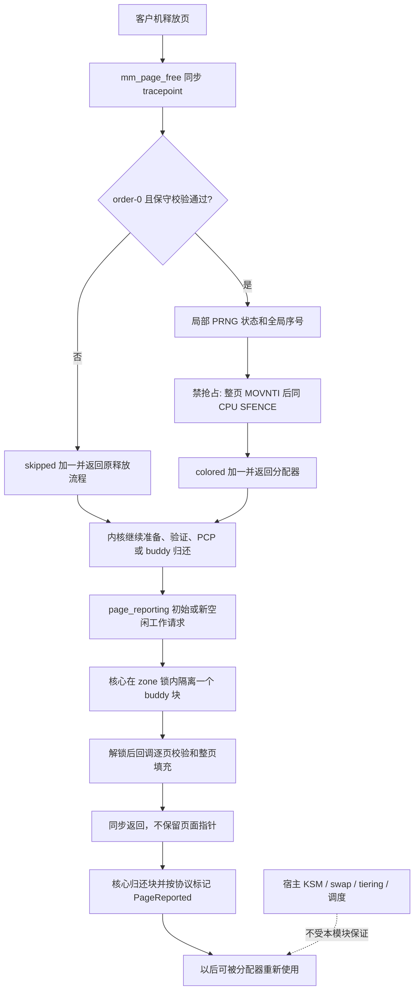

# anti-balloon 架构、边界与验证记录

## 1. 文档范围

本文记录 2026-11-02 这一轮 `anti-balloon` 实现的实际行为、选择依据、测试证据和维护要求。它不是宿主机内存预留协议，也不把设计愿望、源码配置、VM 测试通过和生产部署成功混为一谈。

实现的准确定位是：**在明确受限的客户机内核生命周期中，尽力将部分空闲页改写成不易压缩、较难整页去重的内容；不保留大型用户态填充池，不承诺宿主机 DRAM 常驻，不承诺覆盖全部空闲页。**

本文仅补充文档，不执行生产配置变更、模块加载、服务重启或系统激活。现役部署状态另见第 14 节，不能从本文的源码示例推断已经完成部署。

### 1.1 源码入口

| 文件                                                                                         | 职责                                                                 |
| -------------------------------------------------------------------------------------------- | -------------------------------------------------------------------- |
| [`nixos/modules/optimize/anti-balloon.nix`](../nixos/modules/optimize/anti-balloon.nix)      | NixOS 选项、模块构建、systemd 服务、气球驱动阻断、保留的用户态填充器 |
| [`kfree_hybrid_ept.c`](../nixos/modules/optimize/anti-balloon-kernel-src/kfree_hybrid_ept.c) | 受限释放回调、隔离空闲页回调、整页写入、计数器及注册/卸载            |
| [`Makefile`](../nixos/modules/optimize/anti-balloon-kernel-src/Makefile)                     | 使用目标内核 Kbuild 构建和安装外置模块                               |
| [`anti-balloon-kernel-test.nix`](../tests/anti-balloon-kernel-test.nix)                      | 双 VM 功能、负向策略、压力、生命周期及微基准测试                     |
| [`anti-balloon-memory-test.py`](../tests/anti-balloon-memory-test.py)                        | 有界并发内存完整性 fixture                                           |
| [`nixos/hosts/hkg0/default.nix`](../nixos/hosts/hkg0/default.nix)                            | `hkg0` 选择内核后端并关闭用户态填充器                                |
| [`flake.lock`](../flake.lock)                                                                | 构建输入锁定；精确内核仍须从目标主机配置求值                         |
| [`flake/checks.nix`](../flake/checks.nix)                                                    | 现有 checks 清单；不能凭测试文件存在就假设新增了对应 flake check     |

源码中的模块名 `kfree_hybrid_ept` 是实现标识，不表示模块能控制宿主 EPT、读取宿主驻留状态或获得宿主内存锁定权限。

## 2. 原始目标与接受的取舍

本轮工作的业务背景是小内存 VPS 的高 CPU 等待现象，以及旧填充进程持有大量无业务用途内存的成本。原始目标按意图归纳如下，不将讨论中的理想化机制视为已经实现的承诺。

1. 区分 QEMU/KVM、Proxmox 和商业虚拟化的零页共享、去重、压缩、气球、空闲页报告与换出机制，避免针对错误原因优化。
2. 尽可能让客户机空闲页保持非零、难压缩的内容，并在释放路径上处理新释放的内存。
3. 尽可能影响长期空闲内存的活跃度估计，降低冷页被宿主回收后的延迟，但不增加明显 CPU 负担。
4. 不再为这一目的长期保留接近 1 GiB 的用户态假负载池，让业务可以正常使用客户机 RAM。
5. 不破坏内存所有权、分配器约束、用户态零初始化、安全策略或卸载时的回调生命周期。
6. 先用与目标相同的内核进行可重复 VM 验证，再单独评估生产临时激活和后续启动配置。

这些目标存在冲突。整页高熵改写要消耗 CPU 和内存带宽；不持有页就不能任意访问它；保留所有空闲页既不再是“空闲”，也会制造客户机压力；频繁触碰不能约束宿主的分配权。当前实现优先保证明确的生命周期和保守退出，接受低同步覆盖率、高阶页异步处理、无持续保温保证和非零成本。

### 2.1 明确非目标

- 不保证虚拟机的全部 RAM 始终位于宿主 DRAM，不阻止 host swap、NVMe tiering 或运营商调整资源。
- 不保证消除 CPU steal、宿主超售、存储拥塞或 vCPU 调度延迟。
- 不提供每隔固定秒数遍历全部空闲 PFN 的功能，不承诺周期性刷新全部 EPT accessed 位。
- 不修改宿主 KSM、QEMU RAM backend、Proxmox 内存预留或 VMware/Hyper-V 资源配置。
- 不关闭 KASAN、KMSAN、page poisoning、`init_on_free` 等安全或调试机制来迁就模块。
- 不覆盖所有内核版本、架构、释放类型、设备内存、内存热插拔或硬件故障情形。
- 不提供加密随机数、密码学擦除或跨 VM 内容唯一性的保证。
- 不以释放事件数代替唯一物理页覆盖率，不以一次微基准代替性能结论。

## 3. 两层内存管理不能混淆

客户机应用看到的是客户机虚拟地址。客户机内核把它映射到 guest physical memory，宿主再为该 guest physical memory 提供真实 backing。客户机分配器认为一页“空闲”，不代表宿主已经释放 backing；客户机认为一页“正在使用”，也不代表其 backing 一直在宿主 DRAM。

Linux 的 [KVM x86 MMU 文档](https://docs.kernel.org/virt/kvm/x86/mmu.html)明确说明，普通 guest memory 属于 VMM 的用户态地址空间，受宿主 Linux 内存管理控制，可能被宿主换出。因此 guest `SwapUsed=0` 不能证明没有 host swap，guest `mlock()` 也不是 host `mlock()`。

### 3.1 回收机制对照

| 机制                   | 实际发生什么                                                   | 随机填充的作用与边界                                        |
| ---------------------- | -------------------------------------------------------------- | ----------------------------------------------------------- |
| Demand-zero / 共享零页 | 尚未实际写入的内存可能不需要独立物理 backing；读零可以共享零页 | 写入会使部分 backing 实体化，但不建立永久预留               |
| KSM / TPS 整页去重     | 内容相同的候选页共享 backing，写入时 COW                       | 不同内容降低相等概率；不能阻止换出，写入还可能产生 COW 成本 |
| 压缩                   | 在保留逻辑内容的前提下使用更小的编码                           | 高熵数据通常难压缩，但仍可存到 swap 或其他层级              |
| Balloon inflation      | guest driver 占用客户机页并让宿主收回 backing                  | 交还页的原内容无关紧要；随机内容不能阻止有权交还它的驱动    |
| Free-page reporting    | 客户机暂时隔离空闲页，允许宿主丢弃内容后归还客户机分配器       | 报告已经授权 discard，内容非零不是保护条件                  |
| Free-page hinting      | 提供空闲页信息；在所检查的 QEMU 路径中用于减少迁移传输         | 不是普通运行时 reporting 的同义词                           |
| Host swap              | backing 的内容转移到宿主 swap，按需恢复                        | 随机页一样可以换出；guest swap 统计看不到全部过程           |
| Memory tiering         | 宿主在 DRAM 与其他介质之间管理内存层级                         | 即便不被产品称为传统 swap，也不等于 DRAM-only               |

“冷”不等于“允许丢弃”。正确的虚拟化实现不能因为一页长期未访问，就无条件把仍有效的非零业务数据变成零。它必须保留内容、采用正确的 COW，或者获得该页内容可丢弃的协议许可。

### 3.2 QEMU/KVM 与 Proxmox

KSM 是内容匹配，不是理解客户机 `/proc/meminfo` 的空闲页探测器。Linux KSM 扫描有资格合并的映射；QEMU 的 `mem-merge` 或 RAM backend 的 `merge` 控制资格，宿主扫描器是否实际运行仍是另一件事。合并页也可能被换出。参见 [Linux KSM](https://docs.kernel.org/admin-guide/mm/ksm.html)、[QEMU 参数](https://www.qemu.org/docs/master/system/invocation.html)和 [Proxmox KSM](<https://pve.proxmox.com/wiki/Kernel_Samepage_Merging_(KSM)>)。

Proxmox 的 fixed memory 主要表示不按最小值/最大值动态调整客户机分配量，并不等于锁定 QEMU backing。官方文档说明，固定分配时仍可保留 balloon device 用于统计；`balloon: 0` 是禁用该设备，而不是宿主 no-swap 的证明。自动分配可对客户机制造压力，继而导致 guest reclaim、guest swap 或 OOM。具体默认值和设备特性以部署版本为准，参见 [Proxmox Memory](https://pve.proxmox.com/pve-docs/chapter-qm.html#qm_memory)。

在已检查的 [QEMU virtio-balloon 实现](https://gitlab.com/qemu-project/qemu/-/blob/master/hw/virtio/virtio-balloon.c)中，`free-page-hint` 与 `free-page-reporting` 是不同 feature/queue/property：前者联系迁移路径，后者可以调用 `ram_block_discard_range()`。不得以其中一个的状态推断另一个。上游默认值也不能替代对管理平台生成的实际 QEMU 参数的检查。

QEMU 迁移中的零页编码、XBZRLE 等优化也不意味着它始终压缩所有运行中 VM 的冷内存。宿主 Linux 可能另有 [zswap](https://docs.kernel.org/admin-guide/mm/zswap.html)；这仍属于另一层。写满不可压缩内容可能增加迁移、快照和宿主存储负担。

### 3.3 VMware 压缩与分层

VMware 的 balloon 驱动让客户机选择回收对象，但 ESXi 还可以不依赖客户机配合而换出 VM 页。vSphere 9 的文档描述了内存压缩缓存：符合压缩阈值的换出候选可以先被压缩；不可压缩并不代表不可换出。现代 TPS 的跨 VM 策略也与历史默认值不同，不能把所有 ESXi 版本视为同一策略。

vSphere 9 的 Memory Tiering over NVMe 是独立功能，文档默认关闭；启用后，VM memory 可以使用 DRAM 与 NVMe 层级。因此讨论“没发生传统 swap”时仍须核对 tiering。内存 reservation、准入控制、tiering opt-out 都是宿主管理决策，不由 guest 随机填充器代替。

官方依据：[Balloon Driver](https://techdocs.broadcom.com/us/en/vmware-cis/vsphere/vsphere/8-0/vsphere-resource-management/administering-memory-resources/memory-balloon-driver.html)、[Memory Reclamation](https://techdocs.broadcom.com/us/en/vmware-cis/vsphere/vsphere/8-0/vsphere-resource-management/administering-memory-resources/memory-reclamation.html)、[vSphere 9 Compression](https://techdocs.broadcom.com/us/en/vmware-cis/vsphere/vsphere/9-0/vsphere-resource-management/administering-memory-resources/memory-compression.html)、[TPS Policy](https://knowledge.broadcom.com/external/article/318959)、[Memory Tiering](https://techdocs.broadcom.com/us/en/vmware-cis/vsphere/vsphere/9-0/vsphere-resource-management/memory-tiering-over-nvme.html)。

### 3.4 Hyper-V Dynamic Memory

Hyper-V Dynamic Memory 根据 guest 配合、已提交内存信息、最小/最大内存和 buffer 策略调整内存，不宜套用“ESXi 压缩然后换出”的统一模型。Microsoft 将正常 guest paging 与 Smart Paging 区分：后者是特定重启条件下的临时机制，不是运行中 VM 的常规超配机制。

Linux `hv_balloon` 还包含在支持条件下使用 cold-discard hypercall 的空闲页报告路径。传统 balloon 与 free-page reporting 仍须分别分析。阻断 `hv_balloon` 也可能损失 Dynamic Memory 和热添加等平台集成功能，不能把黑名单当作无副作用开关。

官方依据：[Hyper-V Dynamic Memory](https://learn.microsoft.com/en-us/windows-server/virtualization/hyper-v/dynamic-memory)、[Linux hv_balloon 源码](https://raw.githubusercontent.com/torvalds/linux/refs/heads/master/drivers/hv/hv_balloon.c)。

### 3.5 活跃度、swap 与“不可见内存”

宿主可以利用二级页表的 accessed 信息、MMU notifier 或产品自有 working-set 采样了解访问情况，而无须知道 guest 中哪个应用持有一页。EPT accessed 与迁移 dirty tracking 也不是一回事。一次访问最多影响某次观测，不能为未来采样周期或驻留时间提供承诺。

| guest 操作                | 能影响什么                                  | 不能保证什么                                           |
| ------------------------- | ------------------------------------------- | ------------------------------------------------------ |
| `mlock()`                 | guest 内核对该映射的换出                    | host backing 不换出、进程不被杀、宿主及时调度          |
| `swapoff` / 低 swappiness | guest 的回收选择                            | host 无 swap；压力也可能转为 guest OOM                 |
| `MADV_FREE`               | guest 可以在压力下丢弃相应匿名页内容        | 页面已立刻释放、RSS 不计费或 host 不换出               |
| `memfd` / tmpfs / shmem   | 改变对象与映射形式                          | “隐身”内存、永久驻留；这些页面依然有内存账本和回收规则 |
| 周期读取                  | 可能影响 guest/host aging，可能触发 refault | 覆盖全部物理页或阻止宿主换出                           |
| 随机写入                  | 降低部分去重/压缩机会                       | 内容永久不变或禁止报告/discard                         |

真正要求宿主 no-swap，需要宿主管理员核对 QEMU memory locking、libvirt `<locked/>`、适当的 reservation 或真实 host HugeTLB backing，并承担容量和 OOM 风险。guest THP、guest HugeTLB、guest `mlock()` 不能自动变成 host HugeTLB 或 host 锁定。

参见 [mlock(2)](https://man7.org/linux/man-pages/man2/mlock.2.html)、[tmpfs](https://docs.kernel.org/filesystems/tmpfs.html)、[memfd_create(2)](https://man7.org/linux/man-pages/man2/memfd_create.2.html)、[libvirt Memory Backing](https://libvirt.org/formatdomain.html#memory-backing)、[HugeTLB](https://docs.kernel.org/admin-guide/mm/hugetlbpage.html)。

## 4. 为什么不使用 PFN 扫描或小池循环

### 4.1 `refcount == 0` 不是所有权证明

本轮对精确 Linux 7.3.0 源码的审计确认，引用计数为零不仅可能表示 buddy/PCP 空闲页，也可能表示暂时 frozen 的 folio，或者分配器已经交给调用者、尚未建立普通引用计数的 private frozen allocation。迁移、拆分和分配准备期间都可能出现不能被旁观者触碰的零引用状态。

因此，下列手法都不构成安全写入协议：扫描 PFN 后看一次引用计数；重复检查；使用 `READ_ONCE()`；加屏障；检查后再做 `CAS(0 -> 1)`。这些操作不能与真实拥有者约定排他生命周期，可能错误地接管正在迁移或已经私有分配的页。

### 4.2 `PageBuddy` 也不是通用通行证

`PageBuddy` 主要标记 buddy 空闲块的头页，不是该块每个 base page 都携带的“空闲”标签。看到它为假不能断言该页不在空闲块中；无锁看到它为真，也不能保证下一条指令时仍然空闲。

在合法且生命周期稳定的 zone 上，持续持有相应 `zone->lock` 时检查 buddy 链表成员关系，才能排除同一 buddy 分配器的并发使用。这个锁不自动保护 PCP、已隔离页、准备中的页或 frozen allocation。检查后释放锁，再往原指针写数据仍然是竞争。

在关闭中断的 zone 自旋锁内长时间填充又会制造不可接受的延迟。合理的原生内核设计应在锁内隔离有界块，在锁外处理，再按协议归还，并处理 hotplug 生命周期。本轮所需的一些底层隔离、归还和内存在线同步 helper 并未导出给外置模块；不能靠一个已导出的节点指针弥补整个协议。

### 4.3 小批量 LIFO 循环不能扫遍 RAM

“分配少量页、填充、释放、继续分配”在持有有效分配时可以是内存安全的，但不是全内存遍历算法。PCP 常以头部插入和头部取出的方式工作，小批量循环会反复拿回刚归还的同一组页。迭代次数很多只说明回收次数多，不说明唯一 PFN 覆盖很多。

增大常驻池只能扩大它自己拥有的集合；锁住整个池则直接消耗客户机可用内存。当前实现不通过这种方式伪造“无占用的全内存保温”。

## 5. 当前内核架构

内核后端由两个互补但不完整的入口组成：同步处理部分 `order-0` 释放事件，异步处理 page-reporting framework 真正隔离的 buddy 空闲块。二者调用相同的整页填充函数。



图中 reporting 不是把这些页上报给 hypervisor。模块只是借用 Linux 的已隔离页回调，执行本地写入，不发 virtio descriptor、Hyper-V hypercall 或 discard 请求。

### 5.1 双重版本限制

NixOS assertion 要求 `pkgs.stdenv.hostPlatform.isx86_64` 且 `kernel.modDirVersion == "7.3.0"`。C 预处理条件再次要求 `CONFIG_X86_64` 和 `LINUX_VERSION_CODE == KERNEL_VERSION(7, 3, 0)`。

这表示当前仅审计了精确的 x86_64 Linux 7.3.0 路径，不是“Linux 7.3 及以后均支持”。版本号相同也不是任意下游补丁的自动批准：目标 kernel config、补丁、结构布局、导出符号与调用顺序仍须一起审计。

外置模块通过 `kernel.moduleBuildDependencies`、目标 `kernelModuleMakeFlags` 和 `${kernel.dev}/lib/modules/${kernel.modDirVersion}/build` 构建，Makefile 调用内核的 `modules` 与 `modules_install`。不存在复制一套独立内核头文件或向运行中内核注入 ABI 猜测的路径。

### 5.2 同步释放入口

当前使用枚举查找名为 `mm_page_free` 的 tracepoint，再调用通用 tracepoint 注册 API。没有基于函数入口 ABI 的 kprobe，没有探测 `free_unref_page` 返回值，也没有在页面已经进入空闲链表后保留裸指针再写。

精确 7.3.0 中的这个 tracepoint 位于 `__free_pages_prepare()` 早期，在主要的 free-page validation、调试对象/锁检查、poison、释放清零和架构处理之前。它提供本次同步释放的时间窗口，但不意味着传入的任意页都已经完成安全验证。

这正是保守校验和 instrumentation 禁止条件存在的原因。**可使用的生命周期来自同步调用点及其内核协议，不来自引用计数检查本身。** Tracepoint 通常是观测接口，此处修改页内容是针对精确实现的窄范围设计，不是通用 tracepoint 对写入安全的承诺。

### 5.3 释放回调的筛选条件

`on_page_free()` 当前遇到以下任一情况就不写入，并将 `free_events_skipped` 增加一次。

| 条件                                          | 保守拒绝的原因                                             |
| --------------------------------------------- | ---------------------------------------------------------- |
| `in_nmi()`                                    | 不把写页和额外原子操作引入 NMI 释放路径                    |
| `order != 0`                                  | 同步实现只接受单个 base page，不复制高阶/compound 拆解逻辑 |
| `PageCompound`                                | compound 元数据和释放准备不在此简化协议内                  |
| `PageReserved`、`PageHWPoison`、`PageOffline` | 不写保留、已知硬件损坏或离线页                             |
| `PageHighMem`、zone device                    | 不假设特殊内存具有普通 direct-map 访问语义                 |
| `page_ref_count(page) != 0`                   | 拒绝尚有引用的输入；零引用仍不是独立授权                   |
| 原始 `_mapcount != -1`                        | 拒绝尚不符合普通未映射状态的元数据                         |
| `page->mapping != NULL`                       | 不自行归一化匿名映射、类型复用等元数据                     |
| `page->flags.f & PAGE_FLAGS_CHECK_AT_FREE`    | 拒绝内核释放校验仍应处理的标志                             |
| `page_pool_page_is_pp()`                      | 不触碰 page-pool 特殊所有权                                |
| KFENCE 地址                                   | 不绕过 KFENCE 的受保护分配路径                             |
| `CONFIG_MEMCG` 下 `memcg_data != 0`           | 不自行处理尚有 memcg 状态的页                              |

这些条件有意产生大量 false negative，即跳过本来或许可以在更晚阶段处理的释放。它们不是整个分配器验证逻辑的复制品，也不宣称可以让本来错误的释放、其他内核内存破坏或硬件故障变得安全。

### 5.4 安全策略和调试机制

以下编译配置会直接触发构建拒绝：`CONFIG_KASAN`、`CONFIG_KMSAN`、`CONFIG_DEBUG_PAGEALLOC`、`CONFIG_DEBUG_OBJECTS_FREE`、`CONFIG_DEBUG_LOCK_ALLOC`、`CONFIG_PREEMPT_RT`。

原因不仅是性能。释放 tracepoint 早于某些检查，提前覆盖内容可能破坏检查依赖的对象或锁状态，也可能与 sanitizer、unmap 或 RT 上下文规则冲突。正确操作是保留安全配置并停用该后端，而不是为加载模块关闭保护。

初始化时若 `want_init_on_free()` 或 `page_poisoning_enabled_static()` 表示相关策略正在生效，则打印 `incompatible init_on_free/page_poison policy` 并返回 `-EOPNOTSUPP`。只编译了 page poisoning 支持，不等于运行时已经启用，因此使用实际运行状态判断。

模块不关闭或绕过 `init_on_alloc`。普通匿名用户态新映射仍必须满足内核零初始化语义；不能让用户态读到旧内容或本模块的随机数据。fixture 对 fresh mapping 为零的校验正是这一底线的一部分，但不能代替完整内核审计。

## 6. 页面写入与并发

### 6.1 整页标量写入

`color_page()` 通过 `page_address()` 获取已经由上层保证适用的普通页地址，对 `PAGE_SIZE / sizeof(u64)` 个字写入。当前 4 KiB base page 对应 512 个 64 位字。

写入使用标量 `MOVNTI`，不是 SIMD/FPU 指令，不依赖内核借用浮点状态。非临时写入的意图是降低缓存污染，但不能据此宣称零 cache 成本、零总线成本或某一机器上一定更快。

每次都完整改写 4096 字节，没有“首尾签名相同就略过中间”的捷径。页面在两次释放之间可能只改过中间部分；首尾看似仍是旧签名，不足以证明整页高熵状态仍在。

### 6.2 抢占与 `SFENCE`

tracepoint 本身不能被一概假定为禁止抢占。当前实现从开始 `MOVNTI` 循环前调用 `preempt_disable()`，直到同一 CPU 完成 `SFENCE` 后才 `preempt_enable()`。

这样做是为了让发出 streaming stores 的 CPU 自己完成所需的 fence，再允许页面被重新使用。不能先迁移 CPU，再期望另一 CPU 上的 `SFENCE` 自动排空原 CPU 的写入缓冲；也不能以普通编译器屏障或只针对普通 SMP store 的屏障替代该语义。

禁止抢占不是关闭所有中断。实现允许适用的嵌套执行，但不在释放回调内分配内存、睡眠、拿新锁或主动调度。reporting 工作上下文则在已完成单页 fence 后，每处理 16 个 base page 调用一次 `cond_resched()`；这是让出调度的机会，不是固定 CPU 配额。

### 6.3 随机状态

模块加载时用 `get_random_bytes()` 生成一次 `seed`。每个页面使用 `seed + atomic64_inc_return(&sequence)` 初始化栈上局部状态，然后用 SplitMix64 生成该页内容。

这里不是共享的可变 per-CPU PRNG 状态，所以不会因为抢占或中断嵌套丢失同一 CPU 的随机状态更新。全局原子序号为每次调用分配输入；每个调用自行推进自己的局部生成器。

SplitMix64 是廉价非密码学 PRNG。不能把它描述为 CSPRNG，也不能把不同输入等同于形式化的整页唯一性保证。全局原子序号和计数器还会引入跨 CPU cache-line 争用，属于实际成本的一部分。

## 7. `page_reporting` 隔离路径

### 7.1 所有权协议

Linux page-reporting core 在 `zone->lock` 下从 buddy 链表隔离块，释放锁后调用 reporter，回调返回后再把块归还。回调期间，普通分配器不能把该隔离块分配给其他使用者。

`color_reported_pages()` 逐项处理 scatterlist，按 `sg->length >> PAGE_SHIFT` 展开 base pages。它不在返回后保存页面指针，不异步继续访问，也不伪造 buddy 标志或自行插回链表。填充与归还由明确的核心协议串联。

隔离只排除分配器复用，不等于阻止所有硬件故障或离线标记变化。因此每个 base page 写入前仍检查 HWPoison、Offline、Reserved、HighMem、zone device 和 KFENCE。发现不适用页时，记录已完成的部分并返回 `-EIO`，使核心不会把整个部分填充块当作成功报告。

这个检查只能避免主动写入已知不适用页，不能消除恰好同时发生的新硬件故障，也不是硬件 poison 注入测试的替代品。

### 7.2 容量与 order 的准确含义

reporter 设置 `.capacity = 1`，表示最多一个 scatterlist 条目，不是每次最多一个 4 KiB 页。条目可以是一个高阶 buddy 块。

当前已审计配置中 `PAGE_SHIFT = 12`、`MAX_PAGE_ORDER = 10`，所以最大暂时隔离 payload 为：

```text
capacity * (PAGE_SIZE << MAX_PAGE_ORDER)
= 1 * (4096 << 10)
= 4,194,304 bytes
= 4 MiB
```

这部分在处理期间暂时不能给分配器使用，并不是“绝对零占用”。没有永久保留的大型 payload 池；模块代码、状态、栈、scatterlist、workqueue 等元数据仍有成本。4 MiB 只是当前精确配置的 payload 上限，不能在内核升级后不复核便沿用。

`.order = 0` 请求从 order-0 开始扫描，即最低扫描阶数，不是把最大回调块限制为 order-0。若全局 `page_reporting_order` 已由其他配置设置，核心保留该全局值，不一定采用本 reporter 的请求。排查时应读取实际参数。

### 7.3 不是周期性 EPT 保温

注册时核心提出初始工作请求，之后由新空闲页通知、预算和核心状态驱动进一步工作。已标记 `PageReported` 的块会被跳过，重新分配或合并等状态变化可能让它重新进入处理范围。

因此，即使看到 `page_reporting_delay_ms`，也不能把它解释为“每隔这个间隔重写全体空闲页”。该值是工作调度延迟，不是全页驻留 SLA；核心还受水位、预算、空闲链表状态和调度影响。PCP 页不直接属于这个 buddy 扫描路径，高压力下更不能承诺及时处理所有高阶页。

模块不修改 reporting core 的 work/state，不强清 `PageReported`，也不反复注册来模拟周期扫描。要实现真正持续的空闲页处理，需要重新设计原生有界隔离扫描器及其内核同步协议，不能给当前模块加一个裸 PFN 定时器就宣称完成。

### 7.4 不抢占其他 reporter

page-reporting 注册是单消费者接口。已有 reporter 占用时核心返回 `-EBUSY`，本模块不驱逐 virtio-balloon 或其他使用者。初始化会撤销已注册的 tracepoint，等待相关回调退出，再返回失败。

这也意味着它不是可以与任意 reporting driver 叠加的透明插件。`Free page reporting enabled` 是核心框架日志，本模块活动时不等于正在向宿主报告或 discard。

## 8. 初始化、服务与卸载

### 8.1 初始化顺序

1. 检查运行中的 `init_on_free` / page-poison 策略，冲突时不加载。
2. 初始化随机 seed，枚举找到 `mm_page_free`；找不到则返回 `-ENOENT`。
3. 注册同步释放回调；错误直接上报。
4. 注册 page reporter；失败则撤销 tracepoint 并调用 `tracepoint_synchronize_unregister()` 清理。
5. 打印包含 `order-0 release hook, isolated reporting, movnti; no host residency guarantee` 的活动日志。

不能只检查某条较早的框架日志就宣布初始化成功；应同时检查服务结果、模块目录和最终活动日志。

### 8.2 卸载顺序

实际 `kfree_hybrid_exit()` 顺序是：

```text
tracepoint_probe_unregister()
tracepoint_synchronize_unregister()
page_reporting_unregister()
打印 unloaded
```

第一个操作停止新的 tracepoint 注册入口，第二个等待已有 tracepoint 执行结束。精确内核的 tracepoint 同步机制不等同于普通 `synchronize_rcu()`，不能随意替换。最后的 reporting unregister 由核心撤销消费者并同步取消/等待相关 delayed work。

只有两条回调生命周期都结束，模块代码和数据才可释放。强制卸载绕过的正是这类保护，不能用于消除停机等待或掩盖问题。

### 8.3 systemd 语义

`anti-balloon-kernel.service` 为 `Type=oneshot`、`RemainAfterExit=true`，具有 `ConditionVirtualization=vm`，启动和停止超时均为两分钟。当前由 `multi-user.target` 拉起，并排序在 `systemd-modules-load.service` 之后，而不是等待拉起自己的 `multi-user.target`，避免不必要的延后或依赖排序问题。`active (exited)` 是正常预期，含义是加载命令成功结束，不是有一个常驻填充进程。

服务状态不能代替 `/sys/module/kfree_hybrid_ept` 的实际状态；手工卸载后，oneshot 状态可能与模块存在性不一致。服务也没有为内核回调设置 CPUQuota；不能把 systemd 加载命令的 CPU 用量视为后续 kernel work 的总成本。

### 8.4 不重启激活时的模块搜索路径问题

此前服务启动和停止使用 `modprobe kfree_hybrid_ept` 与 `modprobe -r kfree_hybrid_ept`。在线排查发现的问题是：NixOS 默认模块搜索路径仍可能指向 `/run/booted-system/kernel-modules`；新 generation 虽然构建了 `.ko`，未重启时 booted generation 的模块树里仍没有它，因而出现 `Module ... not found`。

这不同于模块本身的初始化失败，也不一定是编译失败。交付前重新读取的实际源码已经将服务改成如下 Nix 字符串，路径由本次构建的模块 derivation 决定，而不是查找 booted generation：

```nix
ExecStart = "${pkgs.kmod}/bin/insmod ${kernelModule}/lib/modules/${kernel.modDirVersion}/updates/kfree_hybrid_ept.ko.xz";
ExecStop = "${pkgs.kmod}/bin/rmmod kfree_hybrid_ept";
```

执行前仍必须核实目标 Nix-store 文件的真实路径、压缩格式、运行中 `uname -r`、完整 `vermagic` 和依赖。`insmod` 不自动解析依赖，不能跳过这项检查；也不能使用 force 选项绕过 ABI 不匹配。这里的 `.ko.xz` 是当前构建布局，不是所有未来内核配置的必然输出。

源码加载方式已修改，不等于生产服务已成功采用或初始化成功。实际部署验证仍保留在第 14 节由执行会话填写。

## 9. NixOS 配置接口

所有相关选项属于 **`services.anti-balloon`**，不是 `programs.anti-balloon`，也没有独立的 `services.kfree-hybrid-ept` 用户选项树。

| 选项              | 默认值   | 当前含义                                             |
| ----------------- | -------- | ---------------------------------------------------- |
| `enable`          | `true`   | 导入模块后启用整体策略                               |
| `memoryFiller`    | `true`   | 保留的用户态随机池；启用内核后端必须显式设为 `false` |
| `kernel.enable`   | `false`  | 实验性精确版本内核后端                               |
| `cpuQuotaPercent` | `5`      | 只限用户态填充服务，按单个 CPU 百分比计              |
| `interval`        | `"3m"`   | 用户态扫描/重填间隔；`null` 或空串只保留初始分配     |
| `safetyMarginMB`  | `512`    | 用户态安全余量，代码按 MiB 换算并对小内存自适应      |
| `fillMode`        | `"full"` | 用户态 full 或 sparse；不改变内核后端的整页改写      |
| `bootMemtest`     | `false`  | 可选 `memtest=1`，不是随机化或驻留机制               |

`hkg0` 的源码选择如下：

```nix
services.anti-balloon = {
  memoryFiller = false;
  kernel.enable = true;
};
```

同时开启两个后端会触发 assertion。内核不受支持、运行策略冲突或 reporter 被占用时，不会自动降级成一个大型用户态池；这种降级会改变资源占用，不能静默发生。

整体启用还会为 `virtio_balloon`、`vmw_balloon`、`hv_balloon`、`xen_balloon` 配置 blacklist 和 `install ... /bin/false`。这只阻止对应的可加载驱动路径，不会卸载已经加载的驱动，也阻止不了 built-in 驱动。必须检查实际内核和运行状态。

模块保留 QEMU Guest Agent 的独立配置。停止 qemu-guest-agent 不是关闭内核 balloon 的替代办法。`vm.swappiness = lib.mkDefault 0` 只改变 guest 回收倾向，不等于 `swapoff`，也不约束宿主 swap。

### 9.1 reporting 控制不要臆造

已研究的 upstream `virtio_balloon` 源码没有 `virtio_balloon.free_page_reporting=0` 这样的报告禁用参数。应对实际模块执行 `modinfo -p virtio_balloon`，不能把未经验证的参数写入配置并认为生效。

有权限的宿主管理端可以核对 QEMU `free-page-reporting=off` 或 libvirt `freePageReporting='off'`。禁用整个 balloon device 是更大的改动，会影响 balloon/统计等功能。

`page_reporting.page_reporting_order` 是核心阶数控制，不是通用 Boolean 开关。精确检查的源码会限制取值范围，不应依赖“设一个超大 order 就一定禁用”的技巧；文档和具体版本实现可能不一致。参见 [libvirt Balloon Device](https://libvirt.org/formatdomain.html#memory-balloon-device)及[核心源码](https://raw.githubusercontent.com/torvalds/linux/refs/heads/master/mm/page_reporting.c)。

## 10. 保留的用户态 `MADV_FREE` 后端

用户态实现仍保留给没有选择实验性内核后端的主机，不应在解释 `hkg0` 迁移时误称它已从仓库删除。

它通过匿名私有 `mmap` 获得页，建议 `MADV_NOHUGEPAGE`，按块填充后调用 `MADV_FREE`。页面在被 guest 实际回收前仍可能占用 RSS/cgroup 内存，扫描也会影响 guest LRU。它不是“不计内存的隐藏缓存”。

`full` 模式每 4 KiB 页写 512 个 SplitMix64 字，并确保首字节非零；`sparse` 模式每隔 256 字节写一个 64 位字，每页共 16 个字，即 128 字节。稀疏内容可以干扰整页相等判断，但余下大量零字节仍高度可压缩。

周期扫描读取页首，必要时检查中间位置；检测到被丢弃后重新读为零的页时重填，再标为 `MADV_FREE`。这依赖用户态映射及其合法生命周期，与内核后端的“任何接受页都整页重写”不同。它也不是内核端首尾签名跳过优化。

容量决策读取 `/proc/meminfo`，扣除本进程实际 `LazyFree`，并参考 cgroup 限额及用量；读不到 `LazyFree` 时退回已分配账本并警告。这是启发式 headroom 管理，不是 OOM 不可能发生的证明，也不能视为完整的任意 cgroup 层级安全模型。

常规主机保留余量会被限制在总量三分之一以内且至少 64 MiB；不超过 512 MiB 的微型主机采用总量约 10%、24 至 48 MiB 的边界。常规初始填充分块为 2 MiB，微型机为 4 MiB；周期重填的脏页批次以 2 MiB 为界。单次动态扩容最多 512 MiB，但初始总分配并不受这个动态扩容上限约束。

这些分块限制的是填充后尚未 `MADV_FREE` 的窗口，不是总 RSS、进程元数据或整个 guest 的内存上限。`interval = null` 或 `""` 禁止后台扫描与扩容，但初始映射仍常驻进程并等待回收，不是执行一次后立即退出。

服务使用 `CPUQuota=5%` 的默认硬上限，表示最多约 0.05 个 CPU，不是整台多核 VM 的 5%。`Nice=19`、batch 调度和 idle I/O 是额外倾向，不能代替 quota。`MemorySwapMax=0` 限制的是该 guest cgroup 的 swap，仍与 host swap 无关。

`OOMScoreAdjust=1000` 让填充器更适合被牺牲，但不能保证所有时刻业务都无损。退出时解映射也需要 CPU，在高 steal 和 quota 下可能很慢，所以服务停止预算为两分钟。

## 11. 成本、预算与常见算术误区

### 11.1 页数与触碰量

按 8 GiB RAM、4 KiB base page 计算：

```text
页数 N = 8 GiB / 4 KiB = 2,097,152

每页触碰一个 64 B cache line:
N * 64 B = 134,217,728 B = 128 MiB

每页触碰两个 64 B cache line:
N * 128 B = 268,435,456 B = 256 MiB

每页完整写 4 KiB:
N * 4 KiB = 8 GiB
```

因此“8 GiB 内存每页一条 cache line 只需 16 MiB”是错误的。两个 line 是 256 MiB，还没有计入页元数据、页表遍历、TLB、cache misses、COW、refault 或总线上的其他传输。

这里的 128 MiB / 256 MiB 是按独立 cache line 计算的触碰量示意，不是实际机器每轮一定产生的精确 DRAM 流量。cache 命中、写策略、NUMA、宿主 backing 和页表情况都会改变真实成本。

### 11.2 内核路径成本

同步路径每个接受事件至少要做一次完整 4 KiB 生成/写入、一个 `SFENCE`、全局序号和完成计数更新。若接受速率为 `R` 页/秒，则仅逻辑 payload 写入速率为：

```text
W = R * 4096 bytes/s
```

异步 reporting 每页还有检查和计数成本，每 16 页提供一次 `cond_resched()` 机会。`capacity=1` 限制隔离 payload，并不限制某一秒的累计处理页数；核心预算、水位和延迟也不是 systemd CPUQuota。

同步回调的耗时落在触发释放的内核执行上下文，reporting 多落在 workqueue。用户态填充器的 CPUQuota 对二者均不生效。测量调用进程 CPU 不足以覆盖所有异步 CPU，`anti-balloon-kernel.service` 的 oneshot CPU 统计同样不足。

### 11.3 对 guest 与 host 的副作用

整页改写会让宿主看到更多真实写入，可能触发 COW、dirty tracking、迁移重传或新的 host backing 分配。降低压缩/去重收益本身就可能增加宿主内存压力，继而换出其他页，不能预设净效果一定有利。

高阶释放只走可能较晚发生的 reporting，PCP 空闲页可能长时间不进入这条路径。页刚写过随机数据，不代表后来不会被初始化、再分配、报告或换出。未保留大型池是当前设计的优点，但不能据此声称没有任何资源代价。

## 12. VM 验证设计与结果

### 12.1 精确测试拓扑

[`anti-balloon-kernel-test.nix`](../tests/anti-balloon-kernel-test.nix) 接收 `pkgs` 和 `kernelPackages` 参数。测试必须从目标配置传入精确 kernelPackages，不能换成测试机器默认内核来绕过限制。

测试创建两台 VM，各 768 MiB RAM、2 个 vCPU，均关闭用户态填充器并启用内核后端配置。两次已完成的 KVM 记录使用了取消服务自动拉起、由脚本显式加载的版本；交付前的当前源码已恢复自动拉起，额外等待正常 VM 的模块服务启动后将其停止，再运行 absent 基线。这个改动将启动依赖和自动加载也纳入后续验证。

| 节点       | 特殊设置         | 目的                                       |
| ---------- | ---------------- | ------------------------------------------ |
| `machine`  | 默认安全策略     | 正常加载、计数、完整性、压力、卸载和重载   |
| `hardened` | `init_on_free=1` | 验证模块拒绝不兼容策略，而不是修改安全配置 |

当前源码先验证正常 VM 的服务自动启动并停止，再执行下列主要检查。后续 absent 基线仅表示测量时模块已卸载，不再表示本次启动以来从未加载过；解释新的对照结果时应保留这一区别。

1. `hardened` 的 `modprobe` 必须失败，模块目录不存在，内核日志存在策略冲突提示。
2. `machine` 在模块缺席时运行三次微基准和内存完整性 fixture，建立基本对照。
3. 启动模块服务，确认没有 `virtio_balloon`，等待 `reported_pages_colored > 0`。
4. 模块加载后再跑三次微基准和 fixture，要求同步完成计数比 fixture 前增加。
5. 执行 `stress-ng --vm 2 --vm-bytes 160M --vm-method all --verify --timeout 15s`。
6. 用 systemd 管理 180 秒上限的并发 churn，确认 churn 仍在运行后，完成三次停止模块、确认消失、再加载。
7. 停止 churn，再运行 fixture，打印最后一轮加载周期的计数器，最终卸载并再校验一次。
8. 对内核日志执行 `BUG:|Oops:|WARNING:|Bad page state|general protection fault` 负向检查。

### 12.2 内存完整性 fixture 的覆盖

fixture 用两个 `fork` worker，各循环创建 8 MiB 私有匿名映射，共运行约 15 秒，父进程总期限为 25 秒。两个 worker 通过 barrier 同步开始。

每次迭代先完整读取新映射并要求全零，再由带 worker/iteration 标识的 SHAKE-256 生成 payload，写满并校验；一个 worker 保持约 5 ms，另一个约 150 ms，再次完整比较，以覆盖一边保留数据、另一边频繁分配释放的情形。每个 worker 至少完成两次迭代。

fixture 会建议 `MADV_HUGEPAGE`，因此可以触及适用的 THP 场景，但 `madvise` 建议不是实际拿到 THP 的证明。微基准则显式 `MADV_NOHUGEPAGE`，两者目的不同。

两个 worker 的映射、payload、零缓冲和比较临时缓冲峰值估计约 64 MiB，设计上在 128 MiB fixture 预算内留出 Python 开销。这个预算不是 cgroup 硬限额，也不包括整个 VM、内核和同时运行的其他测试程序。

fixture 不能验证所有 PFN 是否被随机化，不能观察 host swap，更不能模拟全部硬件 poison、hotplug、NUMA、IRQ 或 sanitizer 组合。

### 12.3 执行口径

第一次沙箱执行因 KVM 权限不足退回 TCG，随后出现时序/计时问题，生命周期测试没有整体通过。它不能作为可靠的性能数据，也不能改写成“测试 derivation 已通过”。后来调整了测试中的 churn 生命周期，并用具有 `/dev/kvm` 权限的当前用户直接运行构建好的测试 driver。

**有效证据是精确内核、双 VM 的直接 KVM driver 执行通过两次。本文不声称 `nix build` 执行完整 test derivation 已成功。** 构建 `.driver` 与让 Nix sandbox 成功执行测试是不同阶段。

本轮已有输出记录的两次 KVM test script 完成时间分别为 93.76 秒和 94.48 秒；第二次在脚本结束后正常 cleanup。输出不必有字面 `PASS` 横幅，成功判断依据是所有断言/subtest 完成和正常退出。

两次记录发生在第 8.4 节的服务加载路径、启动排序和测试自动启动检查修正之前。它们是所测内核后端和当时测试版本的证据，不能自动视为已经重新验证了后续改动；按第 13 节重新构建 driver 才会使用当前源码，新增执行结果须另行记录。

### 12.4 第二次 KVM 的计数器

| 计数器                   | 最终打印值 | 含义                                                |
| ------------------------ | ---------: | --------------------------------------------------- |
| `free_pages_colored`     |     10,725 | 当前加载周期内，接受并完成写入的 order-0 释放事件数 |
| `free_events_skipped`    |  2,566,328 | 当前加载周期内，释放回调跳过的事件数                |
| `reported_pages_colored` |     29,569 | 当前加载周期内，经隔离回调完成写入的 base page 次数 |

这些是**最后一次重载之后**的计数器，不是整个测试全过程累计。卸载会销毁状态，再次加载从零开始；同一物理页可以重复出现，同一页也可能先被同步路径处理、之后又被 reporting 处理。

`skipped` 对高阶释放只按一次事件计，而 reporting 按 base page 计，分母单位也不相同。不能把 `10,725 / (10,725 + 2,566,328)` 当作 RAM 覆盖率，不能用两种 colored 数简单相加推断唯一页数。大量 skipped 符合保守筛选的预期，同时也是同步覆盖有限的真实限制。

### 12.5 1 GiB churn 微基准

基准每次执行 128 轮 `8 MiB mmap -> MADV_NOHUGEPAGE -> memset -> munmap`，累计写入量 1 GiB，不是同时持有一块 1 GiB 映射。每种状态运行三次，对程序自己打印的 `CLOCK_MONOTONIC` wall 和 `CLOCK_PROCESS_CPUTIME_ID` process CPU 分别取中位数。

| 模块状态 | wall 中位数，秒 | process CPU 中位数，秒 |
| -------- | --------------: | ---------------------: |
| absent   |        0.465695 |               0.465575 |
| loaded   |        0.413363 |               0.413261 |

这是程序内部的计时值，不是测试 driver 包装命令的时间。loaded 数值较低**不能证明模块带来加速**：样本少、先后顺序固定、缓存/分配器状态和调度噪声均会影响结果，且 process CPU 不包含独立 kworker 的全部异步开销。该基准也未测 tail latency、宿主 DRAM 驻留、迁移或长期业务吞吐。

若以后需要性能结论，应使用更多交错/随机顺序重复、明确记录宿主 steal、控制 VM/host 内存压力，并采集整机 CPU 与 workqueue 活动；不能把这一组数值变成产品性能承诺。

### 12.6 生命周期与诊断

| KVM 轮次       | 压力下三次停止命令耗时 | 最终停止耗时 |
| -------------- | ---------------------- | ------------ |
| 第一次有效 KVM | 0.43 / 0.31 / 0.52 秒  | 0.08 秒      |
| 第二次有效 KVM | 0.18 / 0.13 / 0.14 秒  | 0.08 秒      |

这些是测试日志中 `systemctl stop anti-balloon-kernel` 的完成时间，包含服务命令路径，不是仅测某一个 RCU primitive。它们说明已测 churn 条件下卸载能结束，不是未来任何高压力机器的停止上限。

已检查输出未出现 kernel BUG/Oops，最终指定 warning/bad-page/fault 检查也通过；第一轮摘要未发现 RCU stall。外置模块及未提供受信签名产生的 taint 提示是另一类诊断，不应伪装成完全没有任何内核提示。若宿主或 guest 启用了签名强制策略，模块仍可能被拒绝。

两次短时 VM 通过不等于穷尽并发安全证明，不等于长期硬件压力、持续 poison/hotplug 故障注入、生产数天负载或所有 guest workload 已验证。

### 12.7 本地证据定位

本轮执行会话提取的本机日志位置如下，它们不是仓库文件，也不保证在其他机器长期存在。应在正式发布或后续验证时单独保留对应日志。

- 第一次有效 KVM：`/home/tippy/.local/share/kilo/tool-output/tool_19ce132d9001bLUkWOYPrE5JKH`，脚本结束约在 L2157，最终计数在 L2174-L2176。
- 第二次有效 KVM：`/home/tippy/.local/share/kilo/tool-output/tool_19ce5ee8d001KL1s7e3wK4316s`，结束及 cleanup 在 L2167-L2178，微基准及最终计数在 L2183-L2187。

## 13. 可重复的安全 VM 验证

以下是供维护者执行的测试方法，不表示本文写作会话重新运行过这些命令。生产节点不应承担测试 driver 的破坏性压力和频繁加载卸载。

### 13.1 锁定构建输入

在 `/home/tippy/source/flakes` 工作目录运行，使用仓库当前 `flake.lock` 与 `hkg0` 的 kernelPackages，不访问全局 flake registry，不运行 `nix flake update`。

```bash
git status --short
nix eval --offline --raw \
  .#nixosConfigurations.hkg0.config.boot.kernelPackages.kernel.modDirVersion
nix build --offline --no-link --print-out-paths \
  .#nixosConfigurations.hkg0.config.system.build.anti-balloon-kernel
```

核对结果必须为审计范围内的内核。模块文件、Nix 模块和 fixture 必须真实进入测试 derivation 的 source；Git flake 通常忽略未纳管文件，因此未纳管新增文件可能导致求值缺失。不要为“让测试可见”顺带暂存无关修改，也不要把工作区已有改动还原。

当前测试文件未自动暴露为 `checks.x86_64-linux.anti-balloon-kernel`。可直接导入它并构建 driver：

```bash
driver=$(nix build --offline --impure --no-link --print-out-paths --expr '
  let
    flake = builtins.getFlake (toString ./.);
    host = flake.nixosConfigurations.hkg0;
    pkgs = import flake.inputs.nixpkgs { system = "x86_64-linux"; };
    test = import ./tests/anti-balloon-kernel-test.nix {
      inherit pkgs;
      kernelPackages = host.config.boot.kernelPackages;
    };
  in test.driver
')
test -x "$driver/bin/nixos-test-driver"
```

`--impure` 用于本地路径求值，不代表使用未锁定的 nixpkgs。`--offline` 假设所需输入/构建依赖已在本地；缺少时应显式准备锁定依赖，而不是改用 registry 的任意当前版本。此处只构建 `.driver`，不声称已运行 `.test` derivation。

### 13.2 用有 KVM 权限的用户运行

先检查 `/dev/kvm` 与当前用户权限，再运行 driver。两台 VM 共配置约 1.5 GiB guest RAM，另需 QEMU、driver 和宿主余量。

```bash
id
ls -l /dev/kvm
test -r /dev/kvm && test -w /dev/kvm
ls -ld /tmp/kilo
work=$(mktemp -d /tmp/kilo/anti-balloon-kvm.XXXXXX)
"$driver/bin/nixos-test-driver" --no-interactive -o "$work"
```

应检查 QEMU/driver 实际使用 KVM，而不仅是设备文件可读写；出现 `failed to initialize kvm`、permission denied 或 TCG fallback 时停止性能解释并先修复运行环境。不要通过放宽所有用户设备权限或关闭测试超时掩盖问题。成员组刚变更时还须确认当前进程凭据已经更新。

这里沿用两次有效执行的锁定 nixpkgs 导入方式与 `--no-interactive` 模式，只增加独立输出目录便于保留证据。当前锁定 driver 没有 `--run-tests` 参数，不应添加这个未经支持的开关。

保留完整日志与输出目录，记录 flake.lock、源码修改状态、kernel version/config、QEMU/driver 路径、KVM 状态、运行用户和宿主负载。微基准应读取程序打印的 JSON 中位数，不从外层测试耗时反推。

### 13.3 验收与故障处理

- 正常 VM 必须实际加载模块，并观察两条路径的计数变化，而不是只看服务 active。
- hardened VM 必须因安全策略拒绝，不得为通过测试移除 `init_on_free=1`。
- fixture、stress-ng、加载卸载和最终日志检查必须全部完成；一项失败就保留失败现场。
- 新出现 BUG/Oops、bad page、数据不一致、RCU stall、软锁死或卸载挂起时停止推进部署；不要强制卸载或继续跑生产试验。
- 增加的安全测试应覆盖当前变更的假设，但不能要求启用已明确不支持的 instrumentation 后仍成功加载。
- reporting 被占用、低水位导致计数迟缓和版本拒绝应分别分类，不要统一归咎于“内存不够”。

## 14. 当前部署快照

**由执行会话验证后补充**

本节刻意不填“生产已部署成功”。已知源码中 `hkg0` 选择了内核后端，VM 验证有两次有效 KVM 通过；执行会话正在核对临时激活和模块加载路径。任务交接时，boot generation 尚未改变。

执行会话完成后应补充：运行中的 `uname -r`；目标 `.ko` 路径和 `vermagic`；实际服务 `ExecStart` / `ExecStop`；模块和计数器状态；业务健康检查；`/run/current-system`、`/run/booted-system` 及 boot generation 的区别；是否仅临时激活；失败、回滚或重启需求。

临时激活成功也不能自动改写成下次启动配置已更新，成功构建 system closure 更不能代替服务启动和业务健康证据。

## 15. hkg0 故障背景与排查命令

### 15.1 历史观察不是因果证明

此前 `hkg0` 约有 1.9 GiB guest RAM，旧用户态池约持有 954 MiB，观测到约 85% 至 96% 的 CPU steal。停止旧池后，可用内存回到约 1 GiB，但 steal 仍约 90%。

这支持“停止假内存池并未消除宿主调度等待”的结论，不支持“模块已修复 host swap”或“旧池就是全部 CPU 满载原因”。steal 是 vCPU 得不到运行时间的观测，与 guest 用户态进程实际 CPU 消耗不能相加混称为同一瓶颈。

同轮还发现独立的 Janus 重启循环：缺失 public IPv4 映射导致启动前检查失败，后续观察累计约 37,537 次重启。仓库 [`nixos/modules/nextcloud/data.nix`](../nixos/modules/nextcloud/data.nix) 已为 `hkg0` 补充 `103.231.56.56`。这是配置来源修复，不是 anti-balloon 内存算法的一部分，也不能宣称它解决了 85% 至 96% steal。生产是否采用该修复仍需部署证据。

### 15.2 优先只读检查

在目标 guest 执行下列命令时，先区分服务、模块、运行内核和 generation；不要先重启服务来抹掉现场。

```bash
uname -r
systemd-detect-virt
systemctl status anti-balloon-kernel anti-balloon --no-pager
systemctl show anti-balloon-kernel \
  -p ActiveState -p SubState -p ExecStart -p ExecStop -p Result
systemctl cat anti-balloon-kernel
readlink -f /run/current-system
readlink -f /run/booted-system
readlink -f /run/booted-system/kernel-modules
journalctl -u anti-balloon-kernel -b --no-pager
journalctl -k -b --no-pager
```

确认文件存在后检查计数器：

```bash
ls /sys/module/kfree_hybrid_ept/parameters
for name in free_pages_colored free_events_skipped reported_pages_colored; do
  printf '%s=' "$name"
  cat "/sys/module/kfree_hybrid_ept/parameters/$name"
done
cat /sys/module/page_reporting/parameters/page_reporting_order
cat /sys/module/page_reporting/parameters/page_reporting_delay_ms
```

这些计数器权限为 `0444`，只能读取，不能作为运行时开关写入。报告参数是否存在取决于实际内核配置；缺少某个 sysfs 文件应结合内核配置解释。采样差值前后须确认没有重载，否则 epoch 不同。

检查驱动与策略：

```bash
lsmod
modinfo -p virtio_balloon
cat /proc/cmdline
sysctl vm.swappiness
cat /proc/meminfo
cat /proc/pressure/memory
cat /proc/pressure/cpu
vmstat 1 10
```

`lsmod` 只列可加载模块，不能排除 built-in；sysfs、kernel config、启动日志和设备状态应共同核对。guest `vmstat` 的 `si/so` 主要描述 guest swap，不能观察宿主全部 swap；`st` 是 steal。没有宿主权限时，应将宿主 swap/compression 结论标为不可直接观测，而不是用 guest 的零值填补。

### 15.3 按错误类型定位

| 现象                                           | 优先核对                                                        | 不应采取的捷径                                   |
| ---------------------------------------------- | --------------------------------------------------------------- | ------------------------------------------------ |
| `Module ... not found`                         | 搜索树是否仍为 booted generation；目标 store `.ko` 是否实际存在 | 为了搜索到文件就强制重启生产，或复制模块覆盖旧树 |
| `Invalid module format`                        | `uname -r`、完整 vermagic、符号版本、内核构建与补丁             | `--force-vermagic`、`--force-modversion`         |
| Unknown symbol                                 | 依赖是否内置/已加载；导出符号与 module config                   | 绕过导出限制或修改任意内核内存                   |
| `incompatible init_on_free/page_poison policy` | 实际安全策略；选择停用后端                                      | 关闭安全策略只为加载模块                         |
| reporting registration failed / `-EBUSY`       | 其他 reporter、已加载 balloon 或 built-in 集成                  | 驱逐其他 reporter 或修改核心私有状态             |
| service active 但计数目录不存在                | 是否手工卸载；oneshot 状态是否陈旧                              | 只根据 systemd active 报告成功                   |
| 同步 colored 少、skipped 多                    | 保守筛选、实际释放类型、当前 epoch                              | 把比值写成物理内存覆盖率                         |
| reporting 不增长                               | 实际最低 order、已报告状态、buddy/PCP 分布、水位和 delayed work | 每秒强制重载或清 PageReported                    |
| 高 CPU 或高延迟                                | guest system CPU、kworker、整页事件速率、steal、业务压力        | 认为用户态 CPUQuota 已限制内核                   |
| 停止慢/挂起                                    | tracepoint 同步、reporting work、CPU steal、完整内核日志        | 强制卸载正在执行的代码                           |

只在已经构建并核实真实模块文件后，才对该绝对路径运行 `modinfo -F vermagic` 和 `modinfo -F depends`。短版本字符串相同不是完整 ABI 检查，不能在文档中硬编码一个未经当前构建确认的 Nix store hash。

### 15.4 回退原则

获准的 VM 或生产变更窗口中，可通过正常停止 `anti-balloon-kernel.service` 退出后端，并确认模块目录消失及业务正常。该操作仍是生产修改，本文没有执行它。

若准备长期停用，应在目标配置中禁用 `kernel.enable`；是否重新开启用户态池须单独决定，不能默认为“恢复旧行为”就一定更安全。不要为了回退而改变内核安全策略、强制卸载或撤销同轮无关配置修复。

## 16. 内核升级审计清单

版本门禁的目的是让维护者重新证明关键假设，而不是升级时机械地把两个 `7.3.0` 字符串换掉。至少重新检查下列项目。

1. 从锁定目标配置取得真实内核源码、补丁、config、构建输出和 module symbol versions，确认不是只看 upstream 同名版本。
2. 重新定位释放入口和 `mm_page_free` 的调用顺序，检查它是否仍同步、仍在普通分配器发布之前，以及是否存在新调用上下文。
3. 审计 sanitizer、debug objects、lockdep、page poisoning、init-on-free、arch free、unmap 和 RT 的先后关系，重新评估编译拒绝条件。
4. 检查 `struct page` 布局，包括 `flags.f`、mapcount/mapping/memcg/page-pool 复用，核对 `PAGE_FLAGS_CHECK_AT_FREE` 和 compound/frozen 语义。
5. 检查 direct-map 可访问性、KFENCE、zone device、offline/HWPoison 状态和内存热插拔假设；不能用 refcount 替代生命周期证明。
6. 核对 tracepoint 导出接口及 `tracepoint_synchronize_unregister()` 的实际等待域，不以普通 RCU API 猜测替换。
7. 审计 page-reporting 隔离、回调、归还、错误路径、单消费者和 unregister 行为，确认错误时没有泄漏隔离页或悬空回调。
8. 重新确认 `capacity` 的单位、最低 order/global override、`MAX_PAGE_ORDER`、page size、水位和工作预算，重新计算最大临时隔离量。
9. 验证标量 `MOVNTI` 与同 CPU `SFENCE`、抢占控制、局部 PRNG 和原子计数在新的上下文中仍适用。
10. 重新跑精确内核双 VM 正向、负向安全策略、完整性、并发卸载、重载和日志检查；按需增加压力/长时/硬件故障测试，而不是仅重新编译。
11. 核对新模块的文件安装位置、压缩格式、签名、vermagic、依赖和不重启激活路径，保持 build、test、temporary activation、boot generation 的证据独立。
12. 更新本文的审计范围、预算、结果和未验证项；不把历史 KVM 通过记录沿用为新内核的证明。

当前最重要的维护底线是：宁可保守跳过页、拒绝加载或停用实验后端，也不能为提高覆盖率越过分配器所有权和安全机制。

## 17. 参考资料使用规则

上述 Linux/QEMU `master` 或 `latest` 链接用于机制解释，不是本模块 ABI 依据。VMware、Proxmox 和 Hyper-V 文档也具有产品/版本范围，不证明当前 VPS 供应商采用了其中任一设置。

本轮精确生命周期审计依据是目标锁定配置取得的 Linux 7.3.0 源码，重点文件包括 `mm/page_alloc.c`、`mm/page_reporting.c`、`include/linux/page_reporting.h`、`include/linux/page_ref.h`、`include/linux/tracepoint.h`、`include/linux/page-flags.h`、`mm/memory-failure.c` 及相关 debug 检查。升级时以新构建源重新审计，不能把旧源码行号当作永久接口。

补充机制资料：

- [Linux Free Page Reporting](https://docs.kernel.org/mm/free_page_reporting.html)：框架目的、隔离和回调。
- [Linux Kernel Parameters](https://docs.kernel.org/admin-guide/kernel-parameters.html)：安全初始化、poison 及 reporting 参数，须与实际版本源码交叉检查。
- [Linux virtio_balloon](https://raw.githubusercontent.com/torvalds/linux/refs/heads/master/drivers/virtio/virtio_balloon.c)：guest balloon、hinting、reporting 及 feature negotiation。
- [QEMU Balloon Statistics](https://www.qemu.org/docs/master/interop/virtio-balloon-stats.html)：统计通道不等于内存锁定。
- [QEMU Migration RAM](https://gitlab.com/qemu-project/qemu/-/blob/master/migration/ram.c)：迁移零页/编码优化与运行时内存回收的区别。
- [Linux KVM MMU-notifier Source](https://github.com/torvalds/linux/blob/master/virt/kvm/kvm_main.c)：宿主对二级映射活跃度的整合。
- [Linux Multi-Gen LRU](https://docs.kernel.org/admin-guide/mm/multigen_lru.html)与 [DAMON](https://docs.kernel.org/mm/damon/design.html)：访问采样和 aging 的机制示例，不代表供应商使用了这些策略。
- [vSphere Working-Set Allocation](https://techdocs.broadcom.com/us/en/vmware-cis/vsphere/vsphere/8-0/vsphere-resource-management/administering-memory-resources/how-esxi-hosts-allocate-memory.html)：活跃工作集与宿主资源决策。
- [vSphere Reservations](https://techdocs.broadcom.com/us/en/vmware-cis/vsphere/vsphere/8-0/vsphere-resource-management/configuring-resource-allocation-settings/resource-allocation-reservation.html)与 [Tiering Configuration](https://techdocs.broadcom.com/us/en/vmware-cis/vsphere/vsphere/9-0/vsphere-resource-management/memory-tiering-over-nvme/memory-tiering-configuration.html)：真正需要由宿主控制的资源政策。

最终判断必须保持三条边界：**有随机内容不等于宿主常驻，计数增长不等于全 RAM 覆盖，VM 通过不等于生产部署成功。**
