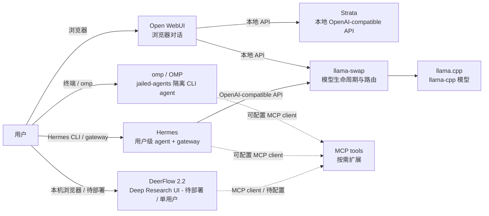

# arx8 AI Agent 架构

## 当前组件



- Open WebUI 是现有浏览器聊天界面，当前配置把 Strata 和 llama-swap 作为两个 OpenAI-compatible provider。
- Hermes 是单用户 `tippy` 的通用 agent。CLI、gateway、记忆和 provider 配置由 Hermes 官方 Home Manager module 管理；gateway 运行于用户 systemd，不使用 rootful Podman。Hermes 配置直连本机 llama-swap 的 llama.cpp endpoint。
- OMP (oh-my-pi) 是通用终端 agent，用于在当前目录读写文件、运行工具和进行多轮对话。系统命令名为 `omp`，不是另一个叫 `pi` 的 agent。OMP 使用 `jailed-agents` 的 OMP builder；其 jail 只 RW 当前工作目录和 `~/.omp`，不开放家目录其他内容。
- OMP 的 jail 使用独立网络 namespace。当前没有把宿主模型 API 暴露给 jail，因此 OMP 使用自己的 provider 登录/外部模型连接；它不会自动继承 Hermes 的本地模型路由或 Open WebUI 凭据。使用云端模型时 prompt 和工作区上下文会发送给对应 provider。
- DeerFlow 2.2 是计划中的个人 Deep Research 应用，不是已部署组件。源码审查确认：Compose 含 nginx/frontend/gateway/Redis，AIO sandbox 需将 Docker socket 授予 gateway（root-equivalent）；BoxLite 需 KVM，尚未在 arx8 实机验证。项目 API 也没有 user-owner 隔离，不能作为多人隔离应用。实现必须先选定可接受的 sandbox；首期只允许单用户 loopback，不接共享 ContextForge。
- llama-swap 当前只注册 llama.cpp，并通过 `exclusive` 路由组管理该模型。Strata 目前独立于 llama-swap，因此不要假定它与 llama.cpp 已完成统一互斥或自动切换。
- MCP 是供 agent 调用外部工具的协议，不是模型或 agent。本机尚未部署通用 MCP server；fra0 的 ContextForge/Dify 不是 arx8 loopback 服务，当前没有把其管理面或工具接入这些 agents。
- Strata 与 llama.cpp 目前不是由 llama-swap 统一管理；llama-swap 只登记 llama.cpp。Hermes 使用其 OpenAI-compatible endpoint；Open WebUI 另外连接 Strata。不能据此推定 Strata 与 llama.cpp 已完成显存互斥。

## OMP 使用

在终端进入希望 OMP 操作的目录并启动：

```sh
cd /path/to/project
omp
```

OMP 默认以当前目录作为工作区；agent 会话、认证和用户配置保存在 `~/.omp`。首次启动按 OMP 提示运行 `/login` 完成 provider 登录，再运行 `/model` 选择可用模型。也可以在终端通过 `omp models` 查看可用模型。

1. 首次使用按提示运行 `/login` 完成 provider 登录；在 TUI 输入 `/model` 选模型。OMP 也支持启动参数 `omp --model provider/model-id`。
2. 在当前目录里描述任务，OMP 可使用内置文件、搜索、bash、PDF/URL 阅读、web search、browser、LSP 和 subagent 等工具；具体可用功能取决于所选模型、配置和 jail 权限。
3. 阅读/编辑工程时核对修改预览和命令副作用；外部 API、云端 provider 与 web search 可能把 prompt 或所选内容发送到远端。
4. 输入 `/help` 查看当前版本命令；`/new` 开新会话，启动时可用 `omp --help` 查看 CLI 参数。

OMP 支持多家云端/账户 provider 和本地 Ollama、llama.cpp、LM Studio 等 endpoint。自定义 OpenAI-compatible provider 可放入 `~/.omp/agent/models.yml`，默认模型角色可写到 `~/.omp/agent/config.yml` 的 `modelRoles.default`；具体格式见 [OMP Providers 文档](https://omp.sh/docs/providers)。因 OMP jail 隔离网络，指向宿主 `127.0.0.1` 的 provider 当前不会工作；不要把 token 写入仓库、Nix expression 或公开 project config。

`jailed-agents` 默认允许网络 namespace 和当前工作目录写入，但会隐藏未授权的宿主 home 路径。OMP 的 jail 不是虚拟机：工作区内恶意内容仍可能影响 agent 行为，网络可用也不等于出站域名白名单。不要在工作目录放入 SSH、浏览器 profile、age/SOPS key 或其他秘密。按 Nix 构建验收需求，OMP jail 开放 Nix daemon，以运行 Nix 检查和构建；上游 `enableNix = true` 还允许 agent 构建和运行任意 nixpkgs derivation，这绕过受限工具清单，是明确接受的信任边界。jail 不挂载 `/etc`、SOPS 密钥、systemd socket，也不授予 `sudo` 或系统激活权限。

Hermes 以 `tippy` 登录态运行，因此它的文件和命令权限等同于该用户本身（当前用户属于 `wheel` 且 Nix trusted user）。不要让 Hermes gateway 处理不可信用户输入；gateway 仅服务本机用户级工作流，不对外开放端口。不要把可触发特权 NixOS 激活的命令或 wrapper 交给 agent。

## 工具扩展与 MCP

OMP 自带 web search、URL/PDF 阅读等工具；Hermes 也包含自己的工具、memory、skills 和 gateway。MCP 用于按需扩展外部工具。新增 MCP server 后，需在相应 agent 的 MCP client 配置中显式连接，并单独审核 transport、凭据来源、工具和网络权限。当前没有为论文工作流硬编码目录、skills、项目格式或 MCP 工具清单。

## DeerFlow 部署边界

DeerFlow 仍需后续单独完成部署，不包含在当前已启用配置里。首选先验证 v2.2.0 的 BoxLite provider 是否可在 arx8 的 KVM 环境运行；如果不能，改用 AIO Docker provider 就必须明确接受 gateway 获得 root-equivalent Docker socket 权限，不能描述为已隔离宿主。个人版应绑定 `127.0.0.1:2026`、关闭公开注册、使用运行时 secret 设置 `BETTER_AUTH_SECRET`，只创建一个个人账号。禁止将多人项目内容托付给其默认 project API ACL。

DeerFlow v2.2.0 官方 Compose 拓扑是 nginx、frontend、gateway、Redis；Kubernetes provisioner 是另一种 sandbox 后端，不是可以省略的 AIO 容器。锁定版本/配置和 sandbox 选择通过实机验证前，不标记为已安装/已连接。

## 连接和故障检查

- Open WebUI 查询其已配置的 Strata 和 llama-swap `/v1` endpoint；Hermes 直连 llama-swap `127.0.0.1:8080/v1`；OMP 使用其 jail 内的 provider 登录/自动发现。三者模型列表和认证状态互不共享。
- OMP 在 jail 中访问 `127.0.0.1` 时指向 jail 自身。当前未开启 host networking 或 loopback 转发，所以 OMP 看不到宿主 llama-swap/Strata；不要以共享网络 namespace 作为绕过方案。
- DeerFlow 和 arx8 MCP server 尚未部署；fra0 的 ContextForge/Dify 不能当成本机服务使用。DeerFlow v2.2.0 项目不是 user-owner ACL 边界，只能作为单用户服务；AIO sandbox 的 Docker socket 权限需显式审批，BoxLite 需先验证 KVM。完成相关组件部署、认证和 sandbox 验收后再把虚线改为实线连接。
