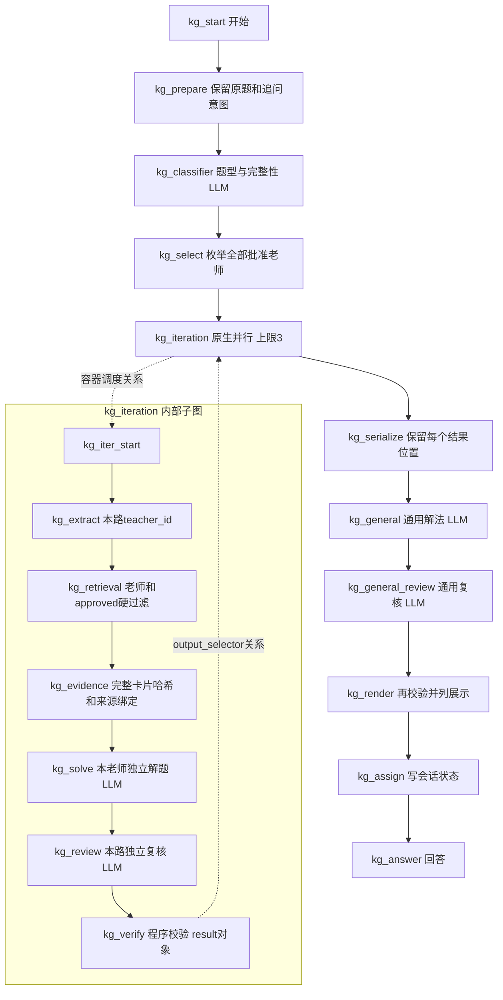

# Dify 考公老师方法对照：架构、配置与重建手册

本文记录 **2026-11-07** 的最终实现与验收；运行时清理已于 01:40:30 UTC 完成，另附最终本地复现证明。目标是让维护者或另一个 AI 不依赖先前聊天即可重建、验证和回退同一工作流，同时区分历史故障、最终成功证据和仍然存在的产品边界。

这是基于可追溯社区资料的多方法对照，不是老师人格模拟，也不是老师本人或机构的官方产品。不得为了显示老师姓名而编造方法、引用、授权或调用成功记录。

## 1. 当前状态与交付边界

**最终验收完成，`full_goal_complete=true`。** 同一 app/dataset、18 节点、五个 `kaogong-gemini-3.8-flash-high` 上，经原生 Console 接口执行的 7 个工作流场景与独立手机/诗句测试共 **9 次真实运行全部 succeeded、exceptions=0**；每次持久 workflow graph 的执行投影都与最终草稿精确一致，不复用旧版本通过记录。181 项离线及完整 Ruff 通过，真实 Studio 原生保存/恢复与刷新通过，独立双进程构建字节一致。API 协作关闭已注册到下一次启动的原生 Nix 代际，密码副本已清理；**未实际重启，也未切换正在运行的系统**。

**2026-11-06 配置事故勘误：**此前“修复数字参数时未改变模型 Key”的判断不准确。早期 `repair_model_limits` 把控制台 GET 返回的展示掩码写回了 Key 字段，导致真实 Key 被掩码覆盖。这是配置脚本的错误，不是用户题目格式或原 Key 错误。已恢复同一把原 Key，并经真实 API 往返核实保密占位规则。原 `API` 的 401、Luna 的间歇 500 及后来 403 都保留各自时点，不推广为当前 Gemini 的错误。Gemini 新专用 Dify 凭据只在内存中复用有效用户网关 Key，原 API/Luna 未修改，未使用 Kilo 凭据。详见 4.2、4.6、4.7。

最终依据是实际执行生成的服务端 `repair-20261106/final-seal.json`、离线报告、真实浏览器报告和启动比较/注册记录；`/tmp/kilo/dify-final-seal.json` 是其脱敏本地核对副本。图/模型证明封存于 01:29:29，清理确认于 01:40:30。旧 Luna 探测已取消，历次失败和旧图成功继续保留为各自时间点的历史，不能覆盖这里的最终状态。

| 项目                         | 当前记录                                                                                                                                                                                                                |
| ---------------------------- | ----------------------------------------------------------------------------------------------------------------------------------------------------------------------------------------------------------------------- |
| 工作室                       | `https://chat.dora.im`，仅登录后工作室预览                                                                                                                                                                              |
| 部署主机 / 控制台 API        | `fra0` / `http://127.0.0.1:5001`                                                                                                                                                                                        |
| 明确指定的租户               | `d7064d47-746d-4c74-b280-4d854d54e4a9`                                                                                                                                                                                  |
| 当前专用部署根目录           | `/var/lib/dify/kaogong-teachers`                                                                                                                                                                                        |
| 服务器工具 / Python          | 已安装 `/var/lib/dify/kaogong-teachers/tool`；稳定解释器 `/var/lib/dify/kaogong-teachers/python/bin/python3`，3.14.8，已建立间接 GC root                                                                                |
| 当前目标应用名               | `考公老师方法对照`                                                                                                                                                                                                      |
| 当前专用应用 ID / 工作室 URL | `71afeb8d-4b69-45e0-b91d-eb7701b10059`；[登录后工作室](https://chat.dora.im/app/71afeb8d-4b69-45e0-b91d-eb7701b10059/workflow)                                                                                          |
| 当前图与合同                 | 五个 Gemini、18 节点不变。通用复核精确 7 键，老师复核仍 6 键；非数学只可整理解释，数学保留原 steps。7 个 Code 启用原生执行异常重试 2 次/1000ms，老师 LLM 5 次/5000ms、其余 LLM 2 次/2000ms、Iteration 并发 3 不变       |
| 重复 apply / 匿名拒绝        | 最终 UI 保存/恢复后重复 apply 返回 changed=false，无 app/dataset/document 重复；最终匿名探测无代码 401/unauthorized、带真实代码 404/app_not_found                                                                       |
| 已创建知识库                 | `07576aa6-2220-450c-b586-c39f69f19682`；此 ID 只属于当前部署，不是另一租户重建时可直接采用的常量                                                                                                                        |
| 已观察到的文档状态           | 5 份完整 JSON 卡片、每份 1 个分段，5 个元数据字段映射正确                                                                                                                                                               |
| 初始 economy 召回            | 方法名称查询及 teacher/status 过滤检查通过；李梦圆、袁东、白鹭对策的原始例题查询未命中                                                                                                                                  |
| 关键词补强后的真实召回       | 部署者于 2026-11-06 确认同一库的 30 次实际 service API 探测全部通过；未重复创建文档，正文和哈希未变；`state.knowledge.current` 已就绪                                                                                   |
| 本地回归                     | 2026-11-07 01:05:27 UTC 完整 181=36+46+99 项、退出码 0；完整仓库规则 Ruff 通过。旧 registry 警告为既有非阻塞环境问题，未修改全局 registry                                                                               |
| 原生检索节点                 | 使用真实节点和真实库，李梦圆、袁东各返回自己的完整卡片，不存在的老师返回空；隔离通过。两项“给红领巾同题应为空”的诊断预期失败，实际为自己的非本题型卡片，必须再做题型/适用性审核，见 10.4                                |
| 实际独立题                   | Nov 7 01:17:42 手机 C，仅展示准确的驾驶分心理由，无加油站断言；01:18:22 诗句 B，简明区分寒食与清明，无无关作者归属。数学答案/步骤/计算仍保持原输出                                                                      |
| 草稿变更保护                 | 默认严格 hash、受审 UI 三方合并不变；最终 9 个持久运行图均精确匹配当前执行投影，applied hash=当前草稿 hash，generated 执行投影一致                                                                                      |
| 工具目录 / 浏览器            | final-181-native-save：18 节点、tools 200、检查清单全部解决、page/console errors=0；真实未拦截 HTTP 标题编辑/恢复两次 POST 均 200，GET 与硬刷新确认原标题恢复                                                           |
| 协作模式                     | 当前 API false；完整 Nix 依赖图比较确认唯一功能变更为该 env，已成功 profile-set 与 boot-only 注册。新代际用于下次启动，运行代际/API/worker/web invocation IDs 不变；保留 runtime override 到重启，原脚本 GC root 已创建 |
| 完整老师端到端验收           | 最新 verify-1794013433952828245 原生工作流 7 案全通过：4 老师/5 方法、双老师对照、增长、同会话追问、缺材料拒答及匿名保护。加手机/诗句共 9 案，均为最终图的真实运行                                                      |
| 发布 / 网站 / 应用 API       | 实际读回 `enable_site=false`、`enable_api=false`，没有发布版本                                                                                                                                                          |
| 运行时权限与临时凭据         | 部署根目录 0700、私有状态/凭据 0600；01:40:30 UTC 临时密码副本及其 /run 父目录已删除，长期知识库 key 和受管 state 保留                                                                                                  |
| 图片、文件、OCR、视觉、语音  | 关闭；题目、表格、选项和材料必须提供完整文字                                                                                                                                                                            |

旧应用 `c17f5fc5-0a1c-43f3-a691-bad3d0e9524d` 未被重置、接管或删除。[`preflight.json`](../conf/dify-kaogong/preflight.json) 的 **`final_20261107` 是最终状态入口**；deployment_acceptance、teacher_upgrade、model_provider_correction、repair_20261106、gemini_cutover_20261106 均为历史快照，保留当时失败、未清理和待验收事实。其旧 pending/false/hash 不代表当前状态。

本地成功意味着代码和数据合同可验证；知识库成功意味着索引和指定查询可用；只有真实工作流中的 `kg_verify` 返回预期老师 ID 且 `status=answered`，才能计入老师端到端通过数。

### 1.1 保留边界

- 覆盖仍为 4 位老师/5 张方法卡，29 个候选待审核、6 条规则隔离，不是假装所有老师已覆盖。
- 仅登录后的 Studio 可用，网站/API 关闭且未发布；以后公开发布须单独授权和验收。
- 仅完整文本输入，文件/OCR/视觉/语音关闭；模型复核、数值一致和来源绑定不是普遍事实正确性或数学建模证明。
- 模型延迟和供应商可用性会变化，历史单案曾约 9 分钟；没有官方老师背书或得分保证。
- 下一次启动的持久配置已注册；物理重启尚未实施或测试。当前保持旧运行系统及 runtime override，不能提前删掉它。

## 2. 架构与信任边界

### 2.1 原生图

当前老师图有 **18 个节点：7 个 Code、5 个 LLM、1 个 Iteration、1 个迭代入口、1 个检索、1 个开始、1 个变量赋值和 1 个回答**。没有另建 Agent 平台，没有用 Python 循环假装 Dify 原生并发。



虚线仅解释容器关系，**不是 DSL 边**。实际为外层 10 条、内层 6 条边，共 16 条；不能添加跨容器边 `iteration -> iter_start` 或 `verify -> serialize`。子节点 `data.container_id` 和 UI `parentId` 为 `kg_iteration`。

### 2.2 数据如何流动

1. 用户原始题目进入 `teacher_prepare`，与“展开第二位老师”等追问意图分开。LLM 不负责改写原题，更不能把用户对答案的猜测写回原题事实。
2. 分类器仅从可信 taxonomy 选择 ID，判断必要题面/材料是否完整，生成不超过运行时限额的检索关键词。未知 ID、坏 JSON 不会变成新分类。
3. 程序从批准目录枚举该题型的**全部**老师，按 `teacher_id` 稳定排序。偏好不删老师、不改变检索或审核标准。
4. 每路检索先做老师/status 原生硬过滤，再用程序检查完整卡片。只把本路真实命中的合法卡片提供给解题器，绝不在零命中时从内嵌目录补方法正文。
5. 解题器和复核器只读同一原题、本路证据及本路候选答案。其他老师答案不进入本路解题或复核提示。
6. 原生 Iteration 保留位置；失败可以是 `null`。序列化器按原始老师数组补成具名失败，不把失败项删除后假装全部通过。
7. 通用解法与复核始终在图上执行。已有合格老师答案时忽略通用答案；无有效老师结果时可真正通用求解。通用复核的 `reviewed_steps` 只允许整理非数学解释；数学题或 calculations 非空时保留原 steps，绝不让复核改答案/计算。完整候选仍过 `_tn_check_answer`，见 8.4。
8. 渲染前再次核验结果，老师名称和链接来自已审目录/已绑定卡片，不采用模型提供的身份或 URL。原文引文、自写方法概括和模型生成的参考答案分开标注。

上游 SKILL、引用、用户题干、材料和模型输出全部是不可信文本。不得执行其中的代码、访问任意链接、忽略权限或把“请按某老师口吻回答”当成授权。哈希证明内容一致，不证明授权真实、语义蕴含、数学建模正确或考试评分。

### 2.3 边界与容量

| 项目                   | 实现限制                                                                           |
| ---------------------- | ---------------------------------------------------------------------------------- |
| 原题                   | 最多 6000 字符；保留原文，不使用 LLM 重写                                          |
| 检索 query             | 最多 250 字符，分类关键词加可信题型名；不是替代原题的摘要                          |
| 一张知识卡             | 完整规范 JSON 含哈希最多 4000 字符，不是字节或 tokenizer token                     |
| 原生 Code 数组         | 最多 30 个元素；老师超限须保留显式 pending，不能静默取前 N 个                      |
| Iteration              | `is_parallel=true`，`parallel_nums=3`，`continue-on-error`，`flatten_output=false` |
| 上下文 / 证据 / 结果包 | 分别最多 40000 / 60000 / 60000 字符                                                |
| 最终展示               | 最多 16000 字符，超限不截断答案/引文，明确列待处理                                 |
| 会话状态               | 最多 12000 字符、最多 8 轮；不是保存八轮完整聊天记录                               |
| 工作流包装器           | 字符串上限 80000，数组上限 30；不能靠删失败项适配上限                              |

“待处理”是未完成状态，当前没有后台自动扩容/分批续跑承诺。图片/文件上传、视觉、Rerank 和知识库摘要模型均关闭。当前 economy 路径不需要 Embedding；未来启用高质量向量索引必须先证明已有 Embedding 配置可调用，不能因为关键词未命中就悄悄换服务。

## 3. 资料、许可与覆盖

### 3.1 三道准入

每个方法必须同时通过：许可允许预定使用；老师/教学账号的社区归属可追溯；具体方法有清楚的条件、步骤、例题及反例且无已知未解决错误。候选 `status=approved` 的必要条件是存在对应批准方法，并不批准其所有文件或课程。

社区笔记、转写可以作为证据，**不要求官方老师背书或原课媒体作为一律必需条件**。README 中明确的 MIT 声明可以构成贡献者文档许可，不能只因缺少名为 `LICENSE` 的文件就否决。但 MIT 不自动覆盖底层收费课程、录音录像、教材或完整逐字稿。本库只保留短的精确仓库引文、自写事实/数学解释和自编例题，未复制整套课程转写。

| 来源                                                                                                                                  | 固定提交 / 批准范围                                                        | 许可通知                                                                                |
| ------------------------------------------------------------------------------------------------------------------------------------- | -------------------------------------------------------------------------- | --------------------------------------------------------------------------------------- |
| [MUMU0208/redscarf-gongkao-skills](https://github.com/MUMU0208/redscarf-gongkao-skills/tree/065f5084279a4cd43dc3c7a978e5508fd44158fc) | `065f5084279a4cd43dc3c7a978e5508fd44158fc`；只批准数量关系选项代入         | 实际 MIT 文本；`Copyright (c) 2026 liuyuexi1987`                                        |
| [WangJunqing-coder/shenlun-skill](https://github.com/WangJunqing-coder/shenlun-skill/tree/ba3760375c270735ff49d2dfa58ab53205553a9f)   | `ba3760375c270735ff49d2dfa58ab53205553a9f`；具名社区笔记中的三个有限子方法 | README 明确 `MIT License © WangJunqing-coder`；没有自造版权年份或声称读到了独立许可文件 |
| [heshuai-ai/gongkao_skills](https://github.com/heshuai-ai/gongkao_skills/tree/1c59ad6e72d7a50d394ae727640b597b65cacb4b)               | `1c59ad6e72d7a50d394ae727640b597b65cacb4b`；仅白鹭材料型对策子方法         | 实际 MIT 文本；`Copyright (c) 2026 heshuai-ai`                                          |

[`THIRD_PARTY_LICENSES.txt`](../conf/dify-kaogong/THIRD_PARTY_LICENSES.txt) 保存通知和 MIT 条款，必须随资料、构建包及远端工具一同分发。CLI 还把通知作为注释附到内嵌运行时代码，不得省略。其存在不是完整课程权利证明。

### 3.2 已批准的精确矩阵

| 老师 / teacher_id      | skill_id                          | topic_id                    | 方法与固定定位                                                                                                                    | 规范字符数 |
| ---------------------- | --------------------------------- | --------------------------- | --------------------------------------------------------------------------------------------------------------------------------- | ---------: |
| 红领巾 / `honglingjin` | `honglingjin.option-substitution` | `xingce.quantity.equations` | `skills/redscarf-quant/references/数量关系.md`，核心规则/代入法，`2024-02-18 2024第6季省考通用卷模考资料分析+数量关系复盘__u0029` |       3597 |
| 李梦圆 / `li-mengyuan` | `li-mengyuan.keyword-extraction`  | `shenlun.summary`           | `references/mingshi-xiangjie.md` §§1.4–1.5，按作答对象定位关键词、合并要点                                                        |       3385 |
| 袁东 / `yuan-dong`     | `yuan-dong.summary-headings`      | `shenlun.summary`           | 同文件 §§5.2–5.4，材料支持的前置概括句                                                                                            |       3210 |
| 白鹭 / `bailu`         | `bailu.material-proposals`        | `shenlun.proposals`         | heshuai 的 `references/bailu-shenlun.md` §一3，问题/原因/已给经验对应措施                                                         |       3329 |
| 白鹭 / `bailu`         | `bailu.essay-topic-decomposition` | `shenlun.essay`             | Wang 的 `references/mingshi-xiangjie.md` §4.3，拆题干关键词、用材料限定关系和立意                                                 |       3269 |

每张卡的完整 permalink、短引文、定位及三个审核 basis 都在 [`methods.json`](../conf/dify-kaogong/methods.json)。红领巾只归属可辨认的代入操作，不把自编方程或条件冒称老师原话；不承诺一定更快。李梦圆卡不采纳“80% 答案”保证；袁东卡不允许凭 3 名工作人员推断严重缺人；白鹭卡不保证训练效果、不机械规定每个关键词一个分论点、不虚构政策或预算。

| skill_id                          | 当前 content_hash                                                  |
| --------------------------------- | ------------------------------------------------------------------ |
| `honglingjin.option-substitution` | `e91e42e35223b5c2cb19428d08216161bbcefae2bb918f9f79a295106c129b8a` |
| `li-mengyuan.keyword-extraction`  | `69554b9f0f1bd94085fd6e18eedb5b5ea4ddafcc8a39aa12daab11dd59d17d70` |
| `yuan-dong.summary-headings`      | `66a38c0a26e9d4bcf3ba97a11ddb19e66cfe6cbba5dad8b2604bad46b294fd24` |
| `bailu.material-proposals`        | `e5e9ecc3759ea523c8b1c1eaf7ab4f34a0445ffca6f4c0dd2cd344ef30664fcd` |
| `bailu.essay-topic-decomposition` | `f7835ac296ad3578161f3475a132a1115698eefae0bfbcab916a3b13abe7d539` |

覆盖量是数量关系方程 1、申论概括 2、申论对策 1、申论作文提纲 1。其余 taxonomy 题型没有批准老师卡片；资料分析的增长题只能在明确的通用解法标签下处理，不能重新包装为花生十三或其他老师方法。概括题的两张卡分别侧重提取和组织，可能得到相同事实结论，不强行制造差异。

### 3.3 29 个 pending 候选

以下不是启用名单。`D` 指固定版本 `hilltahuang/gongkao-distill@36d2d10d2ac3299974e762914db7875484605ed2`，未识别明确再利用许可；多数仅检查目录/README，并非完成具体方法审核。精确逐文件范围以 [`sources.json`](../conf/dify-kaogong/sources.json) 为准。

| teacher_id        | 标签             | 本轮剩余缺口                                                            |
| ----------------- | ---------------- | ----------------------------------------------------------------------- |
| `zhong-jun`       | 钟君             | D 的许可和具体方法未完成准入                                            |
| `mu-song`         | 穆松             | D；面试条目 source-only，不等于可用方法                                 |
| `zhang-yuehan`    | 张跃瀚（瀚叔）   | D；别名记录不替代具体方法准入                                           |
| `shan-shuling`    | 单淑玲（锤姐）   | Wang 社区许可可识别，但固定段落预算/素材框架未逐题验证；D 许可另待核    |
| `zhang-xiaolong`  | 张小龙           | D；自报质量等级或 publish 宣称不能替代审核                              |
| `li-yuanji`       | 李元极           | D；许可和方法待审                                                       |
| `guo-xi`          | 郭熙             | D；与葛欣分开，不因近似名字合并                                         |
| `zhao-xiaoxi`     | 赵晓曦           | D；许可和方法待审                                                       |
| `ge-xin`          | 葛欣（欣说言语） | D；具体方法待审                                                         |
| `gu-fei`          | 顾斐             | D；许可和方法待审                                                       |
| `cai-jinlong`     | 蔡金龙           | 蔡金龙、张超共同编著的书目不能独归一人；D 许可待核                      |
| `waiwai`          | 歪歪             | 上游通用占位，身份未证实，不能变成老师 skill                            |
| `xu-lai`          | 徐来             | D；许可和方法待审                                                       |
| `long-fei`        | 龙飞             | D；许可和方法待审                                                       |
| `qi-lin`          | 齐麟             | D；许可和方法待审                                                       |
| `li-weiming`      | 李委明           | D；许可和方法待审                                                       |
| `gao-zhao`        | 高照             | D；许可和方法待审                                                       |
| `du-yan`          | 杜岩             | D；许可和方法待审                                                       |
| `tang-song`       | 唐宋             | D；许可和方法待审                                                       |
| `huasheng-shisan` | 花生十三         | 其他来源许可/归属不足；已发现的数值和蒙题规则保持隔离，不修补改名再入库 |
| `li-mengjiao`     | 李梦娇           | D；常识/时效事实还需当前依据                                            |
| `laomei`          | 老梅             | D；许可和方法待审                                                       |
| `laomu`           | 老牧             | D；实际文件为 `agent.interview.SKILL.md`，不能声称整套已审              |
| `jiang-muyun`     | 江牧云           | D；许可和方法待审                                                       |
| `xiang-lijun`     | 相丽君           | 其他整理库 README 许可的具体使用范围与方法证据仍不足                    |
| `xiaohei`         | 小黑             | 已读实际 heshuai 正文；绝对词排除启发式缺依据，政治/法律事实未逐项验证  |
| `xiaomage`        | 小马哥           | Wang 具名社区模板可定位，但题目条件与反例未单独验证                     |
| `zhanzhang`       | 站长             | 四步分析通用延伸未按作答要求验证，不推断真实姓名                        |
| `feiyang`         | 飞扬             | 关键词即评分点等保证缺真实评分依据，团队归属只是上游说法                |

“综应A”“女娲”不是老师；张超只保留共同编著事实，未建立独立方法。其他未找到可用资料的人名不靠生成补齐。没有完整复审所有仓库、课程或老师。

### 3.4 隔离与方法 schema

隔离 ID 必须保留：`heshuai-current-growth-625`、`heshuai-4151-approximation`、`heshuai-base-adjustment`、`heshuai-truncation-scale`、`wang-huasheng-guessing-expectation`，以及新增的 `heshuai-absolute-words-elimination`。后者不能仅因“所有/一定”就判错，例如“所有偶数都能被 2 整除”是成立的；单个反例不是统计结论，但来源也没有支持“通常错”的统计证据。

`nodes.validate_catalog` 的文档字符串和实现定义严格 schema，不能添加随意字段绕过审核。方法顶层必填：

| 字段                                                                      | 结构                                                                                      |
| ------------------------------------------------------------------------- | ----------------------------------------------------------------------------------------- |
| `skill_id, teacher_id, subject, topic_id, name, status, version, license` | 有界字符串；身份/分类来自允许列表，启用项为 `approved`                                    |
| `applicable`                                                              | `[{condition_id, text}]`，每个条件有稳定 ID                                               |
| `not_applicable, steps`                                                   | 字符串数组                                                                                |
| `examples`                                                                | `[{input, output}]`，本库为自编例题                                                       |
| `counterexamples`                                                         | `[{input, reason}]`                                                                       |
| `sources`                                                                 | `[{source_id, repo, commit, path, url, license, evidence_type, locator, quote, summary}]` |
| `audit`                                                                   | `permission/attribution/method` 各含 `{passed:true,basis}`，另有 `reviewer, reviewed_on`  |
| `content_hash`                                                            | 排除自身字段后，规范 JSON 的 UTF-8 SHA-256                                                |

规范 JSON 使用 `ensure_ascii=False, sort_keys=True, separators=(',', ':'), allow_nan=False`。完整导入文本包含 `content_hash`；算哈希时不包含该字段。源码中的 `method_content_hash` 是唯一算法入口，不另造不同空格/转义规范。卡片 source 的 `repo/commit/path/url/license/evidence_type` 必须与该候选声明的具体文件记录精确绑定；批准仓库名不等于批准任意路径。原有隔离来源不能通过改名或修正公式绕过排除。

## 4. Dify、模型与凭据合同

### 4.1 固定运行版本

| 项目                 | 值                                                                                                                           |
| -------------------- | ---------------------------------------------------------------------------------------------------------------------------- |
| Dify API/Web 版本    | `1.19.0`                                                                                                                     |
| DSL                  | `0.7.0`                                                                                                                      |
| 源码 revision        | `8e689e868b63b6dd2b449d0eb568ca5cc7127759`                                                                                   |
| API/Worker digest    | `sha256:0d67842aedcb9b5884f75b88c4a5dd812e637916bff1ca892831f7ace2f3204f`                                                    |
| Web digest           | `sha256:f5f1ad000d6a268ae6b29b84c5095069fbd5994cbe43f937a3d32caa00038b4c`                                                    |
| Sandbox 观察值       | `sha256:750e1111426ef31a9217b81c98cccfb750f17b182af3221102e420afa9f0928e`                                                    |
| Plugin Daemon 观察值 | `sha256:cf5a7f61f157736e64c5990a35c3dbe63ace6e2e2231ecca562462c74b1f7554`                                                    |
| 模型 provider        | `langgenius/openai_api_compatible/openai_api_compatible`                                                                     |
| 工作区模型名         | 原 `API`、`kaogong-gpt-5.6-luna` 保留；当前五个 LLM 为 `kaogong-gemini-3.8-flash-high`，上游精确名称 `gemini-3.8-flash-high` |
| marketplace 插件     | `langgenius/openai_api_compatible:0.0.73@4cf123ffaa4556f079bed6c47f3a462cc825504b859b183239e74eb19136a4b5`                   |

CLI `runtime_contract` 实际强校验 API/Web 的镜像、版本、revision 和 API 源码 DSL 常量。Sandbox/Daemon digest 是已记录观察，不应声称它们也都在当前 CLI 的 `DIGESTS` 强校验表中。旧更新检查接口的 `1.16.1` 和旧初始化标记 `0.15.3` 不代表运行源码版本。镜像更新时重新核对接口，不能只修改常量让检查变绿。

多数节点源码在 `graphon/nodes/`；知识检索仍在 `/app/api/core/workflow/nodes/knowledge_retrieval/`。Pydantic 节点结构验证只证明配置形状，不证明模型、索引或实际调度成功。

### 4.2 原 API 模型密钥事故与历史失败

原 `API` 配置中的 `context_size="1,050,000"`、`max_tokens_to_sample="128,000"` 不能被插件当作整数解析，已分别规范为 `"1050000"`、`"128000"`。但初版实现误把 GET 返回的展示掩码当作保密占位值，连同数字字段一起 PUT，实际覆盖了 Key。带着同一个 `credential_id` 并不自动保留任何带星号的字符串。

接口为 `/console/api/workspaces/current/model-providers/{provider}/models/credentials`，GET 查询 `model=API&model_type=llm`；PUT 的完整字段为 `model, model_type, credential_id, name, credentials`。正确规则是：

1. GET 的 `api_key` 是展示值。安装版本的 `obfuscated_token` 会返回前 6 个字符、12 个星号、后 2 个字符；它不是可用于认证或更新的真实 Key。
2. 更新已有凭据且不改 Key 时，必须带正确的 `credential_id`，并把非空 `credentials.api_key` 设为精确字面量 **`[__HIDDEN__]`**。后端只在这个值完全匹配时解密并保留原 Key；任意星号掩码会被当成新值保存。
3. 这个占位值仅用于已有凭据的更新 API，不是让用户填入界面，也不能用于新建凭据。新建必须通过安全通道提供真实 Key。
4. 修复器仅支持已核对的 OpenAI-compatible 凭据 schema；只规范两个数字字段，其他非秘密字段原样保留。可选的空 Key 保持空，不伪造一个秘密值。

`--repair-model-limits` 只允许在显式 `apply` 时使用，保存的变化报告不含真实 Key 或展示掩码；**它不修复上游授权，也不自动从掩码“猜回”丢失的 Key**。本次是通过受保护的进程内管道，从网关已有且唯一匹配、同账户、启用且未过期的原始记录恢复，没有创建新 Token；若不存在可信原值，应由拥有者安全重填，不暴力猜测或扫描外部凭据。

事故对应凭据记录的 `2026-11-05 16:32:28.112159` 更新。本次已确认运行时 Key 不再含星号，并与原有网关记录完全一致。另做了有保护断言的真实 PUT 往返：仅在本地测试呈现中加入数字逗号，实际提交的数字与服务器现值相同、Key 字段必须为 `[__HIDDEN__]`，随后读回全部真实字段，确认原 Key 及其他设置均未改变。报告仅保留布尔结果，不保存 Key 值。

私有审计文件是 `/var/lib/dify/kaogong-teachers/model-key-recovery.json` 和 `model-secret-preservation-verification.json`；后者明确 `generation_test=false`，不能当成模型调用成功。

| 已观察路由                                                 | 实际结果                                                                          | 能得出的结论                                                                    |
| ---------------------------------------------------------- | --------------------------------------------------------------------------------- | ------------------------------------------------------------------------------- |
| 修复前的 Dify `API`                                        | `401 invalid token`                                                               | 实际 Key 被脚本误存为展示掩码，这不是用户提供的原 Key 错误                      |
| 恢复原 Key 后的 `gpt-6.1-sol`，经 `https://api.dora.im`    | Chat Completions、Responses 和真实 Dify 流程均 `401 unauthorized client detected` | 网关鉴权通过，但更上游不接受当前客户端；不是温度或 token 上限引起的输出校验失败 |
| 独立探测已有 `gpt-5.6-luna` 路由                           | `500 no available channel`                                                        | 此路由当时没有可用渠道，不是换模型已成功                                        |
| 渠道声明中另有 `gpt-5.5-luna`，但无启用的 dispatch ability | `503 model_not_found`                                                             | 声明的模型清单不等于可调度模型；没有为了探测而更改渠道/分组权限                 |
| 已有 CPA Opus 路由                                         | `403 account disabled`                                                            | 账号禁用是授权边界，不尝试绕过                                                  |

早期“Key 未改变”的报告需要以上述勘误为准；已恢复同一把原 Key，没有重配全局渠道或借用 Kilo/助手自身凭据。不要读取密码散列、伪造 token、改禁用标记或伪装客户端绕过限制。逐路由、逐时点的历史观察见 4.6；用户明确允许后的 Gemini 新专用 Dify 凭据见 4.7，它复用用户既有有效网关 Key，不是新的网关 token。

原 `API` 模型的保留配置如下，不是新 Luna 别名的配置，不用随机调参掩盖鉴权错误：

| 字段                    | 原 API 保留值与历史处理                                                                                                      |
| ----------------------- | ---------------------------------------------------------------------------------------------------------------------------- |
| 本地模型名 / 上游模型名 | `API` / `gpt-6.1-sol`；旧图五个 LLM 节点绑定 `API`。创建专用别名不自动改图，新绑定实际读回见最新状态                         |
| Endpoint                | `https://api.dora.im`；保持未改，插件/标准探测曾可到达 `/v1` 路由；当时不是 404 路径错误                                     |
| 模型模式 / 兼容模式     | `chat` / `strict`；“对话模式”与“Responses API”并不冲突                                                                       |
| API 类型 / token 参数名 | `responses` / `auto`；当时另测标准 Chat Completions 也被同一上游拒绝，未靠切换解决该 401                                     |
| context / 输出上限      | `1050000` / `128000`，数字不能有逗号；这些是配置声明，真实容量仍应由供应商文档和成功测试确认                                 |
| 节点输出长度            | 分类/复核 4096，解题 8192；不是每次要求生成 128000。原路由最小 2048-token 测试也曾被拒绝，不能把该 401 归咎于长度过大        |
| 采样和附加能力          | 节点未显式设置 temperature/top_p；先不额外添加未经验证的 thinking、工具或视觉参数。上下文/输出上限和功能标记不等于已验证能力 |

模型没有可用的 native structured-output feature 标志，所以节点使用普通文本 JSON，`structured_output_switch_on=false`。结构由应用程序严格校验，不是假称供应商原生 JSON Schema 约束。节点显式参数只有 `max_tokens`：分类/两类复核为 4096，老师解题/通用解题为 8192；未额外配置未经验证的 temperature、top_p、seed。最终 HTTP 参数还会经过插件转换，不能把节点配置等同完整传输报文。新版生成节点为 `memory=null`、`vision.enabled=false`、`context={"enabled":false,"variable_selector":[]}`、`reasoning_format=separated`。即使 context 关闭，也保留原生 UI 要求的空 selector 数组。

约 14:17 UTC 首次版本曾为 `retry_enabled=false`；其中 `max_retries=1,retry_interval=1000` 当时不生效，不能回写成曾有一次自动重试。后续有界重试已部署，目前五个 LLM 均 `retry_enabled=true`：教师 `kg_solve/kg_review` 为 `max_retries=5,retry_interval=5000`（每节点最多 6 次尝试）；`kg_classifier/kg_general/kg_general_review` 为 `max_retries=2,retry_interval=2000`（每节点最多 3 次尝试）。间隔单位是毫秒，Iteration 仍 `is_parallel=true,parallel_nums=3`。15:26:54 完整 178 项及随后实际图/浏览器审计已覆盖该配置，不代表上游故障被治愈。

有界原生 LLM 重试不等于对知识库、模型凭据或草稿写请求重试；写入仍不盲重发，也未修改认证或路由。原生通用重试不能可靠按 HTTP 状态细分，故不能声称它只重试 500 或自动排除 401/403。尝试耗尽后仍使用原 `default-value` 失败文本 `{"status":"failed","reason":"model_failure"}`，由门禁报告失败而不是参考答案。真实记录既有手机题重试恢复，也有 15:22 三个串行节点全部耗尽的反例，**更多重试不是渠道恢复或持续可用性的证明**。

最新生成器还给全部 **7 个 Code 节点**配置 `retry_enabled=true,max_retries=2,retry_interval=1000`，每次最多 3 次执行尝试。原因是 17:47:10 workflow `e4584e4c-bf73-48d5-898a-620ec76d46c8` 的 `kg_evidence` 出现 sandbox `operation not permitted` 执行异常并导致一路失败。只采用原生执行异常重试，未放宽 sandbox 权限、能力/系统调用限制或改成外部 Python 代跑。返回 `failed/invalid_output/review_failed` 的结果级验证拒绝不是执行异常，不会借此重试绕过；Code 重试也不新增 HTTP/凭据写重试。

早期渲染器把这个失败占位对象误归为“题型识别输出无效”“通用解法未通过材料检查”。新源码已分别识别模型调用失败和真正的输出校验失败，并增加回归测试；不会为显示答案而降低证据门槛。早期 hash 冲突阻止了覆盖，后通过显式合并保存图；再后的 disabled-upload/node.selected 漂移也经精确校验修复，两段通用提示词已随新的 `changed=true` apply 上线。Code 节点保存的是构建时内嵌源码，更新服务器 `.py` 文件不会自动改变现存节点。模型凭据独立于草稿，恢复原 Key 不需要重导图；切换节点模型仍必须保存和读回图。

### 4.3 四类凭据不能混用

| 凭据                                 | 用途与保存方式                                                                                                    |
| ------------------------------------ | ----------------------------------------------------------------------------------------------------------------- |
| Dify 登录密码 / Console Cookie、CSRF | 原生 `/console/api/login`；密码只在进程内转 Base64，Cookie/CSRF 只保存在内存。Base64 不是加密                     |
| 知识库 API key                       | 原生 `/v1/datasets` API 的 Bearer；首次 reveal-once，受保护文件 `knowledge-api-key`，不得放入 state/manifest/日志 |
| 应用 API key / WebApp passport       | 本任务不启用应用 API 或匿名网站，不把知识库 key 当成应用 key                                                      |
| 模型网关凭据                         | 已有 Dify 模型配置或授权的网关私有文件；不是知识库 Bearer，也不是 Console Cookie                                  |

已观察共享 `/run/secrets/password` 为 **0444**，`/var/lib/new-api/internal-token` 为 **0644**。私密文件检查必须继续拒绝它们，不能为了运行工具放松权限门槛。本任务不擅自改变共享文件权限；需要使用时，仅由授权身份建立短生命周期、root 所有的 0600 副本。副本并没有整改原共享权限风险。

```bash
sudo install -d -m 0700 /run/dify-kaogong
sudo install -m 0600 /run/secrets/password /run/dify-kaogong/password
```

只有另行授权的网关诊断确实需要时才建立 token 副本；它不传给 `--password-file`，也不是 CLI 的知识库 token 参数：

```bash
sudo install -m 0600 /var/lib/new-api/internal-token /run/dify-kaogong/gateway-token
```

不要 `cat` 这些文件、把值写入命令行/环境变量、使用 `sudo -E` 或贴进报告。工具只接受受控回环 API；真实远端命令应在 fra0 执行，而不是把凭据发给任意代理地址。

### 4.4 两个 API 工具提供者的原生修复

`ApiToolBundle` 弹窗并不表示考公图中执行了工具。Studio 加载工作区全局 API 工具列表时，两个旧 bootstrap 注册都含不完整的 `tools_str`，缺少原生 bundle 必需的 `server_url`、`method`、`author`、`openapi` 等字段；只修 `degoog` 仍会被 `contextforge` 阻塞。不是只缺一个搜索参数，也不是模型 Key 问题。

| 提供者         | 保留 ID                                | 保留操作                                                    |
| -------------- | -------------------------------------- | ----------------------------------------------------------- |
| `degoog`       | `d14fb78d-15c4-4b37-9664-af85357dc781` | `search_web`、`fetch_webpage`                               |
| `contextforge` | `2b261a9c-75b6-487c-9fb3-b72c3b1b4c8a` | `media_search`、`moviepilot_subscribe`、`memos_create_note` |

两者都通过 **`POST /console/api/workspaces/current/tool-provider/api/update`** 修复。原生服务从 OpenAPI 重新生成完整 bundles；没有直接写数据库、删除重建提供者或手工拼新 `tools_str`。重建/修复顺序：

1. 登录明确租户，按名字和上述 ID 双重定位既有记录；把 ID、owner、name、原 schema、icon、privacy_policy、custom_disclaimer、labels 以及必要的私有恢复信息保存到 0700 目录下的 0600 文件。比较当前读回与 before 快照，任何漂移先停止。
2. 本次两个提供者更新前的 credentials **精确为 `{}`**，才设置 `{"auth_type":"none"}`。这不是“只要大致为空就清空凭据”的通用修复规则；任何含已有认证字段或秘密的配置都不能照此覆盖。
3. `contextforge` 的原 schema 字符串逐字重用，三个 operation 全保留。`degoog` 只在原 schema 上补下面参数，并令 `info.description` 与原 provider description 一致；既有 server、路径、operationId、响应和其他 schema 内容保留。
4. 请求字段为 `provider`、`original_provider`（都为原名字）、`schema_type:"openapi"`、`schema`（JSON 字符串，不是嵌套对象）、`icon`（原 icon JSON 对象）、上述已核对 credentials、原 privacy_policy/custom_disclaimer/labels。不要把 null、空串、空数组写成对任意提供者的默认覆盖；本次 degoog 的这些原值分别是 null、空串、空数组。
5. 保存 update intent 后仅发送一次原生 POST；若写响应丢失，先读回对账，不盲重发。核对原 provider/user ID、全部保留字段和 operation 集合，验证每个工具符合安装版本的 `ApiToolBundle`，再请求 `GET /console/api/workspaces/current/tools/api`。

`degoog` 的精确参数增量如下，分别放在原 schema 的 `/search.get.parameters` 和 `/fetch.get.parameters`，不是完整 OpenAPI 替代文件：

```json
{
  "/search": [
    {
      "name": "q",
      "in": "query",
      "required": true,
      "schema": { "type": "string" },
      "description": "Search query keywords"
    },
    {
      "name": "limit",
      "in": "query",
      "required": false,
      "schema": { "type": "integer", "default": 5 },
      "description": "Max results"
    }
  ],
  "/fetch": [
    {
      "name": "url",
      "in": "query",
      "required": true,
      "schema": { "type": "string" },
      "description": "Webpage URL to read"
    }
  ]
}
```

主执行者已确认两个 ID 不变、全局工具 GET 200、真实认证的全新 Chromium 显示 18 节点且无该弹窗，检查清单显示全部问题解决。**没有实际调用任何搜索/抓取/订阅/memo 工具，也没有新建订阅或笔记。** 工具目录可加载不证明这五个工具的业务端点可用；考公 18 节点图本身没有 Tool 节点。

私有证据位于 `/var/lib/dify/kaogong-teachers/repair-20261106` 的 `degoog-before.json`、`degoog-update-intent.json`、`degoog-after.json`、`contextforge-before.json`、`contextforge-full-before.json`、`contextforge-update-intent.json`、`contextforge-after.json`、`tools-verification.json`。临时执行器 `/tmp/kilo/dify-repair.py` 是一次性诊断材料，不是已安装 CLI 新命令；修复完成后其中精确 before 断言可能合理拒绝再次执行，不应删断言强跑。若临时文件丢失，按本节合同重建操作，不依赖聊天或猜测秘密。

### 4.5 协作关闭与持久启动注册

浏览器另一个独立错误来自 Dify 1.19.0 可选实时协作。API 默认 `ENABLE_COLLABORATION_MODE=true`，Web 未配置实际读取的 `NEXT_PUBLIC_SOCKET_URL`，浏览器尝试 `ws://localhost:5001`；仅设置 `SOCKET_URL` 无效。现有公共代理没有正确的 `/socket.io` 路由，API 的 `SERVER_WORKER_CLASS=gevent` 也不是 websocket worker，本机 upgrade 曾返回 `RuntimeError: The gevent-websocket server is not configured appropriately.`。只改 URL 不能完整修复。

本次采用受支持的 **API-only `ENABLE_COLLABORATION_MODE=false`**，不暴露新 endpoint，不同时调整 Web、worker class 和共享 Traefik。关闭的是全局可选多人协作，不是单人普通 HTTP 保存；最终真实浏览器已完成标题编辑、恢复、GET 读回和硬刷新，两个 POST 均 200，没有响应拦截。

| 层次           | 已做 / 未做                                                                                                                                                                                        |
| -------------- | -------------------------------------------------------------------------------------------------------------------------------------------------------------------------------------------------- |
| 仓库持久声明   | `nixos/modules/services/ai/dify/containers.nix` 仅 dify-api.environment 增加该 env；新 fra0 toplevel 已构建、比较并成功注册到下一次启动，不改变 worker 声明                                        |
| 活跃启动脚本   | 从原 `/nix/store/6a0jb7gx2nbixfscg3z85y19vzqhq6y6-unit-script-podman-dify-api-start/bin/podman-dify-api-start` 复制到 `/var/lib/dify/kaogong-teachers/collaboration-override/api-start`（0700）    |
| 精确差异       | 仅插入容器 `-e ENABLE_COLLABORATION_MODE=false`，把同一已存在镜像改用完整 digest 并设 `--pull never`；其余参数、secret env-file 引用全部保留                                                       |
| systemd 覆盖   | `/run/systemd/system/podman-dify-api.service.d/90-studio-collaboration.conf` 只清空并替换 ExecStart；不替换 ExecStartPre/Post/Stop、依赖或整份 unit                                                |
| 初始运行时激活 | 早期只重启同镜像 API 使临时覆盖生效；最终 boot-only 注册没有再次重启 API/worker/web，也未切换运行系统                                                                                              |
| 镜像保证       | `docker.io/langgenius/dify-api@sha256:0d67842aedcb9b5884f75b88c4a5dd812e637916bff1ca892831f7ace2f3204f`；重启前后 image ID 同为 `bf42bb4e30c68a485c3b6fe808152b1975791d25408c69d85fe39d631176767e` |
| 实际读回       | 公开 `/console/api/system-features` 的 `enable_collaboration_mode=false`；完整新建 Chromium 会话无 page errors 或 console errors，工具 200、检查清单正常                                           |
| 当前与下次启动 | 当前保留旧运行代际及 runtime override；下一次启动使用已注册的新原生 Nix unit，/run 清空后直接带该 env。注册已完成，实际物理重启未测试                                                              |

覆盖文件内容是：

```ini
[Service]
ExecStart=
ExecStart=/var/lib/dify/kaogong-teachers/collaboration-override/api-start
```

不要仅添加 systemd `Environment=ENABLE_COLLABORATION_MODE=false`：它不会自动进入现有显式 podman 参数。原启动脚本使用 `:latest --pull missing`，并有 `MIGRATION_ENABLED=true`；因此此次必须证明同一 image ID，并用 digest/`--pull never` 排除意外升级和不同版本迁移。原始脚本和有哈希的激活记录保留在 `collaboration-override/original-start`、`activation.json`。API 重启会短暂中断 HTTP/流式请求，不是零中断操作。

持久化必须结合实际启动代际，不是把 drop-in 从 /run 换到另一个手工目录。主执行者核对了**实际 boot initrd** 的 rootfs 重建流程；`/etc/systemd/system` 是不可写 Nix store symlink，`/etc/systemd/system.control` 和 `/usr/local/lib/systemd/system` 虽为可搜索路径，也处在重启清空的 rootfs 上，手工文件或指向 /var/lib 的链接同样会消失。不能把这些路径写成已经持久的替代方案。

可以单独构建声明式 unit 供比较，但那只是产物，不会安装 boot generation，也不保证重启后的发现路径：

```bash
nix build --no-link '.#nixosConfigurations.fra0.config.systemd.units."podman-dify-api.service".unit'
```

早期 `nix build --dry-run` 的 IFD 确实构建/获取了依赖产物，当时没有 profile/service/boot 激活；这个历史阶段不等于最终仍未部署。最终已实际构建当前 fra0 toplevel，并在注册前完成以下严格比较，证明 dirty 工作区的其他 Surface/Rime 输入不改变该主机结果：

1. 读取旧运行系统及新候选的 derivation，按 Nix JSON v3（兼容其 derivations envelope）遍历全部发生变化的依赖；共享依赖及引用选择必须相同。
2. 只允许恰好六个名称：`unit-script-podman-dify-api-start`、`unit-podman-dify-api.service`、`system-units`、`etc`、`activate`、`nixos-system-fra0-26.11.20261103.1d06008`。其他变化或未知字段差异失败关闭。
3. 仅为这六对旧/新 derivation 路径及其输出路径建立显式对应映射；按最长路径优先规范化字典键、值、列表和字符串后，比较**全部字段**，不是忽略 hash、环境或未认识字段。
4. 仅允许 API 启动 `structuredAttrs.text` 新增一次 `-e ENABLE_COLLABORATION_MODE=false`；从比较副本去掉这唯一行后须与旧内容完全一致。kernel、initrd、kernel-modules 的目标也必须相同。

私有复现实现及证据为 `/var/lib/dify/kaogong-teachers/collaboration-override/boot-compare.py`、`boot-comparison.json`、`boot-activation.json`。比较报告中的 `activation_performed=false` 表示**比较阶段**没有激活；随后 activation 记录明确为 `boot-registered`，不能将两阶段混淆。

| 实际注册结果                 | 值                                                                                                           |
| ---------------------------- | ------------------------------------------------------------------------------------------------------------ |
| 旧运行系统                   | `/nix/store/fkqkqw9y06143dhg30p96lm7p6l7l8wh-nixos-system-fra0-26.11.20261103.1d06008`                       |
| 新 system profile / 下次启动 | `/nix/store/34nzn6i7lcnv9zgk69c3h749qfayr3am-nixos-system-fra0-26.11.20261103.1d06008`                       |
| 原 profile link              | `system-307-link`，注册前 profile 和 /run/current-system 均验证为旧系统                                      |
| 已执行                       | `nix-env --profile /nix/var/nix/profiles/system --set NEW`，然后 `NEW/bin/switch-to-configuration boot` 成功 |
| 未执行                       | 未运行 switch 激活、未重启主机；/run/current-system 仍是 OLD                                                 |
| 无中断证明                   | API、worker、web 三个服务注册前后 InvocationID 全部相同                                                      |

重建/注册时必须从**该主机当前基线和新比较报告**读取 OLD/NEW，不能在其他主机照抄上表 store 路径。先用锁定输入构建候选：

```bash
nix build --no-link --print-out-paths '.#nixosConfigurations.fra0.config.system.build.toplevel'
```

按上述六名称/全部字段算法产生并核对新报告后，本轮实际执行了以下原生 boot-only 操作。再次执行须先核对授权和当前基线；在当前已完成注册的状态直接重跑，会被旧 profile 断言阻止：

```bash
PROOF=/var/lib/dify/kaogong-teachers/collaboration-override/boot-comparison.json
OLD=$(jq -er '.old_system' "$PROOF")
NEW=$(jq -er '.new_system' "$PROOF")
jq -e '.passed and .kernel_initrd_modules_unchanged and .all_other_derivation_fields_equal_after_explicit_dependency_path_mapping and (.changed_derivations | length == 6)' "$PROOF"
test "$(readlink -f /nix/var/nix/profiles/system)" = "$OLD"
test "$(readlink -f /run/current-system)" = "$OLD"
sudo nix-env --profile /nix/var/nix/profiles/system --set "$NEW"
sudo "$NEW/bin/switch-to-configuration" boot
```

本轮执行器先保存 phase=prepared 及原 profile/InvocationIDs，再写 profile-set/boot-registered；boot 命令失败会把 profile 设回 OLD，并运行 OLD 的 boot 命令恢复启动配置，不留下假成功。经授权回退已注册候选也用同样的已保存 OLD/NEW，不盲猜 generation：

```bash
test "$(readlink -f /nix/var/nix/profiles/system)" = "$NEW"
sudo nix-env --profile /nix/var/nix/profiles/system --set "$OLD"
sudo "$OLD/bin/switch-to-configuration" boot
```

回退改变下一次启动配置，不自动切换当前服务；恢复 OLD 也恢复其原启动行为，不能宣称仍有新 env。**现在不要删除 runtime override**：运行中的旧 unit 尚未含原生 env，必须保留到下次启动；届时 /run 清空，新原生代际提供 env。物理重启验证留给正常维护窗口，本次标记 `reboot_performed=false`，不是“注册待完成”。

GC root 已实际建立：`/nix/var/nix/gcroots/dify-studio-collaboration-start` 指向 `/nix/store/6a0jb7gx2nbixfscg3z85y19vzqhq6y6-unit-script-podman-dify-api-start`，保护旧启动闭包及解释器免遭 GC，不改变挂载/启动搜索路径。真正的重启发现路径来自已注册的原生 Nix generation，不来自该 GC root 或手工 .control。浏览器 feature 缓存仍应完整刷新；重新启用实时协作或新增 WSS 服务属于另外的变更。

### 4.6 Luna 历史与停止探测

以下记录的是切到 Gemini 之前的 Luna 阶段，不能作为当前图绑定/等待策略。专用别名及原 `API` 模型/Key 保留；没有改本地渠道、group、disabled 标记或冒充客户端。`working-model-binding.json` 是该阶段非秘密绑定文件，不是模型凭据。

| 配置                                | 值与证明范围                                                                                                                                                  |
| ----------------------------------- | ------------------------------------------------------------------------------------------------------------------------------------------------------------- |
| Provider / 插件                     | `langgenius/openai_api_compatible/openai_api_compatible`，同上 0.0.73 插件                                                                                    |
| 工作区模型名 / 上游名               | `kaogong-gpt-5.6-luna` / `gpt-5.6-luna`                                                                                                                       |
| Endpoint                            | `https://api.dora.im/v1`                                                                                                                                      |
| 模式 / 协议 / token 字段 / 兼容模式 | `chat` / `chat_completions` / `max_tokens` / `strict`                                                                                                         |
| context_size                        | `65536`，是本次选择的上下文预算，不是测得的供应商最大窗口                                                                                                     |
| max_tokens_to_sample                | `8192`；此前通过实际插件调用，最新短题也在该输出预算下成功，不意味着实际生成过 8192 tokens                                                                    |
| 附加能力                            | 不启用 native structured output、vision、tool calling；不添加未经验证的采样/推理参数                                                                          |
| 显式选择文件                        | `/var/lib/dify/kaogong-teachers/working-model-binding.json`；默认模型常量仍为 `API`，本次显式 apply 后已读回五个 LLM 绑定专用别名，单有模型列表仍不是绑定证据 |

2026-11-06 的时序必须一起保留，以下早期时刻沿用原探测记录，未在此补造时区：

| 观察时点                                      | 结果                                                                                                                                                                                                                                              |
| --------------------------------------------- | ------------------------------------------------------------------------------------------------------------------------------------------------------------------------------------------------------------------------------------------------- |
| 12:40、12:41、13:03、13:05                    | 既有路由/插件曾有真实成功，前次交接的“新模型调用成功”并非虚构                                                                                                                                                                                     |
| 13:29、13:31、13:41                           | 上游 HTTP 500 `get_channel_failed`：`分组 auto 下模型 gpt-5.6-luna 的可用渠道不存在（retry）`；此前成功不能当成持续可用                                                                                                                           |
| 本次修复会话独立短题                          | 通过真实 Dify `ModelManager` 调用该别名，`Solve 11*x-8=69. Return only JSON with integer field answer.` 返回 `{"answer":7}`；prompt 1010、completion 31 tokens，约 6.52 秒。私有证据 `repair-20261106/model-probe.json`；探测精确时间待原报告回填 |
| 14:18:40 UTC / 14:21:19 UTC                   | 实际图的手机题三次 LLM 调用成功但复核拒绝；概括题李梦圆 answered、袁东一路 Unknown error，整图 partial-succeeded，见 10.5                                                                                                                         |
| 14:34:31 UTC / 14:49:50 UTC                   | 增长题真实 succeeded、555.56 且复核/复算通过；提示词修订后的手机题 C 被真实 solver/reviewer 接受，一次已恢复重试使 Dify 摘要保留 partial-succeeded                                                                                                |
| 14:55:37–14:56:28 UTC / 15:22:37–15:22:58 UTC | 全量 verify 先出现概括题两路最终失败，最新则分类/通用求解/通用复核三个串行节点都耗尽上游 500，未选择老师                                                                                                                                          |

Luna 曾在真实成功后反复出现 500，15:22 串行节点也失败，不能将该阶段故障限定为老师并发。当时限定范围诊断确认本地 channel 5/default 有效，`auto` 属更上游 group；这些 500 的诊断不能自动用于后来不同的 403。

**16:00 UTC Luna 改为 HTTP 403 `client_not_allowed`，16:01 再确认后立即删除原每 10 分钟 cron。** 请求 ID 为 `202611061600537900515778268d9d6BhF05wIP`。网关日志没有匹配行，不能断言该 403 的 channel 或本地/上游来源。没有继续 Luna 探测、伪装客户端或更改授权绕过；其后用户授权 Gemini，并已完成最终有限验收，不再处于旧探测等待状态。

### 4.7 用户授权的 Gemini 切换

用户在 **16:03 UTC** 明确允许 Gemini 3.8 Flash High。主执行者只读确认已有 CPA channel 2 为 status=1、default dispatch ability 已启用，没有启用渠道、更改网关认证/分组或改 Kilo 配置。为当前 Dify 工作区新建专用模型凭据时，仅在进程内存中复用既有 Luna 配置中有效的**用户网关 Key**；原 `API` 和 Luna 的模型/凭据未修改，没有使用 Kilo 凭据或 provider。

| 字段                                | 当前配置与证明范围                                                                                                                                                      |
| ----------------------------------- | ----------------------------------------------------------------------------------------------------------------------------------------------------------------------- |
| 工作区模型别名 / 上游精确模型名     | `kaogong-gemini-3.8-flash-high` / `gemini-3.8-flash-high`                                                                                                               |
| Provider                            | `langgenius/openai_api_compatible/openai_api_compatible`，沿用已有插件                                                                                                  |
| Endpoint                            | `https://api.dora.im/v1`                                                                                                                                                |
| Dify 凭据名称 / ID                  | `kg-gemini-20261106` / `01a1b1a7-f970-75b8-a45f-c97b96f412a9`，不是新建网关 token                                                                                       |
| 模式 / 协议 / token 字段 / 兼容模式 | `chat` / `chat_completions` / `max_tokens` / `strict`                                                                                                                   |
| context / 输出预算                  | `65536` / `8192`；context 是选定客户端预算，不是测得最大窗口，短输出不等于生成过 8192 tokens                                                                            |
| 输出/附加能力                       | 普通 JSON text，非 native structured output；不添加未经验证的 vision/tools 能力                                                                                         |
| 部署根目录下文件                    | `gemini-model-binding.json`、`gemini-model-installation.json`，安装 phase=ready；绑定文件不含 Key                                                                       |
| 实际图与浏览器                      | `apply --merge-ui-only` changed=true，同 app/dataset、18 节点、五个 Gemini、私有未发布；`gemini-studio` 新 Chromium 无 page/console errors，tools 200、检查清单全部解决 |

真实能力探测必须保留首次格式失败，而不是只写 HTTP 200：

| 时间 UTC | 请求/结果                                                     | 判断                                           |
| -------- | ------------------------------------------------------------- | ---------------------------------------------- |
| 16:08:54 | 原始 HTTP 200，`13*x=104` 求得 8，但包在 Markdown fence 中    | strict check=false，不能视为符合普通 JSON 合同 |
| 16:14:45 | 显式无 fence 的 system/prompt，`9*x+8=71` 返回裸 JSON，结果 7 | 原始协议严格检查通过                           |
| 16:20:15 | 真正 Dify 插件求 `12*x-5=103`，输出 `{"answer":9}`            | 插件调用通过，延迟 45.286 秒                   |

这些探测只证明各自请求成功，不证明所有题目质量。历史双老师概括曾用 **8 分 57 秒**，不能假定每次调用很快。最终受限单项说明、数学 steps 不变、Decimal/简单分数一致性和 Code 重试版本已重新完成 9 次实际运行、执行图匹配与封存，见 10.7，不靠旧图回放完成验收。

## 5. 文件职责与可重建资产

| 文件                                         | 职责                                                                                                                                  |
| -------------------------------------------- | ------------------------------------------------------------------------------------------------------------------------------------- |
| `scripts/dify-kaogong.py`                    | 四命令入口、登录/租户/版本检查、模型数字修复、应用状态机、严格草稿 hash、显式受限 UI 三方合并及原子基线/保存恢复、真实预览验收        |
| `scripts/dify_kaogong_knowledge.py`          | 知识库 key、不可变代际、完整卡片上传、显式元数据、关键词补强、召回正负检查                                                            |
| `scripts/dify-kaogong-native-probe.py`       | 显式联网诊断：在原有 API 容器运行未修改的原生检索节点，不调用 LLM、不改草稿；保留词法非相关的失败预期                                 |
| `conf/dify-kaogong/sources.json`             | 33 个候选、逐文件固定来源、有限审核范围、6 个隔离记录                                                                                 |
| `conf/dify-kaogong/methods.json`             | 5 张实际批准卡片及哈希，不放测试 fixture                                                                                              |
| `conf/dify-kaogong/taxonomy.json`            | 唯一合法 topic_id 和学科映射，含 `unknown`                                                                                            |
| `conf/dify-kaogong/nodes.py`                 | 严格目录 schema、来源/哈希校验、有限 Decimal 运算；另保留旧空目录运行时                                                               |
| `conf/dify-kaogong/teacher_nodes.py`         | 当前 7 个老师图 Code 边界函数、5 个完整字面量提示词、会话和渲染                                                                       |
| `conf/dify-kaogong/workflow.py`              | 确定性生成/校验 DSL；批准目录走 18 节点图，空目录才走历史四节点图                                                                     |
| `conf/dify-kaogong/THIRD_PARTY_LICENSES.txt` | 许可归属和标准 MIT 条款，随资产和内嵌代码分发                                                                                         |
| `conf/dify-kaogong/acceptance.json`          | 工程验收输入及明确标记的合成 fixture，禁止导入生产知识库                                                                              |
| `conf/dify-kaogong/preflight.json`           | 保留历史快照；`repair_20261106` 为切换前修复/Luna 阶段，`gemini_cutover_20261106` 记录当前 Gemini、有限任务和最新提示词全套待验收边界 |
| `tests/test-dify-kaogong.py`                 | 目录/旧运行时/CLI/草稿保护等离线回归                                                                                                  |
| `tests/test-dify-kaogong-knowledge.py`       | 原生 API 形状、key/代际/索引/过滤/关键词恢复的隔离测试                                                                                |
| `tests/test-dify-kaogong-teachers.py`        | 老师运行时和实际生成 Code 包装器的离线边界测试                                                                                        |

禁止传整个仓库、`.git`、本地会话、秘密、SOPS 解密内容或运行时凭据。构建包无凭据，包含 `chatflow.yml`、`manifest.json`、`catalog.json`、`binding.json` 和许可通知；`chatflow.yml` 使用合法 JSON 子集表达 YAML，不依赖 PyYAML。

临时探测脚本、构建实验和工具缓存统一放在项目外的 `/tmp/kilo`，不要在项目根目录新建 `superpowers`、临时计划或零散说明目录。本软件说明集中在本文件，`docs/README.md` 只保留入口；运行所需源码、数据、许可通知和正式测试仍分别归入 `scripts`、`conf/dify-kaogong`、`tests`。Ruff 使用下列项目外缓存目录，避免重新生成根目录 `.ruff_cache`。

本次修复开始时主执行者的 `/tmp/kilo` 为空，旧临时探针/浏览器环境并未继续存在，已重新构建。本地 Chromium 材料位于 `/tmp/kilo/dify-browser`，远端私有诊断位于 `/var/lib/dify/kaogong-teachers/repair-20261106`；这些路径是本轮观察，不是永久备份。重建不能假定历史 `/tmp` 文件存在，也不能把浏览器 Cookie/trace 或私有恢复材料加入公开白名单。

## 6. 从源码重建与部署

### 6.1 本地检查和未绑定构建

在仓库根目录使用已有锁定输入，不做全仓库 NixOS 构建，不修改主机 Nix 声明：

```bash
nix shell --inputs-from . nixpkgs#python3 --command python3 -B scripts/dify-kaogong.py check
nix shell --inputs-from . nixpkgs#python3 --command python3 -B scripts/dify-kaogong.py build --output /tmp/kilo/dify-kaogong-build
nix shell --inputs-from . nixpkgs#python3 --command python3 -B scripts/dify-kaogong.py verify
```

`check` 验证目录/生成图；`verify` 执行全部 `tests/test-dify-kaogong*.py`。最终 **2026-11-07 01:05:27 UTC，36 知识库 + 46 老师 + 99 基础/CLI = 181 项通过，退出 0**，报告 `/tmp/kilo/kaogong-offline-verification.json`。新增覆盖未请求补充说明不展示、数学原步骤不变、Decimal 等值及有界简单分数校验。178/180 等旧结果仍是历史，focused 子集不重复计数。真实模型通过另外由最终 9 案证明，不能用离线数替代。

静态检查命令如下。`teacher_nodes.py` 是拼接片段，所用全局函数由 `nodes.py` 和生成器注入，因此只对该片段豁免 `F821`，不全局忽略未定义名称。完整包装器会在测试中编译并执行。

```bash
nix shell --inputs-from . nixpkgs#ruff --command ruff check \
  --cache-dir /tmp/kilo/flakes-ruff-cache \
  --per-file-ignores 'conf/dify-kaogong/teacher_nodes.py:F821' \
  scripts/dify-kaogong.py scripts/dify_kaogong_knowledge.py \
  scripts/dify-kaogong-native-probe.py conf/dify-kaogong \
  tests/test-dify-kaogong.py tests/test-dify-kaogong-knowledge.py \
  tests/test-dify-kaogong-teachers.py
```

主执行者已对最终源码按上面**完整仓库规则**运行 Ruff 并通过，不是只选 F/E9；缓存在项目外。离线报告中的旧全局 Nix registry 警告仍是既有非阻塞问题，没有修全局 registry 或改锁定输入来掩盖它。

本轮浏览器依赖曾被 Nix GC 删除，已从锁定 flake 输入重新构建 Python+Playwright 和浏览器闭包，不是靠不可复现的系统浏览器或全局 pip 安装。恢复命令模式如下，在仓库根目录运行，返回的 store 路径用于本机，不照抄别的主机旧路径：

```bash
PYTHON_ENV=$(nix build --no-link --print-out-paths --impure --expr 'let f = builtins.getFlake (toString ./.); p = import f.inputs.nixpkgs { system = builtins.currentSystem; }; in p.python3.withPackages (ps: [ ps.playwright ])')
BROWSERS=$(nix build --no-link --print-out-paths --impure --expr 'let f = builtins.getFlake (toString ./.); p = import f.inputs.nixpkgs { system = builtins.currentSystem; }; in p.playwright-driver.browsers')
export DIFY_CHROMIUM_EXECUTABLE="$BROWSERS/chromium-1248/chrome-linux64/chrome"
```

本锁定版本/Linux 的实际 Chromium 为 `/nix/store/njyg4nr7cy7g3b1g1a5yw422wn53s8l8-playwright-browsers/chromium-1248/chrome-linux64/chrome`。`/tmp/kilo/dify-browser.py` 已支持 `DIFY_CHROMIUM_EXECUTABLE`；更换平台/锁定版本须核对该构建的实际可执行文件位置。浏览器脚本是临时诊断工具，使用前仍需按受控流程认证，不能把已清理密码/旧 Cookie 当长期凭据；重建依赖不等于再次完成业务验收。

离线默认 binding 的精确结构如下，其中全零 UUID 是明确占位，不可直接用于实际检索：

```json
{
  "dataset_id": "00000000-0000-0000-0000-000000000000",
  "retrieval_top_k": 5,
  "provider": "langgenius/openai_api_compatible/openai_api_compatible",
  "model": "API",
  "dependencies": [
    {
      "type": "marketplace",
      "value": {
        "marketplace_plugin_unique_identifier": "langgenius/openai_api_compatible:0.0.73@4cf123ffaa4556f079bed6c47f3a462cc825504b859b183239e74eb19136a4b5"
      }
    }
  ]
}
```

此时 manifest 的 `requires_binding=true` 是正确结果。`--binding-file` 是可选的非秘密 JSON 配置；`apply` 总是由受管知识库映射解析真实 dataset_id/top_k，不能通过手填现存 UUID 接管别人的知识库。首次不提供该选项使用默认 provider/model；后续优先级为显式 binding、受管 state.binding、默认 binding。`build` 不读取远端 state，因此重建非默认模型必须显式提供同一 binding。

### 6.2 最小传输和 Python GC root

以下是明确白名单的资产归档，不包含密码、token、state 或整个 workspace。先完成所有测试文件交付再归档；核对两端归档 SHA-256 后才解包。

```bash
tar -czf /tmp/kilo/kaogong-teachers-assets.tar.gz \
  scripts/dify-kaogong.py scripts/dify_kaogong_knowledge.py \
  scripts/dify-kaogong-native-probe.py \
  conf/dify-kaogong/nodes.py conf/dify-kaogong/teacher_nodes.py \
  conf/dify-kaogong/workflow.py conf/dify-kaogong/sources.json \
  conf/dify-kaogong/methods.json conf/dify-kaogong/taxonomy.json \
  conf/dify-kaogong/acceptance.json conf/dify-kaogong/preflight.json \
  conf/dify-kaogong/THIRD_PARTY_LICENSES.txt \
  tests/test-dify-kaogong.py tests/test-dify-kaogong-knowledge.py \
  tests/test-dify-kaogong-teachers.py
sha256sum /tmp/kilo/kaogong-teachers-assets.tar.gz
scp /tmp/kilo/kaogong-teachers-assets.tar.gz fra0:/tmp/kaogong-teachers-assets.tar.gz
nix build --inputs-from . nixpkgs#python3 --out-link /tmp/kilo/kaogong-python
PY_STORE=$(readlink -f /tmp/kilo/kaogong-python)
nix copy --to ssh-ng://fra0 "$PY_STORE"
```

`fra0` 表示已获授权的 SSH 配置。Nix closure 复制要求既有远端 store 权限；失败时由授权运维处理，不放宽 SSH/Nix 权限。`PY_STORE` 是本地 shell 中公开的 store 路径，不是凭据；不要硬编码历史偶然存在的 store 路径到日常命令。以下目录创建和解包命令在服务器执行：

```bash
sudo install -d -m 0700 /var/lib/dify/kaogong-teachers
sudo install -d -m 0700 /var/lib/dify/kaogong-teachers/tool
sha256sum /tmp/kaogong-teachers-assets.tar.gz
sudo tar --no-same-owner -xzf /tmp/kaogong-teachers-assets.tar.gz -C /var/lib/dify/kaogong-teachers/tool
sudo chmod -R go-rwx /var/lib/dify/kaogong-teachers/tool
```

回到保留 `PY_STORE` 的本地 shell，通过 SSH 使用已经复制的同一个路径建立间接 GC root：

```bash
ssh fra0 "sudo nix-store --realise '$PY_STORE' --add-root /var/lib/dify/kaogong-teachers/python --indirect"
ssh fra0 "sudo /var/lib/dify/kaogong-teachers/python/bin/python3 --version"
```

本轮部署者已确认该 root 和 Python 3.14.8 实际存在；异机重建仍要执行自己的验证。常用解释器此后固定为 `/var/lib/dify/kaogong-teachers/python/bin/python3`，代码固定为 `/var/lib/dify/kaogong-teachers/tool`。只在本次受管根目录更新资产，不覆盖旧 `/var/lib/dify/kaogong`。

### 6.3 四个 CLI 命令

`build` 永远离线；`apply` 本身就是远程写入命令，不需额外 `--remote`。`check --remote` 登录并读配置；`verify --remote` 会发送检索和工作室调试请求，产生审计/会话记录，不是只读 dry-run。

在 fra0，先按第 4 节建立私密密码副本，然后执行：

```bash
sudo /var/lib/dify/kaogong-teachers/python/bin/python3 -B \
  /var/lib/dify/kaogong-teachers/tool/scripts/dify-kaogong.py check --remote \
  --email i@dora.im --password-file /run/dify-kaogong/password \
  --tenant d7064d47-746d-4c74-b280-4d854d54e4a9

sudo /var/lib/dify/kaogong-teachers/python/bin/python3 -B \
  /var/lib/dify/kaogong-teachers/tool/scripts/dify-kaogong.py apply \
  --email i@dora.im --password-file /run/dify-kaogong/password \
  --tenant d7064d47-746d-4c74-b280-4d854d54e4a9 \
  --state-dir /var/lib/dify/kaogong-teachers

sudo /var/lib/dify/kaogong-teachers/python/bin/python3 -B \
  /var/lib/dify/kaogong-teachers/tool/scripts/dify-kaogong.py verify --remote \
  --email i@dora.im --password-file /run/dify-kaogong/password \
  --tenant d7064d47-746d-4c74-b280-4d854d54e4a9 \
  --state-dir /var/lib/dify/kaogong-teachers
```

以上无合并开关的 `apply` 保持严格 hash 检查。普通重建可在 `apply` 或离线 `build` 后附 `--binding-file /var/lib/dify/kaogong-teachers/binding.json`；文件只含前述非秘密字段，apply 会保存解析后的受管绑定。不要用零 UUID 的离线产物覆盖已绑定文件。只有确实存在千位逗号问题且授权修改时，在 `apply` 后附 `--repair-model-limits`，不把它当模型登录修复开关。

当前对**同一受管应用**选择用户授权的 Gemini 专用模型，使用下列显式 binding 路径。Gemini 切换已实际 changed=true、五个模型读回正确且 app/dataset 不变；后续提示词改变仍须单独保存/审计，不能沿用首次切换结果：

```bash
sudo /var/lib/dify/kaogong-teachers/python/bin/python3 -B \
  /var/lib/dify/kaogong-teachers/tool/scripts/dify-kaogong.py apply \
  --email i@dora.im --password-file /run/dify-kaogong/password \
  --tenant d7064d47-746d-4c74-b280-4d854d54e4a9 \
  --state-dir /var/lib/dify/kaogong-teachers \
  --binding-file /var/lib/dify/kaogong-teachers/gemini-model-binding.json \
  --merge-ui-only
```

该 binding 保留 dependencies 和受管 dataset/top_k，provider 为原 OpenAI-compatible ID、model 为 `kaogong-gemini-3.8-flash-high`，不含 Key。此前 Luna 命令同形但用 `working-model-binding.json` 和 Luna 别名，保留为历史而非当前选择。显式 binding 是选择已配置的模型，不创建凭据；新 Gemini 凭据已在单独授权步骤建立。开关只放宽已审 UI 漂移，不强制覆盖执行编辑、不接管新知识库、不删除 state 或另建 app。保存后逐个读回五个模型名，active 不能替代实际绑定检查。

返回码 `0` 表示该命令自己的检查完成，`2` 表示安全阻塞。`apply` 返回配置数量并仍标 `requires_live_acceptance=true`；配置 active 不是模型请求成功。保存图后必须继续 `verify --remote`。

操作结束或中断后只删除本次建立的临时副本，不删状态或长期知识库 key：

```bash
sudo rm -f -- /run/dify-kaogong/password /run/dify-kaogong/gateway-token
sudo rmdir /run/dify-kaogong
```

这些命令用于每次维护的收尾；本次已有独立最终证明：Nov 7 01:40:30 UTC 密码副本及其父目录已删除，长期知识库 key 和 state 保留。以后重跑受认证命令应重新建立短期 0600 凭据并再次清理，不依赖本次已删除副本。

### 6.4 部署版本的精确复现记录

本节先保留密钥事故前、15:27/15:37 Luna 和 17:18 Gemini 的历史 hash；**最终当前 hash 与双进程字节复现在 10.7**。旧 hash 不当成新版本证据。纯生成 DSL 与保留 UI 的 applied 草稿分别核对，不必字节相同；所有最终数据已封存，不再是待回填状态。

已从服务器 `build` 目录仅导出 `chatflow.yml`、`manifest.json`、`catalog.json`、`binding.json` 和 `THIRD_PARTY_LICENSES.txt` 到本地 `/tmp/kilo/dify-kaogong-bound`。没有复制 `state.json`、登录密码、知识库 key 或 Cookie。

对同一源码版本和导出的非秘密 binding 重新构建：

```bash
nix shell --inputs-from . nixpkgs#python3 --command python3 -B \
  scripts/dify-kaogong.py build \
  --binding-file /tmp/kilo/dify-kaogong-bound/binding.json \
  --output /tmp/kilo/dify-kaogong-repro
sha256sum /tmp/kilo/dify-kaogong-bound/chatflow.yml /tmp/kilo/dify-kaogong-repro/chatflow.yml
sha256sum /tmp/kilo/dify-kaogong-bound/manifest.json /tmp/kilo/dify-kaogong-repro/manifest.json
```

该历史版本的两份 DSL 文件 SHA-256 均为 `35bc7912e907c2cc3be229e8808c252dc491272c4f3512b65cd2c18df86c03ce`，两份 manifest 均为 `21db4b449f7d52103a9af2210a8768615e5bc5e06fcd393724b9636252b5fb27`。这是**文件字节哈希**，不要混同 `manifest.dsl_sha256` 的规范对象哈希、方法卡 hash 或 Dify 的草稿并发 hash。改源码、合法配置或资源 ID 后哈希可以改变，应比较同一版本/绑定下的新导出和新构建，而不是强行保留旧哈希。

历史精确复现只证明当时源码/绑定可重建当时图。**15:27:22 UTC** 私有 `repair-20261106/final-audit.json` 曾确认 phase=ready、受管资源 1 app/1 dataset/5 documents、五个 Luna/context=[]、未发布及 site/API=false；当时重入 changed=false。以下不是当前 Gemini 哈希：

| 审计对象               | SHA-256                                                            |
| ---------------------- | ------------------------------------------------------------------ |
| generated 草稿基线     | `778ea1019ceb88ee0dee42c5862edcc4b8bb7625e176b0da7a3c9ba871313aeb` |
| applied 基线及实际草稿 | `e2bc6b897b12f123812724ffa6202c334d1c2bb328fb337933752a73b6cb9b8a` |
| bundle / manifest      | `d2dbc251be0ca7fa024a86814cc8ebc7331284ac82a492872d3809fd62565d3c` |

applied 与实际草稿哈希相等，执行投影与 generated 相等；保留的 UI 默认值/选择状态解释了两个完整草稿哈希不同。这些规范对象哈希不是文件字节 SHA-256，也不是 Dify 并发 token。

**15:37:05 UTC 历史 Luna 独立构建：**两个新 CLI 进程使用当时源码/`binding.json`，输出分别为 `reproduce-a`、`reproduce-b`。无模型调用、无 app/草稿/库修改。今后按同样步骤重建时应使用该次最新绑定与新输出目录，不把历史产物覆盖成新证据。

```bash
sudo /var/lib/dify/kaogong-teachers/python/bin/python3 -B \
  /var/lib/dify/kaogong-teachers/tool/scripts/dify-kaogong.py build \
  --binding-file /var/lib/dify/kaogong-teachers/binding.json \
  --output /var/lib/dify/kaogong-teachers/repair-20261106/reproduce-a
```

两份输出的 5 个文件当时逐字节一致，也与当时部署 `build/` 一致，报告为 `repair-20261106/no-model-checks.json`。历史文件字节 SHA-256：

| 文件                       | SHA-256                                                            |
| -------------------------- | ------------------------------------------------------------------ |
| `chatflow.yml`             | `614beab6742bbfa3c0d08efad5ccdd932f952c7e1aea6ad33ecfbd0e90beb238` |
| `manifest.json`            | `3f81af0686d52c15815137ce31f0567d7c85f7c59a9c2119bf9c456a65e0560f` |
| `catalog.json`             | `9fb8901dbc78ff42614d992a682061337b9c18c5cc595672c3b83b5c73b2fb72` |
| `binding.json`             | `0adb897e64abeb94452e69d8c616500a3a1178a2cd8bba610882bf51ec85161a` |
| `THIRD_PARTY_LICENSES.txt` | `55174afe56f8706d3731068639c5e04af71bb277b8610de17ad6e6a08326903d` |

**17:18:31 UTC 较早 Gemini 审计**也已完成，以下全是该次历史规范对象 hash，不是最后代码的审计：

| 对象                   | SHA-256                                                            |
| ---------------------- | ------------------------------------------------------------------ |
| generated 草稿         | `d03013923f2b4de0a246215cc3608ae553e4c225093d28ac12f53bae0def73a1` |
| applied 及当时实际草稿 | `37564f059fb1a47ead2d2671e021488680610dfc396e5584a69ef5b731183609` |
| bundle                 | `180d2367b1ed497acd8b3c63c225d1f0222dee7f2c73fc3dc4006164c3116a4f` |

17:18:45 两个独立 Gemini CLI build 的 5 个文件互相及与当时部署文件逐字节一致；同次匿名探测为 401/unauthorized 和 404/app_not_found。证据为私有 `repair-20261106/gemini-no-model-checks.json` 及当时 Gemini reproduce 目录。不能拿这些旧目录重新命名为最终版本证据；最后代码须再次构建、读回和比对。

## 7. 知识库原生接口与关键词策略

### 7.1 凭据、代际与完整分段

知识库 helper 的调用合同：

```python
ensure_knowledge(client, tenant, methods, state, save_state, *,
                 token=None, token_file=None, embedding=None, index_timeout=300)
verify_retrieval(client, tenant, knowledge, methods, *, token=None, token_file=None)
```

调用者先校验目录、运行版本并持有 state 锁。helper 只修改 `state['knowledge']`；`save_state(state)` 必须 durable。CLI 使用 `token_file=state_dir/'knowledge-api-key'`。`token` 和 `token_file` 不能混用。`embedding=None` 为 economy；显式高质量配置只接受已验证的 `{provider,model,verified:true}`，当前 CLI 默认不启用它。

知识库 key 通过 Console 的 `GET/POST /console/api/datasets/api-keys` 管理。创建请求为 `{"dataset_ids":[],"knowledge_space_ids":[]}`，返回完整 key 只有一次；GET 只提供掩码。创建意图先持久化，key 文件以 0600 写入并 fsync。文件丢失/响应丢失不能循环创建新 key，也不能从掩码、数据库散列或其他服务 token 恢复。由授权者通过原生管理界面核对并恢复受保护凭据，未解决则保持阻塞。

这个原生 grant 是**当前工作区范围的 dataset key**，空 scope 数组不是“仅这 5 份文档”的权限。helper 核对 key 类型、掩码唯一匹配、已记录 key ID 和明确租户，并用自身的 UUID/资源清单限制写入；token 不进入工作流或 LLM。达到原生 10-key 上限会阻塞，不删除别人的 key 以腾出配额。缺少 key 的 verify 只报错，不创建新凭据。

以下 `/v1` 请求只使用独立 Bearer transport，**不携带 Console Cookie/CSRF**；禁止跨来源重定向。GET 的有限退避不适用于写请求，401/403 不自动重试。

创建私有知识库：

```http
POST /v1/datasets
```

```json
{
  "name": "本次持久化的唯一名称",
  "description": "本次持久化的UUID标记",
  "permission": "only_me",
  "provider": "vendor",
  "indexing_technique": "economy",
  "retrieval_model": {
    "search_method": "keyword_search",
    "reranking_enable": false,
    "top_k": 5,
    "score_threshold_enabled": false
  },
  "summary_index_setting": { "enable": false }
}
```

占位名称由 helper 的真实 UUID 意图替换，不按人类同名资源接管。每张实际方法上传一次完整规范 JSON：

```http
POST /v1/datasets/{dataset_id}/document/create-by-text
```

```json
{
  "name": "kaogong-method:本次持久化UUID",
  "text": "完整方法卡规范JSON字符串，含content_hash",
  "doc_form": "text_model",
  "doc_language": "Chinese",
  "indexing_technique": "economy",
  "retrieval_model": {
    "search_method": "keyword_search",
    "reranking_enable": false,
    "top_k": 5,
    "score_threshold_enabled": false
  },
  "process_rule": {
    "mode": "custom",
    "rules": {
      "pre_processing_rules": [],
      "segmentation": {
        "separator": "__KAOGONG_COMPLETE_METHOD_BOUNDARY__",
        "max_tokens": 4000,
        "chunk_overlap": 0
      }
    }
  }
}
```

此版本 splitter 实际按字符计数。分隔符不得出现在卡片中；不能切碎方法、启用 QA 改写或让摘要模型重写正文。等待 `indexing_status=completed`，读回必须恰好一段、`enabled=true`、`status=completed`、无 error、完整内容与原规范字符串相同。超时默认每文档 300 秒，可接受范围 1–1800 秒；失败不更新 current。

### 7.2 显式元数据及两种过滤位置

对 `teacher_id, skill_id, topic_id, status, content_hash` 五个字段分别创建 String 元数据，保存返回的真实 UUID：

```http
POST /v1/datasets/{dataset_id}/metadata
```

```json
{ "type": "string", "name": "teacher_id" }
```

映射文档时一次带齐五项；以下用类型占位说明接口，实际字段 ID/值必须来自读回映射与实际卡片：

```http
POST /v1/datasets/{dataset_id}/documents/metadata
```

```json
{
  "operation_data": [
    {
      "document_id": "真实文档UUID",
      "partial_update": true,
      "metadata_list": [
        {
          "id": "teacher字段UUID",
          "name": "teacher_id",
          "value": "li-mengyuan"
        },
        {
          "id": "skill字段UUID",
          "name": "skill_id",
          "value": "li-mengyuan.keyword-extraction"
        },
        {
          "id": "topic字段UUID",
          "name": "topic_id",
          "value": "shenlun.summary"
        },
        { "id": "status字段UUID", "name": "status", "value": "approved" },
        {
          "id": "hash字段UUID",
          "name": "content_hash",
          "value": "69554b9f0f1bd94085fd6e18eedb5b5ea4ddafcc8a39aa12daab11dd59d17d70"
        }
      ]
    }
  ]
}
```

再读回字段名称、类型、UUID、值。front matter、正文 JSON 字段不会自动等价于原生 metadata；漂移或未受管字段不得静默覆盖。

公共召回接口的过滤必须放在 `retrieval_model.metadata_filtering_conditions` 内，放请求根层可能被忽略：

```http
POST /v1/datasets/{dataset_id}/retrieve
```

```json
{
  "query": "原始方法名称或原始例题",
  "retrieval_model": {
    "search_method": "keyword_search",
    "reranking_enable": false,
    "top_k": 5,
    "score_threshold_enabled": false,
    "metadata_filtering_conditions": {
      "logical_operator": "and",
      "conditions": [
        {
          "name": "teacher_id",
          "comparison_operator": "is",
          "value": "li-mengyuan"
        },
        { "name": "status", "comparison_operator": "is", "value": "approved" }
      ]
    }
  }
}
```

原生工作流检索节点则把 `metadata_filtering_mode=manual` 和 `metadata_filtering_conditions` 放在节点 data 根层，动态值是 `{{#kg_extract.teacher_id#}}`。新版生成器还为两条 condition 提供唯一稳定 UI ID：`kg-filter-teacher`、`kg-filter-approved`。它们是条件的标识，不是第 7.2 节知识库字段 UUID；不改变 teacher/status AND 过滤语义。这两个接口的层级不同，不能直接互抄整个请求。

### 7.3 为什么 top_k 必须覆盖整代资料

此版本 economy/Jieba 先对整个库的关键词索引排序截取，再按 document_ids_filter 过滤。即使每位老师独立迭代，`top_k=1` 也可能先被别的老师占满，导致本老师假阴性。因此专用代际必须恰好 N 份已验证文档/分段，Top-K 覆盖**整代全部分段**；当前 N=5。新增未受管文档、陈旧索引或多分段都使这个证明失效，不能继续声称完整召回。

这不是让 LLM 选全局 Top-K 老师。老师集合始终由目录先完整枚举；检索 Top-K 只服务于资料召回。当前 builder 允许 1–30 且不能小于批准卡片数，超过能力须明确扩展并验收，不偷偷截断。

### 7.4 教学关键词补强

初始完整 JSON 分段包含大量英文 audit 和通用词；Jieba 默认少量关键词可能没有“报修/维修/借还”，原始例题的查询关键词又可能排除“材料/概括”。所以名称命中、字段正确、分段完成都不能证明例题召回成功。

已实现策略 **`teaching-ascii-cjk2-6-v1`**：仅从方法 `name`、全部 `steps` 和全部 `examples[].input` 生成 ASCII 字母数字词及小写形式、连续 CJK 的 2–6 字 n-gram；与原有原生关键词取并集、去重、排序。排除 JSON 字段名、来源和英文审核模板。最多 4096 项、每项 128 字符，超过则阻塞，不能截断。初始自生词数量为红领巾 672、李梦圆 752、袁东 730、白鹭对策 922、白鹭作文 831，合并原生词后的数量以实际记录为准。

仅对本工具尚未接受的 pending 代际，使用原生关键词更新接口：

```http
POST /v1/datasets/{dataset_id}/documents/{document_id}/segments/{segment_id}
```

```json
{ "segment": { "keywords": ["实际计算并与原生词合并后的完整有序词项"] } }
```

**不发送 content、answer、enabled**，不修改来源、例题或哈希以迎合测试。保存 `keyword_intent={marker,strategy,content_hash,before,desired,phase}` 后重读；当前值等于 before 才允许一次更新，等于 desired 则不重发，其他值是外部变更冲突。更新前后均验证完整卡片、metadata 和索引完成状态；已接受代际不接受未记录的关键词策略变化。

安装源码依据是 `services/knowledge/segments/application.py` 对省略 content 的保留及 keywords 更新，和 `segments/indexing.py` economy 路径调用 `Jieba.update_texts(...,replace_existing=True)`。服务内部可能把异常记录在 segment.error，故 HTTP 返回并不等于成功。

补强只是词法召回辅助，不证明语义相关。仍须对每张卡使用**未改写的原始名称和第一条例题**各执行一次正查询、一次错误老师查询、一次 `status=quarantined` 查询，当前合计 30 次 API 探测。所有正查询必须包含对应卡片且不混入其他老师/状态；全部负查询必须为空。本轮部署者已报告这些实际探测通过，见第 1 节；这仍不是原生检索节点或老师 LLM 的端到端成功。

## 8. 节点、函数、提示词与 JSON 合同

### 8.1 精确节点绑定

下表中的 `node.field` 对应 Dify selector `[node_id, field]`。除 `kg_assign` 版本 2 外，生成器使用所核对原生节点版本；不要直接拿旧四节点的数字 ID 改连线。

| 节点 ID             | 类型 / 核心输入                                                      | 输出或关键配置                                                      |
| ------------------- | -------------------------------------------------------------------- | ------------------------------------------------------------------- |
| `kg_start`          | start，输入来自 `sys.query`                                          | 无自定义表单变量                                                    |
| `kg_prepare`        | Code：query=`sys.query`，state=`conversation.kaogong_state`          | `question,request,state` 均 string                                  |
| `kg_classifier`     | LLM：prepare.question/request；system 提示后追加实际 taxonomy JSON   | `text`，max_tokens=4096                                             |
| `kg_select`         | Code：classification=classifier.text，其他来自 prepare               | `teachers:array[object],context:string,query:string`                |
| `kg_iteration`      | iterator_selector=`kg_select.teachers`                               | start=`kg_iter_start`，output=`kg_verify.result`，并行 3，保留 null |
| `kg_iter_start`     | iteration-start                                                      | 容器入口，无跨容器真实边                                            |
| `kg_extract`        | Code：item=`kg_iteration.item`                                       | `teacher_id:string`                                                 |
| `kg_retrieval`      | knowledge-retrieval：query=`kg_select.query`，dataset_ids=[实际库ID] | multiple；hard teacher/status AND；Top-K=全部分段；无 rerank/视觉   |
| `kg_evidence`       | Code：teacher_id=extract，result=retrieval.result，context=select    | `evidence:string`                                                   |
| `kg_solve`          | LLM：prepare.question、extract.teacher_id、evidence.evidence         | `text`，max_tokens=8192                                             |
| `kg_review`         | LLM：与 solve 相同资料，另加 solve.text                              | `text`，max_tokens=4096                                             |
| `kg_verify`         | Code：teacher_id、solve.text、review.text、evidence、context         | `result:object`，内部载荷为 JSON 字符串                             |
| `kg_serialize`      | Code：results=iteration.output，context=select                       | `results:string`，不丢位置                                          |
| `kg_general`        | LLM：select.context、serialize.results                               | `text`，max_tokens=8192；无老师方法时真正求解                       |
| `kg_general_review` | LLM：上述 context/results，加 general.text                           | `text`，max_tokens=4096                                             |
| `kg_render`         | Code：context、results、general.text、general_review.text            | `answer,state:string`                                               |
| `kg_assign`         | assigner v2，input_type=variable，operation=`over-write`             | value=`kg_render.state`，目标 conversation.kaogong_state            |
| `kg_answer`         | answer                                                               | `{{#kg_render.answer#}}`                                            |

`kaogong_state` 是 String，初值 `""`。旧草稿 GET 的 conversation_variables 不含 DSL selector，CLI 对比时只投影实际返回字段，不能因此把相同草稿误判为手改。

本次生成器的 UI 合同修复是五个 LLM 的 `context.variable_selector=[]` 和检索条件的两个稳定唯一 ID，均已在线；Code 输出 schema 的 **`children:null` 保持原样**。此前缓存空 iterator 的运行成功输出 `[]`，其报告保留 `iteration_form_action_incomplete=true`；后来单独执行了页面范围缺缓存模拟，新输入表单已实际显示且无 `.join` 崩溃。两项证据分开，后者没有删除后端缓存或提交模型执行，见 10.1。

### 8.2 Code 拼接与函数签名

builder 把 `nodes.py`、`teacher_nodes.py`、许可注释拼接，注入可信 `KAOGONG_CATALOG={taxonomy,sources,methods}`，再生成每个节点的 `main` 包装器。提示词通过 AST 字面量读取；构建/验证不能执行外部传入的任意源码。运行时无自定义模块导入、网络请求或模型代码执行。

```python
teacher_prepare(query: str, state: str) -> {question: str, request: str, state: str}
teacher_select(classification: str, question: str, request: str, state: str) -> {teachers: list, context: str, query: str}
teacher_extract(item: dict) -> {teacher_id: str}
teacher_evidence(teacher_id: str, result: list, context: str) -> {evidence: str}
teacher_verify(teacher_id: str, solution: str, review: str, evidence: str, context: str) -> {result: dict}
teacher_serialize(results: list, context: str) -> {results: str}
teacher_render(context: str, results: str, general: str, general_review: str) -> {answer: str, state: str}
```

这是接口形状表示，箭头后的 `{field:type}` 不是要直接执行的 Python 类型声明。实际严格规则位于上述函数和 `nodes.py` 公共 schema。

检索 `result` 是原生 Source 数组，每项 `content` 为完整卡片 JSON，`metadata.doc_metadata` 为文档元数据。当前 text_model 不带 title/content 或 QA 包装；未知包装拒绝，不从任意文本截取大括号内的对象。完整卡片必须与可信目录精确一致。未知、修改过或跨老师的命中导致整批证据拒绝；同一老师的已知但非本题型卡片只被排除，不能提供给求解器。

evidence 字符串解析后为 `{teacher_id,status,reason,methods,request}`，status 为 `ok/empty/rejected`。`request` 必须等于 context.request，确保只拿原题和本路证据的 solver 仍能收到追问意图。空命中说明固定为“未取得可核验资料：可能未命中或检索异常”，因为原生 multiple retrieval 可能吞掉底层异常返回空数组，不能断言这位老师没有方法。

### 8.3 完整提示词的精确提取

五个完整提示词是源文件中的 `CLASSIFY_PROMPT`、`SOLVE_PROMPT`、`REVIEW_PROMPT`、`GENERAL_PROMPT`、`GENERAL_REVIEW_PROMPT`。**不要用本文摘要替换它们。** 以下命令按 AST 字面量提取全部正文，逐字输出，不执行运行时代码，不需要聊天历史，也没有省略号：

```bash
nix shell --inputs-from . nixpkgs#python3 --command python3 -B -c '
import ast
from pathlib import Path
names = ("CLASSIFY_PROMPT", "SOLVE_PROMPT", "REVIEW_PROMPT", "GENERAL_PROMPT", "GENERAL_REVIEW_PROMPT")
tree = ast.parse(Path("conf/dify-kaogong/teacher_nodes.py").read_text())
prompts = {}
for node in tree.body:
    if isinstance(node, ast.Assign) and len(node.targets) == 1 and isinstance(node.targets[0], ast.Name) and node.targets[0].id in names:
        assert isinstance(node.value, ast.Constant) and isinstance(node.value.value, str)
        assert node.targets[0].id not in prompts
        prompts[node.targets[0].id] = node.value.value
assert set(prompts) == set(names)
for name in names:
    print("\n### " + name + "\n" + prompts[name])
'
```

重建时分类 system prompt 后追加 `"\nAllowed taxonomy:\n" + json.dumps(taxonomy,ensure_ascii=False,sort_keys=True)`；各 user prompt 使用第 8.1 节 selector。老师 solve/review 不能获得别的老师答案；general/review 不能把其他老师的结果当真值。修改任何提示词都改变图 hash，必须重新构建和验收。

### 8.4 分类、解题、复核 schema

分类输出精确字段为 `topic_ids:string[]`、`complete:boolean`、`clarification:string`、`search_terms:string`。topic ID 必须合法，`unknown` 不与其他 ID 混用。JSON 重复键、非有限数字、未知字段和类型错误均拒绝。分类坏 JSON 不凭空枚举老师，完整普通题仍可经过通用分支独立检查；complete=false 不允许强行回答。

下面是解题 JSON 的结构 schema；方法来源、逐字锚点、条件覆盖和算术语义约束另由程序执行，不是仅靠 schema：

```json
{
  "type": "object",
  "additionalProperties": false,
  "required": [
    "status",
    "reason",
    "skill_ids",
    "evidence",
    "conditions",
    "answer",
    "steps",
    "material_quotes",
    "calculations"
  ],
  "properties": {
    "status": { "enum": ["answered", "skip", "not_needed"] },
    "reason": { "type": "string", "maxLength": 500 },
    "skill_ids": {
      "type": "array",
      "maxItems": 16,
      "uniqueItems": true,
      "items": { "type": "string" }
    },
    "evidence": {
      "type": "array",
      "maxItems": 32,
      "items": {
        "type": "object",
        "additionalProperties": false,
        "required": ["source_id", "quote"],
        "properties": {
          "source_id": { "type": "string" },
          "quote": { "type": "string" }
        }
      }
    },
    "conditions": {
      "type": "array",
      "maxItems": 64,
      "items": {
        "type": "object",
        "additionalProperties": false,
        "required": ["skill_id", "condition_id", "quote"],
        "properties": {
          "skill_id": { "type": "string" },
          "condition_id": { "type": "string" },
          "quote": { "type": "string", "maxLength": 1500 }
        }
      }
    },
    "answer": { "type": "string", "maxLength": 6000 },
    "steps": {
      "type": "array",
      "maxItems": 16,
      "items": { "type": "string", "maxLength": 1500 }
    },
    "material_quotes": {
      "type": "array",
      "maxItems": 24,
      "items": { "type": "string", "maxLength": 1500 }
    },
    "calculations": {
      "type": "array",
      "maxItems": 40,
      "items": {
        "type": "object",
        "additionalProperties": false,
        "required": ["operation", "operands", "result"],
        "properties": {
          "operation": {
            "enum": [
              "add",
              "subtract",
              "multiply",
              "divide",
              "growth_from_current",
              "growth_from_base"
            ]
          },
          "operands": { "type": "object" },
          "result": {
            "type": "object",
            "additionalProperties": false,
            "required": ["operation", "values", "unit", "places", "rounding"],
            "properties": {
              "operation": { "type": "string" },
              "values": {
                "type": "object",
                "additionalProperties": { "type": "string" }
              },
              "unit": { "type": "string" },
              "places": { "type": "integer", "minimum": 0, "maximum": 6 },
              "rounding": { "enum": ["half_up", "half_even", "down"] }
            }
          }
        }
      }
    }
  }
}
```

教师 answered 必须应用至少一个实际提供的 skill；每张应用卡至少一个精确 source_id/完整 quote；所有 applicable condition_id 都要有原题中的连续原文锚点。步骤和 answer 不允许伪造老师身份、来源、URL 或权威背书。至少一条 material_quote，至少一步。申论允许完整正文，但事实必须有材料依据，建议不能写成既成事实。

skip/not_needed 时 answer 必须为空，所有数组为空；老师分支不能 not_needed。通用分支的 skill_ids/evidence/conditions 始终为空，不能拿老师来源装饰通用答案。已有合格老师答案时，即便通用模型乱输出 answered，渲染器也不采纳。

**老师 `REVIEW_PROMPT` 保持原 6 键**：五个布尔标志和 issues，不能添加 reviewed_steps：

```json
{
  "type": "object",
  "additionalProperties": false,
  "required": [
    "passed",
    "issues",
    "facts_supported",
    "method_applicable",
    "calculations_consistent",
    "word_limit_satisfied"
  ],
  "properties": {
    "passed": { "type": "boolean" },
    "issues": {
      "type": "array",
      "maxItems": 16,
      "items": { "type": "string", "maxLength": 500 }
    },
    "facts_supported": { "type": "boolean" },
    "method_applicable": { "type": "boolean" },
    "calculations_consistent": { "type": "boolean" },
    "word_limit_satisfied": { "type": "boolean" }
  }
}
```

**通用 `GENERAL_REVIEW_PROMPT` 改为精确 7 键**，在同样六键上强制增加 reviewed_steps；不是可选兼容字段。通用 answered 结果缺它、或 reviewer 加 answer/calculations 等额外键都会拒绝：

```json
{
  "type": "object",
  "additionalProperties": false,
  "required": [
    "passed",
    "issues",
    "facts_supported",
    "method_applicable",
    "calculations_consistent",
    "word_limit_satisfied",
    "reviewed_steps"
  ],
  "properties": {
    "passed": { "type": "boolean" },
    "issues": {
      "type": "array",
      "maxItems": 16,
      "items": { "type": "string", "maxLength": 500 }
    },
    "facts_supported": { "type": "boolean" },
    "method_applicable": { "type": "boolean" },
    "calculations_consistent": { "type": "boolean" },
    "word_limit_satisfied": { "type": "boolean" },
    "reviewed_steps": {
      "type": "array",
      "maxItems": 3,
      "items": { "type": "string", "maxLength": 1500 }
    }
  }
}
```

两类复核都要求五个布尔值是**真正的 true** 且 issues=[]，数字 1 不算 true；无算术时 calculations_consistent=true 也不免除事实/适用性/字数检查。通用 method_applicable 指通用推导，不是老师方法。原问题、正式答案、材料引文、老师证据、calculations 永远不由 reviewer 改写。

通用渲染器的额外合同如下，不适用于老师结果：

1. 先对原 `steps` 检查真正 list、1–16 条、每条非空字符串且至多 1500 字符；不能用一个好 reviewed_steps 掩盖坏类型的原 steps。
2. 若 `_tn_math(context)` 为真，**或 calculations 非空**，整份原 steps 保持不变。提示词要求 reviewed_steps=[]；代码仍对该字段做 0–3 条非空字符串/长度校验，但不采用其中任何文字。即使未被采用的数学改写含新数值，也不会进入发布结果。
3. 非数学通用候选允许 1–3 条 reviewed_steps，passed=true 时不能为空。若 `answer.strip()` 精确为一个 `[A-H]` 字母，且原题识别出至少两个不同 `[A-H]` 字母选项（后接 `.．、:：=`），只保留**第一条独立理由**供展示；其余可选补充不展示。不是针对某个题目或 B/C 的特判。所有输入条目先做类型/长度检查，保留条目的数值再须是原 question/answer/steps/calculations JSON 中 `_tn_numbers` 数值集合的子集。
4. 只在候选副本中替换 steps，删除传给旧门禁的 reviewed_steps 扩展字段，然后对**完整候选**执行 `_tn_check_answer`：原主答案、精确材料引用、证据/条件、计算与角色/单位、字数和全部复核标志仍须通过。其他标志 false 或 issues 非空时，即使已暂存整理文字也不会展示。
5. 非数学展示明确标注解释由独立复核整理；数学展示明确标注答案、步骤与计算记录保持原解题输出。该有限编辑不能挽救错误选项、错误数值、伪造引用或缺材料，也不硬编码用户答案。

### 8.5 算术、字数和结果 schema

普通四则 operands 精确为 `{"left":{"value":"2","unit":""},"right":{"value":"3","unit":""}}`。增长运算为 `{"current":"5000","rate":"12.5%","unit":"万元"}` 或把 current 改为 base。禁止任意表达式、代码、eval、浮点操作数及未支持的复合单位。

`calculate` 返回完整 `{operation,values,unit,places,rounding}`，普通 values 只有 result，增长运算精确含 current/base/growth。模型必须提交完整 result，程序按相同精度/舍入重算：**values 键集合必须完全相同，各值经 `_number` 与实际结果的 Decimal 精确数值比较**，所以 `"5000"`、`"5000.0"`、`"5000.00"` 相等；不是浮点容差，也不允许靠近的错误结果。再将 values 暂以实际值代入比较副本，要求其余 operation/unit/places/rounding 元数据精确相同。此比较不改写原发布答案或计算记录。

`_number` 仍只接受有界普通十进制字符串：不得有科学计数、加号、分数、逗号、非有限值、JSON 浮点/布尔或不合法前导零；小数最多 12 位，绝对值不超过 `10^12`。末尾补零等值不改变计算角色/单位/精度/舍入要求，错误的 625、偷换 current/base 或单位仍拒绝。操作数仍须来自原题/前序结果，另允许无量纲 0、1、100。算术正确不证明列式正确，独立复核仍不可省。

最终还支持数学 **answer 文本内最多 16 个简单 `a/b` 或 `a÷b`**。这是独立的有界结果表示校验，不把 `_number` 改为表达式求值器，也不改变已展示答案。曾有真实增长答案正确给出 555.56 并补充 5000/9，被旧的字面分母检查挡住；该旧失败保留，修复规则为：

1. 只提取有界普通十进制 a、b；零分母、超界/非法形式、链式除法或混合表达式拒绝。最多 16 项，不调用 eval，不支持任意表达式或未知 operation。
2. 原 calculations 仍先通过完整复算/metadata/角色/单位门禁，再按其中每种已记录 rounding，以 6 位小数重算**相同原操作数和 operation**，建立这些高精度结果到原已验证声明值的对应。
3. 对每个简单分数调用现有 `calculate("divide", ...)`，同样使用每种记录的 rounding 和 6 位小数；必须匹配前述重算结果。仅在**校验副本**中用匹配的已声明结果替代该分数，再执行原 answer 数值来源/结果门禁。原 answer、steps、calculations 不因这个过程改写。
4. `5000/8`、零分母、链式/混合运算、未知运算和超界数值有拒绝测试。该规则证明的是**有限精度下的数值一致性**，不是符号恒等式或精确有理数证明，也不证明建模/选项正确。提示词仍要求 answer 只给所求数值/单位，推导放 steps。

`GROWTH_ROLES` 同时识别“现期/本期”及“基期”的量、值、收入、营业收入、销售收入、销售额、产值、产量；`GROWTH_RATE` 识别增长率、同比/环比增长率和同比/环比增长。仍必须在原题中找到**唯一明确的金额角色、百分比和单位**，不把未经说明的金额、去年/今年或“下降”自动猜成另一口径。例如 `某企业现期收入5000万元，同比增长12.5%，增长额是多少？` 可以绑定为 `growth_from_current`，输出约 555.56 万元；把该输入改按基期计算，或用普通乘法提交 625，均会拒绝。新增的两个离线回归专门覆盖这种自然表述及错误口径，旧四节点占位流程的狭窄输入解析不再用于当前老师图。

正式 answer 的字数按**所有非空白字符**计数，标点也算，解释步骤和引用不算进正式答案。程序识别如“不超过80字”“80字以内”；不承诺等同所有考试的人工字数统计方式。

Code 结果对象结构为：

```json
{
  "type": "object",
  "additionalProperties": false,
  "required": [
    "teacher_id",
    "status",
    "reason",
    "solution",
    "review",
    "evidence"
  ],
  "properties": {
    "teacher_id": { "type": "string" },
    "status": { "enum": ["answered", "skip", "failed", "pending"] },
    "reason": { "type": "string" },
    "solution": { "type": "string" },
    "review": { "type": "string" },
    "evidence": { "type": "string" }
  }
}
```

answered 的后三项为经过校验的**规范 JSON 字符串**，不是深度嵌套对象；失败时为 `""`。这样避免原生 Code 对象深度限制。序列化外壳为 `{version:1,items:[结果对象],warnings:[代码]}`，仍整体作为字符串传递。渲染阶段解析并重新执行相同检查，不信任模型或中间对象自称 answered。

reason 使用固定失败代码：`retrieval_empty`、`retrieval_rejected`、`no_topic_evidence`、`not_applicable`、`invalid_output`、`review_failed`、`branch_failed`、`capacity_pending`、`invalid_context`。不把不受审查的模型报错文本当确定解释，也不泄露服务器响应中的凭据。

### 8.6 会话与比较

保存状态字段为 `version,turn,question,topics,last_teacher_ids,last_skill_ids,preferences`。只保存本题和合法 ID，不保存八轮任意模型正文。支持“展开第二位老师”“解释第一步”“为什么不是625”“以后优先第二位老师”。序号参照上一轮真实展示顺序，不存在则明确报缺口，不补造老师。每次追问重新检索并核验，不把历史答案当事实。

新题清除 previous 和题目相关槽位，只保留合法展示偏好。偏好不改变枚举、检索、审核或其他老师可见性。状态无效、超 12000 字符或第 9 轮追问要求重新提交原题。

相同结论只说明表述一致，不是正确性证明；不同数值或表述明确要求逐点核验，不自动做语义等价判定、不按多数票选答案。引用原文与模型解释分开；没有不同方法时不人为制造老师差异。

### 8.7 已上线的通用常识边界

14:18:40 UTC 的真实手机题中，分类、通用求解、通用复核三个 LLM 调用都成功，solver 得出正确选项 C；复核却因背景知识未逐字写在原题中，以及加油站风险解释不够精确而拒绝。这与 HTTP 授权失败、题干缺失、模型没有生成答案是不同问题，不能统一写成“上游不可用”。但 solver 选项正确也不能越过复核门禁直接展示。

主执行者随后只修改 `teacher_nodes.py` 的 **`GENERAL_PROMPT` 和 `GENERAL_REVIEW_PROMPT`**，没有针对手机题硬编码选项、生成参考答案或新增题目特判。完整提示词仍按 8.3 的 AST 命令从源码提取；改动含义为：

1. 对普通低风险常识、基础科学、稳定文化知识，允许可靠基础知识及合理推理，不再要求每个背景知识都逐字出现在题干。
2. steps 必须区分题干事实和通用常识判断。模型已有知识不等于本次外部检索/来源核验，不能编造引文或冒称查证。
3. 因果/风险解释区分主要机制、可能性和必然性；不把概括风险夸大为必然事故或一律适用的现行规定。
4. 现行法律政策、时效事实、专业争议、关键知识不确定，以及必要题干/选项/指定材料缺失，仍须明确缺口并 skip，不能用模型自信代替依据。
5. 老师分支的来源/适用条件审核、申论及指定材料事实约束、逐字 material_quotes、数学复算/单位/现期基期角色、字数和输出 schema 均未放宽。通用 skill_ids/evidence/conditions 仍为空；复核全部布尔值为 true 且 issues=[] 才能通过。

新增离线 `test_general_background_knowledge_still_requires_independent_review` 使用与手机无关的哺乳动物合成 fixture（鲸与鲤鱼），同时验证合法通用结果可展示、复核 `passed=false/facts_supported=false` 时仍不展示。它是结构和门禁测试，不是真实模型常识正确率测试。第二次 apply 曾被 9.2 所述漂移阻止，现已通过精确校验修复并实际部署两段提示词；**14:49:50 UTC 手机题真实 solver/reviewer 已通过并展示 C**，按驾驶分心与无线通信的区别解释，用“可能”描述风险，没有将手机风险写成必然爆炸。该实际成功与离线 fixture 分开记录，不能扩张为所有常识题或当前持续可用性的证明。

### 8.8 当前整理规则的原因与证据

Gemini 曾选对手机/诗句选项却额外写错诗人信息。仅要求“解释更短”仍可能生成多余错误，整段拒绝又会丢掉本来正确的主答案。因此采用 8.4 的**受限非数学编辑复核**：只整理解释、不改答案/证据/算术，再跑完整旧门禁。17:41:02 实际诗句结果 B 的整理说明正确区分寒食与清明，删除了错误 D 作者；B 相关韩偓《寒食夜》的归属已有主执行者先前独立核验，不是工作流实时访问外部来源。17:44:15 手机结果 C 以驾驶注意力为关键区别，不称手机必然导致爆炸；潜在射频风险只在常规考试题设语境下说明，未扩大成所有现实设备/场景的工程结论。主答案均未被编辑器替换。

数学格式历史也保留：红领巾曾因正式 answer 只有 C 而失败，于是在 SOLVE/GENERAL 提示词要求选项与所求数值同时出现，现有 synthetic 测试保留 C 失败、C,x=3 通过。较早原生产全套中红领巾后来实际通过，不能继续称它从未通过；但该旧图结果不能代替最终版本回归。

18:06 左右增长候选 555.56 曾因 current 的十进制补零文本差异被拒绝；18:11 左右又因 reviewer 把说明换成引入新数值 8 的分数形式而拒绝。前者修成严格 Decimal 等值，后者修为**任何数学/calculations 非空都禁止步骤改写**，不是给新数字开白名单。18:18:48 实际增长 succeeded、555.56，原步骤/计算保留，通用复核 7 键、五个标志 true、issues=[]、reviewed_steps=[]。两个旧失败仍是失败，不改记 passed。

最终 46 项老师测试还覆盖单项只展示首条独立理由和有界分数一致性；完整 181 项以及当前图 9 案均已通过。17:58:54 的旧 180 项保留其历史范围，不用旧结果替代最终证据。

## 9. 持久化、幂等与恢复

| 应用 phase | 持久化后允许的动作 / 中断恢复                                                                                                                                  |
| ---------- | -------------------------------------------------------------------------------------------------------------------------------------------------------------- |
| `reserved` | 已绑定 origin/account/tenant/UUID marker，先保存恢复包                                                                                                         |
| `creating` | 发创建请求前已保存意图；响应丢失只按唯一 marker 对账，不重发创建                                                                                               |
| `created`  | 已有 app_id；确认尚无草稿，关闭 site/API，再读回；若已有别人写的草稿则停止                                                                                     |
| `private`  | 公共入口关闭、未发布；检查原草稿 hash，才导入/验证知识库                                                                                                       |
| `saving`   | 写前冻结完整 desired、基底内容/服务器 hash 和 recovery 校验值；恢复时只完成该目标，读回已等于目标则确认，仍精确等于基底才允许原生并发保护的 POST，其他漂移停止 |
| `ready`    | 保存读回匹配，配置就绪；仍需真实验收，不能由此宣称模型可用                                                                                                     |

`state.json` 0600、目录 0700、`lock` 防并发，绑定当前账号/租户/origin，不能跨租户或按应用名字采用旧资源。相同输入重复 apply 应保持资源 ID，返回 changed=false；GET 对 429/5xx 有限重试，非幂等写不盲目重发。创建标记 0 个或多个匹配都需人工核对，不能删除 state 重建以掩盖不确定性。

`reserved` 状态可以已经含有该部署预先创建并验证的知识库而尚无 app_id；恢复仍是本工具第一次创建应用，不能因已有知识库而接管某个同名应用。知识库就绪、应用创建、草稿保存和真实预览是四个分别判断的阶段。

应用创建接口：`POST /console/api/apps`，mode=`advanced-chat`，description 为已保存 marker。先 `POST /apps/{id}/site-enable {enable_site:false}` 和 `/api-enable {enable_api:false}`，再读回无 published workflow。草稿 GET/POST 为 `/apps/{id}/workflows/draft`；POST 提交 graph/features/conversation_variables 与当前服务器 hash。默认用户改稿、发布、开启公共入口、身份/版本不符均阻塞，不强制覆盖。显式 UI 合并只接受下节已核对的呈现变动，不绕过发布/身份/版本检查。旧 c17f 应用被阻止覆盖的历史保留，不据新机制接管它。

保存前生成 `before-*.json`，包含受管草稿、服务器 hash、**本轮 helper/绑定修改之前深拷贝的原 state** 和知识库目录；不能把提议的新 binding 写成“修改前”状态。`recovery-bundle.json` 保存资产、生成 DSL 和冻结的 desired 图；`build/` 保存纯生成的实际绑定 DSL（不是合并后 UI 的导出），`binding.json` 保存非秘密资源绑定，`verification.json` 保存该次成功或失败结果。快照可能有用户材料和内部元数据，仍按私有文件处理，不提交仓库。

知识库状态保存在 `state.knowledge`：schema_version、tenant_id、origin、key_intent、generations、current、history。每个 generation 保存 catalog/indexing 指纹、dataset/doc/segment UUID、五字段映射、索引阶段、keyword_intent 与验证结果。`current` 表示知识库已通过 helper 的检查，不等于应用草稿已经切到该代。

修改或撤回批准方法时，更新目录与哈希后建立新的不可变知识库代际；旧图和旧库不动，新代全部通过后才切受管草稿。不会原地替换课程、删除旧文档或依靠旧库中 status 改写来掩盖撤回。未完成的本次关键词补强只允许在其 pending 代际内按 before/desired 意图恢复，不等同任意已接受代际可编辑。

没有自动 rollback/delete 命令。人工恢复必须明确本次受管 app ID，确认没有并发编辑，使用最新服务器 hash 和对应 before 快照恢复受管草稿，继续保持网站/API 关闭，再重新验收。不要整库恢复、直接改数据库、接管同名应用或恢复其他人的资源。恢复后 hash 不一致导致自动化停止是保护机制，不能篡改 state hash 让它通过。

### 9.1 显式 UI-only 三方合并与双基线

合并前 recovery DSL 的规范 `draft_content` 哈希**精确等于** `state.draft_sha256`，不是用当前源码猜出来的近似基线。主执行者逐字段比较当时草稿，观察到漂移只有节点 `data.selected=false`、派生 `positionAbsolute`、节点/边 `zIndex`（外层 0、内层 1001），以及 6 条内层边的 `data.iteration_id="kg_iteration"`；没有可执行改动。约 14:17 UTC 已使用下述受限机制成功保存 UI/模型绑定修复图；该历史漂移诊断不证明后续每次远端都未被编辑，重入仍须重新检查。

`--merge-ui-only` 只允许 `apply`，要求已有同账号/租户/origin 的受管 app、draft hash、ready/saving state；不会创建应用。默认 `apply` 仍精确比较完整受管草稿 hash，发现 UI 漂移也先拒绝。正常已记录基线后的重复 apply 会保留上次接受的 UI，而不是恢复生成器布局。

`execution_content` 仅移除通过类型/范围/关系校验的显示字段，保留其他执行内容做精确比较：

| 允许的 UI 投影                 | 严格边界                                                                                                                                       |
| ------------------------------ | ---------------------------------------------------------------------------------------------------------------------------------------------- |
| graph.viewport                 | 只含有限数字 x/y/zoom，zoom 0.01–100，坐标在 +/-10000000 内                                                                                    |
| 节点 position / width / height | position 只含有界数字 x/y；尺寸 1–100000；data.width/height 只允许在 Iteration                                                                 |
| 节点 data.title / selected     | title 为最多 1000 字符字符串；顶层 `node.selected` 与 `node.data.selected` 是两个独立字段，均只接受 bool，并分别按三方规则保留，不接受数字代替 |
| 节点 positionAbsolute          | 必须等于节点相对位置加实际父容器位置；不是允许任意绝对坐标绕过 parent 校验                                                                     |
| 节点/边 zIndex                 | 必须是 int，容器外为 0，容器内为 1001                                                                                                          |
| 内层边 data.iteration_id       | 仅当源/目标均正确属于 `kg_iteration` 且 isInIteration=true 时，允许精确值 `kg_iteration`；不能用它变更容器/连线                                |

节点/边 ID 重复、未知或非白名单图字段、执行参数/Code/提示词/model/selector/边端点等当前草稿改动、非法 UI 类型、环境变量或非空 RAG pipeline variables 均不能混入 UI 放行。GET envelope 仅接受安装版本已核对的 `graph,features,conversation_variables,environment_variables,hash,id,created_at,created_by,updated_at,updated_by,marked_comment,marked_name,rag_pipeline_variables,tool_published,version,version_number`；忽略这些已知 API 元信息不代表忽略 graph 内的未知内容。会话变量只接受受管字段，若带 selector 必须精确为 `['conversation',name]`。

三方基准为 **B=上次 generated、R=当前远端、L=本次新 generated**。先证明 R 与 B 的执行内容相同，再逐 UI 字段应用规则：

| 比较                     | 结果                                                          |
| ------------------------ | ------------------------------------------------------------- |
| R == B                   | 用户未改，使用 L                                              |
| L == B 且 R != B         | 生成器未改，保留 R                                            |
| R == L                   | 两边一致，接受该值                                            |
| R != B、L != B 且 R != L | 双方发生不同改动，**冲突并停止**，不是远端/本地任意一方自动赢 |

字段缺失也参与比较，Studio 首次补入的已审 UI 字段可保留；最后重新计算派生绝对坐标，并证明合并后的执行投影与 L 完全相同。新源码可以更新受审生成内容，例如内嵌 Code、context selector、条件 ID 和明确模型 binding；这个开关的“UI-only”限定的是**当前远端允许漂移的范围**，不表示新生成图不能包含代码修复。若远端已经手改提示词、模型或连线，仍必须人工协调，不能静默覆盖。

`state.json` 的 `draft_baseline` 同时保存 `generated`、`applied`、`generated_sha256`、`applied_sha256`，由私有临时文件/fsync/原子替换保存，避免分散基线文件撕裂。generated 是纯生成草稿，applied 是含保留 UI 的实际保存草稿；两者执行投影必须相等，`applied_sha256` 必须等于 state 的 `draft_sha256`。旧 state 没有 capsule 时，只允许从私有 recovery 迁移，要求 manifest 哈希等于 state.bundle_sha256、DSL 哈希等于 manifest.dsl_sha256、旧草稿哈希等于 state.draft_sha256；不能以新 build 冒充历史基线或直接把当前 hash 认领为基线。

合并前先检查图漂移/三方冲突，再允许知识库或模型凭据 helper 写入。UI 合并要求 `state.knowledge.current` 与原 binding 指向同一已有库，skill/content_hash 集合完全一致；helper 验证后的知识状态也必须与原 owned 状态相等。它不是新增卡片/新代际部署通道。显式切换到已有 active 模型被允许，但 active 只证明配置存在，不证明当前上游调用成功。

保存前再次 GET，要求当前内容 hash 和 Dify 服务器并发 hash 都没变。recovery 冻结 `desired`、app/tenant/origin、base_draft_sha256、server_hash、DSL/manifest/catalog，state 保存 `pending_draft_sha256`、`pending_bundle_sha256`、`pending_recovery_sha256` 和 phase=saving。中断后：

1. 校验整个 recovery 哈希、身份、DSL/manifest 和 desired 哈希。任何不一致停止，不重建并猜测上次目标。
2. 远端正好等于冻结目标时，核对私有状态后接受；仍等于冻结基底且 server hash 没变时，才用冻结 hash 保存；其他变化均拒绝。
3. 保存响应 hash 必须等于读回 hash，完整读回内容必须等于 desired，再写 ready 和原子双基线、清 pending 字段。
4. 恢复只完成原冻结目标，不调用知识库/凭据 helper，不混入恢复时的新源码或新 binding。后来的新需求须下一次 apply 单独执行。

无须 POST 的纯 UI 认领可在显式合并且所有校验通过后返回 `changed=false`，同时更新已验证的 applied 基线；changed 不等于“完全没有 state 文件写入”。`verify --remote` 遇到 hash 漂移时可验证上述受限 UI 投影，但**不接管新 hash、不写基线、不保存图**，仍会执行实际检索/模型验收并写 verification 报告。生成器严格校验没有因 UI 合并放宽；修改源码/模型后需分别保留纯生成 bundle 哈希与实际 applied 哈希，再进行第 10 节真实验收。

### 9.2 已修复的 Disabled Upload Hydration

第一次真实浏览器打开/自动保存后，关闭的上传功能被 Studio 补入 UI 默认值，超出最初精确投影，因此第二次 apply 合理地停止。现在已完成来源可核对的精确白名单并实际合并保存，**文件/图片仍未开启**。另一次真实选择产生顶层 `node.selected`，也已作为独立 bool 字段严格验证和三方保留，不再只识别 `data.selected`。

源码依据为 Dify 1.19.0 的 `web/app/components/workflow-app/utils.ts:buildInitialFeatures` 补默认值、`workflow-app/hooks/use-workflow-init.ts` 读取上传配置、`api/controllers/console/files.py` 的 `GET /files/upload` 返回 12 个限制；后端 `core/app/app_config/features/file_upload/manager.py:convert` 仍以 enabled 为总开关，advanced-chat generator 在关闭时使用 `file_objs=[]`。不是忽略整个 features，也不是因为 UI 有本地/远程选项就认为上传已启用。

`execution_content` 只接受 `features.file_upload` 的以下形状：必填 `enabled=false`；`allowed_file_types`、`allowed_file_extensions`、`allowed_file_upload_methods` 三个字段均为真正的空 list；`number_limits` 是整数 0 或 3。可选的 `image` 若存在，必须精确等于下面内容，不能增删字段、开开关或调整顺序：

```json
{
  "enabled": false,
  "number_limits": 3,
  "transfer_methods": ["local_file", "remote_url"]
}
```

可选的 `fileUploadConfig` 若存在，键集合和值必须精确为以下 12 个整数；bool、float、缺键、增键或任一不同值都拒绝。这是已观察部署的受审限制集，不是对任意 Dify 配置的通用默认保证：

```json
{
  "file_size_limit": 15,
  "knowledge_file_size_limit": 15,
  "batch_count_limit": 5,
  "file_upload_limit": 20,
  "image_file_size_limit": 10,
  "video_file_size_limit": 100,
  "audio_file_size_limit": 50,
  "skill_file_size_limit": 50,
  "workflow_file_upload_limit": 10,
  "image_file_batch_limit": 10,
  "single_chunk_attachment_limit": 10,
  "attachment_image_file_size_limit": 2
}
```

验证时只在深拷贝投影中将 number_limits 规范为 0，移除两个已核对可选项以比较执行等价；实际合并只对 `number_limits,image,fileUploadConfig` 做原三方 overlay，保留合法 UI 默认值。generated/applied 及真实草稿 hash、冻结保存恢复合同不变。enabled=true、任一非空 allowed 数组、未知键或执行修改仍在 helper 写入前阻止；不能手改 state/hash 或删除旧状态绕过。补充该校验及顶层 selected 后，原应用的提示词/重试版 apply 已实际 `changed=true`，没有新建 app/dataset。

## 10. 工作室人工核对与验收

### 10.1 UI 配置核对

1. 登录 `https://chat.dora.im`，明确切换到上述租户。检查授权后的 `kaogong-gemini-3.8-flash-high`、原 API/Luna 保留及插件 ID；逐节点读回实际绑定。供应商 active 和一次短题成功不替代下列验收。
2. 知识库列表打开本次受管私有库，查看 5 文档、5 完整分段、五个 String metadata 的 UUID/值、索引状态和关键词。不得上传 sources.json 候选表或测试 fixture 作为知识。
3. 打开新专用应用，逐项对照第 8 节节点/selector，特别是 Iteration 原生并行 3、完整老师数组、容器所属和 hard AND 过滤。不要把检索过滤改成 LLM 提示约束。
4. 文件/视觉/语音、Rerank 和摘要模型保持关闭。普通 LLM JSONtext 不启用不支持的 native structured output，不随意增加采样参数。
5. 只在工作室调试，不点发布。未发布不自动等于网站/API 开关关闭，两项均需真实读回。导入 DSL 不携带可靠的部署访问策略；手动导入的新应用也要先关闭入口。
6. 右侧调试依次运行下面的真实题和追问，检查每路节点的输入输出，而不仅看最后文字有没有老师姓名。失败时保留失败状态和受控诊断信息，不用 fixture 覆盖线上答案。

工具/协作修复及图保存后，主执行者已在全新认证 Chromium 核对 tools 200、无 `ApiToolBundle` 弹窗、18 节点、干净检查清单及 page/console errors=0。此前真实缓存空 iterator 单节点运行成功输出 `[]`，原报告 `iteration_form_action_incomplete=true` 保留为该次历史，不将它改写成新输入已提交。

后来另做的**隔离 UI 缺缓存测试已经通过**：仅在当前 Chromium page 的 GET 响应中省略 selector `['kg_select','teachers']` 的缓存条目，其余响应保留；服务器缓存未删、未改图、未伪造模型输出。点击真实 Iteration 测试入口，实际显示 query/context/question、iterator input 和“开始运行”，没有 `.join` 崩溃，page/console errors=0、tools 200。该测试没有提交表单或调用模型；它证明缺少客户端条目时表单能渲染，不是“服务器原生无缓存”或非空迭代全模型通过。

复现该隔离检查时只在已认证的单个浏览器页面范围拦截对应只读 GET，并用实际响应删除上述唯一条目后传回；记录变更前后 selector 集合、表单可见性和浏览器错误，结束后撤销页面拦截。不能全局拦截、删除服务器变量、替换 SSE/model 返回值或把隔离 UI 测试冒充真实模型验收。普通 HTTP 保存 UI 修改后刷新及未回传的其他交互，继续按最终浏览器审计单独回填。

### 10.2 真正通过的标准

CLI 预览使用 `POST /console/api/apps/{app_id}/advanced-chat/workflows/draft/run`，输入 `{query,inputs:{},files:[]}`，追问另带原 conversation_id。必须收到可接受的 `workflow_finished`、完整 `message_end`、非空答案和一致 conversation_id；截断流、SSE error 或跨会话不接受。

Dify 会把某些已恢复的重试计入 `exceptions_count`，使所有最终节点成功的运行仍标为 `partial-succeeded`。新版 `preview` 不把该状态一律拒绝，也不一律放行：只在观测到的全部 `node_finished.status` 都为 `succeeded`、至少出现 `kg_render` 和 `kg_answer`、exceptions_count 是真正的正整数且无非空 workflow error 时接受；手机实际记录的 error 为 null。没有节点、缺末端门禁、残留 failed/default fallback 或错误摘要都阻止。当前源码用 error 的 truthiness 检查，不能将其描述为对所有输入都强制要求显式 JSON null。

通过此门禁也不改写原状态：返回并记录 `workflow_status="partial-succeeded"` 和 `recovered_exceptions`；正常成功仍是 succeeded。教师测试随后仍必须核对精确的预期 teacher_id 集合及各 `kg_verify` 的 answered，不因 preview 接受就免除材料/复核要求。focused PreviewTests 4 项通过只是离线合同覆盖；14:49:50 的手机运行提供了真实“已恢复重试、最终节点全成功”的证据，与 14:55、15:22 仍有未恢复失败的运行分开处理。

真实老师检查来自 SSE `node_finished` 中 `node_id=kg_verify` 的 `outputs.result.teacher_id/status`。标题中出现“李梦圆”但该分支 failed，不算成功。预期老师集合须完全相等，不能只检查“至少有一位”。

| 用例       | 原题 / 期望                                                                                                                                                                        |
| ---------- | ---------------------------------------------------------------------------------------------------------------------------------------------------------------------------------- |
| 双老师概括 | `概括维修服务存在的问题，不超过80字。材料：报修登记后无人告知办理进度。热线与网站重复登记同一事项。夜间无人接听报修电话。`；李梦圆、袁东两个 kg_verify 均 answered，事实和字数通过 |
| 选项代入   | `整数x、y均非负，x+y=7，2x+3y=18。求x。选项A=1、B=2、C=3、D=4。`；红领巾 answered，x=3，条件/唯一性解释与计算可核对                                                                |
| 材料对策   | 使用 `bailu.material-proposals.examples[0].input` 原文；白鹭 answered，不虚构拨款/政策                                                                                             |
| 作文提纲   | 使用 `bailu.essay-topic-decomposition.examples[0].input` 原文；白鹭 answered，不把提纲冒充完整文章                                                                                 |
| 通用增长   | CLI 的完整收入增长题；无老师 answered，明确“通用解法”，约 555.56，不以错误现期乘增长率得 625                                                                                       |
| 同会话展开 | 双老师题后发“展开第二位老师”；仍保留原题和两位匹配老师，不只凭序号生成新人                                                                                                         |
| 缺材料拒答 | `请概括材料中的主要问题，但我还没提供材料。`；不得有老师 answered，明确材料缺口                                                                                                    |

还应检查坏 JSON、假 source_id、引文不符、其他老师内容、非 approved 卡片、改变单位/现期基期角色、超字数、缺失条件、检索超时/空结果、展示容量和无效会话状态。离线测试使用真实批准目录及显式模型输出 fixture 验证门禁，不声称 fixture 是真实模型回答；合成 >3 老师 fixture 只用于边界，禁止上传为真实老师。

### 10.3 匿名入口

先读回 `enable_site=false,enable_api=false` 且没有发布版本，再对同一个真实 `/api/passport` 路由做不带 Console Cookie 的两次请求：

| 请求                   | 必须响应                                                                                    |
| ---------------------- | ------------------------------------------------------------------------------------------- |
| 不带 `X-App-Code`      | HTTP 401，`code=unauthorized`，`status=401`，message 精确为 `X-App-Code header is missing.` |
| 带本应用真实 site.code | HTTP 404，`code=app_not_found`，`status=404`                                                |

不能把任意错误路径的 404、历史推断的 `not_found` 或其他 401/403 当成功。若接口错误码变化，重新核对安装源码和实际路由；不能扩大 allowlist 绕过测试。此验收针对禁止匿名公开入口，不是浏览器点击式全功能验收。

15:37:05 UTC 已对当前应用独立重做上述两次原生请求，HTTP 状态、业务 code 和 body.status 均符合表格，未使用 Console Cookie。结果保存在 `repair-20261106/no-model-checks.json`；该次检查没有模型调用。

### 10.4 原生检索与单节点调试陷阱

可从本地仓库运行已保存的诊断脚本，资源换代时显式传入本次 app/dataset ID：

```bash
nix shell --inputs-from . nixpkgs#python3 --command python3 -B \
  scripts/dify-kaogong-native-probe.py \
  --app-id 71afeb8d-4b69-45e0-b91d-eb7701b10059 \
  --dataset-id 07576aa6-2220-450c-b586-c39f69f19682
```

这是显式联网诊断，不属于离线 `verify`。脚本通过既有 SSH 将自身和已审核卡片送入 fra0 的现有 `dify-api` 容器，在 `WorkflowEntry.single_step_run` 的真实 `VariablePool` 中设置查询和老师变量，调用未修改的 `KnowledgeRetrievalNode`。它校验同租户、私有未发布应用、真实五卡正文/哈希、文档/分段 ID、硬过滤配置和执行前后草稿不变；不替换模型输出或检索器，不调用 LLM，只可能产生正常查询审计和命中计数。

实际两组原始例题的结果相同：

| 变量场景                     | 李梦圆例题 / 袁东例题                               |
| ---------------------------- | --------------------------------------------------- |
| 设置对应老师变量             | 各命中 1 张本老师的完整已审核卡片                   |
| 设置不存在的老师             | 均 0 条                                             |
| 不设置老师变量               | 均 0 条                                             |
| 仅在单节点输入中额外传老师键 | 均 0 条                                             |
| 将老师变量设为红领巾         | 各命中 1 张红领巾自己的代入卡，不是李梦圆或袁东资料 |

因此脚本输出 `isolation_passed=true`、`llm_tokens=0`、`draft_unchanged=true`，但 **`passed=false`、退出码 1** 保留最后两项“应为空”的失败预期。这不是全绿验收，也不是老师解题通过。词法检索会返回同一老师的非相关卡片，元数据隔离不能替代 `teacher_evidence` 的 topic 检查、方法条件审核和独立复核；不要删除诊断结果或放宽门禁掩盖它。

服务器保留的 `native-retrieval-verification.json` 是此前经单节点调试 API 得到空结果的失败记录，没有将其覆盖成成功。后续隔离运行时诊断以本节脚本输出和 `preflight.json.teacher_upgrade.native_retrieval_execution` 为准；记录的 scope 不同，不可混为一次验收。

同理，知识库 helper 返回的 `verification.native_node_execution_tested=false` 表示该 helper 只执行 service API 的 30 次检查；它不会把外部诊断冒充为自己执行过的检查。不要手改这一字段制造通过状态，原生诊断结果单独记录。

单节点调试器的陷阱来自安装版本的选择器提取：

```python
{"kg_retrieval.query": ["kg_select", "query"]}
```

它只登记查询，不登记 `['kg_extract','teacher_id']`，额外变量加载器也没有知识检索分支。故先单独运行 `kg_extract`、保存调试变量，或额外提供 `teacher_id`、`kg_extract.teacher_id` 等输入名，仍不能保证老师变量进入检索节点的变量池。未解析的 `{{#kg_extract.teacher_id#}}` 会变成字面量 `kg_extract.teacher_id`，不是空字符串，于是匹配不到老师元数据。**单节点界面显示 succeeded 和空数组，不足以证明库为空。** 正常图运行由前置 Code 在同一迭代运行时提供变量；上述脚本以相同原生运行时验证了这一边界，没有修改 Dify 源码来绕过问题。

### 10.5 Luna 阶段真实运行历史

以下是 2026-11-06 主执行者回传的实际记录。仅提供 workflow ID 前缀的项目保留前缀，不补造完整 UUID；约略时间不伪装成精确时间。私有运行材料位于 `repair-20261106`，每次复测应保留之前结果，而不是覆盖后宣称首次即成功。

| 时间 UTC / 记录                                            | 实际结果                                                                                                                                                                                                | 验收边界                                                                                                                                                    |
| ---------------------------------------------------------- | ------------------------------------------------------------------------------------------------------------------------------------------------------------------------------------------------------- | ----------------------------------------------------------------------------------------------------------------------------------------------------------- |
| 约 14:17 / `apply --merge-ui-only`                         | `changed=true`，原 app/dataset 不变，五个 LLM 均读回 `kaogong-gpt-5.6-luna`                                                                                                                             | UI/绑定版已部署，不证明随后通用提示词修订已部署或模型案例全通过                                                                                             |
| 保存后全新认证 Chromium                                    | 无 page/console errors、tools 200、检查清单干净；Iteration 选择/运行无 `.join` 崩溃，缓存空 iterator 输出 `[]`                                                                                          | 该次保留 `iteration_form_action_incomplete=true`，与后来缺缓存表单显示测试分开                                                                              |
| 14:18:40 / workflow 前缀 `23676118`，手机题                | `kg_classifier`、`kg_general`、`kg_general_review` 三个 LLM 均 succeeded；solver 正确选 C，reviewer 拒绝                                                                                                | 历史拒绝原因为题干未逐字给出背景知识及风险表述不精确；后续 14:49 真实通过不抹去这次失败                                                                     |
| 14:21:19 / workflow 前缀 `6cedc95c`，双老师概括题          | 两路原生检索各取正确老师资料；李梦圆 `kg_verify.status=answered`，30 字有材料依据的参考答案；袁东 solver/reviewer 显示 `Unknown error`，保留具名 failed；整图 `partial-succeeded`                       | 后续通过持久节点错误、插件和网关 channel 5 关联，确认为上游 HTTP 500 `get_channel_failed`，不是已证明的迭代并发 bug。1 位真实 answered 不等于双老师比较通过 |
| 约 14:25 / 完整离线 verify                                 | 36+43+94=173 项通过                                                                                                                                                                                     | 历史阶段，早于后续 hydration/重试及 preview 改动                                                                                                            |
| 第二次 apply 被阻止，随后修复                              | 上传关闭但 UI 补默认值；后续又观察到顶层 node.selected。精确白名单完成后新 apply `changed=true`，同 app/dataset/18 节点/5 Luna                                                                          | 不是强制覆盖或新建应用，通用提示词/selector/条件 ID/有界重试已在线                                                                                          |
| 隔离缺缓存 UI 测试                                         | 页面范围 GET 仅省略 `[kg_select,teachers]` 条目，真实 query/context/question/iterator input/开始运行表单显示，无 `.join`，page/console errors=0、tools 200                                              | 未删服务器缓存、未提交表单、未运行模型；不冒称服务器天然空缓存或完整模型验收                                                                                |
| 14:34:31 / 增长题                                          | 真实工作流 succeeded，答案 555.56，模型 review=true，程序 `growth_from_current` 核对 current=5000/base=4444.44                                                                                          | 是原自然收入增长问题的真实解答，不是固定模板或 fixture；完整教师计划仍未通过                                                                                |
| 14:49:50 / `41171172-fad4-4555-aa42-6b747cd08e99`，手机题  | 真实 solver/reviewer 通过，C；解释驾驶分心不同于无线通信，风险用“可能”而非必然事故；所有观测最终节点 succeeded                                                                                          | 一次重试恢复，Dify 原状态 `partial-succeeded`、error=null、exceptions_count=1；依据 10.2 接受但保留该原状态，不伪改 succeeded                               |
| 14:51:43 / 完整离线 verify                                 | 36+43+98=177 项通过                                                                                                                                                                                     | 早于最新 preview 测试和教师 retry=5，不能当最终版本结果                                                                                                     |
| 14:55:37–14:56:28 / 全量 verify 概括题                     | 两位老师最终 failed；袁东 solver 虽 answered，李梦圆 solver 与袁东 reviewer 仍有未恢复的上游 500                                                                                                        | 任一中间 solver 成功不能替代本路 kg_verify/复核或双老师集合验收                                                                                             |
| 15:22:37–15:22:58 / `b08f5758-03e5-4256-83ed-fc2c71fea992` | 分类、通用求解、通用复核三个串行 LLM 均耗尽上游 500 `get_channel_failed`，没有老师被选入                                                                                                                | 最新完整验收仍失败；证明不能把故障限定为老师并发，不是批准目录已空或 Key 丢失                                                                               |
| 15:26:54 / 最终完整离线 verify                             | 36+43+99=178 项通过，退出 0，含 preview 门禁/教师 retry=5                                                                                                                                               | 是本地工程通过，不是当前上游恢复或完整教师通过                                                                                                              |
| 15:27:22 / final-audit 与最新重入/浏览器                   | phase=ready，同 app/dataset、1 app/1 dataset/5 documents；applied=实际 hash、执行投影=generated；重复 apply changed=false。fresh final-studio 18 节点、tools 200、检查清单全解决、page/console errors=0 | site/API=false、未发布，教师重试 5/其他 2 已读回；上游最新 500 未因本地/界面通过而解除                                                                      |

以上全部为 Gemini 切换前历史。手机/增长真实成功、老师单路成功及后来失败都保留，不能互相抹去；178 项、ready 和旧 hash 不是最新 Gemini 图验收。匿名入口 15:37:05 的独立拒绝证据也只证明那个时点。

私有临时 wrapper `/tmp/dify-repair.py verify-all` 保留各用例原始 SSE。Luna 历史失败目录为 `/var/lib/dify/kaogong-teachers/repair-20261106/verify-1793978556097763935`，有 workflow `b08f5758-03e5-4256-83ed-fc2c71fea992` 的持久节点证据；不是最新 Gemini 目录。不要把 SSE/Cookie/秘密/材料复制到公开报告；wrapper 是诊断器，不是公开 CLI 新子命令或模型返回值替代器。

Luna 十分钟探测在 16:00/16:01 的 403 后已取消，不再按该历史周期继续请求。用户随后授权 Gemini，不是绕过 Luna 的客户端禁用；当前采用下一节的有限主机任务执行实际验收。

### 10.6 Gemini 迭代历史与有限任务

| 时间 UTC / workflow                                                | 实际结果                                                                                                                                           | 不能推出的结论                                                                                                                                                    |
| ------------------------------------------------------------------ | -------------------------------------------------------------------------------------------------------------------------------------------------- | ----------------------------------------------------------------------------------------------------------------------------------------------------------------- |
| 16:25:08 / 手机题                                                  | workflow succeeded，三路 LLM 成功，C、reviewer=true；解释驾驶分心而非无线通信                                                                      | 解释冗长且含无关机制，已据此增加通用最小解释规则；不据选项正确声称每句额外事实已独立核验                                                                          |
| 16:28:30 / 诗句题                                                  | workflow succeeded，B、reviewer=true；但 D 项作者误署为 Li Ying                                                                                    | 主执行者独立核对[维基文库《全唐詩》卷656](https://zh.wikisource.org/wiki/全唐詩/卷656)，确认是羅隱。因此完整诗句质量**未通过**，不把 reviewer=true 当事实正确保证 |
| 16:32:03–16:41:00 / `86c3fe6b-5aa8-4f7b-b67d-022e7141e6b6`         | workflow succeeded、0 exceptions；李梦圆和袁东各检索自己的正确卡，solver/reviewer/kg_verify 都 answered                                            | 是真实双老师成功，约 9 分钟；但不是完整套件通过。随后提示词变化后不再等于当前精确执行图，只保留为历史成功                                                         |
| summary 后旧临时 driver                                            | 保存 `1-summary.sse` 后退出，没有全套 final result                                                                                                 | 可能与本地监控连接中断有关，但精确原因未证明；不能假定模型失败或全套成功                                                                                          |
| 16:52:55–16:57:05 / `e6878523-ec8e-4d91-9943-b14ab876a67b`，红领巾 | 节点执行成功，solver 正确选 C、steps 得 x=3 且逐项检查，模型 review=true；但 kg_verify failed/invalid_output，正式 answer 只有 C；通用分支也只有 C | **该次未通过**；随后较早全套中的真实通过与最新版本待回归分别记录，不能互相覆盖                                                                                    |
| 较早数学答案格式修订后                                             | 当时 43 项老师测试通过，随后原生产全套确实跑完通过，见下表                                                                                         | 不能将这个旧版本结果当最新 7 键复核/Decimal/Code 重试后的通过                                                                                                     |

为避免本地会话断开影响长任务，主执行者改用 **`dify-kaogong-gemini-acceptance.service`** 的隔离有限 systemd 作业，不是持续后台循环，也不是新的模型服务：

| 设置            | 实际值/限制                                                                                                |
| --------------- | ---------------------------------------------------------------------------------------------------------- |
| PATH            | `/run/wrappers/bin:/run/current-system/sw/bin:/etc/profiles/per-user/tippy/bin`                            |
| UMask           | `0077`                                                                                                     |
| RuntimeMaxSec   | `2h`，有界运行，不无限等待/重试                                                                            |
| stdout / stderr | 都进入私有 `/var/lib/dify/kaogong-teachers/repair-20261106/gemini-acceptance-service.log`                  |
| 第一次启动      | 因缺 PATH 在模型调用前失败；之后显式修正 PATH，不能把此失败报告为 Gemini 不可用                            |
| 当时任务状态    | 此阶段曾准备重新跑数学 steps 不变/Decimal 修订后的全套；其后的最终 7 案和手机/诗句 9 案已全部完成，见 10.7 |

该 unit 让已启动的有限任务不依赖本地监控连接，不代表可跨主机重启持续运行或已完成。不要将私有 stdout/stderr 原文贴到仓库；只记录无秘密摘要、用例 ID 和状态。

旧 summary 曾在恢复阶段复用，但仅在持久 workflow graph 与当时 execution graph 精确相同后接受，`/var/lib/dify/kaogong-teachers/Gemini-verification.json` 记录真实 run ID。后来原生产全套确实从头执行并通过；再后的运行时代码已变化，两份旧证据均不能冒充当前套件。不得只比较模型名、忽略 Code/提示词差异或放松执行图比较。

**约 17:18 的较早 Gemini 图原生产 7 案全套通过**，私有目录为 `/var/lib/dify/kaogong-teachers/repair-20261106/verify-1793984655002768280`。每案都是 succeeded、无重试；4 位老师、5 张方法卡覆盖、同会话追问、缺材料拒答与匿名检查均通过。精确全套结束秒数未单独提供，以下 run ID 是实际证据，不预填时间：

| 用例                | 实际 workflow ID                       |
| ------------------- | -------------------------------------- |
| summary-comparison  | `a28906eb-93de-4bb8-ac83-f356ad9f0760` |
| option-substitution | `b7a9c1fa-4724-4788-96f1-f03f5635233c` |
| material-proposals  | `c9f0b7d8-3e01-46fd-87d7-9799fb586b9a` |
| essay-outline       | `26f0bb95-953d-4c1d-8d29-c5b521359285` |
| general-growth      | `506954cf-65d4-452a-a1fe-4c44e6280b44` |
| 同会话追问          | `1975dc50-e871-4aee-bbdb-7e6db9f60b87` |
| 缺材料拒答          | `66d7e5a9-4f88-4fd0-a8a1-d3b2ea008554` |

随后状态按时间保留，不能用早先全套 passed 覆盖新的失败，也不能因新失败否认过去成功：

| 时间 UTC                        | 实际结果                                                                                                    | 当前解释                                                                             |
| ------------------------------- | ----------------------------------------------------------------------------------------------------------- | ------------------------------------------------------------------------------------ |
| 17:41:02 / 诗句                 | 整图 succeeded、B；受限整理解释正确为寒食而非清明，无错误 D 作者                                            | 主答案未改，解释通过真实非数学编辑路径；B 的韩偓《寒食夜》归属此前由主执行者独立核验 |
| 17:44:15 / 手机                 | 整图 succeeded、C；整理解释突出驾驶注意力与无线通信区别，不写成必然爆炸                                     | 主答案未改；潜在 RF 风险表述限常规题设语境，不扩大为普遍工程事实                     |
| 17:45 一轮全套，异常于 17:47:10 | workflow `e4584e4c-bf73-48d5-898a-620ec76d46c8` 的 kg_evidence 遇 sandbox operation not permitted，一路失败 | 之后只加 7 个 Code 原生有界执行异常重试，不放宽 sandbox 权限或结果级门禁             |
| 17:57–18:06 一轮全套            | 四个教师用例通过，增长格式门禁失败                                                                          | 不是全套通过；不得省略失败的增长/后续未完成项                                        |
| 17:58:54 / 完整离线             | 36+45+99=180 项通过                                                                                         | 早于最终数学解释不变/Decimal padding 修订，后续相同计数也须重新实跑                  |
| 约 18:06 / 增长                 | 算出 555.56，但 values.current 的末尾补零表示差异触发拒绝                                                   | 历史失败保留；随后改为精确 Decimal 等值，不改角色/单位/元数据                        |
| 约 18:11 / 增长                 | 答案正确，但复核解释引入新分数数值 8 被门禁拒绝                                                             | 历史失败保留；随后数学题全面保留原 steps，不放开新数字                               |
| 18:18:48 / 增长                 | 整图 succeeded、555.56，原 steps/calculations 保留；7 键复核五个标志 true、issues=[]、reviewed_steps=[]     | 最新独立增长通过，不等于最终当前图 7 案套件通过                                      |

截至上述 18:21 历史阶段，最终全套等事项当时尚未完成；**这些状态已被下面 Nov 7 的最终封存替代**。旧失败不改成 passed，旧成功不冒充最终图。本文件编辑没有触发运行或等待/轮询任务。

### 10.7 最终封存：181 项与 9 次真实运行

最终入口为 `preflight.json.final_20261107`。主执行者脱敏封存 `/tmp/kilo/dify-final-seal.json` 的图/模型证据时间是 **2026-11-07 01:29:29.235639 UTC**，清理记录更新至 **01:40:30.101017 UTC**。最新原生产全套目录是 `/var/lib/dify/kaogong-teachers/repair-20261106/verify-1794013433952828245`，不是较早的通过目录。

以下九次都是真实新运行，status=succeeded、exceptions=0。封存逐一读取其持久 graph 并证明 execution projection **精确等于当前草稿**；不是只看模型名、节点数或用旧 SSE 假回放。7 案覆盖 4 位老师/5 张方法、一次双老师比较、增长、同会话追问和缺材料拒答，额外两案为用户手机/诗句题：

| 案例                      | 最终 workflow ID                       | 结果                                        |
| ------------------------- | -------------------------------------- | ------------------------------------------- |
| summary-comparison        | `d175fc90-03a3-4402-8e94-e0504c9d48b5` | 李梦圆、袁东均 answered                     |
| option-substitution       | `0e8b86e0-09b7-4a48-bb78-82e5c838447c` | 红领巾 answered                             |
| material-proposals        | `d9b3c4ac-deee-4651-924e-930dbd502626` | 白鹭 answered                               |
| essay-outline             | `333d2cac-2f03-4157-b66e-c92f56cfb6f5` | 白鹭 answered                               |
| general-growth            | `ff244d04-18e3-456d-864a-853661b65872` | 通用解法与 555.56 检查通过                  |
| 同会话追问                | `02b13bea-8c42-41f1-87f7-0527bbbc362b` | 保持原问题及匹配老师集合                    |
| 缺材料拒答                | `f6d426aa-cc3f-437a-a848-b0570f7b2664` | 未补造材料/答案                             |
| 手机，01:17:42.257819 UTC | `5fc5d2ba-ee81-42b7-8bd3-231f1f5f4e61` | C；首条独立解释为驾驶分心，无加油站断言展示 |
| 诗句，01:18:22.710773 UTC | `1c6bcb40-aadc-4d24-878b-0612dc3f73a6` | B；寒食与清明的必要区别，无无关归属展示     |

手机/诗句私有证据是 `repair-20261106/run-phone.json`、`run-poem.json`。检索报告五方法各有两项 positive query、teacher/status 过滤通过；其中 `native_node_execution_tested=false` 是该 service API 检查的范围，不能篡改成它单独运行了原生节点。实际完整工作流中的原生检索则由上述新运行证明；历史隔离节点探针也保留自己的范围。

**当前规范对象哈希**（不是文件字节哈希，也不是 Dify 服务器并发 token）：

| 对象                        | SHA-256                                                            |
| --------------------------- | ------------------------------------------------------------------ |
| generated 草稿              | `dc97380fb69488b818809f79687d76636fb7be530226056d1a10a87cfe099137` |
| applied 及实际 current 草稿 | `3bfb6ea4ef378cd1b23504c89fb38a659aff136c751406ca5c12c06cf3c04d01` |
| bundle                      | `788afe767ecb3dd8ee6e1150d33c4d41905059f2453ca3cdd02e19121b10a147` |

01:29:03 审计为 phase=ready、18 节点、五个 Gemini/context selector=[]、7 个 Code retry=2/1000、教师 LLM=5/5000、其他 LLM=2/2000。applied=current 且执行投影匹配 generated；同一 app/dataset，恰好五个受管 document，没有重复创建。用户界面标题编辑/恢复后重复 apply 为 changed=false。

01:29:28.766508 的两个独立 CLI 构建进程输出目录为 `repair-20261106/sealed-20261107T012928Z-a`、`sealed-20261107T012928Z-b`。五个文件互相以及与已部署 build **逐字节一致**，该重建本身无模型调用：

| 文件                     | 最终字节 SHA-256                                                   |
| ------------------------ | ------------------------------------------------------------------ |
| chatflow.yml             | `d38f1e6d488275fdc8d823ef03bb65ede00cefe1bb2e85d0a79a88e3707e6a45` |
| manifest.json            | `46db74a001438f06f1412ed5a96661aed7ddbad5b160e4f5a2100e2bfe4e1173` |
| catalog.json             | `9fb8901dbc78ff42614d992a682061337b9c18c5cc595672c3b83b5c73b2fb72` |
| binding.json             | `41f86d76e20c93e387eafb5981e4dedc1a47986506792e221efd411a919026f7` |
| THIRD_PARTY_LICENSES.txt | `55174afe56f8706d3731068639c5e04af71bb277b8610de17ad6e6a08326903d` |

**封存的部署源文件字节哈希**如下。五个本地 Python 文件字节与部署完全相同；四个资产 JSON 因排版而原始字节不同，经规范化 JSON 比对及额外本地构建，已确认语义相同、生成文件字节相同，未回退用户格式。哈希表仍记录真实部署字节，不伪称两边所有原始字节相同：

| 源文件                             | SHA-256                                                            |
| ---------------------------------- | ------------------------------------------------------------------ |
| scripts/dify-kaogong.py            | `775d0032c46026f18411655e2cd2910b6a23ac58d89f4511f5be2b6f04e6daaa` |
| scripts/dify_kaogong_knowledge.py  | `600c82898b8077480fe5dc6d16d085cf46b564b126fc2b9a4e3f7d7e50ea9a2e` |
| conf/dify-kaogong/workflow.py      | `01b686e212577a71faabda2a3fcb1073235cce0c2735db6cee7d79d1b9da4993` |
| conf/dify-kaogong/nodes.py         | `e271f32352ed85f5ef902ee0088ab148ab487f93cc2c27d6447083eaf2280a87` |
| conf/dify-kaogong/teacher_nodes.py | `e2c345a662e849e1310c3b7c6873095a3893891e50b2a5500714a551d7af2349` |
| conf/dify-kaogong/methods.json     | `2dc0d4e85f83183a8fd379b6a2dc7015891fc52cd0cc92098ae4dc96e89d3001` |
| conf/dify-kaogong/sources.json     | `5c37cb672d4a3518670097be559859c94749115c726dee8678367262cc443896` |
| conf/dify-kaogong/taxonomy.json    | `b7b99127c6438237c4071969a5badbbe7bcb2655d87196c15a581b84d8b685ba` |
| conf/dify-kaogong/acceptance.json  | `826bdda4489e98793d548ad66e5c3d1033bdbb1e74765542ac842442eb6a45c0` |

主执行者还用**当前本地仓库**及导出的非秘密 `/tmp/kilo/dify-final-binding.json` 独立运行 CLI build，输出 `/tmp/kilo/final-local-reproduction`，五个产物字节全部匹配上述部署封存哈希；证明为 `/tmp/kilo/local-reproduction-verification.json`。因此已验证两次独立服务器构建加一次独立本地构建，不需要改变用户 JSON 排版或借用服务器模型运行来伪造本地结果。

最终浏览器 `/tmp/kilo/dify-browser/final-181-native-save.json` 确认 18 节点、零 page/console errors、tools 200、检查清单全部解决；**未拦截响应**的原生 HTTP 标题编辑/恢复为 `[200,200]`，GET 和硬刷新证实原始标题恢复。这不是早先只省略客户端缓存项的表单 fixture；早先隔离测试仍仅证明其 UI 范围。

浏览器报告及截图也已归档到私有 `repair-20261106/browser-final`。最终匿名 passport 无代码为 401/unauthorized，带真实代码为 404/app_not_found；site/API=false、未发布，未开放公共入口。`/run/dify-kaogong/password` 与父目录已于 01:40:30.101017 UTC 删除，长期知识库 key、state、binding 和恢复证据保留，无未取消的探测/唤醒或活动测试作业。持久 boot 注册与 GC root 已按 4.5 完成；只有物理重启未实际测试。至此本次交付验收完成，`full_goal_complete=true`。

## 11. 排障与不应采用的捷径

| 现象                                                     | 定位与处理                                                                                                                                                                                                                                 |
| -------------------------------------------------------- | ------------------------------------------------------------------------------------------------------------------------------------------------------------------------------------------------------------------------------------------ |
| 总是返回旧固定无匹配文本                                 | 先检查当前 app ID 和 18 节点图；可能仍打开旧 c17f 空目录应用。不能据此判断新资料无用                                                                                                                                                       |
| check/build passed，但无法答题                           | 本地 schema/DSL 与实际模型授权不同；检查真实 LLM 节点错误和当前 binding                                                                                                                                                                    |
| API active 或凭据校验通过，生成 401                      | 记录具体模型和时点，检查已有上游授权；数字逗号修复不解决 token。不要借用助手 key 或把某路由失败推广到全部模型                                                                                                                              |
| Luna `500` 后出现 `403 client_not_allowed`               | 500 曾有关联证据；403 请求 ID 没匹配网关行，来源层/渠道未确定。十分钟 cron 已取消，不继续请求/冒充客户端；Gemini 是用户另行明确授权                                                                                                        |
| CPA 403 account disabled                                 | 对应账号授权边界，由授权运营者处理；不改禁用标记、不冒充其他客户端                                                                                                                                                                         |
| `ApiToolBundle` / 全局 tools GET 失败                    | 同时检查 degoog 和 contextforge 的旧 bootstrap bundles；按 4.4 原生 update 重新生成，保持 ID/schema/元数据和既有秘密，不以真实订阅/memo 调用作为加载测试                                                                                   |
| `ws://localhost:5001` / websocket 报错                   | 可选协作配置不完整；本次 API-only 受支持关闭已生效，刷新 feature 缓存。运行时 override 不持久，后续按 4.5 激活声明而不是误以为改仓库即生效                                                                                                 |
| 节点面板 / Iteration UI 异常                             | 核对新版 context.variable_selector 空数组和条件唯一 ID 的实际读回，children:null 保持；检查浏览器错误，不用后端 schema 通过代替真实点击                                                                                                    |
| 名称命中、原始例题不命中                                 | 检查原生关键词、教学关键词策略、Top-K 是否覆盖全部分段；保留原始例题，不改测试问题来隐藏失败                                                                                                                                               |
| 错老师或 quarantined 查询也有结果                        | 硬过滤失败。核对公共 API nested filtering 与节点 data filtering 的层级、metadata UUID/值，禁止切图                                                                                                                                         |
| 空 result                                                | 可能无命中，也可能 multiple retrieval 吞异常；保留“未取得可核验资料”歧义并查节点/索引日志                                                                                                                                                  |
| 公共 retrieve 通过，单节点 debugger 却空                 | 核对调试入口接受的是 `query`，不是 `kg_select.query` 这个字段名；metadata 模板还需要变量池中真实 `kg_extract.teacher_id`。单节点输入提取可能只加载查询变量，不能用缺变量的调试结果否定公共召回，更不能往生产图塞固定 teacher_id 让测试通过 |
| `invalid_output` / 模型默认 failed JSON                  | 从结构、完整输出、source_id、精确 quote、condition quote、calc result、字数逐层排查；不得跳过复核                                                                                                                                          |
| 通用 solver 正确但 reviewer 因题干未写背景常识而拒绝     | 两段通用提示词已上线，手机题后续真实通过；指定材料和独立复核门禁保留，不硬编码选项或关闭复核                                                                                                                                               |
| 单路老师 answered 或中间 solver 成功，但整体失败         | 检查本路 review/kg_verify 和精确预期老师集合；14:55/15:22 是保留的历史失败，最终当前图已另行通过。以后有界重试仍非成功保证                                                                                                                 |
| 第二次 apply 曾因 disabled-upload/node.selected 漂移阻止 | 现已精确验证 12 个限制值、关闭开关/空数组及两层 selected bool，再三方保留；未知或执行改动仍拒绝，不忽略整个 features、不改 hash                                                                                                            |
| partial-succeeded 但所有最终节点成功                     | 核对完整 SSE、末端节点、正整数 exceptions_count、无错误摘要及实际 answered 结果，按 10.2 记录已恢复异常；不能一律放行 partial                                                                                                              |
| 诗句选项对、解释夹带作者错误                             | 通用 7 键复核只可整理非数学解释，五标志/完整候选仍过原门禁，主答案不可变；17:41 实际诗句成功，不把作者硬编码到工作流                                                                                                                       |
| 数学题 steps 有数值、正式 answer 仅字母                  | 保留 numeric-grounding 门禁；answer 同时给选项/所求数值。最终红领巾实际通过不意味着可以取消该门禁                                                                                                                                          |
| 数学 reviewed_steps 补出新分数或数字                     | `_tn_math` 或 calculations 非空时不采用任何复核改写，保留原 steps；0–3 字符串形状检查仍做，不能靠新数字白名单绕过                                                                                                                          |
| 等值计算结果因补零不同被拒绝                             | 最新 values 用 `_number`/Decimal 精确等值比较；键集合、operation/unit/places/rounding 仍精确，错误 625 或角色/单位仍拒绝                                                                                                                   |
| Code sandbox operation not permitted                     | 仅原生执行异常有限重试，7 节点各最多 3 次；不改 sandbox 权限、不重试结果级 validation failed 来制造成功                                                                                                                                    |
| 以 /etc/.control 或 /usr/local 代替 /run 实现持久化      | 这些手工路径在 rootfs 重建时仍丢失；本次已通过完整基线比较注册原生 Nix boot generation，GC root 仅保护 store。不要提前移除当前旧运行系统的 runtime override                                                                                |
| 长 summary 成功但 driver 没 final result                 | 仅接受已保存的真实单案；有限 systemd 作业继续/重跑，核对 PATH 和私有日志；图改变后不得复用旧证据冒充当前全套                                                                                                                               |
| `unbound retrieved method` / 来源拒绝                    | 比对完整卡片、固定 commit/path/url、content_hash、原生 doc_metadata；不能只信文档标题                                                                                                                                                      |
| 第一个老师正常，第二个消失                               | 检查原始老师数组、nullable iteration 结果和 positional serializer，禁止 remove-abnormal-output                                                                                                                                             |
| 追问换了题或用了上一题材料                               | 检查 prepare.question、evidence.request、context.previous 和新题重置；不能开启 LLM 全历史 memory 代替受限状态                                                                                                                              |
| 用户改稿 hash 冲突                                       | 默认停止；只有可信旧基线、已审纯 UI 漂移且无三方冲突才显式 `--merge-ui-only` 原 app 保存。执行编辑/未知字段/并发变化继续拒绝，不改 hash 或删 state 掩盖                                                                                    |
| key 文件丢失 / 创建响应不确定                            | 原生控制台人工核对，恢复私有凭据/唯一 marker；不能重复铸造 key 或从掩码还原                                                                                                                                                                |
| 容量 pending / 模型输出截断                              | 结果尚未完成；保持待处理名单，不能截掉引文、老师或失败位置来宣称完成                                                                                                                                                                       |
| 版本或镜像检查失败                                       | 重新审查安装源码/API/节点合同；不直接改 digest 常量、主机配置或跳过检查                                                                                                                                                                    |

### 11.1 后续版本的重验流程

本次最终版本已完成以下检查；以后修改代码、数据、binding 或部署边界时，需要为新版本重新执行，不沿用本次封存冒充新通过：

1. 保留授权边界，固定新源码/绑定并完成离线和完整静态检查；不重新启用旧 Luna 探测或擅改网关权限。
2. 用原 state 与明确 binding 做必要的受限保存并读回；代码/提示词/模型变更必须生成新 hash，不能只更新服务器文件就称图已更新。
3. 用有限真实任务执行原生产 7 案及独立手机/诗句等目标题；逐一比较持久执行图与该次当前图，不减弱比较或假回放旧结果。
4. 检查老师集合/answered、材料/数学/字数、追问和拒答；记录所有成功、恢复异常或失败，不把模型复核当普遍事实证明。
5. 完成真实浏览器保存/恢复/刷新、幂等、匿名保护、资源审计及双进程字节复现，保存新版本源码/图/文件哈希。
6. 清理临时凭据并保留私有恢复材料；启动配置若变更，重新比较/注册，明确区分 boot-only 与 running switch/实际重启。当前最终记录为 `final_20261107`，未来版本另记，不改写旧历史。

## 12. 安全、备份与后续扩展

题目、材料和命中的社区卡片可能被发送到已配置的外部模型服务。不要输入个人敏感信息、未授权课程全文或机密材料；应确认实际路由、保留期限和授权。关掉匿名入口不等于资料不会到外部模型。

已观察到的 Restic 范围主要覆盖租户私钥、Qdrant 快照和 PostgreSQL dump，**没有完整覆盖 `/var/lib/dify/storage` 上传目录，也未证明覆盖新的 `/var/lib/dify/kaogong-teachers`**。备份服务 success 不等于恢复演练。当前新增知识库和私有 runtime 需要单独确认备份范围；本任务没有更改 Nix 备份声明。

前述公开资产白名单归档可用于重建算法和批准资料，不包含 key。`before-*.json`、state、知识库 key 和运行时恢复包是主机内私有恢复材料，不是异地灾备。需要受控加密备份和小范围恢复演练；不得把它们提交仓库或在日志打印。丢失数据库/上传/索引/key 后不能仅凭一份 DSL 声称会话和所有资源可完整恢复。

增加老师或方法的流程：

1. 固定实际仓库 commit 和具体文件，逐条核对许可、具名社区归属、操作条件及反例。认可真实 README 许可，但不推断课程全文权利。
2. 自写有限方法解释和例题，保留短精确引文/定位，必要时补许可通知。原隔离项保持排除，不用“修正版”偷换老师归属。
3. 完成方法所有字段及三门审核，使用 `method_content_hash` 重算，完整规范 JSON 不超过 4000 字符。候选 approved 必须有真实批准方法。
4. 更新候选/方法数量、题型覆盖、文档中的 ID/hash 表和验收用例。测试不能把工程 synthetic/fixture 输入混进生产方法。
5. 本地 check/build/verify 后，用新的不可变知识库代际验证整卡、五字段、关键词策略、名称/原始例题和独立负过滤；每增加分段重新计算全库 Top-K 容量。
6. 在有实际授权的模型上通过对应老师真实 kg_verify answered、材料/计算/字数/拒答/追问验收，再填当前验收表。配置成功、模型多数一致或检索分数都不是正确率证明。

维护完成后，应保留本文、全部白名单资产、锁定版本、方法来源许可、实际绑定和私有恢复材料。未修复上游授权、未完成检索或未完成真实老师预览时，交付状态仍必须明确写“未完成端到端验收”。
