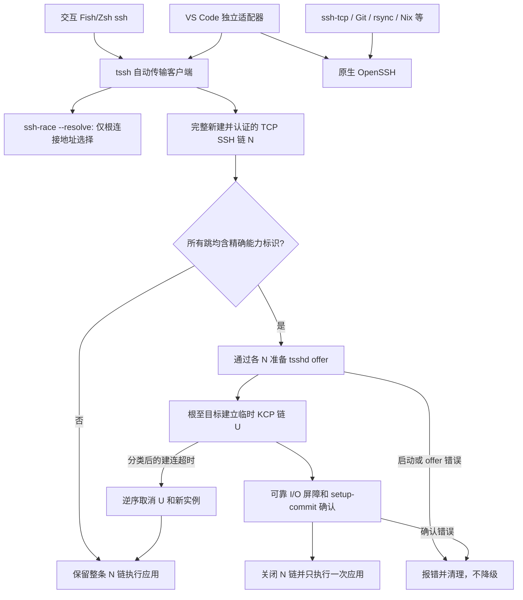

# tssh/tsshd 传输迁移架构与实现

## 1. 范围与实施状态

实现依据为 `.kilo/plans/1793463170275-tssh-tsshd-migration.md`，并纳入后续要求：尽可能复用官方包；主机例外使用字符串列表，默认仅包含 `cu`。

截至 2026-11-01，代码、定向包、回归测试及全部现役配置求值已完成。后续按明确授权执行了 `colmena apply --verbose --on cu,fra0`：`cu` 激活成功；`fra0` 已切换配置，SSH/KCP 可用，但整体激活因独立的 `podman-zotero-sync-server.service` 启动失败返回错误。未对 `arx8` 执行部署，未提交或推送。

- 除 `cu` 外，服务器能力和交互终端自动入口默认启用。
- `cu` 不安装该 tsshd、不发布能力标识、不启用交互 tssh 入口。
- OpenSSH 客户端、sshd、原 TCP 监听、密钥、认证及工具配置保持不变。
- Git、rsync、SCP/SFTP、Nix/Colmena、受限服务及救援连接继续使用原生 OpenSSH。
- VS Code 的独立适配器已实现；参数、安装器式 stdin 和动态转发已测试，但真实桌面扩展的完整安装/工作区流程尚未验收，`vscodeValidated` 默认仍为 `false`。

“源码策略启用”不等于“现役机器已经部署”。旧实例也不会因源码或包变更自动消失。

## 2. 分层架构



`ssh-race` 不管理 tsshd、协议选择、租约、认证或回退。它没有远端协调器和分布式竞速逻辑。脚本层也没有失败后重新运行远端命令的逻辑。

## 3. 官方包复用与必要补丁

锁定的根 nixpkgs 为 `3ec636362e1816bc2f0888fa0fa2c69f1bc9e504`，官方 `trzsz-ssh` 为 `0.1.26`、`tsshd` 为 `0.1.9`。计划要求的基线是 tssh `0.1.27` 和 tsshd `0.1.10`。

| 本地入口                          | 官方基础                                 | 最小覆盖                                                                         |
| --------------------------------- | ---------------------------------------- | -------------------------------------------------------------------------------- |
| `pkgs/trzsz-ssh-auto/default.nix` | `trzsz-ssh.override` 后的官方 derivation | Go 1.26、版本、固定源码、局部补丁、vendor 哈希、相关测试、`mainProgram = "tssh"` |
| `pkgs/tsshd/default.nix`          | 通过 `pkgs.path` 加载官方 tsshd recipe   | Go 1.26、版本、固定源码、局部补丁、vendor 哈希、测试依赖和测试阶段               |

复用官方构建生命周期、常规构建参数、已有 hook 和元数据，不复制一套独立打包实现。服务器 recipe 从 nixpkgs 路径加载是为了避免本地同名 `pkgs.tsshd` 递归引用自身。

固定源码 revision：

- tssh：`7dc4f01a9bc29b7775852bf6531745df2d1a0151`。
- tsshd：`aadccecc014bff097e8b50e2af76a4449a0f561a`。
- tssh 内嵌 tsshd 依赖仍为 `5874860ecb2f`；没有替换成另一份依赖或远端 fork。

内嵌依赖补丁通过 `modPostBuild` 在 `go mod vendor` 后应用，最终 vendor 哈希包含补丁和依赖测试。真实输出是 `bin/tssh`。源码及 vendor 哈希保存在对应 recipe 中，无占位哈希，无 lockfile 更新。

必要自写部分是官方版本未提供的认证后能力识别、全链事务回退、实例取消句柄、setup 租约、可靠 I/O 确认，以及验收中复现的 argv/PTY 缺口。KCP、smux、加密、重密钥和一般会话引擎仍使用上游实现；没有自行实现密码协议或 OpenSSH。

## 4. 共同声明式策略

选项定义位于 `nixos/modules/base/openssh.nix`，Home Manager 复用同一组选项，并兼容不完整的 standalone `osConfig`。

```nix
programs.ssh.transport = {
  enable = true;
  excludedHosts = [ "cu" ];
  udpPortRange = { from = 61001; to = 61999; };
  setupTimeout = 10;
  mtu = 1350;
  heartbeatTimeout = 8;
  aliveTimeout = 86400;
  terminalValidated = true;
  vscodeValidated = false;
};
```

| 选项                        | 类型/含义                                                            |
| --------------------------- | -------------------------------------------------------------------- |
| `excludedHosts`             | `listOf str`，按本机 `sourceHost` 排除来源端/服务端，不是单个字符串  |
| `sourceHost`                | 本机名称；NixOS 默认 `networking.hostName`，standalone HM 可显式设置 |
| `effectiveEnabled`          | 只读；请求启用、未被排除且服务器包兼容时才为真                       |
| `package` / `clientPackage` | 可配置包，默认使用上述官方 derivation 覆盖                           |
| `udpPortRange`              | 闭区间，默认 999 个独立实例端口，客户端、防火墙和路由共用            |
| `setupTimeout`              | 每跳 UDP 建立预算，不等同于 TCP 认证或服务器启动超时                 |
| `mtu`                       | 根 KCP UDP 包预算，范围 576-1500；子跳进一步受父层数据报预算限制     |
| `terminalValidated`         | 交互 Fish/Zsh 入口开关；已通过相关 VM 验收，默认启用                 |
| `vscodeValidated`           | 独立桌面验收开关；默认关闭，不影响服务器标识及终端入口               |

例如 `excludedHosts = [ "cu" "fra0" ];` 会同时排除这两台来源端/服务器。没有新增针对 `cu` 目的地的 KCP 禁用块：目标或跳板为 `cu` 时，由其缺失能力标识自动保留 TCP。既有 `cu` 的 `50560` 映射保持不变。

## 5. 能力识别与连接事务

兼容包安装有效时，sshd 使用受支持的 `VersionAddendum tsshd-kcp-auto-v1`。不是补丁版 OpenSSH，不使用登录 Banner，也不是受限密钥授权声明。

客户端读取已经完成 SSH 认证的 `ServerVersion()`，按 token 精确匹配，拒绝前缀/后缀碰瓷。没有 `command -v`、可执行性探测、远端版本探测或额外预检脚本。

每条连接保存逻辑身份、主机、用户、端口、参数以及各自拥有的 `N[i]`/`U[i]`：

1. 展开原生跳板拓扑。只有精确匹配声明式已知 helper 时才翻译 `a-b` 目的地；不解析远端命令中的连字符。
2. 从根到目标认证整条新 TCP 链。自动分支在 control lookup 前拒绝 mux 复用，不启动应用、不读取应用 stdin。
3. 任一跳缺标识或包含不透明 ProxyCommand，就返回完整 TCP 链；不会请求 tsshd。
4. 所有跳有标识时，通过对应 `N[i]` 准备并校验全部 offer，包括协议、模式、端口、IP、句柄和加密字段。
5. 根至目标建立 KCP。跳 i 的启动仍使用 `N[i]`，UDP 父级则使用 `U[i-1]`，不是 TCP ProxyCommand 承载 KCP。
6. 完成所需可靠 I/O 屏障，再通过原有总线确认 `setup-commit`；全部成功后发布传输状态和回调、逆序关闭 TCP 链、开始应用。

无标识保留 TCP、分类后的 UDP 建连超时回退 TCP。认证、启动、权限、协议、offer、远端显式错误或 commit 确认失败均报错，不静默降级。显式 `--tcp`/KCP 选项优先于自动意图；第三方无标识 tsshd 仍可显式选择 KCP。

这不是会话中的跨协议转换。应用开始后断网不能触发 TCP 重跑命令。

## 6. 生命周期与安全取消

服务器仍由已认证 SSH 用户按需启动，没有常驻 root broker 或统一 UDP 监听服务。

自动 offer 扩展 `BindAddress`、`SetupVersion = 1` 和随机 `SetupHandle`。句柄是瞬态秘密，不写 Nix 配置、不出现在诊断日志中。

- 每实例使用现有私有用户 runtime 目录，记录/套接字分别限制权限。
- 取消通过保留的原生 SSH 会话执行同一个 tsshd 的 `--cancel-setup`，再走 owner-only Unix socket。
- 验证文件/套接字类型、所有者、权限、`SO_PEERCRED` UID、token、协议版本和状态；拒绝符号链接、伪造、跨 UID、跨实例及已执行应用的取消。
- 接口不接受 PID 或端口；没有 `pkill`、任意端口查杀或 Attach 接管。
- setup 的中间 UDP 转发可取消；前台应用或普通转发执行提交后不可取消。
- 取消/过期 tombstone 支持幂等重试，并有回收期限；正常关闭移除活跃记录。

租约覆盖全链准备、UDP 建立、设置/屏障和提交确认的总预算，并有余量，最大 3600 秒。取消送达失败会明确报告，未提交的早期实例仍会按 setup 租约到期，不会因心跳续租。

确认后的中间跳没有前台 shell，它的正常期限是可由心跳更新的空闲预算，而不是无条件截断活跃会话的 24 小时硬上限。所有权和执行状态与这类续期分开。

## 7. 地址选择、地址族与 MTU

`ssh-race --resolve [-4|-6]` 复用原 TCP 地址竞速，输出一行 JSON：

```json
{ "host": "selected.example", "address": "192.0.2.10" }
```

成功后关闭 winner 和 loser，不读取 stdin、不运行原有 pump。普通 ProxyCommand 模式仍保留，晚到连接也会被清理。逻辑主机/key 身份不被这个 IP 覆盖。

原生嵌套 SSH `direct-tcpip` 请求不会传递完整的地址族语义，父服务器可能用 IPv6 连接目标，即使根连接为 IPv4。目标 tsshd 因此返回实际 SSH 本地 bind 地址，子 UDP 跳跟随该字面 IP 的地址族，不做额外本机 DNS 替换。通配 bind 只在确有字面认证 peer 元数据时才使用该 peer；无法确定时失败，不猜测。

KCP 固定包 MTU不能靠丢弃超长包自动收敛。本次锁定引擎的父层 AES-GCM/FEC 1+1 OOB 预算需扣除：nonce 12、tag 16、FEC 8、conversation 4、转发 channel ID 8，共 48 字节。

```text
根请求 1350 -> 子跳最多 1302 -> 再下一跳最多 1254
```

每跳在准备 offer 时取自身请求与父 offer 数据报预算的较小值。纯计算有测试与真实锁定 KCP 引擎的 `GetOOBMaxSize()` 对照，过深或过小预算明确拒绝。这不改变上游密码或 FEC 实现，也不启用 UDP-over-TCP 伪回退。根 MTU仍需按实际隧道/path MTU 调整。

## 8. 入口、I/O 与路由

交互入口只在 Fish/Zsh 的交互配置中生效，`ssh-tcp` 是真实绝对路径 OpenSSH 救援入口。原有跳板 helper 同样固定到 OpenSSH，防止别名递归；没有覆盖系统 `ssh` 二进制。

VS Code 适配器为 `home-manager/modules/desktop/vscode-ssh-adapter.py`：

- `-G`/`-V` 原样委托真实 OpenSSH。
- 仅翻译目的地之前的 verbosity；目的地之后的应用 `-v` 等参数不变。
- 受限身份、未知/不支持/矛盾参数在认证前选择 OpenSSH。
- 支持的 `-T/-D` 走独立 tssh 实例，关闭自动 mux/Attach；没有应用失败后重试。

非 PTY可靠配置先发送已有 `SetKeepPendingInput(true)`、`SetKeepPendingOutput(true)`，然后等待同一总线上的有序 heartbeat ack。设置写入、写锁等待、ack 和 setup 确认均有界；成功后清除建立期 deadline。诊断不混入应用 stdout。

`mihomo-routing.nix` 只对所选 UDP 源/目的端口范围增加 IPv4/IPv6 直连例外，不绕过所有 UDP，不清理 DN42 80/81/90、Mihomo 8980/8985 等规则。没有 sysctl 修改。

tmux 状态识别 tssh 的真实目的地及配置参数，配置解析仍使用原生 OpenSSH；辅助 TCP/ICMP 探测不被标为 KCP RTT。

## 9. 实际问题与解决方法

| 问题                                                                       | 解决方法                                                                             |
| -------------------------------------------------------------------------- | ------------------------------------------------------------------------------------ |
| 官方包存在，却最初重复打包逻辑                                             | 改为官方 derivation 的最小覆盖，保留必要源码扩展并明确其理由                         |
| 后台任务及下载出现连接重置                                                 | 保留已生成补丁接手构建，固定 release/revision 和真实哈希；没有客户端无限重试 wrapper |
| 临时恢复目录在长时间暂停后被清空                                           | 从固定源码及仓库补丁机械重建临时源树；实现不依赖 `/tmp` 持久性                       |
| Unix socket 测试目录过长                                                   | 使用短私有 runtime 测试目录，不放宽所有权或 token 检查                               |
| 原测试依赖 `/bin/echo` 或重复 `setsid()`                                   | 使用 shell builtin，正确建立测试子会话，补齐 Python 测试依赖，不跳过完整普通包测试   |
| vendoring 去掉上游 `_test.go`，直接拿 release 比 vendor 会生成错误删除补丁 | 对照纯净 `go mod vendor` 树生成依赖补丁，测试以新增 vendor 文件纳入哈希              |
| 总线写锁/写入可无界等待                                                    | 建立期采用有界锁获取、写 deadline 和有序 ack；清除成功期 deadline                    |
| tssh 把远端 `ss -H...`、`sh -c...` 参数继续当客户端选项                    | 根据现有参数字段识别目的地边界，插入解析结束标记；应用参数不再重解析                 |
| 根 IPv4、原生目标 IPv6 导致子 UDP4 无法连接                                | 跟随认证后的 offer 字面 bind 地址族，不把根地址族强加给子跳                          |
| 多跳大包超过父 OOB 容量                                                    | 根据锁定引擎校准并逐跳限制 MTU，加入链式字节校验                                     |
| VM 的 `cu` 名字命中保留的生产外部映射                                      | 仅测试夹具使用别名 `plain`，生产 `cu` 配置不改                                       |
| VM 控制通道 stdin 被交互客户端读取                                         | 无输入测试显式 `-n`；payload 测试重定向独立文件，不设置 `-n`                         |
| PTY测试没有真实 controlling terminal                                       | 新 session 通过 `TIOCSCTTY` 取得测试 PTY，验证真实终端条件                           |
| `-t -n` 输入 EOF关闭了兼作输出 reader 的 PTY master                        | 仅非 PTY管道在输入 EOF关闭 stdin，PTY由会话结束清理；加入单元和尺寸变化回归          |
| 不透明 ProxyCommand 被误当已知 helper 的风险                               | 匹配配置中的绝对可执行文件和精确参数模板，不按 basename 猜测                         |

## 10. 验证与复现

已通过：

- 三个定向包的 Nix 构建与相关测试，真实 `tssh`/`tsshd` 版本输出。
- `ssh-race` 的无 stdin 解析、字面地址和连接关闭测试；重复 race 测试。
- 客户端完整认证/准备/建立/屏障/提交顺序、marker、显式模式、超时分类和逆序清理的 focused tests。
- 依赖的 offer 校验、总线等待界限和 KCP 数据报预算校准测试。
- 服务端 UID/token/状态/跨实例/幂等/租约及 PTY EOF回归测试。
- VM直连和完整多跳 KCP、实际 UDP socket、链式字节 `cmp`、非零退出码、IPv6、缺标识的混合链。
- VM首跳及目标跳 UDP阻断回退，原 stdin完整保留，应用计数严格一次，stale path报错及显式 TCP绕过。
- VM PTY `40x100 -> 50x120` 与 `SIGWINCH`、安装器式 stdin、真实 `-T/-D` SOCKS HTTP传输。
- VM 同用户并发独立实例与不同 UDP 端口、占满指定单端口后启动报错且应用不执行。
- VM 50ms 延迟、5% 丢包、1% 重复、5% 重排下的 KCP 字节校验；提交后阻断 UDP 4 秒，恢复后输出完整且应用计数仍为一次。
- VS Code 参数转译/认证前委托检查，以及全舰队 OpenSSH、端口、包/标识和主机列表策略检查。
- 12 个 NixOS toplevel 和 2 个 standalone HM activation derivation 对锁定输入求值。

```sh
nix build --no-link path:.#ssh-race path:.#trzsz-ssh-auto path:.#tsshd
nix build --no-link path:.#checks.x86_64-linux.tssh-auto-test
nix build --no-link path:.#checks.x86_64-linux.tssh-policy-test
nix build --no-link path:.#checks.x86_64-linux.tssh-adapter-test
nix build --no-link path:.#checks.x86_64-linux.host-independence-test
nix build --no-link path:.#checks.x86_64-linux.grafana-runtime-hosts-test
```

完整配置求值，不构建/部署舰队：

```sh
nix eval --impure --json --expr '
  let f = builtins.getFlake "path:/home/tippy/source/flakes";
  in {
    hosts = builtins.mapAttrs (_: c: c.config.system.build.toplevel.drvPath) f.nixosConfigurations;
    homes = builtins.mapAttrs (_: c: c.activationPackage.drvPath) f.homeConfigurations;
  }'
```

现役名称为 `arx8 can0 cu fra0 fra1 hkg0 hkg5 nue0 sjc0 surface tyo0 tyo1`；standalone HM为 `tippy@localhost`、`tippy@shg0`。现有 Navidrome和 networkd/DHCP求值警告未作为无关问题改动。

未认证完成的边界：真实 VS Code桌面扩展安装/工作区完整流程、多设备/多用户及大量并发压力、整个端口池耗尽压力、代表性高 RTT 性能对比、地址重绑定、长断网及 daemon重启连续性。小规模并发、单端口耗尽和短时故障注入不等于这些场景的完整验收。

### 10.1 主机清单独立性

SSH 运行配置只依赖本机 `sourceHost`、排除列表和包/参数，不枚举其它机器。全舰队策略检查是独立的 `checks` 产物，不是单机系统的构建输入。

排查时发现旧 Grafana 模块会把 `self.hostNames` 编译为静态下拉列表，仅影响 `fra0`、`nue0`。现已改为从既有监控源运行时查询 `label_values(up{job="node"}, instance)`，不嵌入主机选项列表；刷新仪表盘即可发现新上报的节点。

`host-independence-test` 对现有 12 台机器扩展同一个 `self`，追加一个故意不可求值的新主机，同时保持源码路径和 revision 不变。原生 SSH包、tsshd包、系统/HM SSH配置及所有系统 toplevel derivation 均相同；额外对照验证排除了 `extendModules` 自身造成的差异。`grafana-runtime-hosts-test` 校验实际生成的 dashboard 是运行时 query 类型、没有静态 options。

这不承诺任意 Git 提交都保持系统顶层路径不变：仓库原有的 `system.configurationRevision = self.rev`、flake registry 等来源追踪仍可能改变版本元数据。顶层 derivation 变化也不等于重新编译所有依赖包。

### 10.2 三台实机复测

随后测试范围限定为 `arx8`、`fra0`、`cu`，未部署或探测其它节点。初次 `arx8 → fra0` 的 resolver 和原生 SSH均失败，候选 TCP/DNS确实超时；远端激活后 resolver 选中公网 IPv6，普通用户连接恢复，远端进程父级确认是 `tsshd`。

| 实机路径                    | 结果与边界                                                                          |
| --------------------------- | ----------------------------------------------------------------------------------- |
| `arx8 → fra0`               | 自动 KCP、stdin/SHA-256 校验、EOF 和退出码 37 通过                                  |
| `arx8 → cu`                 | 原生 TCP自动回退、stdin/SHA-256 校验通过，Cu保持例外策略                            |
| `cu → fra0`                 | 显式公网 IPv6原生 SSH通过；普通公网 IPv4路径仍失败                                  |
| `fra0 → arx8`               | Tailscale `100.64.0.7` 的原生 SSH通过；公网/DN42直连未通过                          |
| `cu → arx8`                 | 经 `fra0` 的公网 IPv6和 Tailscale跳板通过；直接路径未通过                           |
| `fra0 → cu`                 | 经 `arx8` 跳板通过；直接 IPv4/IPv6路径未通过                                        |
| `arx8 → fra0 → arx8` 自动链 | SHA-256校验通过；目标 UDP建立失败后整链 TCP回退，进程树证明不是全 KCP，不误报为成功 |

检查还发现 `arx8` 的公布地址与本机当前 Wi-Fi IPv6地址不同。未为掩盖网络问题修改其它节点、公共路由、TCP Brutal、IPsec密钥或全局代理模式；不把缺失的直接连通性归咎于认证成功后的 KCP应用层。

黑洞测试最初误把 systemd 默认继承到 stdout文件的 stderr诊断当成丢失数据；夹具将 `StandardError` 独立送入 journal 后，输出与应用计数断言通过。最后无需再 stop已成功退出并被卸载的临时 unit。

KCP不是所有网络都更快；smux有队头阻塞，1+1 FEC有明显带宽成本。仓库仍关闭严格 host-key checking，本次没有加强或声称加强这个独立安全策略。

## 11. 部署与回滚边界

后续部署仍需单独决策。先部署兼容服务器包及标识，并保留独立 TCP救援会话，再迁移客户端。没有共享监听器、sysctl、NAT穿透或自动舰队部署。

实机部署发现 Colmena原本从本机监听列表选取 `cu:1022`，覆盖了已声明的外部映射端口 `50560`。通用模块现在优先读取本机名称对应的既有 `programs.ssh.customHosts` 条目的 `port`，没有匹配条目时仍使用监听端口。只读取本机条目，不新增全局主机清单。

- 临时救援用 `ssh-tcp` 或绝对路径 OpenSSH；自动客户端可显式 `--tcp`。
- 回滚终端入口用 `terminalValidated = false`，VS Code用 `vscodeValidated = false`。
- 关闭能力/新实例用 `enable = false` 或加入 `excludedHosts`，再按常规配置激活流程部署。
- 包移除不会终止旧进程，已运行的旧 master也不会被本次自动接管；识别具体旧会话后处理，不按 PID/端口范围群杀。

主要实现入口为 `pkgs/{trzsz-ssh-auto,tsshd}/`、`pkgs/ssh-race/`、通用 OpenSSH模块、HM SSH/shell/desktop VS Code模块、Mihomo routing、tmux SSH状态脚本及 `flake/{packages,checks}.nix`。维护补丁时应重新固定源码/vendor哈希并重跑上述验收，不能只改版本号。
