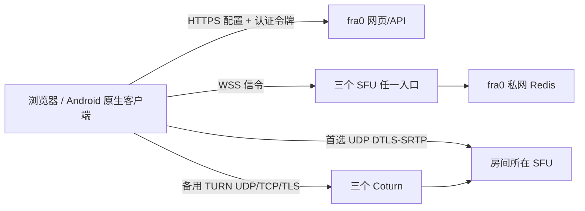

# LiveKit 同屏套件架构

## 部署拓扑

`fra0` 是 HTTPS 网页、配置发现和令牌签发入口，以及唯一 Redis 协调主节点。`fra0`、`cu`、`sjc0` 各运行独立的同屏 SFU 和 Coturn，与既有 MatrixRTC/Nextcloud Talk 隔离。三个 SFU 通过 `fra0.ts:6390` 访问同一个 Redis，Tailscale 负责内网传输加密。



**重要边界：开源 LiveKit 的共享 Redis 不等于跨地域媒体 Mesh。** 一个房间由一个 SFU 承载，其他信令节点可转发信令。默认 `regionaware` 先过滤超负载节点，再优先选择距离当前信令入口 Region 最近的区域；区域内按 `sysload` 排序。各区域坐标从 `_meta.latitude/longitude` 自动汇总，cu 使用中国大区参考中心，不冒充精确机房定位。这使默认 fra0 入口的新房间优先落在 fra0 区域，但并不依据每个客户端 RTT 为同一房间分别选择媒体节点。网页的节点下拉框选择信令入口，不保证改变已有房间的媒体承载节点。`fra0` 的 `primary` 标记指定默认入口，不是对 LiveKit 房间调度器的私有扩展；节点高负载时仍可能分配到其他区域。

没有实现 Enterprise/Cloud 的多 SFU 同房间级联，也不把三台独立 Redis 错当成 Redis Cluster。需要真正的区域级联时，应另行选择支持该能力的发行版并评估跨区域出口成本。当前 Redis 是单点；重启可能影响房间发现/协调，不承诺主节点故障后房间无损迁移。可用 `redisAddress` 对接外部高可用 Redis 服务，但本套件不自动搭建 Sentinel。

`cu` 的信令域名提供来自 `cu.dora.im`/`cuv6.dora.im` 的 A/AAAA，使用已映射的 TCP 50569。它的媒体仍只广告真实公网 IPv6，不广告 `10.105.0.56` 或供应商有限映射端口之外的公网 IPv4，TURN 域名仍保持 IPv6-only。只有 IPv4 的客户端不应依赖 cu 直连媒体或 cu TURN；可使用 fra0/sjc0 的双栈 TURN。国内 IPv6 与海外 IPv6 的可达性也必须实测。跨地址族 TURN 分配受客户端 RFC 6156 支持影响，不能只凭增加 A/AAAA 记录承诺成功。

sjc0 的 LiveKit 信令复用 `sjc0.dora.im/livekit`。LiveKit JS SDK 将基础 URL 路径保留在信令及验证请求中；Traefik 按 Host 和 `/livekit/rtc`、`/livekit/twirp` 路由，并剥掉 `/livekit` 后转发给 SFU。TURN/TLS 复用同一个 `sjc0.dora.im` SNI，但使用 TCP 5352 独立 entrypoint；Traefik 在该端口终止 TLS 并将 PROXY v2 转发至 Coturn。TURN/TLS 与 HTTPS 是独立连接，客户端需显式使用 `turns:sjc0.dora.im:5352`，不依赖额外 DNS 记录。

## 惰性发现与防递归

`default.nix` 导出四个角色及聚合模块；同路径的 `options.nix` 被 NixOS 模块系统去重。每个角色入口给 `_meta.enable` 赋 `lib.mkDefault true`，角色布尔值来自本机静态 `sfu/turn/web/redis.enable`，不会引用拓扑。元数据只包含布尔、字符串、整数，不包含 derivation、`pkgs` 或密钥内容。端口默认值来自纯数据 `settings.nix`。

发现入口优先级：显式 `specialArgs.livekitNodes`、Colmena 的 `nodes`、Flake 的 `self.nixosConfigurations`。同时接受 `node.config` 和 Colmena 的直接 `config` 树；未导入套件的节点会被跳过。只读取 `config.services.livekitSuite._meta`，绝不读取 `node.pkgs`、`system.build.toplevel` 或整机 JSON。`topology` 是一个惰性只读选项；最终 SFU/网页配置 derivation 渲染时才消费它，发现结果不参与 `imports`、角色启用或元数据定义。

依赖方向严格为：

```text
本机静态角色/网络元数据 -> 各节点 _meta -> 惰性 topology -> 配置模板 -> 运行时服务
```

`test-discovery.nix` 使用相互引用的两个节点，把 `pkgs` 和无关 `toplevel` 换成 `throw`，验证元数据及 Flake/Colmena 拓扑求值仍成功。该测试证明**套件本身**不需要实例化软件包，也不依赖整机产物。

不能宣称跨节点读取 NixOS 元数据“恒定亚毫秒、完全零求值”：Nix 必须先建立目标节点的模块固定点并执行它的 imports；目标节点若有自行强制 `pkgs` 的导入逻辑，任何子属性访问都可能受影响。对大型模块树可在 `specialArgs.livekitNodes` 提供只含 `config.services.livekitSuite._meta` 的轻量声明清单，彻底绕过无关节点模块导入。不要把本套件的输出再回写到这个清单。

## 编码与带宽

集中调参入口是 `settings.nix`，主机可以通过 `services.livekitSuite.settings` 按字段覆盖。优先顺序为 AV1、HEVC/H.265、VP9、H.264；网页检测本机发送和接收能力后选择，不代表远端所有设备必然能解码，也不代表所选编码器必然是硬件编码器。SFU 不转码，不会给不支持 AV1 的观察端生成 H.264，必须协商共同编码或使用 SDK 可支持的备用编码发布。

AV1/VP9 使用 `L3T3_KEY` SVC，H.264/H.265 使用兼容的 simulcast 发布策略。Dynacast 停止无人订阅的层，Adaptive Stream 根据观察端实际可见面积请求合适层，降低流量。三个空间层和三个时间层增加适应能力，但会产生编码开销；高层是否能够单独订阅取决于编码器与 SDK。不是“手机算力充足就无需检测 SoC 能力”。

`maxBitrate = 0` 是本套件的**不额外设置视频码率上限**语义，不把非法的零值塞进 WebRTC `maxBitrate`，不修改 SDP、不关闭拥塞控制。浏览器/SDK/编码器仍可能采用自己的默认 encoding 上限；没有标准 API 能保证真正无上限。需要确定预算时使用正数，单位 bit/s，例如 `maxBitrate = 12000000`，而不是为了画质把链路强制灌满。优先提高编码效率和保留拥塞反馈，再调整分辨率/帧率；120fps、4K 都是请求目标，不是设备能力保证。

网页将屏幕内录和麦克风分别采集/发布。内录 Opus 高码率关闭 AEC/AGC/NS/DTX；语音开启 AEC/NS/AGC 和 RED/DTX。手机原生 App 还需要实现自己的双输入音频管线，不能把 Android SDK 的单轨内录 mixer 当作双轨实现，具体边界见 Android 文档。Opus 本身是有损编码，不能称 256kbps 立体声“无损原声”；内录也取决于操作系统和应用是否允许捕获。Android 系统/蓝牙音频焦点与音量 ducking 由原生应用管理，服务端关闭 AEC 并不能消除系统层的压低音乐。

TWCC、NACK、RTX、PLI/FIR 属于 LiveKit/WebRTC 协商机制。服务端开启发送侧带宽估计、保留拥塞控制、独立调节音视频包缓冲和 PLI 节流。浏览器 jitter buffer 与 ICE consent 心跳没有本套件可以任意强制设置的通用接口。SVC 降层与恢复也不保证“优先降帧永不降分辨率”或“毫秒级恢复”；反馈时间、丢包和编码器关键帧周期共同决定行为。

## ICE 选路和故障恢复

发现为每个 TURN 节点生成 STUN、TURN/UDP、TURN/TCP、TURNS/TCP 地址。公开 JSON 仅含地址；认证接口签发短期 TURN REST 凭据，LiveKit 信令也提供同样的外部 TURN 配置。WebRTC 在 `iceTransportPolicy = all` 下对允许的候选对进行连接检查，使用候选优先级和成功检查进行提名。

RFC 8445 的候选优先级形式为：

```text
priority = 2^24 * typePreference + 2^8 * localPreference + (256 - componentId)
pairPriority = 2^32 * min(G,D) + 2 * max(G,D) + (G > D ? 1 : 0)
```

通常 host/srflx 高于 relay，但 peer-reflexive、地址族偏好与客户端实现也参与排序。`iceCandidatePoolSize = 10` 预收集候选，不等于“并发测遍所有服务器后锁定最低 RTT”。ICE 并不以 `argmin(RTT)` 作为标准提名公式。用于观察或额外应用层探测的代价可以是 `RTT + jitterPenalty + lossPenalty`，但没有伪造一套浏览器不存在的自动打分切换 API。

弱网时 LiveKit SDK 的 TCP/TLS fallback、重连和 ICE restart 是实际恢复路径。迁移候选可能有短暂停顿；TURN 进程死亡、房间 SFU 死亡与 Redis 死亡属于不同故障域，不保证无感热切换。浏览器没有可设置的 `continualGatheringPolicy = gather_continually`；这属于部分原生 WebRTC 栈能力，应在客户端实现并验证，不能当作 RTCConfiguration 标准字段注入。

UDP 优先避免 TCP 队头阻塞；TLS 是穿透受限网络的兜底，不会比 UDP 压缩更多视频数据。443/TCP 由既有 Traefik 按 TURN 域名 SNI 分流：终止 TLS、写入 PROXY v2、转发到 Coturn 专用代理端口 5351。PROXY v2 保留真实客户端地址，避免 TURN 返回 loopback XOR-MAPPED-ADDRESS。代理端口由 nftables 拒绝非 loopback 访问；HTTP/3 的 443/UDP 保持不变。客户端必须支持 SNI；不支持 SNI 的原生客户端应另配独立公开 TURN TLS 端口/地址。

Coturn 设置 `tcp-proxy-port` 后不会同时保留普通 TCP 监听。因此每节点的普通 UDP/TCP 与 PROXY v2 入口使用两个隔离的 Coturn 进程、同一派生认证 secret 和不重叠的 relay 端口池，避免配置了 TURN/TCP 地址却没有真实监听。

## 触控安全与丢包

使用 LiveKit 的 lossy `publishData`，由 SDK 管理 DataChannel 的 unordered/无重传通道，而不是自己创建不会被 SFU 转发的任意 DataChannel。`control.touch.v1` 是路由 topic，不是假定的 SCTP label。坐标采用归一化完整触点快照、会话 UUID 和递增序号，丢弃乱序历史消息；抬手消息丢失时 watchdog 自动释放触点。

网页默认关闭触控，且只向选中的发布者 identity 定向发送。手机原生应用仍须检查控制者 identity、room、topic、当前授权 session，再转给只监听 loopback 的本地守护进程；共享房间密码本身不等于获得设备控制许可。Root 与 Shizuku 的权限、采集限制及可运行源码见 `ANDROID_CONTROL.md`。不承诺 0ms 延迟或绕过锁屏/安全界面。

## 密钥与服务隔离

本仓库以 `secrets/common.yaml` 的二级字段 `livekit/master_secret` 作为主种子的统一读取来源，原 Terraform 生成的 64 字符种子由用户原样迁移。套件不再从各节点的 Terraform SOPS 文件读取该值。所有运行时服务通过 systemd `LoadCredential` 读取同一个种子，使用 HMAC-SHA256 域分离派生 API 签名密钥、Redis 密码、TURN secret、用户加入凭据。Nix store 仅保存无秘密模板和派生代码，包含秘密的运行时配置权限为 0600。

主种子不得提供给浏览器。网页仅接收房间加入 JWT 与短期 TURN 凭据，不持久化密码/token。令牌没有管理授权；加入凭据是可信小群体共用密码，不是完整用户账号系统。公开加入 API 的请求体、线程数、等待时间、每分钟请求数均有边界。若要开放给不可信公众，应先接入用户鉴权、房间 ACL、审计及更细的配额。

本套件不注入 sysctl 或 qdisc；`sysctl-tuning.nix` 是显式空模块，保持现有 Linux 调优完整不变。
